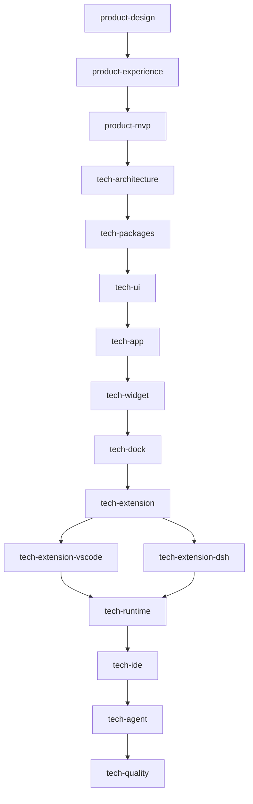

# prac notes 阅读顺序

按“由外而内，再回到边缘”的顺序：先产品，再边界，再由外而内，最后横切。

| # | note | 一句话 |
| --- | --- | --- |
| 1 | [product-design](./in-progress/2026-11-05-product-design.md) | 为谁、为什么、范围与指标 |
| 2 | [product-experience](./in-progress/2026-11-05-product-experience.md) | 用户看到的布局、IDE、agent、导航 |
| 3 | [product-mvp](./in-progress/2026-11-05-product-mvp.md) | 当前范围、stories、验收 |
| 4 | [tech-architecture](./in-progress/2026-11-05-tech-architecture.md) | 部署、进程、模块边界 |
| 5 | [tech-packages](./in-progress/2026-11-05-tech-packages.md) | 代码摊到哪些包 |
| 6 | [tech-ui](./in-progress/2026-11-05-tech-ui.md) | 窗口系统：窗口 / placement / group / layout |
| 7 | [tech-app](./in-progress/2026-11-05-tech-app.md) | app：声明 / 实例 / 启动 |
| 8 | [tech-widget](./in-progress/2026-11-05-tech-widget.md) | widget / board：编排 / reconcile / recovery |
| 9 | [tech-dock](./in-progress/2026-11-05-tech-dock.md) | dock：pins / intent / running / active |
| 10 | [tech-extension](./in-progress/2026-11-05-tech-extension.md) | 贡献机制：manifest / catalog / reconcile |
| 11 | [tech-extension-vscode](./in-progress/2026-11-05-tech-extension-vscode.md) | VS Code adaptor 的四层与投影 |
| 12 | [tech-extension-dsh](./in-progress/2026-11-05-tech-extension-dsh.md) | DSH adaptor 的贡献映射 |
| 13 | [tech-runtime](./in-progress/2026-11-05-tech-runtime.md) | 被贡献的代码在哪执行 |
| 14 | [tech-ide](./in-progress/2026-11-05-tech-ide.md) | IDE 能力面 |
| 15 | [tech-agent](./in-progress/2026-11-05-tech-agent.md) | agent 能力面 |
| 16 | [tech-quality](./in-progress/2026-11-05-tech-quality.md) | 横切：安全 / 性能 / 持久化策略 / 测试 |
| — | [dsh-anchor](./in-progress/2026-10-12-dsh-anchor.md) | 开发环境，不必按序 |

顺序的理由：`tech-ui` 是读者最先看到的那一层（窗口与放置），`tech-app` 是窗口里装的东西，`tech-widget` 是 board 里的编排，`tech-dock` 是到达它们的边缘表面。
