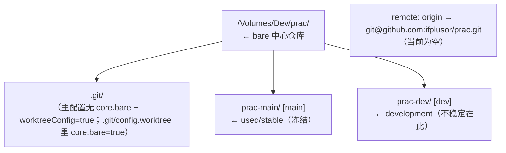

# Agent Note: 开发环境自指稳定性 — bare 仓库 + worktrees（蓝绿冻结）

## Problem

用 prac 自指开发（用 prac 开发 prac）会修改 prac 自己的代码。DSH 的 HMR（`patchReload: live`，改补丁即热重载）会让运行时在**改到一半、尚未稳定**时抖动；一旦中间出错（哪怕只是半截未完成的修改），就可能把正在工作的环境搞挂，无法持续工作。

## Decision

给 prac 建 **bare 中心仓库 + worktrees**，蓝绿冻结：

- `prac-main`（分支 `main`）：**used/稳定**，冻结。装进 DSH profile、被 HMR 盯着的就是这份；**不在里面改**。
- `prac-dev`（分支 `dev`）：**development**，不稳定都留在这里。
- 推进：在 `prac-dev` 开发 + 验证 → 稳定后合到 `main` → 更新 `prac-main` 并重装进 `dsh-master` 基底上的 profile → HMR 载入已知良好版本。
- 定向修复：prac 的 profile 用 `patchReload: startup`（不用 live），从根上去掉热重载抖动。
- 基底：prac 插件编译到 DSH，用 `dsh-master`（master worktree，稳定）作为对齐的框架版本；`dsh-master` 是只读基底、不改。

### 环境结构（镜像 DSH，已核对）

### 复现步骤（含 worktreeConfig trick）

1. 建目录，确认源仓库干净（`git status` 无未提交改动）。
2. `mv <repo> <temp>`：把源仓库整体挪到临时备份。
3. `git clone --bare --no-hardlinks <src> /Volumes/Dev/prac/.git`：从本地历史产出中心 bare（DSH 是从 remote `git clone --bare <remote> .git`）。
4. 配 `.git/config`：`extensions.worktreeConfig = true`；`remote.origin.url = git@github.com:ifplusor/prac.git`；`remote.origin.fetch = +refs/heads/*:refs/remotes/origin/*`；`branch.main.remote`/`branch.main.merge`、`branch.dev.remote`/`branch.dev.merge`。
5. **先 `git config core.bare true` 保持裸**，再建 worktree（这样仓库没有「主 worktree 占用」冲突）：
   - `git worktree add /Volumes/Dev/prac/prac-main main`
   - `git worktree add -b dev /Volumes/Dev/prac/prac-dev main`
6. **再**把 bare 挪进 `config.worktree`：`git config --unset core.bare`（主配置去掉）+ `git config --worktree core.bare true`（写进 `.git/config.worktree`）。
7. `git worktree list` 验证 → `/Volumes/Dev/prac (bare)` + 两个 worktree。
8. 验证后清理临时备份。

> **顺序很关键**：必须**先**让仓库 bare（`core.bare=true` 在主配置）再建 worktree，否则报 `fatal: '<branch>' is already used by worktree at '<repo>'`；然后**再**把 bare 从主配置挪到 `config.worktree`，得到与 DSH 一致的最终态（主配置无 `core.bare`、`.git/config.worktree` `bare=true`）。

## Alternatives considered

- **路线 2（单 repo + 分支）**：prac 提交少时够用；但自改 + HMR 不稳需要一个「运行中冻结、开发分离」的**实体**隔离，单 repo 分支给不了独立被 HMR 盯着的稳定树（worktree 才行）。所以选 worktree。
- **只用 `patchReload: startup`（不建 worktree）**：能去掉 HMR 抖动，但无法蓝绿并行/多并行工作树；也没法给「运行那份」一个独立目录的冻结。`worktree + startup` 双保险。
- **改 DSH 内核**：prac 是消费者；DSH 保持只读基底（`dsh-master`）。动 DSH 内核超出「消费者」边界。

## Consequences

- 开发在 `prac-dev`，遵循 prac 的纪律（决策优先、审决策、记 `.agents/notes/`）；稳定后 promote 到 `prac-main`。
- 开发会话根应设在 `/Volumes/Dev/prac/prac-dev`（加载 prac 的 AGENTS.md + 决策记忆 + 参考），而非裸库根或 `prac-main`。
- DSH 基底用 `dsh-master`；工作树可并行扩展（feature worktree）。
