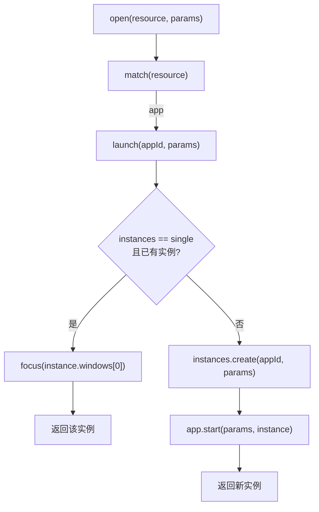

# Technical app — declarations, instances, launch

> 窗口系统见 [tech-ui](./2026-11-05-tech-ui.md)；dock 见 [tech-dock](./2026-11-05-tech-dock.md)；贡献机制见 [tech-extension](./2026-11-05-tech-extension.md)；board 编排见 [tech-widget](./2026-11-05-tech-widget.md)。

## 1. 范围与不变量

### 1.1 范围

app 是什么、实例是什么、一次启动发生什么。

### 1.2 不变量

| id | 不变量 | 验证 |
| --- | --- | --- |
| **I1** | 实例只由 `launch` 创建；`open` 只是在它前面加一步路由。 | grep：`instances.create` 只被 `launch` 调用 |
| **I2** | 实例由管理器创建，在 app 入口运行**之前**；app 拿到实例，不创建、不枚举、不销毁。 | unit：`start` 收到的实例已存在 |
| **I3** | 复用策略是声明（`PracAppDef.instances`），由 `launch` 执行，app 不判断。 | unit：`single` 复用 / `multi` 新建 |
| **I4** | 每个窗口都有 `instanceId`，指向它所属的实例。 | `verify-containers` 的 board 断言 |
| **I5** | 实例的 `windows` 为空时实例结束。 | unit：关闭最后一个窗口 |
| **I6** | 边界参数一律 `unknown`；具体类型由各自的 app 声明。 | 类型检查 |

## 2. 数据模型

### 2.1 三层

| 层 | 类型 | 内容 |
| --- | --- | --- |
| 声明 | `PracAppDef` | `id` / `version` / `label` / `icon` / `paneHeader` / `instances` / `defaultRegion` |
| 代码 | `PracAppImpl<TParams>` | `match` / `start`（**不含 `content`**） |
| 运行时 | `PracApp` | `def` + `impl`，按需创建 |

声明可序列化、可跨进程；代码只存在于运行时。`PracAppDef` 没有 `content` / 窗口 / dock 概念。

### 2.2 实例

```ts
interface PracAppInstance {
  readonly id: string;
  readonly appId: string;
  readonly params?: unknown;   // 启动参数，core 不解释
  readonly windows: readonly string[];
  /** 实例拥有的 durable state；renderer 绑定它，DOM 重挂载不丢。 */
  readonly state?: PracAppInstanceState;
}
```

`PracAppInstanceState = { getSnapshot(); subscribe(fn) }`（uSES 可直接绑定）；实例拥有它，窗口 DOM 卸载/重挂载不丢（见 [rendering-engine](./2026-11-12-tech-rendering-engine.md) R7）。

实例**不是进程**：没有地址空间、不拥有代码；它对应 Android 的 `ActivityRecord`，由启动事务创建、随最后一个窗口关闭而结束。实例拥有 **durable state**：renderer 在 `start` 里拿到 instance 并绑定它（uSES），窗口 DOM 卸载/重挂载不丢（见 [rendering-engine](./2026-11-12-tech-rendering-engine.md) R7）；实例的释放策略见该 note 的 Open questions。

### 2.3 复用策略

| `instances` | Android 对应 | `launch` 的行为 |
| --- | --- | --- |
| `"single"` | `singleTask` | 已有实例 → 前台化，返回它 |
| `"multi"` | `standard` | 每次启动一个新实例 |

## 3. 接口

```ts
interface PracApplications {
  register(app: PracApp): () => void;
  get(appId: string): PracApp | undefined;
  /** Route only: which app claims this resource. No side effects. */
  match(resource: string): PracApp | undefined;
  /** Route then launch. */
  open(resource: string, params?: unknown): PracAppInstance | undefined;
  /** Launch (or reuse, per the declared policy). The only instance creator. */
  launch(appId: string, params?: unknown): PracAppInstance | undefined;
}

interface PracAppInstances {
  get(instanceId: string): PracAppInstance | undefined;
  list(): readonly PracAppInstance[];
  create(appId: string, params?: unknown): PracAppInstance;
  dispose(instanceId: string): void;
  addWindow(instanceId: string, windowId: string): void;
  removeWindow(instanceId: string, windowId: string): void;
  subscribe(listener: () => void): () => void;
}

interface PracAppImpl<TParams = unknown> {
  match?(resource: string): boolean;
  /**
   * The app's entry: runs inside a launch, with the instance the launch created.
   * It creates the instance's windows, each with a parent (group/space) and its content.
   */
  start?(params: TParams, instance: PracAppInstance): boolean;
}
```

- `PracApplications` 由 frame 的 services 提供，`ctx.pracApplications`；
- `PracAppInstances` 是实例表，`ctx.pracAppInstances`；
- 前台化经 `focus(windowId)` 端口注入，`PracApplications` 不认识 WM。

## 4. 启动



- `launch` 是唯一创建实例的路径；
- `start` 里建窗口（经 `ctx.pracWindows`），窗口必须带 `instance.id` **与自己的 `content`**——渲染的对象是 window，不是 app（见 [tech-ui](./2026-11-05-tech-ui.md) §2.1）；
- `open` 匹配不到 app → 返回 `undefined`，不启动任何东西。

## 5. 命名

| 词 | 语义 | 对标 |
| --- | --- | --- |
| `match(resource)` | 纯路由，无副作用 | Launch Services 查询 |
| `open(resource)` | 路由 + 启动 | 双击文件 |
| `launch(appId, params)` | 启动 / 复用 | `startActivity` |
| `start(params, instance)` | app 入口 | `onCreate` |
| `activateWindow` | 把窗口带到前台 | `onNewIntent` / `SetForegroundWindow` |

规则：一个概念一个词（`App`，不用 `Application`）；动词对齐 OS 词汇；`Prac*` 只加在跨边界的核心概念上。

## 6. 与窗口系统的接缝

| 事实 | 归谁 |
| --- | --- |
| 窗口的 `instanceId` | WM 在 `admit` 写入，`close` 时回调实例表 |
| 实例的 `windows` | 实例表，由 WM 的 `addWindow` / `removeWindow` 维护 |
| 焦点 | WM |
| 复用时的前台化 | `focus` 端口（services 注入） |

## 7. 错误与测试

| 错误 | 触发 | 处理 |
| --- | --- | --- |
| `UNKNOWN_APP` | `launch` 的 appId 未注册 | 返回 `undefined` |
| `DUPLICATE_APP` | `register` 重复 id | reject |
| `START_THREW` | `impl.start` 抛错 | 回滚刚创建的实例，返回 `undefined` |

测试：`launch` 的复用/新建、`start` 收到实例、`open` 的路由、实例随最后一个窗口结束、多实例同参数并存。

## 8. Open

1. `def.instances` 是否需要第三个值（如 `singlePerParams`）；
2. `start` 返回 `boolean` 是否够用，是否需要结果对象（错误原因）；
3. 实例是否需要在窗口之外存活（后台实例）；
4. 一个实例多个窗口的语义（现在允许，但没有显式规则）；
5. **实例生命周期**：最后一个窗口关闭是否 dispose instance（当前代码是）？single-instance app 关窗重开要不要保留状态？关闭条件：明确“关窗 = 实例结束”还是“实例可多窗口、可重开”。
6. **启动时谁打开默认 board**：`launch` 只在被点击时发生；一旦 removal of catalogue placement（见 [tech-widget](./2026-11-05-tech-widget.md) §7）落地，左侧 region 不会有任何 board。需要一条启动规则：布局恢复后若某 region 没有活动 board，就 `launch` 该 region 的第一个 pin；或由 arrangement 返回“初始应打开的 board”，启动流程再 `launch` 它。**在它成为阻塞之前不裁决。**

## Related

- [tech-ui](./2026-11-05-tech-ui.md)：窗口 / placement / layout。
- [tech-dock](./2026-11-05-tech-dock.md)：pins / intent / running。
- [tech-widget](./2026-11-05-tech-widget.md)：board 编排。
- [tech-extension](./2026-11-05-tech-extension.md)：谁贡献 app 声明。
