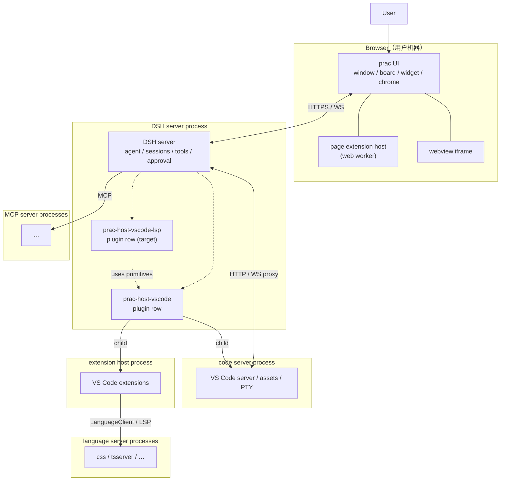
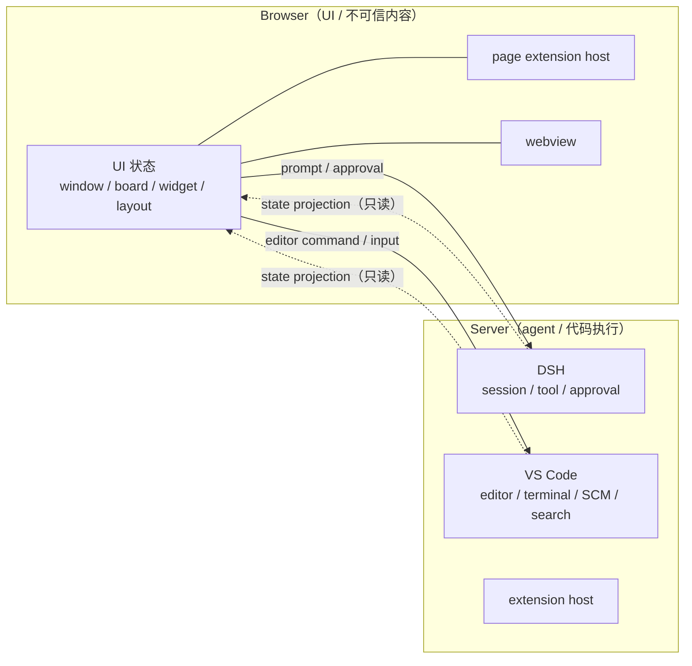
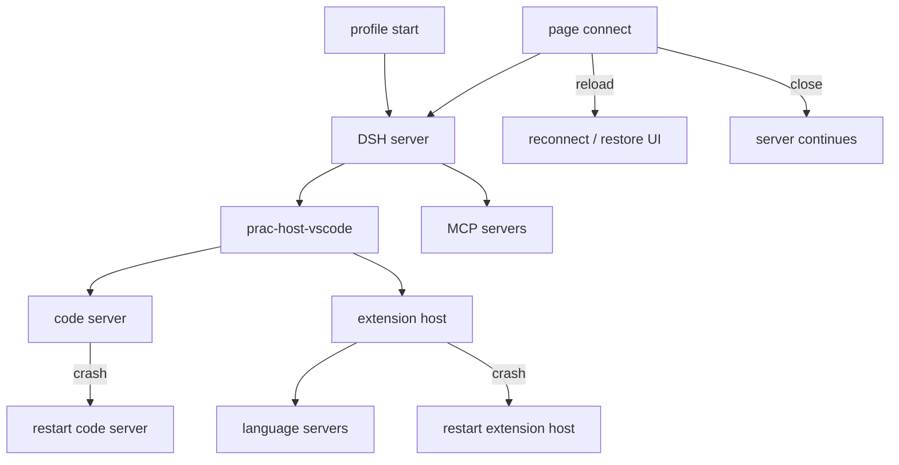
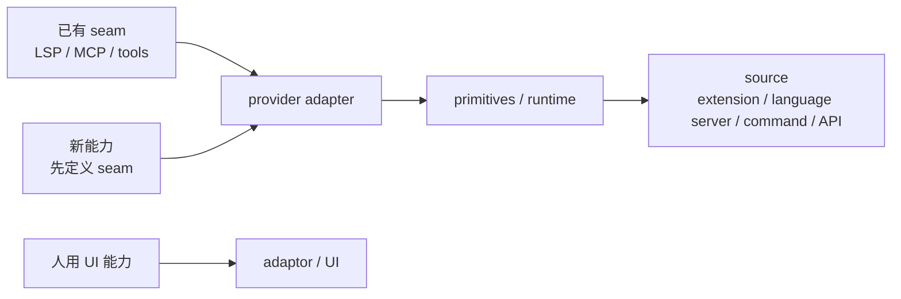
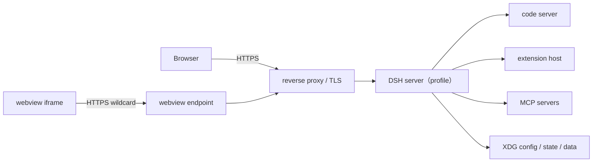

# Technical architecture — deployment, processes, boundaries

> 技术设计 L0；产品意图见 [product design](./2026-11-05-product-design.md)；UI 内部结构见 [tech-ui](./2026-11-05-tech-ui.md) / [tech-widget](./2026-11-05-tech-widget.md)；包映射见 [tech-packages](./2026-11-05-tech-packages.md)。
> 本文只写架构：部署实体、进程、Browser / Server、状态归属、生命周期、能力路径、部署拓扑、约束。
> 验收由 James 签字。

## 1. 范围与读法

- **实线框**：部署实体 / 进程。
- **虚线框**：同一进程里的 plugin row，或只读投影。
- **实线箭头**：调用 / 父子进程 / 同步关系。
- **虚线箭头**：plugin 关系 / 投影 / 异步。
- 图只画部署实体和进程；不画 UI 内部模块，也不画 feature flow。

## 2. 部署实体与进程

- **Browser**：UI 组合 / 渲染、window / board / widget 状态、page extension host、webview。
- **Server**：DSH agent / sessions / tools / approval、LSP seam、MCP client；code server / extension host / language servers。
- `prac-host-vscode` / `prac-host-vscode-lsp` 是 DSH server 进程里的 **plugin row**，不是新进程。
- `code server` / `extension host` 是 `prac-host-vscode` 起停的子进程；`language servers` 由 extension 的 `LanguageClient` 启动 / 连接。
- `page extension host` 在 Browser 侧，与 server 侧 extension host 分开。

## 3. Browser / Server 与状态归属

- **“只读”只指 state projection，不指用户操作。** UI 可以编辑：新建 / 编辑 / 保存 / 终端输入 / SCM / search 都是发给 VS Code 的 command / input；buffer / 文件操作权威在 VS Code 与文件系统，prac 不复制。
- 对 DSH 也一样：prompt / approval / command 是 UI 发出的；conversation / session / tool / approval 的状态投影回 UI，权威在 DSH。
- Agent 新建 / 修改文件走 DSH 工具或 VS Code 命令；文件系统是权威，prac 只收到 workspace / editor 投影。
- 传输：DSH 走 HTTPS / WS；VS Code 走 client adaptor / code server proxy。
- **UI runtime 是 window / board / widget / layout 的唯一 writer**；它不写 editor buffer / DSH session。
- DSH 拥有 conversation / session / tool / approval；VS Code 拥有 editor / terminal / SCM / search / debug；prac 不复制。
- 持久化只属于 prac：frame / space / board 三个 key；见 [tech-ui](./2026-11-05-tech-ui.md)。
- Browser 内容不可信：文件 / webview / 扩展 view；trust / origin / CSP 见 [tech-quality](./2026-11-05-tech-quality.md)。

## 4. 生命周期 / 失败

- page 可关，server 继续；page reload 只重连，不重建 server。
- `extension host` / `code server` 崩溃：重启，page 重连；prac UI 从 frame / space / board key 恢复。
- `extension` 失败：per-app 回滚；不留孤儿窗口。

## 5. 能力路径与未来扩展

- **已有 seam**：新增 provider，不改接口。LSP 是当前实例，细节在 [tech-runtime](./2026-11-05-tech-runtime.md) §4。
- **新能力**：先在 DSH 定义 seam，再写 provider；不在 extension host 里发明接口。
- **人用 UI 能力**：走 adaptor / UI，不进 agent capability。
- extension commands 要显式 allowlist + schema + approval；不批量暴露。
- MCP 不走 extension host 泛化；VS Code 只是定义来源。
- app / widget 的扩展、catalog、reconcile 见 [tech-extension](./2026-11-05-tech-extension.md)；本文只定 host / capability 的位置。
- **prac / DSH 共用 Cordis plugin runtime**：extension 是贡献层，不是第二个 loader；`ctx` 就是 Cordis Context。

> VS Code 是**能力来源**，不是 DSH 的通用 API 桥。

## 6. 部署拓扑

- 自用形态；不做多用户 / 登录。
- 运行期状态按 XDG：config / state / data；构建期 `.build/`。
- webview 需要通配 DNS + 受信任证书；端点模板由部署提供。
- 升级 / 回滚走 profile + pin + 比较门；不 fork 上游。
- **例外（2026-11-08，James 裁决）**：`@deepseek-ai/dsh-client-ui-deliverables` 以 vendored 形式复制为 [prac-client-ui-deliverables](../../../packages/client/ui-deliverables/README.md)，上游行 disable。唯一行为差异是卡片的 `openChangesReview` 改走 prac 的 VS Code diff；其余逐字保留，review tab 留给恢复的 tab。理由是 DSH 没有 open seam，且发布物只带 `lib/`、不含卡片组件源码。范围只此一个叶子；核心仍走 pin + 比较门，升级时整体 re-copy + 重放这一处 diff。

## 7. 约束

DSH 是主干，组合 / 状态 / 进程 / 生命周期归它；VS Code 按 server / client 两半接进来，不 fork，只 pin + patch + overlay；两半之间走 DSH 架构的通信层，不透传 VS Code 传输；LSP 的接口在 DSH，提供方在 VS Code；MCP 只复用定义来源，由 DSH 起 client；运行期状态跟 XDG，构建期状态放 `.build/`；不引 `monaco-vscode-api` / Theia 这类第三方改造。

## 8. Open

1. **进程监督**：code server / extension host / language server 的 supervisor、重启、端口分配。
2. **模块 API**：`prac-host-vscode` 原语 / `prac-host-vscode-lsp` 适配的 contract / 错误码。
3. **数据 schema**：window / board / widget / space 的字段级 schema / 迁移。
4. **并发 / 顺序**：多 workspace、动态扩展、page reload、窗口恢复的竞态。
5. **错误分类**：错误码 / 用户可见 / 重试 / 回滚。
6. **安全模型**：trust / secret / MCP server 的威胁模型。
7. **性能预算**：首帧 / 布局 / 镜像 / 宿主数 / 内存。
8. **部署**：生产 HTTPS / 证书 / 多机。

## Related

- [product design](./2026-11-05-product-design.md)：产品意图 / 范围。
- [tech-ui](./2026-11-05-tech-ui.md)：对象 / WM / frame / 持久化。
- [tech-widget](./2026-11-05-tech-widget.md)：board / widget。
- [tech-ide](./2026-11-05-tech-ide.md)：IDE 能力。
- [tech-agent](./2026-11-05-tech-agent.md)：chat / session / review。
- [tech-extension](./2026-11-05-tech-extension.md)：extension / catalog / host。
- [tech-runtime](./2026-11-05-tech-runtime.md)：extension host / LSP / MCP / webview。
- [tech-quality](./2026-11-05-tech-quality.md)：安全 / 日志 / 性能 / 测试 / 部署。
- [tech-packages](./2026-11-05-tech-packages.md)：包映射 / 依赖 / 构建。
