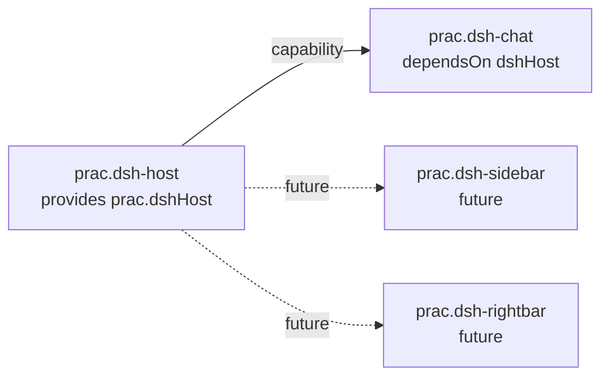
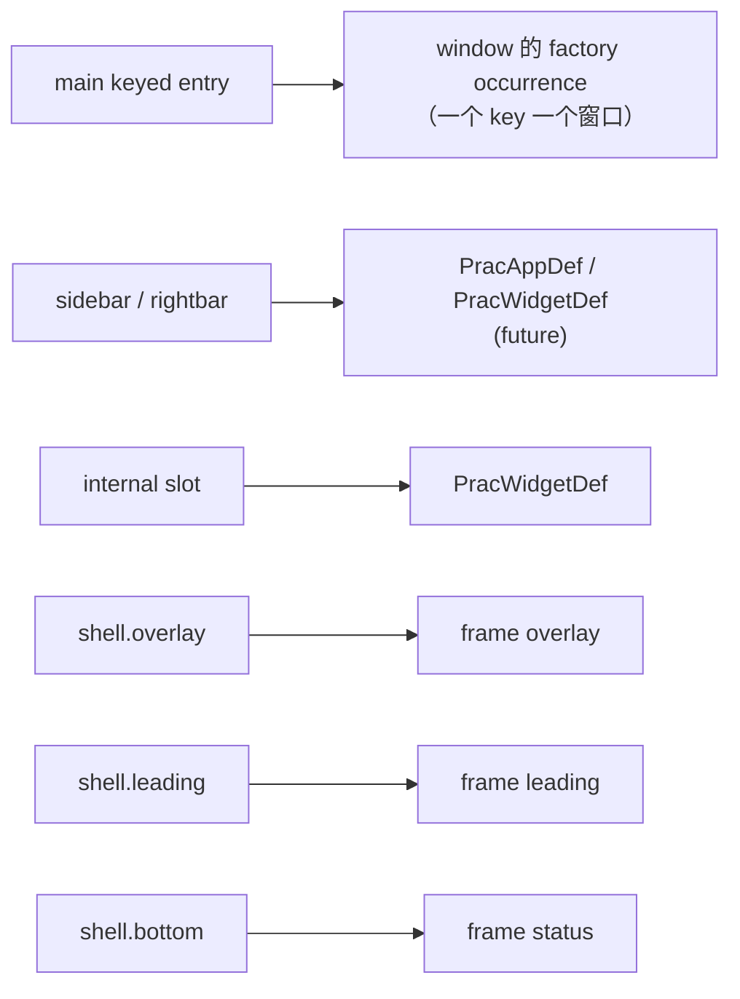
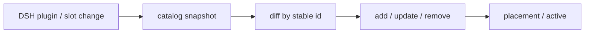

# Technical extension — DSH adaptor

> 技术设计 L3；扩展模型见 [tech-extension](./2026-11-05-tech-extension.md)；agent / chat 见 [tech-agent](./2026-11-05-tech-agent.md)；UI 见 [tech-ui](./2026-11-05-tech-ui.md)；widget 见 [tech-widget](./2026-11-05-tech-widget.md)。
> 本文写 DSH 侧怎么变成 prac extension：host extension 提供 `prac.dshHost`，chat / sidebar / rightbar 等 feature extension 依赖它贡献 app / widget；不重复扩展契约、chat 行为、WM。
> 验收由 James 签字。

## 1. 覆盖与边界

**本 note 覆盖**：

- `prac.dsh-host` / `prac.dsh-chat` / `prac.dsh-sidebar` / `prac.dsh-rightbar` 的划分；
- **DSH plugin** 级贡献（不是直接读 Cordis plugin 列表）到 `PracAppDef` / `PracWidgetDef` 的映射；
- `main` / `sidebar` / `rightbar` / 内部 slot / shell 的归属；
- 当前范围（只接 chat）与后续接入；
- 动态 slot / session 的 reconcile；
- 错误 / 测试。

**不在本 note**：

- extension / catalog / reconcile 契约 → [tech-extension](./2026-11-05-tech-extension.md)；
- chat / session / review 行为 → [tech-agent](./2026-11-05-tech-agent.md)；
- WM / frame / placement → [tech-ui](./2026-11-05-tech-ui.md)；
- widget 拖拽 / board → [tech-widget](./2026-11-05-tech-widget.md)。

## 2. Extension 划分

- **host extension**：`manifest.id = "prac.dsh-host"`，`provides: ["prac.dshHost"]`；只接 DSH slots / content factory，不贡献 app / widget。它在 `apply` 里注册**一个** stable content factory，声明 `main` / `sidebar` / `rightbar`（一次，随插件释放）；各 feature extension 的窗口只是这个 factory 的 occurrence，不各自声明这些槽。
- **chat extension**：`dependsOn: ["prac.dshHost"]`；`apps()` 返回 chat `PracAppDef`；`windows()` 来自 conversation——**一个 conversation 一个 `PracWindow`；tab 是 window group 的 window**；chat 的 `start` 创建窗口并注册 renderer（渲染 host factory 的 occurrence；children 声明在 host factory，不在 per-window entry 上）。窗口模型见 [tech-ui](./2026-11-05-tech-ui.md) §2。
- **sidebar / rightbar**：设计上是 extension，当前不接；接入时各自贡献 app 或 widget。
- 全部 `origin: "dsh"`；host 未 ready → feature disabled / degraded。

**Cordis 接法**：

- host extension 在 `apply(ctx)` 里 `ctx.provide("prac.dshHost", host)`；
- chat / 侧栏 extension 用 `inject: ["prac.dshHost"]`；
- contribution 对象用 `ctx.pracExtensions.register({ ... })` 注册；`ctx.effect` 负责 dispose。
- 不另写 extension activation / dispose 生命周期。

## 3. DSH 贡献来源

**注意区分**：

- **DSH plugin**：基于 Cordis 的产品级插件包，声明 slot / app / shell 贡献；
- **Cordis plugin**：运行时模块。

两者不是两套 runtime：DSH plugin 就是 Cordis plugin 包（带 DSH conventions）。prac 只消费 **DSH plugin 级贡献**（`main` / `sidebar` / `rightbar` / 内部 slot / shell），不直接读 Cordis plugin 列表。

- `main` keyed entry（conversation / plugin manager / task manager）→ 窗口内容（host factory 声明一次、每窗口一个 occurrence）；
- `sidebar` / `rightbar` 设计上是窗口内容（future）；**当前不接**；
- 内部 slot（conversation.* / sidebar.* / settings.* / plugins.*）→ widget；
- `shell.overlay` / toast / quota notice → frame overlay；
- `shell.leading` / `shell.bottom` → frame chrome / status bar，不是 window / widget。

## 4. 当前范围

- 只接 `chat`：`prac.dsh-chat` 由 app 层打开 window 显示；DSH 不直接写 WM。
- `prac.dsh-sidebar` / `prac.dsh-rightbar`：设计保留，暂不接。
- 内部 slot 作为 widget；可移动性仍是 open。
- store / locale / theme 由 DSH 来源拥有；frame 只消费 token / locale service，不把 DSH 的 i18n 三元组搬进 prac。

## 5. 动态 / 生命周期

- session / slot / app 变化 → catalog 更新 → reconcile；不重启。
- chat window：open / close / active 由 app 层按 `windows()` diff 处理；WM 拥有 window 记录。
- session 切换：更新 `windows()`；旧 window close，新 window admit；不直接改 board。
- dispose：释放 host / content；不直接关 window；window 由 app 层处理。

## 6. 错误 / 测试

- `UNKNOWN_WIDGET`：hostFor 未知 slot → 空 host。
- `DUPLICATE_WIDGET` / `DUPLICATE_APP`：id 冲突 → reject。
- `HOST_UNAVAILABLE`：dshHost 未 ready → feature disabled。
- `APP_SYNC_FAILED`：app 层 admit / close 失败 → per-app 回滚。
- 并发：slot 更新与 mount / release 串行；dispose 后不再 mount。
- 测试：
  - unit：slot → widget def / chat → app def / duplicate / dispose；
  - L2：chat open / close / active；session switch；
  - live：chat / dynamic slot；
  - planned：sidebar / rightbar 接入后的 board / window。

## 7. Open

1. **sidebar / rightbar 接入时机与内容类型**：app 还是 widget。
2. **内部 slot 的可移动性**：作为 widget 的边界。
3. **`main` keyed entry 的 app 身份**：每个 key 一个 app，还是一个 app 多实例。
4. **DSH app / window 生命周期**：session 切换时 window 的 open / close。

## Related

- [tech-extension](./2026-11-05-tech-extension.md)：manifest / catalog / reconcile。
- [tech-agent](./2026-11-05-tech-agent.md)：chat / session / review。
- [tech-ui](./2026-11-05-tech-ui.md)：PracWindow / WindowPlacement。
- [tech-widget](./2026-11-05-tech-widget.md)：PracWidget / WidgetPlacement。
- [tech-extension-vscode](./2026-11-05-tech-extension-vscode.md)：VS Code 侧。
- [rendering-engine](./2026-11-12-tech-rendering-engine.md)：窗口/内容/renderer 的引擎边界与 host 实现。
