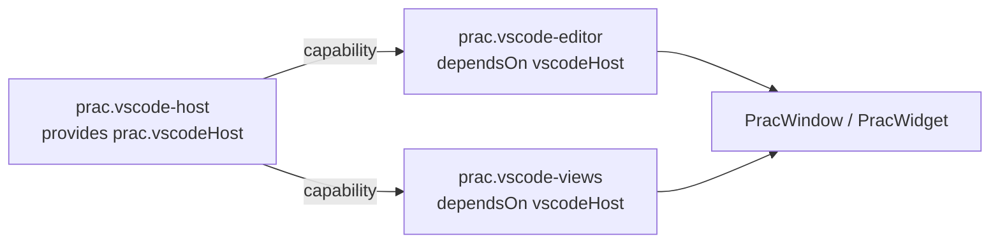
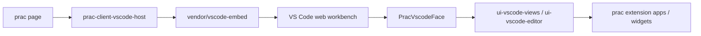
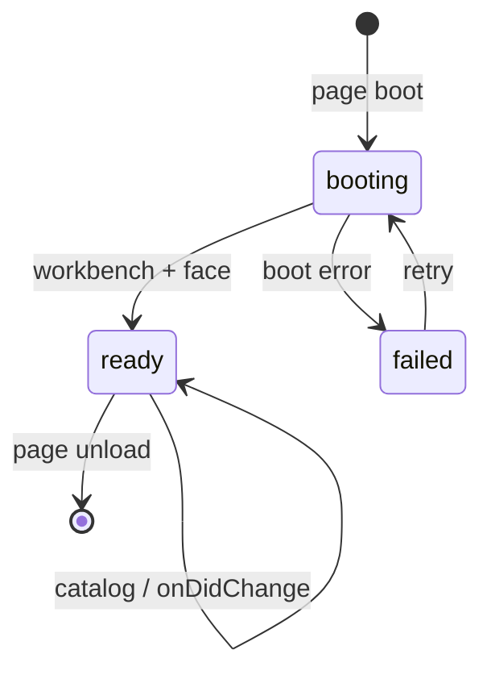
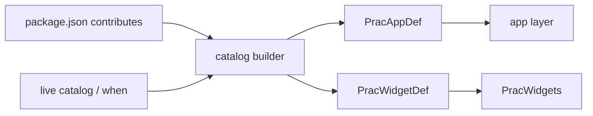

# Technical extension — VS Code adaptor

> 技术设计 L3；扩展模型见 [tech-extension](./2026-11-05-tech-extension.md)；WM / frame 见 [tech-ui](./2026-11-05-tech-ui.md)；editor host / IDE 能力见 [tech-ide](./2026-11-05-tech-ide.md)；runtime 见 [tech-runtime](./2026-11-05-tech-runtime.md)。
> 本文写 VS Code 侧怎么变成 prac extension：host extension 提供 `prac.vscodeHost`，editor / views extension 依赖它贡献 app / widget；不重复扩展契约、editor host、WM。
> 验收由 James 签字。

## 1. 覆盖与边界

**本 note 覆盖**：

- `prac.vscode-host` / `prac.vscode-editor` / `prac.vscode-views` 三个 extension；
- client 侧 VS Code host（embed / face / catalog / boot）；
- `package.json` `contributes` + 实时 catalog / when 的自动转换；
- `ViewContainer` / `View` → `PracWidgetDef`；
- editor input → `PracAppDef` + windows；
- 动态贡献的 reconcile；
- 错误 / 测试。

**不在本 note**：

- extension / catalog / reconcile 契约 → [tech-extension](./2026-11-05-tech-extension.md)；
- editor host 内部（pane host / editor group）→ [tech-ide](./2026-11-05-tech-ide.md) §2.1；
- WM / frame / placement → [tech-ui](./2026-11-05-tech-ui.md)；
- server 侧 `prac-host-vscode`（code server / server extension host）→ [tech-runtime](./2026-11-05-tech-runtime.md)。

## 2. Extension 划分

- **host extension**：`manifest.id = "prac.vscode-host"`，`provides: ["prac.vscodeHost"]`；只 boot / embed / face，不贡献 app / widget。
- **editor extension**：`dependsOn: ["prac.vscodeHost"]`；`apps()` 返回 editor `PracAppDef`；`windows()` 来自当前 editor input——**一个正在编辑的文件 = 一个 `PracWindow`；tab strip 的 tab 是 window group 的 window，不是 window 内的 tab**；`contentFor(windowId)` 返回 editor pane host —— VS Code 渲染的 `TextEditorPane`（不是 `PracWindowPane` 空 pane；见 [tech-ui](./2026-11-05-tech-ui.md) §2.6）。
- **views extension**：`dependsOn: ["prac.vscodeHost"]`；`widgets()` 返回 `PracWidgetDef`；`hostFor(widgetId)` 返回 view 宿主。
- 三者都用 `origin: "vscode"`；host 未 ready → editor / views disabled / degraded。

**Cordis 接法**：

- host extension 在 `apply(ctx)` 里 `ctx.provide("prac.vscodeHost", face / host)`；
- editor / views extension 用 `inject: ["prac.vscodeHost"]`；
- contribution 对象用 `ctx.pracExtensions.register({ ... })` 注册；`ctx.effect` 负责 dispose。
- 不另写 extension activation / dispose 生命周期。

## 3. VS Code host（client 侧）

这里的 host 是 **client 侧** `prac-client-vscode-host`，不是 server 的 `prac-host-vscode`。它把 VS Code web workbench 嵌进 prac page，并把 workbench 的 catalog / command / editor 面桥成 `PracVscodeFace`；不拥有 WM / frame / placement。

### 3.1 包 / 角色

- `prac-client-vscode-host`：boot / workbench host element / bridge / face / catalog / commands；提供 `prac.vscodeHost`。
- `vendor/vscode-embed`：boot、资产、宿主元素、command face、bridge；机制层。
- `vendor/vscode`：上游 pin + patch + overlay；不 fork。
- `ui-vscode-views` / `ui-vscode-editor`：feature extension 的实现包，消费 face。

### 3.2 启动 / 生命周期

- page boot：host extension 起 workbench host element；资产经 code server / proxy；secure context 见 tech-runtime。
- workbench ready + face ready → `prac.vscodeHost` capability ready；editor / views extension 才启用。
- host 失败：placeholder + 诊断；可 retry；不创建 window、不写 board。
- page unload：dispose host / face；hostFor 不再调用。
- host 是 **page 侧**，不是进程；code server / extension host 仍在 server 侧。

### 3.3 Face 边界

`PracVscodeFace` 是 `prac.vscodeHost` 暴露给 feature extension 的桥：

- `catalog` / `onDidChangeCatalog`；
- `hostFor` / `mountView` / `releaseView` / `focusView`；
- `containerActions` / `editorActions` / `runAction` / `runEditorAction`；
- `capabilities.editors`：snapshot / subscribe / settled / version / actions。

边界：

- `PracVscodeFace.hostFor(view)` 是 view 宿主；`PracExtension.hostFor(widgetId)` 是 widget 宿主；两者同名但不同层。
- face 不拥有 window / group / placement。
- editor host 的 pane / editor group 细节在 [tech-ide](./2026-11-05-tech-ide.md) §2.1。

## 4. 自动转换

VS Code 侧要合并两类输入：

1. **静态**：`package.json` 的 `contributes`；
2. **动态**：extension 激活 / 停用、`when` context、view 的 active 状态、commands / menus 的当前解析。

- `ViewContainer` → board hint；`View` → `PracWidgetDef`；
- `EditorInput` → `PracAppDef` + `windows()`；
- commands / menus → resolved action model（不是 app / widget def）；
- 只注册 **active** view；`when` 变化就进出；
- 不搬 `visible`：VS Code 显隐不能成为第二个“在屏上”的真相源；
- 转换由 adapter 负责，VS Code extension 作者不写 prac manifest。

## 5. 映射

- **ViewContainer** → widget board；由 widget board app 打开 board window。container 只是默认 board hint，不是所有权。
- **View** → `PracWidgetDef` + `hostFor`；默认 board hint 来自 container；frame / workbench 决定最终 placement。
- **EditorInput** → `PracAppDef` + `windows()`；每个 input 一个 `PracWindow` 投影；editor host 见 tech-ide §2.1。
- **editor group** → window group 的 adaptor runtime；一个 stage region 一个 editor group；不拥有 chrome / window 记录。
- **actions / commands**：`containerActions` / `editorActions` / `runAction` / `runEditorAction` → resolved action model；frame 渲染。
- **webview / custom editor**：`EditorPane`；secure context 由 runtime 管。

## 5.1 投影：prac window → VS Code

- `PracWindowInput`：prac 窗口的身份投影（editor input 形状）；
- `PracWindowGroup`：prac 的 window group，实现 `IEditorGroupView`，借用 `EditorGroupModel` / `PracEditorPaneHost` / pane 类；
- `PracWindowPane`：frame 渲染窗口的空 pane（内容在 prac frame）；
- **editor 窗口例外**：`TextEditorInput` + `TextEditorPane`，由 VS Code 真实渲染；prac frame 挂 `activeEditorPane.getContainer()`；
- 分流依据是 `appOf(windowId)`，不是 windowId 前缀。

## 6. 动态 / 错误 / 测试

- 贡献变化 → catalog version 更新 → reconcile；不重启。
- 单 view mount 失败 → placeholder + log；不阻塞其他 view。
- `DUPLICATE_WIDGET` / `DUPLICATE_APP`：id 冲突 → reject。
- `UNKNOWN_WIDGET`：hostFor / wrap 未知 → 空 host。
- catalog version 落后 → 重读；不缓存。
- 并发：catalog 更新与 mount / release 串行；dispose 后不再 mount。
- 测试：
  - unit：catalog diff / view → widget def / editor → app def / duplicate；
  - L2：view mount / release / focus；editor input → window；
  - live：containers / editor:group / actions；
  - planned：commands / status / notifications / webview。

## 7. Open

1. **非 editor input 的 capabilities**：chat / board 的 dirty / save / preview / move / tabGroups。
2. **catalog active / visible 边界**：`hideIfEmpty` 由谁执行。
3. **editor host 切片**：S2b / S3 / S4；见 tech-ide §2.1。
4. **actions 覆盖**：commands / menus / status / notifications 的 gate 还缺。

## Related

- [tech-extension](./2026-11-05-tech-extension.md)：manifest / catalog / reconcile。
- [tech-ui](./2026-11-05-tech-ui.md)：PracWindow / WindowPlacement / board。
- [tech-widget](./2026-11-05-tech-widget.md)：PracWidget / WidgetPlacement。
- [tech-ide](./2026-11-05-tech-ide.md)：editor host / IDE 能力。
- [tech-runtime](./2026-11-05-tech-runtime.md)：server 侧 extension host / webview。
- [tech-packages](./2026-11-05-tech-packages.md)：包职责。
