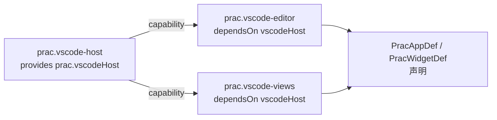
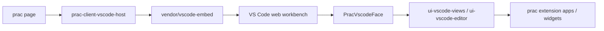
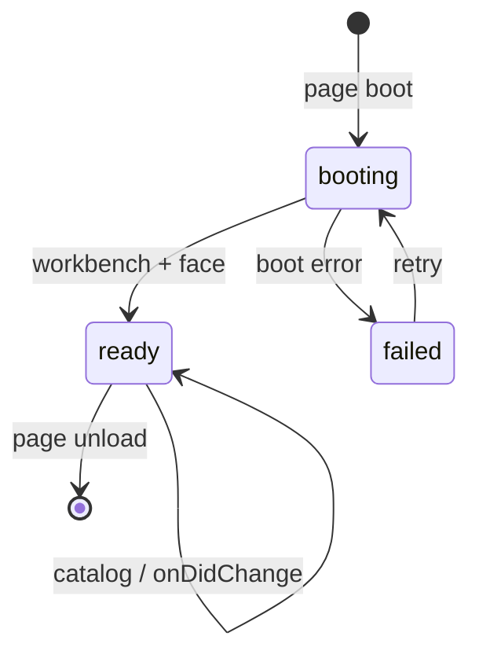
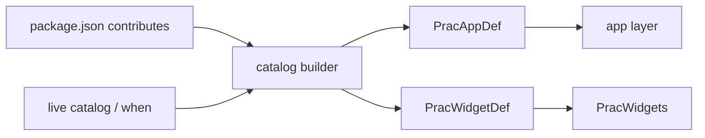

# Technical extension — VS Code adaptor

> 技术设计 L3；扩展模型见 [tech-extension](./2026-11-05-tech-extension.md)；WM / frame 见 [tech-ui](./2026-11-05-tech-ui.md)；editor host / IDE 能力见 [tech-ide](./2026-11-05-tech-ide.md)；runtime 见 [tech-runtime](./2026-11-05-tech-runtime.md)。
> 本文写 VS Code 侧怎么变成 prac extension：host extension 提供 `prac.vscodeHost`，editor / views extension 依赖它贡献 app / widget；不重复扩展契约、editor host、WM。
> 验收由 James 签字。

## 1. 覆盖与边界

**本 note 覆盖**：

- `prac.vscode-host` / `prac.vscode-editor` / `prac.vscode-views` 三个 extension；
- client 侧 VS Code host（embed / face / catalog / boot）；
- `package.json` `contributes` + 实时 catalog / when 的自动转换；
- `ViewContainer` / `View` → `PracWidgetDef` + `PracWidgetImpl`；
- editor input → editor app 的 `open`（每个 input 一个窗口）；
- 动态贡献的 reconcile；
- 错误 / 测试。

**不在本 note**：

- extension / catalog / reconcile 契约 → [tech-extension](./2026-11-05-tech-extension.md)；
- editor host 内部（pane host / editor group）→ [tech-ide](./2026-11-05-tech-ide.md) §2.1；
- WM / frame / placement → [tech-ui](./2026-11-05-tech-ui.md)；
- server 侧 `prac-host-vscode`（code server / server extension host）→ [tech-runtime](./2026-11-05-tech-runtime.md)。

## 2. Extension 划分



- **host extension**：`manifest.id = "prac.vscode-host"`，`provides: ["prac.vscodeHost"]`；只 boot / embed / face，不贡献 app / widget。
- **editor extension**：`dependsOn: ["prac.vscodeHost"]`；`apps()` 返回 editor `PracAppDef`；`appRuntime(def)` 返回 `{ match, start }`；`start(resource)` 创建窗口并在创建时绑定 VS Code 的 renderer（一个正在编辑的文件 = 一个 `PracWindow`；tab strip 的 tab 是 window group 的 window，不是 window 内的 tab）；renderer 返回 VS Code 渲染的宿主（`TextEditorPane`，不是 `PracWindowPane` 空 pane；见 [tech-ui](./2026-11-05-tech-ui.md) §2.3–§2.4）。**不**声明 `windows`。
- **views extension**：`dependsOn: ["prac.vscodeHost"]`；`widgets()` 返回 `PracWidgetDef`；`widgetRuntime(def)` 返回 `{ hostFor, wrap }`；不声明宿主、不声明窗口。
- vscode host 私有地记录它贡献的 app / widget（不写进通用 contract）；host 未 ready → editor / views disabled / degraded。
- 扩展只贡献**声明**：`PracApp` / `PracWidget` 是运行时组合（def + impl），`PracWindow` 是 WM 的实体，三者都不由 extension 直接产出。

**Cordis 接法**：

- host extension 在 `apply(ctx)` 里 `ctx.provide("prac.vscodeHost", face / host)`；
- editor / views extension 用 `inject: ["prac.vscodeHost"]`；
- contribution 对象用 `ctx.pracExtensions.register({ ... })` 注册；`ctx.effect` 负责 dispose。
- 不另写 extension activation / dispose 生命周期。

## 3. VS Code host（client 侧）

这里的 host 是 **client 侧** `prac-client-vscode-host`，不是 server 的 `prac-host-vscode`。它把 VS Code web workbench 嵌进 prac page，并把 workbench 的 catalog / command / editor 面桥成 `PracVscodeFace`；不拥有 WM / frame / placement。

### 3.1 包 / 角色

- `prac-client-vscode-host`：boot / workbench host element / bridge / face / catalog / commands；提供 `prac.vscodeHost`。
- `vendor/vscode-embed`：boot、资产、宿主元素、command face、bridge；机制层。
- `vendor/vscode`：上游 pin + patch + overlay；不 fork。
- `ui-vscode-views` / `ui-vscode-editor`：feature extension 的实现包，消费 face。



### 3.2 启动 / 生命周期



- page boot：host extension 起 workbench host element；资产经 code server / proxy；secure context 见 tech-runtime。
- workbench ready + face ready → `prac.vscodeHost` capability ready；editor / views extension 才启用。
- host 失败：placeholder + 诊断；可 retry；不创建 window、不写 board。
- page unload：dispose host / face；hostFor 不再调用。
- host 是 **page 侧**，不是进程；code server / extension host 仍在 server 侧。

### 3.3 Face 边界

`PracVscodeFace` 是 `prac.vscodeHost` 暴露给 feature extension 的桥：

- `catalog` / `onDidChangeCatalog`；
- `hostFor` / `mountView` / `releaseView` / `focusView`；
- `containerActions` / `editorActions` / `runAction` / `runEditorAction`；
- `capabilities.editors`：snapshot / subscribe / settled / version / actions。

边界：

- `PracVscodeFace.hostFor(view)` 是 view 宿主；`PracWidgetImpl.hostFor(widgetId)` 是 widget 宿主；同名但不同层。
- face 不拥有 window / group / placement。
- editor host 的 pane / editor group 细节在 [tech-ide](./2026-11-05-tech-ide.md) §2.1。

### 3.4 四层与边界

```
WM / frame（决策）
  → vscode-host（镜像 + 映射 + 内容）
  → embed overlay（VS Code 契约实现）
  → vendored VS Code（不变）
```

| 层 | 职责 | 不做 |
| --- | --- | --- |
| **WM / frame** | 窗口存在性、region、group、placement；渲染 `prac.window` 槽 | VS Code 概念（input / group / pane） |
| **vscode-host** | boot / embed；face；文件 → editor input；把 WM 的窗口镜像给 embed；提供宿主渲染 app 的内容 | 决定窗口存在性、region、打开管线 |
| **embed overlay** | 实现 `IEditorGroupView` / `IEditorGroupsService` / `IEditorService`；**editor group 是模型投影（无 UI）**，editor pane 是 window content；frame 的 `WindowGroup` 由 engine 渲染 | 决定窗口集合、知道业务 app、渲染 tab strip |
| **vendored VS Code** | 上游行为 | — |

**接口**

- WM → host：`pracWindows.getSnapshot()` / `subscribe`（单向）；
- host → embed：`mapWindow` / `mountViewInto` / `mountFileInto` / `openFile`（单向）；
- embed → host：`embedBridge` face（回调）；
- embed → vendored：`IEditorService` / `IEditorGroupsService` 契约（实现）。

**两条流**

窗口流：`admit → bindContent（window content）→ 投影（snapshot → editor model）；editor window 的 content 是 editor pane，frame window 的 content 是它的 renderer。`

打开流：`prac.open → registry → app.open / pracVscode.open → editorService.openEditor({ resource }) → TextEditorInput + TextEditorPane`。

**不变量**

- 窗口存在性 / region / group 的写者只有 WM；
- embed 不自行创建窗口，只镜像；
- 投影状态由 editor model 派生（`windowId ↔ IEditorInput`，含非 vscode 的 `PracWindowInput` 身份），不单独维护 `mapped()`；
- editor group 随 prac `WindowGroup` 创建（一个组一个 model group），不做 region → group 的懒建；
- 内容是 app 的，frame 渲染，editor pane 是 VS Code 的；
- **editor group 是模型投影（无 UI）**：vscode 的 editor（pane）渲染成 **file window 的 content**；tab strip / items 由 frame 的 `WindowGroup` 渲染（engine 渲染 frame 的整棵树）；投影方向是 **prac → vscode**；
- embed 不调 `prac.open`。

## 4. 自动转换

VS Code 侧要合并两类输入：

1. **静态**：`package.json` 的 `contributes`；
2. **动态**：extension 激活 / 停用、`when` context、view 的 active 状态、commands / menus 的当前解析。



- `ViewContainer` → board hint；`View` → `PracWidgetDef`；
- `EditorInput` → editor app 的 `open` 声明窗口（每个 input 一个窗口，不再是 `windows()` 列表）；
- commands / menus → resolved action model（不是 app / widget def）；
- 只注册 **active** view；`when` 变化就进出；
- 不搬 `visible`：VS Code 显隐不能成为第二个“在屏上”的真相源；
- 转换由 adapter 负责，VS Code extension 作者不写 prac manifest。

## 5. 映射

- **ViewContainer** → widget board；由 widget board app 打开 board window。container 只是默认 board hint，不是所有权。
- **View** → `PracWidgetDef` + `PracWidgetImpl.hostFor`；默认 board hint 来自 container；frame / workbench 决定最终 placement。
- **EditorInput** → editor app 的 `open` 声明窗口；每个 input 一个 `PracWindow` 投影；editor host 见 tech-ide §2.1。
- **editor group** → 每个 prac `WindowGroup` 一个 **模型** editor group；不按 region 懒建，不拥有 chrome / window 记录，不渲染。
- **actions / commands**：`containerActions` / `editorActions` / `runAction` / `runEditorAction` → resolved action model；frame 渲染。
- **webview / custom editor**：`EditorPane`；secure context 由 runtime 管。

## 5.1 投影：prac window → VS Code

**方向：prac → vscode。** frame 的 `WindowGroup` / window 是权威；VS Code 的 editor group 是**模型投影**（不渲染），VS Code 的 editor 渲染成 **window content**。

**窗口内容有两条路**（由窗口创建时绑定的 renderer / host 决定，不是 origin）：

- **host 渲染**（editor）：VS Code 的 editor input / pane 就是该 window 的 content；`PracEditorPaneHost` 把 pane 的 DOM 挂到 window body。
- **frame 渲染**（chat / board / DSH）：window 的 content 是它的 renderer；frame 渲染。

**editor group 是模型，不是容器**：

- 每个 prac `WindowGroup` 对应一个 editor group（`IEditorGroupView` 的**模型**），随组创建，不按 region 懒建；
- editor group 的 order / active 由 WM 的组镜像（订阅 snapshot），**不渲染**；
- **每个窗口在 editor 模型里都有一个 input**：vscode window → editor input；非 vscode window → `PracWindowInput`（身份投影，**没有 `PracWindowPane`、不渲染**）。**这不是可选项**：一个组可以只有非 vscode window（例如只开 chat），editor 模型仍需要一个 input 才能保持 group / editor service 一致；
- frame 的组才是 tab strip / items / window body 的渲染者；
- host 的私有记录表只需 `windowId ↔ IEditorInput`（pane 是 window content，host 不需要维护 pane 的映射）。

**去掉的中间层**：`mapWindow` / `ensureGroup(region)` / `PracWindowPane` / `mapped()` 不再是一条 per-window 链。投影是**一次** `snapshot → editor model` 的订阅；content 在 `admit` / `bindContent` 时已经确定。`PracWindowInput` **保留**，作为每个窗口在 editor 模型里的身份（含只有非 vscode window 的组）。

## 5.2 vscode host 的记录表

窗口的 `tags` 标出“来自哪个机制”；但 `IEditorInput` / `IEditorPane` 的具体对象是 VS Code 内部的，core 不表达。vscode host 维护自己的记录表：

```ts
Map<windowId, IEditorInput>
```

- 用于 editor 关闭 ↔ 窗口关闭的联动；
- 用于 `CustomEditorInput` / `WebviewEditor` 的 input 映射（pane 是 window content，不在这里）；
- 不写进 core，不进 `PracExtension` 契约。

## 6. 动态 / 错误 / 测试

- 贡献变化 → catalog version 更新 → reconcile；不重启。
- 单 view mount 失败 → placeholder + log；不阻塞其他 view。
- `DUPLICATE_WIDGET` / `DUPLICATE_APP`：id 冲突 → reject。
- `UNKNOWN_WIDGET`：hostFor / wrap 未知 → 空 host。
- catalog version 落后 → 重读；不缓存。
- 并发：catalog 更新与 mount / release 串行；dispose 后不再 mount。
- 测试：
  - unit：catalog diff / view → widget def / editor → app def / duplicate；
  - L2：view mount / release / focus；editor input → window；
  - live：containers / editor:group / actions；
  - planned：commands / status / notifications / webview。

## 7. Open

1. **非 editor input 的 capabilities**：chat / board 的 dirty / save / preview / move / tabGroups。
2. **catalog active / visible 边界**：`hideIfEmpty` 由谁执行。
3. **editor host 切片**：S2b / S3 / S4；见 tech-ide §2.1。
4. **actions 覆盖**：commands / menus / status / notifications 的 gate 还缺。

## Related

- [tech-extension](./2026-11-05-tech-extension.md)：manifest / catalog / reconcile。
- [tech-ui](./2026-11-05-tech-ui.md)：PracWindow / WindowPlacement / board。
- [tech-widget](./2026-11-05-tech-widget.md)：PracWidget / WidgetPlacement。
- [tech-ide](./2026-11-05-tech-ide.md)：editor host / IDE 能力。
- [tech-runtime](./2026-11-05-tech-runtime.md)：server 侧 extension host / webview。
- [tech-packages](./2026-11-05-tech-packages.md)：包职责。
