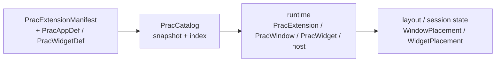
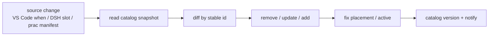
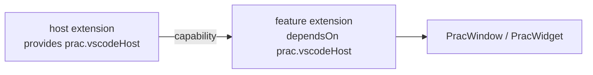

# Technical extension — manifest, definitions, catalog, runtime

> 技术设计 L3；根见 [tech-architecture](./2026-11-05-tech-architecture.md)；UI 见 [tech-ui](./2026-11-05-tech-ui.md)；widget 见 [tech-widget](./2026-11-05-tech-widget.md)。
> 本文给扩展模型：声明 / catalog / 运行时 / host capability / reconcile；VS Code 与 DSH 两侧见 [tech-extension-vscode](./2026-11-05-tech-extension-vscode.md) / [tech-extension-dsh](./2026-11-05-tech-extension-dsh.md)。
> 验收由 James 签字。

## 1. 覆盖与边界

**本 note 覆盖**：

- `PracExtensionManifest` / `PracExtension` / Cordis `Context`；
- 声明式 `PracAppDef` / `PracWidgetDef`；
- `PracCatalog` 快照 / 索引；
- 动态贡献的 reconcile；
- extension registry / 生命周期 / 依赖 / capability；
- host service（`prac.vscodeHost` / `prac.dshHost`）；
- Cordis plugin runtime / DSH 复用；
- 错误 / 并发 / 测试。

**不在本 note**：

- WM / frame / placement → [tech-ui](./2026-11-05-tech-ui.md)；
- board / widget layout → [tech-widget](./2026-11-05-tech-widget.md)；
- VS Code host / 自动转换 → [tech-extension-vscode](./2026-11-05-tech-extension-vscode.md)；
- DSH host / slot 映射 → [tech-extension-dsh](./2026-11-05-tech-extension-dsh.md)；
- host 运行时细节 → [tech-runtime](./2026-11-05-tech-runtime.md)。

> **约定**：“不在本 note”表示由其他 note / 系统拥有，不等于 prac 不做；真正的 non-goal 见 [product design](./2026-11-05-product-design.md) §7。

## 2. 三层：声明 → catalog → 运行时



- **声明**：可序列化、可比较、可持久化；不含函数 / 句柄 / ReactNode。
- **catalog**：从声明归一化出来的快照 / 索引；带 version；不持久化。
- **运行时**：激活后的 extension、host、window、widget、content root；有生命周期。
- **layout / session state**：placement / active / Space；可持久化，但不是声明。

### 2.2 两种 extension

- **host extension**：提供机制（boot / embed / face），不贡献 app / widget；feature extension 依赖它。
- **feature extension**：贡献 app / widget，`dependsOn` 对应的 host。

本文只规定这两种契约的形态，不定义 app 的语义（app 模型见 [tech-ui](./2026-11-05-tech-ui.md) §2）。

### 2.1 extension 与 plugin

**prac 和 DSH 都基于 Cordis。** prac extension 不是新的 plugin runtime，而是：

> **一个 Cordis plugin + 一组 contribution 对象。**

- **Cordis plugin**：`apply(ctx)` / `inject` / `ctx.provide` / `ctx.effect` / dispose；
- **PracExtension**：manifest + `apps()` / `widgets()` / `onDidChange`，由 Cordis plugin 在 `apply(ctx)` 里注册；只贡献声明，不渲染、不持有窗口；
- **DSH plugin**：一个 Cordis plugin 包（DSH conventions），不是另一套 runtime；
- **VS Code extension**：VS Code 自己的插件包；prac 的 VS Code adaptor 是 Cordis plugin，不是 VS Code extension。

关系：**extension ⊂ plugin**。每个 extension 都是 Cordis plugin（或由它注册）；不是每个 plugin 都是 extension（service plugin 可以没有 app / widget）。

- prac / DSH 的 service registry、loader、config、dispose 都复用 Cordis / DSH；
- `dependsOn` 映射到 Cordis `inject` / service 可用性；
- `provides` 映射到 `ctx.provide`；
- 不需要另写 extension activation / dispose 生命周期。

## 3. Manifest / 定义 / extension

```ts
type PracExtensionOrigin = "prac" | "vscode" | "dsh" | (string & {});

interface PracExtensionManifest {
  readonly id: string;                 // global
  readonly origin: PracExtensionOrigin;
  readonly version: string;
  readonly dependsOn?: readonly string[]; // "prac.vscodeHost" / ...
  readonly capabilities?: readonly string[];
  readonly provides?: readonly string[];  // host capability
}

interface PracAppDef {
  readonly id: string;                 // global app id
  readonly version: string;            // runtime pins this
  readonly label: string;
  readonly icon?: string;
  readonly paneHeader?: boolean;
  readonly instances: "single" | "multi";
  readonly defaultRegion?: string;
}

interface PracWidgetDef {
  readonly id: string;                 // namespaced by extension
  readonly version: string;            // runtime pins this
  readonly title: string;
  readonly icon?: string;
  readonly defaultBoard?: string;
  readonly defaultRegion?: string;
}

interface PracWindowDecl {
  readonly id: string;
  readonly appId: string;
  readonly title: string;
}
```

- `PracAppDef` / `PracWidgetDef` **没有** `content` / `hostFor` / `windows`；
- 定义可以来自 VS Code `contributes`、DSH plugin 声明、prac manifest；
- `origin` 只是元数据，不做分支；`prac` / `vscode` / `dsh` 都是同一个 extension 模型。

扩展的运行时接口：

```ts
interface PracExtension {
  readonly manifest: PracExtensionManifest;

  apps?(): readonly PracAppDef[];      // 声明：catalog / reconcile 用
  widgets?(): readonly PracWidgetDef[];

  runtime?(def: PracAppDef): PracAppImpl | undefined;          // 代码：lazy
  widgetRuntime?(def: PracWidgetDef): PracWidgetImpl | undefined;

  onDidChange?(listener: () => void): () => void;
}

interface PracAppImpl {
  content(windowId: string): () => ReactNode;
  match?(resource: string): boolean;
  open?(resource: string): boolean;
}

interface PracWidgetImpl {
  hostFor(widgetId: string): () => ReactNode;
}

// 运行时由声明 + 实现组合；声明永远可序列化，代码永远在运行时。
interface PracApp {
  readonly def: PracAppDef;
  readonly impl: PracAppImpl;
}

interface PracWidget {
  readonly def: PracWidgetDef;
  readonly impl: PracWidgetImpl;
}
```

扩展不是自己实现生命周期，而是由 Cordis plugin 注册：

```ts
import type { Context } from "@deepseek-ai/cordis";

export function apply(ctx: Context): void {
  const off = ctx.pracExtensions.register({
    manifest: {
      id: "prac.vscode-views",
      origin: "vscode",
      version: "1",
      dependsOn: ["prac.vscodeHost"],
    },
    widgets: () => vscodeViewDefs(),
  });

  ctx.effect(() => () => off.dispose());
}
```

- `ctx` 是 DSH / Cordis 的 `Context`；
- `ctx.pracExtensions` 是 Cordis service；
- `ctx.effect` / `ctx.on("dispose")` 负责清理；
- 没有 `PracExtensionContext` / `activate` / `dispose` 这一层。

- app 内容：app 运行时的 `content(windowId)`；extension 不提供内容；
- widget 宿主：widget 运行时的宿主；extension 不提供宿主；
- app 的窗口：app 的 `open` 声明、实例持有；extension 不持有窗口；
- host extension：Cordis plugin，`ctx.provide("prac.vscodeHost", …)`，不贡献 apps / widgets；
- feature extension：Cordis plugin，`inject: ["prac.vscodeHost"]`，贡献 apps / widgets。

## 4. Catalog

```ts
interface PracCatalog {
  readonly version: number;
  readonly extensions: readonly PracExtensionManifest[];
  readonly apps: readonly PracAppDef[];
  readonly widgets: readonly PracWidgetDef[];
  readonly hosts: readonly PracHostDecl[];
}

interface PracHostDecl {
  readonly id: string;                 // "prac.vscodeHost"
  readonly version: string;
  readonly status: "ready" | "starting" | "unavailable";
}
```

- catalog 是 **派生快照**，不是第二权威；
- 按 id / kind 建索引；`version` 每次 reconcile 递增；
- `catalogVersion` 进入 `LayoutState` / UI store，用于判断是否需要重读；
- 不持久化 catalog；重启后重建。

## 5. 动态贡献：reconcile，不重启



- **stable id** 是前提，统一为 `source:kind:id`：
  - `vscode:view:<container>/<view>`；
  - `vscode:editor:<file>`；
  - `dsh:slot:<id>`；
  - `prac:widget:<id>` / `prac:app:<id>`。
- 新增：注册 def；runtime 懒创建；
- 更新：更新 metadata；已有 runtime **pin 旧 def version**（`PracWindow.appVersion` / `PracWidget.version`），新 runtime 用新定义；placement 保留；
- 删除：关闭对应 window / 移除 widget；placement heal；
- 顺序：remove → update → add → fix active / placement；
- **restart 只用于** host 崩溃、ABI / manifest 不兼容、registry 损坏；不用于普通贡献变化。

## 6. Host service / capability



- `prac.vscodeHost` / `prac.dshHost` 是 host capability，不是 extension 类型；
- host extension 是 Cordis plugin：`ctx.provide("prac.vscodeHost", …)`，不贡献 app / widget；
- feature extension 用 Cordis `inject` / `dependsOn`；host 未 ready → disabled / degraded；
- `ctx.get("prac.vscodeHost")` / `inject` 显式取能力；没有 ambient `ctx.pracWindows`；
- supervisor / readiness / restart 见 [tech-quality](./2026-11-05-tech-quality.md) 与 [tech-runtime](./2026-11-05-tech-runtime.md)。

## 7. Registry / 生命周期

```ts
interface PracExtensionsFace {
  register(extension: PracExtension): () => void;
  list(): readonly PracExtensionManifest[];
  catalog(): PracCatalog;
  onDidChange(listener: () => void): () => void;
}
```

`ctx.pracExtensions` 是 Cordis service；`register` 由 plugin 的 `apply(ctx)` 调用。

- `register` 返回 disposer；dispose 只移除该 extension 的贡献；plugin 的 `ctx.effect` 负责调用。
- duplicate extension id → reject；duplicate app / widget id → reject。
- `dependsOn` 映射到 Cordis `inject` / service 可用性；缺依赖 → disabled。
- `origin` 用于诊断 / 策略 / 分组，不做分支。
- app sync：`apps()` diff → 注册 / 移除 app；窗口由 app 的 `open` 走 WM，不由 extension 声明。
- widget：`widgets()` diff → `PracWidgets` 注册；宿主由 widget 运行时提供；board root 负责 placement。
- 失败：per-extension 回滚；不影响其他 extension。

## 8. VS Code / DSH 两侧

- **VS Code**：把 `package.json` `contributes` + 实时 catalog / when 转成 `PracAppDef` / `PracWidgetDef`；editor / views 依赖 `prac.vscodeHost`。见 [tech-extension-vscode](./2026-11-05-tech-extension-vscode.md)。
- **DSH**：消费 **DSH plugin** 级贡献（不是 Cordis plugin）；slot / app / shell 转成同一组 def；见 [tech-extension-dsh](./2026-11-05-tech-extension-dsh.md)。
- 两侧都不直接调用 `ctx.pracWindows`；window 由 app layer / runner 打开。

## 9. OS 的启示

- **package / process 分离**：声明更新不强制重建所有 runtime；新 runtime 用新定义，旧 runtime 可以 pin 旧版本；
- **service supervisor**：host 有 readiness / restart / 依赖顺序；
- **capability**：extension 默认没有 ambient authority；
- **content handler**：文件 / diff / note 的类型路由是独立 point，不是 app / widget 的替代；
- **catalog index**：声明安装时建索引，不在每次启动全量扫；
- **generation / rollback**：reconcile 失败回到上一个 catalog version。

## 10. 错误 / 并发 / 测试

错误：

- `DUPLICATE_EXTENSION` / `DUPLICATE_APP` / `DUPLICATE_WIDGET`；
- `UNKNOWN_DEPENDENCY` / `DEPENDENCY_CYCLE`；
- `HOST_UNAVAILABLE`；
- `CATALOG_STALE`；
- `RECONCILE_FAILED`。

并发：

- catalog 重建串行；extension `onDidChange` 合并 / 去抖；
- reconcile 与 open / close 串行；
- dispose 后不再读该 extension。

测试：

- unit：manifest / defs / duplicate / dependency / catalog / reconcile；
- L2：extension → app / widget；host dependency；dynamic remove；
- live：VS Code / DSH 动态贡献；
- planned：content handler / generation rollback。

## 11. 已定

- **稳定 ID**：`source:kind:id`；source = `vscode` / `dsh` / `prac`；kind = `app` / `widget` / `editor` / `view` / `slot`。
- **一个正在编辑的文件 = 一个 `PracWindow`**；tab 是 window group 的 window。
- **一个 conversation = 一个 `PracWindow`**。
- **def version pinning**：`PracAppDef.version` / `PracWidgetDef.version`；已有 runtime pin 旧 version，新 runtime 用新 version。
- **content handler 不在当前阶段**：作为 future point；现在由 app / widget 直接承接。

## 12. Open

1. **动态 view**：VS Code 静态 `contributes` + `when` 的边界。
2. **content handler 的引入条件**：什么需求下值得成为独立 point。
3. **公开 API**：仍不发布公共 SDK / marketplace。

## Related

- [tech-architecture](./2026-11-05-tech-architecture.md)：进程 / 组件 / 状态根。
- [tech-ui](./2026-11-05-tech-ui.md)：PracWindow / WindowPlacement / app。
- [tech-widget](./2026-11-05-tech-widget.md)：PracWidget / WidgetPlacement。
- [tech-extension-vscode](./2026-11-05-tech-extension-vscode.md)：VS Code host / 自动转换。
- [tech-extension-dsh](./2026-11-05-tech-extension-dsh.md)：DSH plugin / slot。
- [tech-runtime](./2026-11-05-tech-runtime.md)：host / extension host / LSP。
- [tech-quality](./2026-11-05-tech-quality.md)：安全 / 性能 / 测试。
- [tech-packages](./2026-11-05-tech-packages.md)：包映射。
