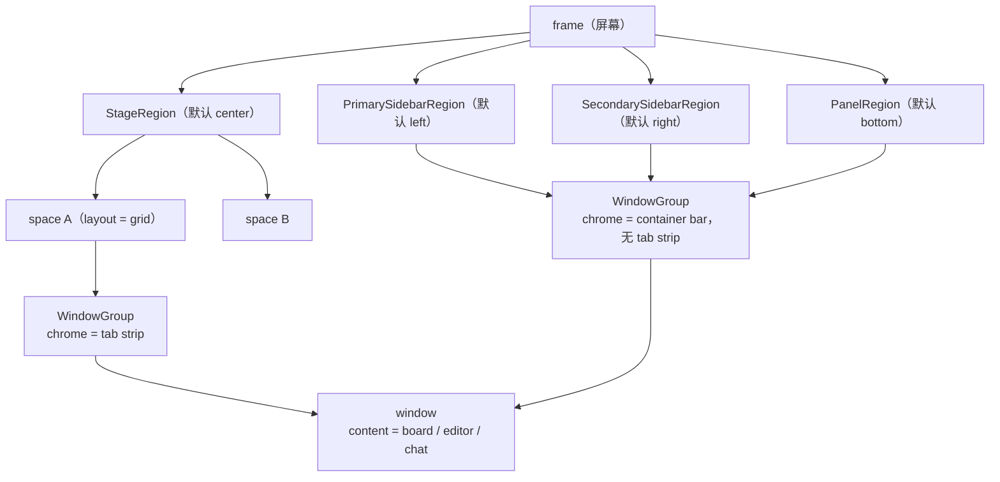
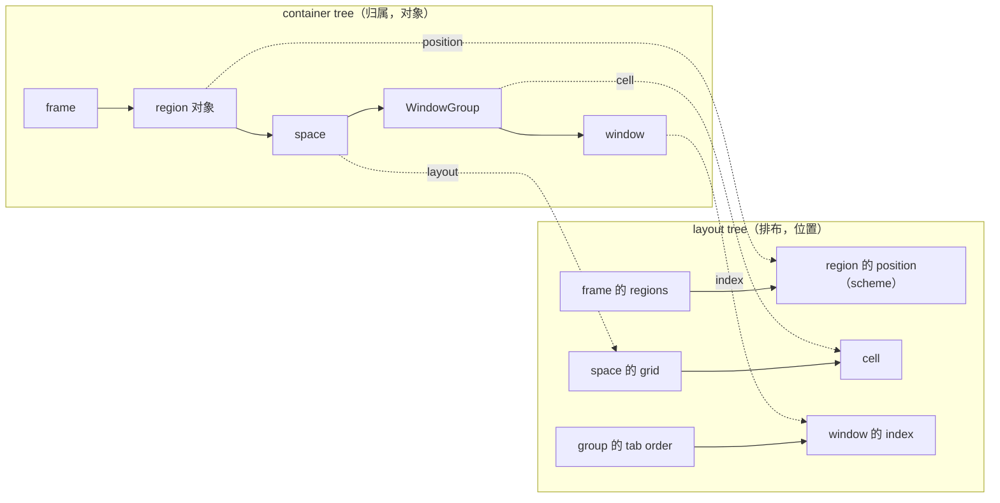
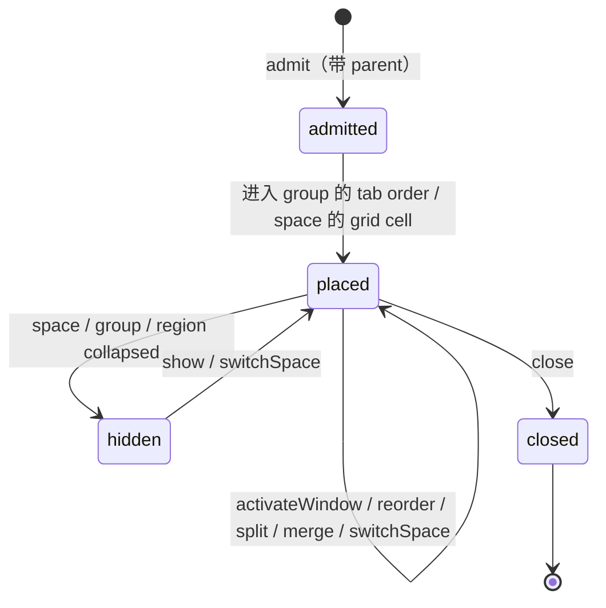

# Technical UI — frame, regions, spaces, groups, windows

> app 与实例见 [tech-app](./2026-11-05-tech-app.md)；dock 见 [tech-dock](./2026-11-05-tech-dock.md)；board 见 [tech-widget](./2026-11-05-tech-widget.md)；渲染引擎见 [rendering-engine](./2026-11-12-tech-rendering-engine.md)。

## 1. 范围与不变量

### 1.1 范围

窗口是什么、落在哪、怎么分组、怎么渲染、怎么恢复。

### 1.2 不变量

| id | 不变量 | 验证 |
| --- | --- | --- |
| **I1** | WM 是唯一写者：**容器树**（region / space / group / window）、**space 的 grid 布局**、**board 布局**都归它；渲染只读快照。 | 代码审查：无渲染路径写 WM |
| **I2** | 窗口是实例的投影：`PracWindow.instanceId` 必有（见 [tech-app](./2026-11-05-tech-app.md) §1.2 I4）。 | `verify-containers` 的 board 断言 |
| **I3** | 每个窗口恰有一个 **parent**：window group（今天）；类型上允许 space / region（未来的 free window），当前不创建。没有 parent-less 的窗口。 | unit：`admit` / `reparent` |
| **I4** | **frame 的 children 是四个平级的 region 对象**：`StageRegion`、`PrimarySidebarRegion`、`SecondarySidebarRegion`、`PanelRegion`。stage 里是 **space ⊃ group ⊃ window**；sidebar / panel 里是 **group ⊃ window**；group 不嵌套。 | unit：`parentOf` / `spaceOf` |
| **I5** | **容器树（归属）**与 **layout 树（排布）**分离：region / grid cell 是布局位置，不是归属；region 对象与位置的绑定由 **scheme** 给、可重映射。 | 类型：`parent` 与 `position` 不共用字段 |
| **I6** | store 只是 recovery 快照，不是权威。 | 代码审查：无读 store 做决策的路径 |
| **I7** | stage 永不隐藏；space / group / region 可折叠 / 隐藏。 | `verify-containers` |
| **I8** | frame 是从属渲染器，没有公开面（无 `LayoutFace`）。 | 类型：frame 无公开 face |
| **I9** | **chrome 归 prac**：group 的 chrome 由 **parent region 对象的行为**决定（space 里的 group = tab strip；sidebar / panel region 里的 group = container bar / stack，**没有 tab strip**）；window 的 chrome 数据来自窗口记录 / app 定义，不来自 content entry。 | 代码审查：chrome 不读 content 注册 |
| **I10** | **stage / space 必须有内容**：space 的 grid 至少一个 `WindowGroup`；最后一个 `WindowGroup` 不会被移除；空 `WindowGroup` 渲染 **frame 的 placeholder**（watermark），placeholder 不是 window、不是 content entry。 | `verify-containers`：关掉最后一个窗口后 group 仍在、placeholder 出现 |

## 2. 数据模型

### 2.1 region：特定对象，不是字符串

```ts
/** 一个具体的 region 对象；行为（chrome / 布局）由对象自己决定。 */
interface PracRegion {
  readonly id: string;
}

interface StageRegion extends PracRegion {
  readonly spaces: readonly PracSpace[];   // 多个 space，一个 active
}

/** sidebar 的共享基类：container bar / stack 的 chrome、收起/展开等行为。 */
interface SidebarRegion extends PracRegion { /* shared sidebar behavior */ }
interface PrimarySidebarRegion extends SidebarRegion { /* sidebar · primary */ }
interface SecondarySidebarRegion extends SidebarRegion { /* sidebar · secondary */ }

interface PanelRegion extends PracRegion { /* panel */ }

/** 方案：region 对象与布局位置的绑定；可重映射。 */
interface LayoutScheme {
  readonly positionOf: (region: PracRegion) => string;
  readonly regionAt: (position: string) => PracRegion | undefined;
}
```

- **每个 region 是一个特定对象**，不是 `role` 字符串；两个 sidebar 共享 `SidebarRegion` 基类。
- region 对象**没有固定方位**：与 left / right / center / bottom 的绑定由 **scheme** 给，**可以重映射**（默认：stage=center、primary=left、secondary=right、panel=bottom）。
- 换方案 / 用户改布局只换绑定，不换 region 对象与其行为。

### 2.2 容器树



> **stage / sidebar / panel 是四个平级的 region 对象**（frame 的 children）；dock 是 frame 的 chrome，不是容器节点。

- **StageRegion** 的 children 是**多个 space**（一个 active）；**space 的 layout 是一张 grid**，cell 是 WindowGroup（cell 可 merge / split）；切换 space 只换这张 grid。
- **sidebar / panel region** 的 children 是 **group**（不套 space）。
- **group 里装的全是 window**；group 的 `order` 就是 tab order；window 的 content 种类不受 group 限制。
- **board 是 window 的 content**；widget 是 board 的内容。board 不是容器节点。
- 归属由 **parent** 表达；**live tree 用对象引用，持久化用 id**（见 §5）。

### 2.3 window

```ts
interface PracWindow {
  readonly id: string;
  readonly appId: string;
  readonly instanceId: string;   // 所属实例
  readonly appVersion?: string;  // admit 时 pin
  readonly parent: WindowGroup;  // 或未来的 space / region
  readonly title: string;
  readonly icon?: string;
  /** Opaque annotation the app sets when it opens the window; core never interprets it. */
  readonly tags?: readonly string[];
}
```

- **内容 renderer 不挂在窗口数据上**：它是 `prac.window` entry（视图注册，key = window id）的 renderer；frame 按 window id 渲染该 entry。窗口数据只存身份 / 归属 / chrome 数据（title / icon）。
- `PracWindowRenderer` 是这条 entry 的组件，props 是 owner（`width` / `viewportWidth`）+ 标准 kit；它渲染实现方的 stable content factory 的 occurrence（见 [rendering-engine](./2026-11-12-tech-rendering-engine.md)）。
- 窗口不是 DOM window，也不是 content surface。用户看到的是：`PracWindow` + 它所在 group 的 chrome + 该窗口的内容 entry。

### 2.4 group：parent 的子类型决定种类

```ts
interface WindowGroup {
  readonly id: string;
  readonly parent: PracSpace | SidebarRegion | PanelRegion;
  readonly order: readonly PracWindow[]; // tab order
  readonly active?: PracWindow;
}

type PracGroup = WindowGroup;
```

- **group 就是 `WindowGroup`，没有 `SpaceGroup` / `RegionGroup` 子类型**：它属于 space 还是 sidebar / panel region 由 **parent** 表达；chrome 是 parent 的行为（space → tab strip；sidebar / panel region → container bar / stack，没有 tab strip）。
- **空 `WindowGroup` 合法**（`order` 为空、`active` 未定义）；space 的最后一个 group 不会被移除，空 group 渲染 frame 的 placeholder（watermark）。
- **数据一个类型，渲染两种**：`WindowGroup` 只有一份数据；渲染样式由 **视图层** 的 `GroupChrome` 表达，按 parent 选——`tabs`（space）或 `container-bar`（sidebar / panel）。`kind` 只存在于视图层，**不进 `WindowGroup`、不进持久化**。

```ts
/** 视图模型：frame 层；不是领域字段。 */
type GroupChrome =
  | { kind: "tabs"; group: WindowGroup }           // space
  | { kind: "container-bar"; group: WindowGroup }; // sidebar / panel
```

**原则**：领域模型只放身份 / 归属 / 生命周期；渲染种类放视图层；只有**数据或不变量**真正不同时才拆子类型（region 对象就是这种情况——Stage / Sidebar / Panel 的 children 与行为不同）。
- group 的 `order` / `active` 由 `admit` / `reorder` / `activateWindow` / `close` 写。
- sidebar / panel 的 group 里可以是多个 window（例如各 container 的 board window）；group 不限制 window 的 content。

### 2.5 space：一张 grid

```ts
interface PracSpace {
  readonly id: string;
  readonly name: string;
  readonly parent: StageRegion;   // StageRegion 持有多个 space
  readonly layout: LayoutState;   // grid；cells = group
}
```

- **space 的 layout 是 grid**：cell 是 group；cell 可 merge / split；每个 space 一份 layout store。
- 切换 space 只换 stage 的 grid；sidebar / panel 的 region / group 不动。
- **board 的布局是窗口 content 的布局**（WM 持有的 board `LayoutState`，键是 `boardId`），不在容器树里。

### 2.6 容器树与布局树：分与合



**两棵树各管什么**

| 树 | 节点 | 谁写 | 生命周期 |
| --- | --- | --- | --- |
| **container tree** | frame / region 对象 / space / WindowGroup / window | WM | 由 `admit` / `close` / `reparent` / `split` / `merge` 改变 |
| **layout tree** | region 的 position、space 的 grid（cell/track）、group 的 tab order、board 的 items | WM（读快照渲染） | 由 `place` / `reorder` / `resize` / `hide` / `collapse` / `switchSpace` 改变 |

**四个接合点**（“合”）

| container | layout 位置 | 归属谁 |
| --- | --- | --- |
| region 对象 | frame 的 region position（left / right / center / bottom） | frame 的 layout，由 **scheme** 绑定 |
| space | StageRegion 的 active space（同一时刻只显示一个） | StageRegion |
| WindowGroup | space 的 grid 里的一个 **cell** | 该 space 的 grid |
| window | group 的 **tab order** 里的 index | 该 WindowGroup |
| board | window content 里的 board layout | window content（WM 持有 `LayoutState`） |

**分与合的规则**

- **归属只由 container tree 决定**；layout 只决定“画在哪、多大、前后”。布局操作（resize / hide / collapse / reorder）**不改变归属**。
- **`admit` 同时写两棵树**：先挂 parent（container），再进 group 的 tab order / space 的 cell（layout）。
- **`close` 同时写两棵树**：从 group order 移除；group 空了，若它不是该 space 的**最后一个** group，移除 group 与它的 cell（container + layout 一起消失）；若是最后一个，**保留空 group 与 cell**，由 frame 渲染 placeholder（VS Code 式）。
- **`split` / `merge` 同时写两棵树**：split 新增一个 WindowGroup（container）并给它一个 cell（layout）；merge 移除被合并的 group（container）与它的 cell（layout）。
- **`reparent` 只改 container 的 parent，但要同时改两边的 order**（旧 group 移出、新 group 移入）；布局位置由新 parent 的 layout 决定。
- **`switchSpace` 只改 StageRegion 的 active space**（布局状态），container 不变；sidebar / panel 的 region / group 不动。
- **`scheme` 重映射只改 region 对象与 position 的绑定**（layout），container 不变。
- **空 `WindowGroup`**：`order` 为空、`active` 未定义；没有 window、也没有 content entry；frame 在 group 的 body 位置渲染 **placeholder（watermark）**。placeholder 是 frame 的 chrome，不是 app 的 content，也不是一个假 window。
- **不变量**：layout 里的每个位置都能解析到一个 container（region / space / group / window）；不存在没有 container 的“孤立布局项”。空 cell 只是布局占位，不是 container。

### 2.7 默认方案下的角色

| region 对象 | 默认位置 | 内容 |
| --- | --- | --- |
| `PrimarySidebarRegion` | left | Explorer / Search / SCM / Debug / Extensions（board window） |
| `SecondarySidebarRegion` | right | board / 任意 window（不固定为 chat） |
| `PanelRegion` | bottom | Problems / Output / Terminal |
| `StageRegion` | center | space（grid；editors / document / chat） |
| top | — | 预留 |

### 2.8 落点（窗口创建时）

- `admit` 解析窗口的 **parent**（一个 window group）：launch 的 target（space / group，来自 arrangement 的策略）→ 该 region / cell 的 group（**包括 content 注册的组**，如 stage 的 editor group）→ app 的 `defaultRegion` → 拒绝。
- **没有 parent-less 的窗口；没有随机落点。** arrangement 是落点策略（app/view → space/group），`start` 从 launch 拿到目标并在创建时挂上 parent。
- space 的 grid / group 的 tab order 是**创建后的布局**，不是归属。

### 2.9 三视角：WM / frame / engine

| 视角 | 拥有 | 输入 | 输出 |
| --- | --- | --- | --- |
| **WM** | 两棵树 + active | app 的 `start` / `admit`、arrangement 的落点、用户的布局操作 | snapshot（两棵树的 join） |
| **frame** | 渲染 | WM snapshot + scheme + chrome 事实（窗口记录 / app 定义） | regions / chrome / window body / 内容座位 |
| **engine** | 内容组合与运行时 | frame 的座位 + `prac.window` entry + stable factory | content occurrence 的 React 树 |

- **WM 是唯一写者**；frame 只读 snapshot；engine 只拿 frame 给的座位。
- **scheme 是两个视角的接缝**：arrangement 给策略（默认落点 + region↔position），WM 存 / 用，frame 消费。
- **两棵树在 WM 里是一张图**（节点同时有 parent 与 position）；分开的是语义，不是存储。
- 渲染路径：`WM snapshot → frame resolve（position → container）→ seat + chrome → prac.window entry → factory occurrence（engine）`；engine 的边界与 render path 见 [rendering-engine](./2026-11-12-tech-rendering-engine.md)。

## 3. 接口

```ts
interface PracWindows {
  admit(appId: string, options: {
    windowId; instanceId; title?; appVersion?;
    parent?: WindowGroup;    // 目标 group（或未来的 space / region）
    spaceId?: string;        // 落点输入（不存储）；由 launch/arrangement 给
    handle?;
  }): string;
  activateWindow(windowId: string): void;   // 激活；若所属 space / region 收起则 show
  close(windowId: string): boolean;
  parentOf(windowId: string): WindowGroup | PracSpace | PracRegion | undefined;
  groupOf(windowId: string): WindowGroup | undefined;
  spaceOf(windowId: string): PracSpace | undefined;
  getSnapshot(): WindowManagerSnapshot;      // { frame, regions, spaces, groups, windows }
  instanceOf(windowId: string): string | undefined;
  subscribe(listener: () => void): () => void;
}

interface PracSpaces {  // 委托 WM
  list(); create(name?); rename(id); remove(id); switchTo(id); active(); onDidChange;
}

/** 方案由 arrangement 提供；frame 消费。 */
interface LayoutScheme {
  positionOf(region: PracRegion): string;
  regionAt(position: string): PracRegion | undefined;
}
```

- **没有 `selectPanel`**：选 panel 是“激活该 panel 的窗口”，选窗口是“激活窗口”；两者都不按 role 找窗口。
- **没有 `LayoutFace`**：frame 无公开面；布局查询经 `getSnapshot()`。
- `activateRole(role)` 是否存在尚未裁决（见 §8）。

## 4. 运行时权威与渲染

| 事实 | 归谁 |
| --- | --- |
| 容器树（region / space / group / window）、parent/children | WM |
| space 的 grid layout | WM |
| board 的布局 | WM（一个 board 一棵 `LayoutState`） |
| placement / region / active | WM |
| chrome（group / window） | frame（读 WM 快照 + region 对象行为 + app 定义） |
| 持久化 | store（只写快照） |
| 渲染 | frame（读快照） |

**内容渲染**：窗口对应的 `prac.window` entry（keyed，key = 窗口 id）带 renderer——实现方注册 **stable factory**（children 声明一次），feature extension 为每个窗口注册这条无 children 的 entry，renderer 渲染该 factory 的 occurrence；frame 在窗口 body 的座位里渲染。**chrome 归 prac**，来自窗口记录 / app 定义，不来自 content entry。engine 的边界、render path、factory/slot 约定见 [rendering-engine](./2026-11-12-tech-rendering-engine.md)。

**`PracWindowInput` 只用于“窗口标注为非 vscode 原生”的窗口**（board / document）。判据是**窗口上的标注**：app 在 `admit` 时声明（`PracWindow.tags`），adaptor 读取，core 不解释它的含义。

## 5. 持久化与恢复

- 策略见 [tech-quality](./2026-11-05-tech-quality.md)；
- 本域 key：`prac-window/v1/<scope>`（容器树 ids + 每个 space 的 grid + group 的 order/active）；
- **live tree 用对象引用；序列化用 id**；恢复时先重建对象，再按 id 连接。
- **视图句柄不进持久化**：`prac.window` entry 的 renderer、`PracWidgetView.content/actions` 等是运行时 / 视图层句柄；持久化只存窗口记录、容器树、布局。
- 恢复顺序：读快照 → WM 重建容器树（region / space / group / window）→ frame 按 scheme 渲染当前 space 的 grid；
- heal：未知 region / space / group / window 丢弃、未知 cell 回默认、active 无效清空、group 的 window 缺失则移除。

## 6. 状态机



- `admit` 必须解析出 parent（group）；`place` 只决定布局位置；
- space 的 grid 切换只换 stage 的 space，不动 sidebar / panel 的 region / group；
- 关闭窗口从 group 的 order 移除，并通知实例表。

## 7. 错误与测试

| 错误 | 触发 | 处理 |
| --- | --- | --- |
| `UNKNOWN_APP` | `admit` 的 appId 未注册 | throw |
| `NO_PARENT` | `admit` 解析不出 group / space / region | throw |
| `UNKNOWN_WINDOW` | `close` 的 id 不存在 | no-op |
| `UNKNOWN_REGION` | `place` 的 region 不存在 | throw |

测试：admit（带 parent）/ close 生命周期、group 的 active 回退、split/merge cell、space 切换只换 grid、scheme 重映射、快照恢复与 heal、sidebar / panel 的 group 不随 space。

## 8. Open

1. **`activateRole` 是否保留**：目前没有调用方；若将来“切到某个 role”成为命令，再引入（用 region 对象，不用 role 字符串）。
2. **一个窗口能否被两个 group 引用**：当前不能（parent 唯一）。
3. **`top` 区域的用途**。
4. **free window**：parent 类型允许 space / region，当前不创建；未来做 free window 时再定 chrome / 交互。
5. **单窗口 group 的 chrome**：sidebar / panel 的 group 通常多 window（container）；若某个 group 只有一个 window，是否仍画它的 chrome（tab strip / container bar），留给实现时决定。
6. **落点解析的实现**：stage 的 `WindowGroup` 是 content 注册的组（editor group），`admit` 如何从 region / cell 解析到它？关闭条件：chat 的 `start` 能在当前 space 的 stage `WindowGroup` 里创建窗口，tab strip 同时有 chat 与 file。
7. **chrome 数据来源**：title / icon 由 `admit` 参数还是 app 定义给；frame 的 pane header 策略如何在不读 content 注册的前提下决定。关闭条件：catalogue 的 chrome 事实全部来自 prac 自己的模型。


## Related

- [tech-app](./2026-11-05-tech-app.md)：app / 实例 / 启动。
- [tech-widget](./2026-11-05-tech-widget.md)：board 编排。
- [tech-dock](./2026-11-05-tech-dock.md)：pins / intent。
- [tech-quality](./2026-11-05-tech-quality.md)：持久化策略。
- [rendering-engine](./2026-11-12-tech-rendering-engine.md)：frame / content / chrome 的引擎边界。
