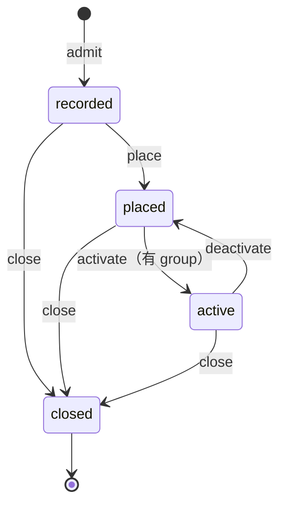
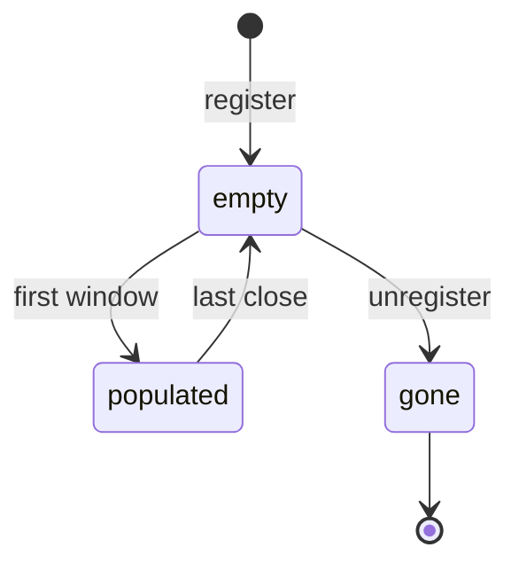
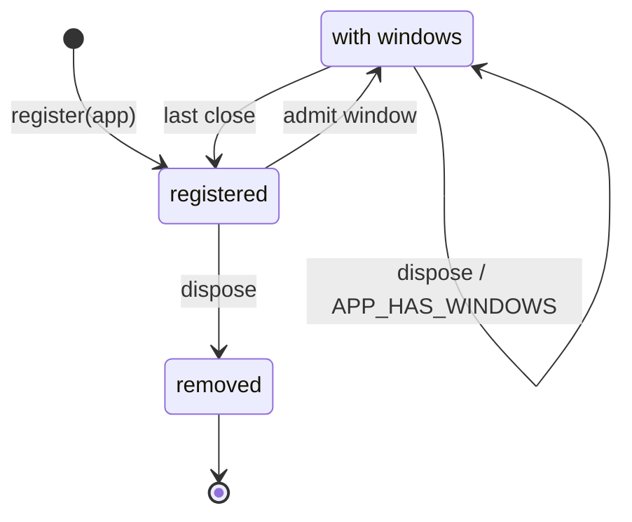

# Technical UI — object model, runtime authority, rendering, open pipeline

> 技术设计 L2；根见 [tech-architecture](./2026-11-05-tech-architecture.md)；行为见 [product experience](./2026-11-05-product-experience.md)。
> 本文是 UI 层的**规范**：对象模型、运行时权威、渲染、打开管线、不变量、服务接口、状态机、持久化、错误与测试。
> 验收由 James 签字。

## 1. 覆盖与边界

**覆盖**：窗口 / placement / group / board / widget / region / Space 的对象模型；WM 的运行时权威；store 的持久化角色；内容的两种渲染模式；frame / board 的布局与几何；isolation / chrome；持久化与恢复；并发 / 错误 / 测试。app 的声明 / 实例 / 启动见 [tech-app](./2026-11-05-tech-app.md)。

**不在本文**：交互文案 → [product experience](./2026-11-05-product-experience.md)；IDE 能力 → [tech-ide](./2026-11-05-tech-ide.md)；extension 声明契约 → [tech-extension](./2026-11-05-tech-extension.md)；board / widget 的细节 → [tech-widget](./2026-11-05-tech-widget.md)。

## 2. 对象模型

### 2.1 App

App 是**能力**，也就是**逻辑 / 代码**。app 不持有运行时状态与数据——那些属于实例。两份形态：

- **声明**（`PracAppDef`，可序列化）：`id` / `version` / `label` / `icon` / `paneHeader` / `instances` / `defaultRegion`；
- **实现**（`PracAppImpl`，代码）：`content(windowId)` / `match(resource)` / `open(resource)`；
- **运行时**（`PracApp`）：`def` + `impl`，按需创建（lazy）。代码当前名 `ApplicationDefinition`，改名见 §10 清理项。

`match` 决定 app 是否认领一个资源；`open` 是 app 自己的打开行为（它声明要开的窗口）；`content` 是窗口内容的工厂。`defaultRegion` 是 app 对 placement 的**声明**，由 arrangement 采纳，WM 不解释。

### 2.3 窗口

窗口是**实例的显示实体**。`PracWindow` 是 prac 的窗口实体记录（身份 + 生命周期），WM 持有：

```ts
interface PracWindow {
  id: string;          // 全局唯一，由 open 的 app 生成（通常是 `appId:resource`）
  appId: string;
  appVersion: string;  // admit 时 pin
  instanceId: string;  // 属于哪个 app 实例
  title: string;
  icon?: string;
  /** Opaque annotation; the core never interprets it. */
  tags?: readonly string[];
}
```

`PracWindow` 不是 DOM window，也不是 content surface。用户看到的窗口 = `PracWindow` + `WindowPlacement` + content surface。

### 2.4 Placement

`WindowPlacement` 描述“放在哪”，**不拥有 window**，放在 space root 的 `LayoutState.items[windowId]`：

```ts
interface WindowPlacement {
  kind: "window";
  region: string;
  order: number;
  hidden: boolean;
  collapsed?: boolean;
  front?: boolean;
  contentId?: string;
  contentRegion?: string;
  boardId?: string;
  size?: number;
  cachedSize?: number;
  max?: number;
}
```

placement 的 `region` 由 WM 的 placement 投影覆盖（§3.2）；`size` / `collapse` / `hidden` / `order` 属于 layout。

### 2.5 Group

`WindowGroupState` 只存成员 / order / active：

```ts
interface WindowGroupState {
  id: string;
  active?: string;
  order: readonly string[];
}
```

一个窗口同时只属于一个 group / region。group 的 order / active 由 WM 写（`admit` / `place` / `reorder` / `activate`）。

### 2.6 Board / Widget / Space

- Board 是**内容**，不是窗口；board window 是 `PracWindow`（`appId` = board app）+ `WindowPlacement.boardId`；
- Widget 与 app 同构：`PracWidgetDef`（声明）+ `PracWidgetImpl`（`hostFor`）+ `PracWidget`（运行时）；
- Widget placement 只在 board root 的 `LayoutState`；
- Space 是 stage 的容器，切换只换 stage；sidebar / panel / dock 不随 Space。

## 3. 运行时权威与持久化

### 3.1 单一写者

同一条依赖关系只能有一种 pattern 写它。声明式和命令式可以共存，但**核心只有一个**：另一侧是接口（facade），或从核心 reconcile 出来的投影。

核心是 **WM（命令式）**：

| 关系 | 写者 | 另一侧 |
| --- | --- | --- |
| 窗口 → group | `admit` / `place` / `reorder` / `activate` | 无第二写者 |
| 窗口 → placement | arrangement 的 `place` | WM 不写 placement |
| placement → 渲染 | WM 的 `getSnapshot` | frame 投影 |
| app → 窗口 | app 的 `open` | WM 记录 |

`syncMembership` 式的“从 items 反推 group”**不存在**：placement 变化由调用方发一次命令。

### 3.2 渲染读 WM

`pracFrame.getState()` 读 layout（tree / size / collapse / hidden / order），再用 WM 的 placement 覆盖每个窗口的 `region`；`pracFrame.subscribe()` 同时订阅 store 和 WM。于是 placement 的真相在 WM，item 表是持久化快照。

### 3.3 store 是 recovery

store 装的是**持久化 snapshot**，不是前端框架的状态管理 store：

- 接口只有 `read()` / `write(snapshot)`，没有 `update(mutator)`；
- 方向是 layout → store：layout 变更后序列化写入；启动时 `read` → heal → WM 的 `restore`；
- 渲染订阅 WM，不从 store 读。

### 3.4 不变量

- `PracWindow.id` 全局唯一；不同 app 用同一个 id ⇒ reject；
- `PracWindow.appId` 必须已注册；
- group 的成员只能是 `PracWindow`；widget 不能进 group；
- 一个 window 同时只属于一个 group / region；
- `LayoutState.items` 的 key 是 item id；window 的 item id 就是 `windowId`；`region` 必须存在；
- 每个 layout root 同时只有一个 writer（frame / board）；
- `active` 不可指向已关闭 / 未放置的 window；
- app 移除前必须没有窗口（`APP_HAS_WINDOWS`）。

## 4. 内容渲染（机制）

### 4.1 逻辑在 app，状态在实例

- **app 拥有逻辑（代码）**：它知道怎么渲染、怎么响应；`content` 是它的渲染代码；
- **实例拥有运行时状态与数据**：窗口显示的内容（文本、文档、board 的 widget 树）属于实例；
- **窗口是实例的显示实体**；frame 只提供挂载点（`prac.window` 槽），不决定内容。

渲染 = app 的代码 + 实例的状态。两者不能混：app 不持有窗口数据，实例不持有渲染代码。

### 4.2 统一的渲染机制

frame 只有**一条**渲染机制：窗口的内容由 app 的 `content(windowId)` 提供，挂进 `prac.window` 槽。没有“frame 渲染 / 机制渲染”两种模式，也没有模式开关。

不同实现只是 app 的 `content` 不同：

- document app → 返回 `PdfView` 这类 prac 内容；
- board app → 返回 board 根；
- editor app → 返回挂载 VS Code editor 宿主的组件（实现见 [tech-ide](./2026-11-05-tech-ide.md) §2.1）；
- DSH 视图 → 返回 DSH 宿主。

frame 不关心实现是哪一种，只负责把 app 给的内容放进槽里。各实现的细节见各自的 note（[tech-ide](./2026-11-05-tech-ide.md)、[tech-widget](./2026-11-05-tech-widget.md)、[tech-extension-dsh](./2026-11-05-tech-extension-dsh.md)）。

## 5. 打开

窗口不是凭空出现的：一个资源（文件、会话、board）先被某个 app 认领，再由 app 声明窗口。

```text
open(resource)
  → app registry: 选第一个 match 的 app（自动分发）
  → app.open(resource): 声明要开的窗口（windowId + title）
  → WM.admit: 记录 PracWindow + 写入 group
  → arrangement.place: 决定 region
  → frame: 投影 item（§4 的呈现）
```

- “哪个 app”由 `match` 决定，frame 不参与；
- app 的 `open` 是 app 的逻辑；窗口的内容由 app 的 `content` 提供（§4）；
- VS Code 的 `EditorService` 包装与 window 投影属于 VS Code 扩展，见 [tech-extension-vscode](./2026-11-05-tech-extension-vscode.md)。

## 6. Services

### 6.1 `ctx.pracWindows`

WM 的唯一写入口。它拥有 `PracWindow` 身份 / 生命周期、group membership / active、placement（region）、close 释放；不拥有 layout 的几何 / order（`ctx.pracFrame`）、app 内容（`ApplicationDefinition.content`）、board 的 widget。

```ts
interface PracWindows {
  admit(appId: string, opts: {
    windowId: string; title?: string; groupId?: string; region?: string;
    tags?: readonly string[]; handle?: WindowRuntimeHandle;
  }): string;
  close(windowId: string): boolean;
  activate(windowId: string): boolean;
  place(windowId: string, regionId: string): void;
  reorder(windowId: string, order: readonly string[]): void;
  register(group: WindowGroupRuntime, regionId: string): RegionBinding;
  registerContent(content: GroupRegionContent, regionId: string): RegionBinding;
  unregister(groupId: string): void;
  groupOf(windowId: string): WindowGroupRuntime | undefined;
  groupIn(regionId: string | undefined): string | undefined;
  getSnapshot(): WindowManagerSnapshot;
  subscribe(listener: () => void): () => void;
  ids(): readonly string[];
  appOf(windowId: string): string | undefined;
  windowContentFor(windowId: string): (() => ReactNode) | undefined;
}
```

### 6.2 `ctx.pracApplications`

`ApplicationDefinition` 的注册表：

```ts
interface PracApplications {
  register(app: PracApp): () => void;
  open(resource: string): PracApp | undefined;
}
```

`register` 的 duplicate id → `DUPLICATE_APP`；disposer 只移除定义，不自动关窗；app 还有窗口时移除 → `APP_HAS_WINDOWS`。`open` 选第一个 `match` 的 app，调它的 `open`。

### 6.3 `ctx.pracSpaces`

Space registry：`list` / `active` / `switchTo` / `create` / `rename` / `remove`。切换只换 stage；最后一个 Space 不可 remove；不创建 window，不写 placement。

### 6.4 frame（无公开面）

frame 是 WM 的**渲染器**，不是一层服务：它订阅 `pracWindows.getSnapshot()` / `subscribe()`，把 placement 渲染成 DOM。没有 `LayoutFace` / `pracFrame` 这样的公开接口。

- 读：WM 的 snapshot；
- 写：一律走 WM 的命令（`place` / `activate` / `reorder`）；
- 几何（track / size / sash / collapse）：frame 的内部渲染细节，不对外；
- `selectPanel`：activities 的（role → window），不属于 frame。

**迁移（删除 `LayoutFace`）**：

| 旧 | 新 |
| --- | --- |
| `layout.getState()` | `pracWindows.getSnapshot()` |
| `layout.listItems()` | `pracWindows.ids()` + `appOf` |
| `layout.listRegions()` | WM 的 region 列表 |
| `layout.place()` | `pracWindows.place()` |
| `layout.registerWindowGroup()` | `pracWindows.register()` |
| `layout.registerContent()` | `pracWindows.registerContent()` |
| `layout.selectPanel()` | activities（role → window） |

## 7. 状态机

### 7.1 Window



- `recorded`：`PracWindow` 已存在，placement 还没有；arrangement 紧接着 `place`；
- `placed`：space root 有 placement，可能在 group，也可能还没有；
- `active`：在 group 且是 active；
- `deactivate`：同 group 另一个 window 变 active；不是 close；
- close 从三态都合法；`active` close 后 group.active 回退 next → prev → first；
- `closed` 是终态；重开 = 新 admit / session 恢复。

### 7.2 Group



- 空 group 保留；不自动 dispose；`unregister` 只从 `empty` 合法；
- 一个 region 只能注册一个 group；重复 → `DUPLICATE_GROUP`；
- content group（board window）走 `registerContent`，不进 manager runtime。

### 7.3 App



## 8. 持久化与恢复

**方向**：layout（WM 运行时）→ 序列化 → store；启动时 store → heal → WM 的 `restore`。

- `prac-frame/v1/<scope>`：shell 的 sidebar / panel / dock / stage 占位；
- `prac-space/v1/<scope>/<space>`：space root；
- `prac-board/v1/<scope>/<board>`：widget 顺序 / 行高 / 折叠；
- `scope`：`?workspace=` 哈希；不同 project folder 不共享。

- 持久化字段：Space、grid placement、track weights、region collapse、surface kind、window group order / active、board widget placement / active；
- **maximized 不持久化**：临时 cell 状态，重启回到原 placement；
- 恢复顺序：先注册 app，再恢复 window；找不到 app 的 persisted item heal 掉；
- frame / space / board 的 key 分开；先恢复 frame，再 space，再 board；
- 失败不阻塞启动；旧数据 heal；一次 store 写入一个 key，失败保留旧值；
- **不持久化**：注意力栈、返回栈、区域内 z-order、maximized。

## 9. 错误 / 并发 / 测试

### 9.1 错误

| code | 场景 | 结果 |
| --- | --- | --- |
| `UNKNOWN_APP` | admit 未知 app | reject |
| `UNKNOWN_WINDOW` | activate / close 未知窗口 | false |
| `DUPLICATE_WINDOW` | windowId 已属其他 app | reject |
| `DUPLICATE_APP` | register 重复 | reject |
| `APP_HAS_WINDOWS` | app dispose 仍有窗口 | 先 close |
| `DUPLICATE_GROUP` | region 已有 group | reject |
| `ORDER_MISMATCH` | reorder 长度 / 未知 / 重复 | reject |

### 9.2 并发

- `admit` / `close` / `activate` 串行；不并发改同一 group；
- app 注册先于 window 恢复；
- dynamic extension：catalog 变化不重建 frame，只更新 item / group；
- `beginNavigation` 取消前一次 pending；multi-workspace 每个 workspace 独立 store / host。

### 9.3 测试

- **unit**：admit / close / single reuse / order / active fallback / duplicate / placement / snapshot；
- **L2**：admit → seat → catalog；close → seat dispose + catalog remove；split → two windows / two entries；
- **live**：containers / board / stack / split / grid* / resize / persistence / space / bottom / views / pdf；
- **planned**：window:lifecycle / window:tab / window:active / isolation:mixed / editor:render。

## 10. Open

1. **命名迁移（清理项）**：
   - `WindowRecord` / `WindowGroup` / `PracWindow` 的统一；
   - `ApplicationDefinition` → `PracApp`、`ApplicationRegistry` → `PracAppRegistry`（`Prac` 前缀约定在 app 层断了，kit 的通用名残留）；服务名 `pracApplications` 保留；
   - 迁移成本；
2. **`PracEditorService` 的落地**：递归防护、`openEditorDirect` 的边界、参数形态；
3. **editor 的 content 路径**：`activeEditorPane.getContainer()` 的挂载与窗口切换；
4. **multi instanceKey**：字段 / 复用规则 / 与 windowId 的关系；
5. **windowId 命名空间**：全局唯一还是 `appId/windowId`；
6. **空 group**：保留 / 自动回收；
7. **surface kind**：window group ↔ board 是否允许运行时替换；
8. **persistence schema**：字段级版本 / 迁移算法。

## Related

- [tech architecture](./2026-11-05-tech-architecture.md)：进程 / 模块 / 协议根。
- [tech-widget](./2026-11-05-tech-widget.md)：board / widget 技术设计。
- [tech-extension](./2026-11-05-tech-extension.md)：PracAppDef / catalog / runtime。
- [tech-ide](./2026-11-05-tech-ide.md)：editor / terminal / SCM 等能力。
- [product experience](./2026-11-05-product-experience.md)：UI 行为。
