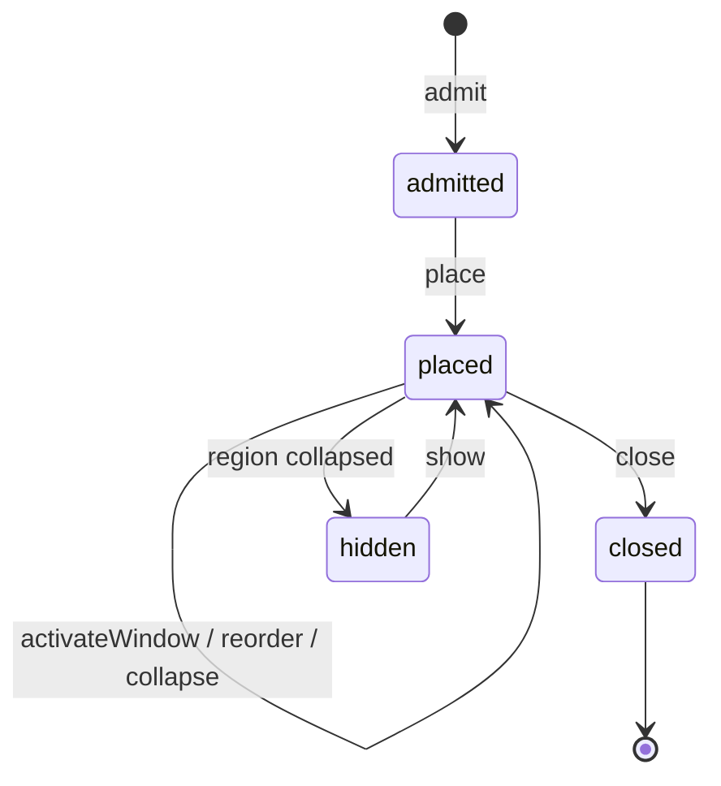

# Technical UI — windows, placement, groups, layout

> app 与实例见 [tech-app](./2026-11-05-tech-app.md)；dock 见 [tech-dock](./2026-11-05-tech-dock.md)；board 见 [tech-widget](./2026-11-05-tech-widget.md)。

## 1. 范围与不变量

### 1.1 范围

窗口是什么、放在哪、怎么分组、怎么渲染、怎么恢复。

### 1.2 不变量

| id | 不变量 | 验证 |
| --- | --- | --- |
| **I1** | WM 是唯一写者；渲染只读快照。 | 代码审查：无渲染路径写 WM |
| **I2** | 窗口是实例的投影：`PracWindow.instanceId` 必有（定义见 [tech-app](./2026-11-05-tech-app.md) §1.2 I4）。 | `verify-containers` 的 board 断言 |
| **I3** | 窗口同时只属于一个 group / 一个 region。 | unit：`admit` / `place` |
| **I4** | 一个 item 的 placement 只存在于一个 `LayoutState` 的 items 里。 | unit：`place` |
| **I5** | store 只是 recovery 快照，不是权威。 | 代码审查：无读 store 做决策的路径 |
| **I6** | stage 永不隐藏；其余 region 可折叠 / 隐藏。 | `verify-containers` |
| **I7** | frame 是从属渲染器，没有公开面（无 `LayoutFace`）。 | 类型：frame 无公开 face |

## 2. 数据模型

### 2.1 窗口

```ts
interface PracWindow {
  readonly id: string;
  readonly appId: string;
  readonly instanceId: string;   // 所属实例
  readonly appVersion?: string;  // admit 时 pin
  readonly title: string;
  readonly icon?: string;
}
```

窗口不是 DOM window，也不是 content surface。用户看到的是：`PracWindow` + `WindowPlacement` + content。

### 2.2 placement / group / 树

```ts
interface WindowPlacement {
  kind: "window";
  region: string; order: number; hidden: boolean;
  collapsed?: boolean; front?: boolean;
  contentId?: string; contentRegion?: string; boardId?: string;
  size?: number; cachedSize?: number; max?: number;
}

interface WindowGroupState { id: string; active?: string; order: readonly string[] }

interface LayoutState { viewportWidth; viewportHeight; tree: LayoutNode; items: Record<string, ItemRecord>; catalogueVersion; activePanelId }
```

- placement 的位置字段由 WM 写；group 的 `order` / `active` 由 `admit` / `place` / `reorder` / `activateWindow` 写；
- region 的 `selector` 决定它如何呈现多个 child：`"title"` / `"rail"` / `"none"`；
- `selectChild(region, child)` 只改 `region.active`——它是**布局细节**，不是“激活窗口”。

### 2.3 区域与角色

| 位置 | 角色 | 内容 |
| --- | --- | --- |
| left | primary sidebar | Explorer / Search / SCM / Debug / Extensions（board） |
| right | secondary sidebar | chat（board） |
| bottom | panel | Problems / Output / Terminal |
| center | stage | editors / document |
| top | — | 预留 |

### 2.4 Space

Space 是 stage 的容器；切换只换 stage。sidebar / panel / dock 不随 Space。

## 3. 接口

```ts
interface PracWindows {
  admit(appId: string, options: { windowId; instanceId; title?; appVersion?; groupId?; handle? }): string;
  activateWindow(windowId: string): void;   // 激活 + 若 region 收起则 show
  close(windowId: string): boolean;
  place(windowId: string, region: string): void;
  reorder(windowId: string, order: readonly string[]): void;
  getSnapshot(): WindowManagerSnapshot;      // { windows, groups, placements, layout }
  instanceOf(windowId: string): string | undefined;
  subscribe(listener: () => void): () => void;
}

interface PracSpaces { list(); add(); remove(); rename(); switchTo(id); onDidChange }
```

- **没有 `selectPanel`**：选 panel 是“激活该 panel 的窗口”，选窗口是“激活窗口”；两者都不该按 role 找窗口。
- **没有 `LayoutFace`**：frame 无公开面；布局查询经 `getSnapshot().layout`。
- `activateRole(role)` 是否存在尚未裁决：`selectPanel` 删除后，dock 走 `launch`，按 role 激活的调用方暂不明确。见 §8。

## 4. 运行时权威与渲染

| 事实 | 归谁 |
| --- | --- |
| 窗口身份 / 生命周期 | WM |
| placement / group / region | WM |
| 焦点 / active | WM |
| 持久化 | store（只写快照） |
| 渲染 | frame（读快照） |

**内容渲染是统一的**：app 的 `content(windowId)` 交给 frame 的 `prac.window` slot；实现不同（document → `PdfView`；board → board root；editor → VS Code pane；DSH → DSH host），机制只有一个。

**`PracWindowInput` 只用于 prac 渲染的窗口**（board / document）。host 渲染的窗口（VS Code 来源）不是 `PracWindowInput`——判据是“谁渲染内容”，不是一个 origin 枚举；VS Code 侧的记录表是 adaptor 私有的。

## 5. 持久化与恢复

- 策略见 [tech-quality](./2026-11-05-tech-quality.md)；
- 本域 key：`prac-window/v1/<scope>`（窗口记录 + layout）；
- 恢复顺序：读快照 → WM 重建 → 渲染；快照失效则空布局；
- heal：未知窗口丢弃、未知 region 回默认、active 无效清空、group 成员缺失则移除。

## 6. 状态机



- `admit` 只建记录；`place` 才定位置；`close` 移除记录并通知实例表；
- region 的 collapsed 只影响渲染与几何，不影响窗口归属。

## 7. 错误与测试

| 错误 | 触发 | 处理 |
| --- | --- | --- |
| `UNKNOWN_APP` | `admit` 的 appId 未注册 | throw |
| `UNKNOWN_WINDOW` | `place` / `close` 的 id 不存在 | no-op |
| `UNKNOWN_REGION` | `place` 的 region 不存在 | throw |

测试：admit/place/close 生命周期、group 的 active 回退、region 收起与 show、快照恢复与 heal、多 Space 只换 stage。

## 8. Open

1. ~~`PracWindow.tags`~~ 已删除：VS Code 侧有自己的私有记录表，`tags` 没有消费者；
2. **`activateRole` 是否保留**：目前没有调用方；若将来“切到某个 role”成为命令，再引入；
3. 一个窗口能否被两个 group 引用（当前不能）；
4. `top` 区域的用途；
5. 多窗口同一 board 的写冲突（见 [tech-widget](./2026-11-05-tech-widget.md) §7）。

## Related

- [tech-app](./2026-11-05-tech-app.md)：app / 实例 / 启动。
- [tech-widget](./2026-11-05-tech-widget.md)：board 编排。
- [tech-dock](./2026-11-05-tech-dock.md)：pins / intent。
- [tech-quality](./2026-11-05-tech-quality.md)：持久化策略。
