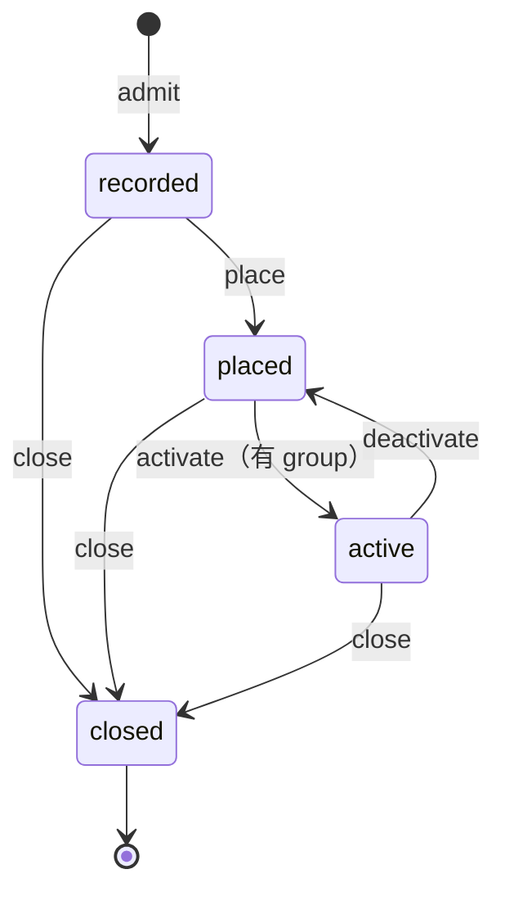
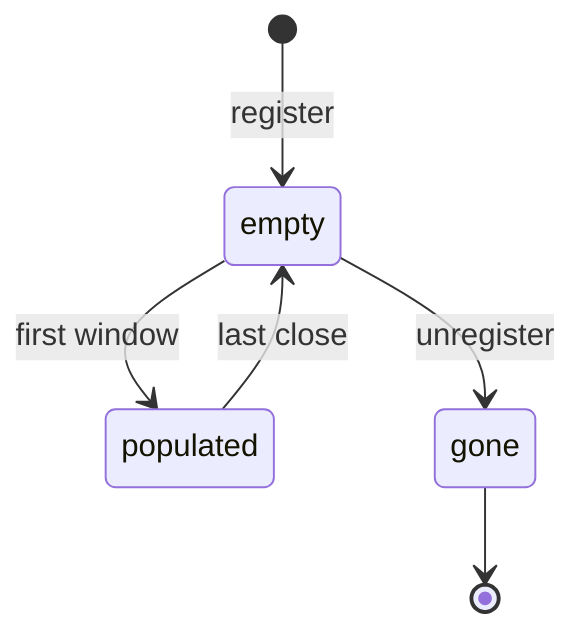
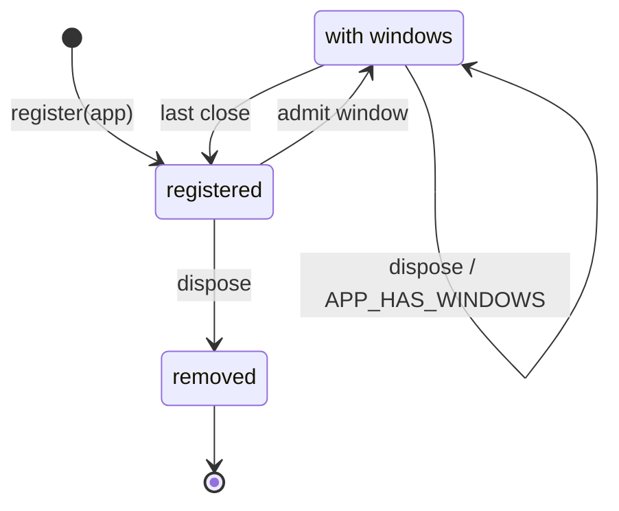

# Technical UI — data model, WM, frame, isolation, chrome, persistence

> 技术设计 L2；根见 [tech-architecture](./2026-11-05-tech-architecture.md)；行为见 [product experience](./2026-11-05-product-experience.md)。
> 本文给字段级数据模型、WM / frame 的 API、状态机、错误、并发与持久化；不含交互文案。
> 验收由 James 签字。

## 1. 覆盖与边界

**本 note 覆盖**：

- 对象 / 数据：app、window、group、board、widget、layout item、region、Space；
- WM：admit / close / activate / group / membership；
- frame：layout root、分配、sash、collapse、board hole；
- isolation：window / widget root、CSS / theme、overlay、focus；
- chrome 数据：tab strip / board header / stack row / actions；
- 持久化 schema / heal；
- 并发 / 错误 / 测试。

**不在本 note**：交互文案 → [product experience](./2026-11-05-product-experience.md)；IDE 能力 → [tech-ide](./2026-11-05-tech-ide.md)；agent 协议 → [tech-agent](./2026-11-05-tech-agent.md)；extension 契约 → [tech-extension](./2026-11-05-tech-extension.md)。

> **约定**：“不在本 note”表示由其他 note / 系统拥有，不等于 prac 不做；真正的 non-goal 见 [product design](./2026-11-05-product-design.md) §7。

## 2. 数据模型（canonical）

### 2.1 两套 window 记录要分开

当前代码里有两个同名 `WindowRecord`：

- `ui-frame/window.ts`：**运行时实例**（id / appId / kind / title / icon / instanceKey）；
- `ui-kit-workbench/contract.ts`：**布局 item**（placement / contentId / contentRegion / boardId / kind）。

**设计上必须分开命名**：

- `PracWindow`：prac 的 window 实体记录（身份 + 生命周期），WM 持有；
- `WindowPlacement`：layout 的 placement 记录。

`PracWindow` 用前缀避开 DOM 的 `Window`；`WindowPlacement` 用后缀说明它只描述“放在哪里”，不拥有 window。

`PracWindow` 不是 DOM window，也不是 content surface；它是 prac-owned 的实体记录。用户看到的完整 window = `PracWindow`（身份 / 生命周期）+ `WindowPlacement`（位置）+ content surface（React root / editor / terminal）。

`WindowPlacement` 不放在 `PracWindow` 里；它放在 **space root** 的 `LayoutState.items[windowId]` 里。`WindowGroupState` 只存成员 / order / active，不存 placement；frame root 只放 shell，board root 只放 `WidgetPlacement`。

两者用 `windowId` 关联；不合并成一个“大 record”，避免布局层依赖 app / title。

### 2.2 类型

```ts
interface ApplicationDefinition extends PracAppDef {
  content(windowId: string): () => ReactNode;
}

interface PracWindow {
  id: string;                 // global unique (current); generated by source
  appId: string;
  appVersion: string;         // pinned at admit
  title: string;
  icon?: string;
  instanceKey?: string;       // multi reuse key; absent = id only
}

interface WindowGroupState {
  id: string;
  active?: string;
  order: readonly string[];
}

interface WindowPlacement {
  kind: "window";
  region: string;
  order: number;
  hidden: boolean;
  collapsed?: boolean;
  front?: boolean;
  contentId?: string;
  contentRegion?: string;
  boardId?: string;
  size?: number;
  cachedSize?: number;
  max?: number;
}

type LayoutItem = WindowPlacement | WidgetPlacement;

interface LayoutState {
  viewportWidth: number;
  viewportHeight: number;
  tree: LayoutNode;                    // region / split / grid
  items: Record<string, LayoutItem>;
  catalogVersion: number;
  activePanelId: string | null;
}

interface RegionNode {
  type: "region";
  id: string;
  size: number;
  flex: boolean;
  collapsed: boolean;
  cachedSize: number;
  min: number;
  max?: number;
  priority?: "low" | "normal" | "high";
  snap?: boolean;
  stack?: boolean;
  selector?: "rail" | "title" | "none";
}
```

`ApplicationDefinition` 是 runtime 版本；声明对应 `PracAppDef`（[tech-extension](./2026-11-05-tech-extension.md)）。`content` 是 runtime，不进入声明。

- `LayoutNode = RegionNode | SplitNode | GridNode`；`SplitNode` 有 axis / children / sizing；`GridNode` 有 rows / columns / cells / weights。
- `WidgetPlacement` 在 tech-widget；这里只保证 `kind` 区分。

### 2.3 Invariants

- `PracWindow.id` 由 source 生成；当前取全局唯一（namespace 策略见 §11.3）；不同 app 用同一个 id ⇒ reject。
- `PracWindow.appId` 必须已注册。
- window group 的成员只能是 `PracWindow`；`WidgetPlacement` 不能进 group；`WindowPlacement` 只描述窗口在 space root 的位置，可以暂不在 group（`placed` 未归组）。
- `WindowGroupState.order` 是 open windows 的排列；`active` 必须在 order 中。
- 一个 window 同时只属于一个 group / region。
- `LayoutState.items` 的 key 是 item id；window 的 item id 就是 `windowId`，widget 的 item id 是 `widgetId`；`region` 必须存在。
- 一个 layout root 同时只有一个 writer（frame / board）。
- `active` 不可指向已关闭 / 未放置的 window。

## 3. Services

四个 service 的分工：

- `ctx.pracWindows`：WM —— `PracWindow` 身份 / 生命周期、group membership / active、close 释放。
- `ctx.pracApplications`：app registry —— `ApplicationDefinition` 的注册 / 移除。
- `ctx.pracSpaces`：Space registry —— stage store 的切换 / 创建 / 删除。
- `ctx.pracFrame` / `ctx.pracLayout`：frame / layout —— `LayoutState`、`WindowPlacement`、track、panel。

共同边界：WM 不写 placement，layout 不创建 window，Space 不碰 sidebar / panel / dock；每个 service 只拥有自己那部分状态。

### 3.1 `ctx.pracWindows`

`ctx.pracWindows` 是 window manager 的唯一写入口。它拥有 `PracWindow` 的身份 / 生命周期、window group 的 membership / active、close 时的释放；不拥有 `WindowPlacement` 的几何 / region / order（`ctx.pracFrame.place`）、app 内容（`ApplicationDefinition.content`）、board root 的 widget（board store，见 [tech-widget](./2026-11-05-tech-widget.md)）。调用方是 app layer / extension runner / client adaptor；UI 组件通过 hook 读，不直接写。

```ts
interface PracWindows {
  admit(appId: string, opts: {
    windowId: string; title?: string; groupId?: string; region?: string;
    handle?: WindowRuntimeHandle;
  }): string;
  close(windowId: string): boolean;
  activate(windowId: string): boolean;
  register(group: WindowGroupRuntime, regionId: string): RegionBinding;
  registerContent(content: GroupRegionContent, regionId: string): RegionBinding;
  unregister(groupId: string): void;
  groupOf(windowId: string): WindowGroupRuntime | undefined;
  groupIn(regionId: string | undefined): string | undefined;
  syncMembership(): void;
  ids(): readonly string[];
  appOf(windowId: string): string | undefined;
  windowContentFor(windowId: string): (() => ReactNode) | undefined;
  subscribe(listener: () => void): () => void;
}
```

一个窗口的生命周期：

```text
admit → PracWindow（+ 可能的 group）
  → arrangement / frame.place → WindowPlacement
  → activate → group.active
  → close
```

关键语义：

- `admit`：`windowId` 幂等；已有 window → `activate`；`instances: "single"` → 复用；未知 app → `UNKNOWN_APP`；无 group → 先记录，等 arrangement；`region` 只是放置提示，placement 由 `frame.place` 写。
- `close`：释放 seat（WM 的窗口占位）/ handle / appOf / title；有 group → remove；无 group → 丢记录；关 active → group.active 回退 next → prev → first。
- `register` / `registerContent`：group 绑 region；board window 的 content group 不进 manager runtime；一个 region 只能有一个 group。
- `unregister`：移除 group 绑定；只应在 group 空 / app 移除时；不自动关窗。
- `syncMembership`：按 `WindowPlacement.region` 归组；移动 group 时保留 handle。
- 查询 / 通知：`ids` / `appOf` / `windowContentFor` / `subscribe` 只读；调用方不缓存第二份状态。
- 错误：`UNKNOWN_APP` / `DUPLICATE_WINDOW` / `DUPLICATE_GROUP` / `UNKNOWN_WINDOW` / `ORDER_MISMATCH`。

### 3.2 `ctx.pracApplications`

`ctx.pracApplications` 是 `ApplicationDefinition` 的注册表。`register(app)` 注册 app，duplicate id → `DUPLICATE_APP`，返回 disposer；disposer 只移除 app 定义，**不自动关窗**。app 还有窗口时移除 → `APP_HAS_WINDOWS`，调用方必须先 `close`。它不拥有 window / placement / group 的状态。

```ts
interface PracApplications {
  register(app: ApplicationDefinition): () => void;
}
```

### 3.3 `ctx.pracSpaces`

`ctx.pracSpaces` 是 Space registry，管 stage store 的 `list` / `active` / `switchTo` / `create` / `rename` / `remove`。切换只换 stage；sidebar / panel / dock 不随 Space。最后一个 Space 不可 remove；未知 id → 错误。它不创建 window，也不写 placement。

```ts
interface Space {
  id: string;
  title: string;
}

interface PracSpaces {
  list(): readonly Space[];
  active(): string | undefined;
  switchTo(id: string): void;
  create(opts?: { title?: string }): string;
  rename(id: string, title: string): void;
  remove(id: string): void;
}
```

### 3.4 `ctx.pracFrame` / `ctx.pracLayout`

`ctx.pracFrame` / `ctx.pracLayout` 是 frame / layout service。它拥有三个 `LayoutState` root：frame root（shell）、space root（stage，放 `WindowPlacement`）、board root（board 内容，放 `WidgetPlacement`）；提供 `getState` / `subscribe` / `listItems` / `listRegions` / `place` / `bindTrack` / `selectPanel`。`place` 只改 placement，不创建 window；`selectPanel` 只选 main key；每个 root 同时只有一个 writer。

`ctx.pracFrame` 是 frame root 的便捷 service；`ctx.pracLayout` 是同一组能力按 root 参数化：

```ts
interface PracFrame {
  getState(): LayoutState;
  subscribe(listener: () => void): () => void;
  listItems(): readonly LayoutItem[];
  listRegions(): readonly RegionNode[];
  place(itemId: string, placement: Partial<LayoutItem>): void;
  bindTrack(trackId: string, handler: (delta: number) => void): () => void;
  selectPanel(key: string): void;
}

type LayoutRoot = "frame" | "space" | "board";

interface PracLayout {
  getState(root: LayoutRoot): LayoutState;
  subscribe(root: LayoutRoot, listener: () => void): () => void;
  listItems(root: LayoutRoot): readonly LayoutItem[];
  listRegions(root: LayoutRoot): readonly RegionNode[];
  place(root: LayoutRoot, itemId: string, placement: Partial<LayoutItem>): void;
  bindTrack(root: LayoutRoot, trackId: string, handler: (delta: number) => void): () => void;
  selectPanel(root: LayoutRoot, key: string): void;
}
```

## 4. 状态机

### 4.1 Window



- `recorded`：`PracWindow` 已存在，但还没有 `WindowPlacement`；arrangement 还没放。`admit` 带 region 时，arrangement 紧接着 `place`，WM 不自己写 placement。
- `placed`：space root 有 `WindowPlacement`；可能在 group，也可能还没有。
- `active`：在 group 且是 active；没有 group 的窗口不能进入。
- `deactivate`：同一 group 的另一个窗口变成 active；不是 close，placement 不动。
- close 从 `recorded` / `placed` / `active` 都合法；`active` close 后 group.active 回退 next → prev → first。
- `closed` 是终态；重开 = 新 admit / session 恢复。
- 已有 windowId 再 admit：active → no-op；recorded / placed → 按已有状态处理，不创建第二个 `PracWindow`。

### 4.2 Group



- `empty` = 已注册但还没有窗口；`register` 后就是这个状态。
- 空 group 保留；不自动 dispose；`unregister` 只从 `empty` 合法。
- 一个 region 只能注册一个 group；重复 → `DUPLICATE_GROUP`。
- content group（board window）走 `registerContent`，不进入 manager runtime；它不走上面的 window count，由 bindings 管。

### 4.3 App



- `registered`：`ApplicationDefinition` 已注册，没有窗口。
- `with windows`：至少一个 `PracWindow` 属于它；last close 回到 `registered`。
- `dispose` 只能在 `registered`；`with windows` 时 `APP_HAS_WINDOWS`，调用方先 close。
- `removed` 是终态；失败 per-app 回滚，不影响其他 app。

## 5. Frame

### 5.1 Layout roots / tree

- `frame root`（shell）/ `space root`（stage，每个 Space 一个）/ `board root`（board 内容）；每个 root 一个 `LayoutState`。
- window placement 只在 **space root**；frame root 不放 window；board root 放 `WidgetPlacement`。
- `LayoutState`：viewportWidth / viewportHeight / tree / items / catalogVersion / activePanelId。
- `LayoutNode = RegionNode | SplitNode | GridNode`。
- `RegionNode`：id / size / flex / collapsed / cachedSize / min / max? / priority? / snap? / stack? / selector?。
- `SplitNode`：axis / children / sizing（`distribute` / `expand`）。
- `GridNode`：rows / columns / cells / spans / rowWeights / columnWeights。
- **单写者**：一个 root 同时只有一个 writer（frame / board）。

### 5.2 分配

- 同轴三块：拖一条边 ⇒ 三块按比例变，任一块 ≥ min 且 ≤ max，另一轴不动。
- 中心 priority：窗口变小时中心最后让位（`high` 先被 resize，`low` 保住尺寸）。
- 边界只由树决定；一次拖动把边界两侧都算进去：
  - `up`（边界之前）/ `down`（之后）各自按 priority 排序；
  - 拖动量先收敛到两侧真正能让的（长出的一侧受 max 限，缩进的一侧受 min 限），再按 Sizing 分；
  - `distribute`（默认）：整个侧边按持有比例吸收，到界把余量传给下一个；
  - `expand`：只推最近的邻居。
- 静止时：固定块取自己的 size（收敛 min / max）；余量给柔性块，按持有尺寸成比例，谁都没有则等分；不够时按 priority 收回；下界是承诺。
- 拖动从像素出发：tree 的 size 只是主张；以画面实际尺寸为起点，写完回树。

### 5.3 Grid

- 默认 2×2；一个 cell 时透明渲染，初始几何不变。
- `splitView` / `createRegionBeside` 按来源方向放新 cell，扩展行 / 列。
- cell move（swap placement）、resize（span，拒绝重叠）、merge / unmerge；merge 保留原始 placement，unmerge 恢复不等 span。
- `columnWeights` / `rowWeights` 负责自由 track resize；拖边界改相对权重；权重持久化。
- merge / unmerge 的 placement 数据持久化。

### 5.4 Sash / collapse / maximized

- sash：边界位置 / 命中 4px / resize 数学属于 layout；手柄 / 光标 / 样式属于 chrome；拖动从非 Disabled 边界开始。
- collapse：region 可 collapse 到 0，记住 cachedSize；`visible` 与 surface 生命周期解耦。
- maximized：cell 临时最大化；**不写进持久化**；当前是目标，代码未完全落地。

### 5.5 Stack

- stack 是 region 的一种排布模式；行为以 resolved stack 规范为准。
- frame 只负责：stack 行头 chrome、fold / drag / sash 落点、22px 行高、`entry.collapsed` 权威。
- stack 行头不是 VS Code pane header；VS Code 的 title / icon / twisty 隐藏，`.actions` 保留。

### 5.6 Board hole / cross-root

- frame / board 共用 LayoutEngine，但 root 独立：space root 的 item 是 window；frame root 只放 shell；board root 的 item 是 widget。
- board root 是 window 内容里的 **hole**：WM layout engine 可通过它 hit-test / drag / size / split；window 仍是 content / lifecycle / focus / theme 边界。
- 跨 root 只允许 **move**；split / combine 在目标 board root 内做；不在 frame 层把两个 window 的 widget 拼成跨 window region。

## 6. Isolation / chrome

### 6.1 Window / widget root

- **window**：外层 containment / stacking / theme / focus 边界；有自己的 root；inactive 可移除内容根。
- **widget**：默认保留自己的 root；VS Code + DSH 混排强制 per-widget root / source-scoped 子树；CSS / theme / reset / overlay 不穿透。
- **同源 window / board** 可共享 root：必须先完成 frame `:host` / `:host-context` 规则迁移，并验证 overlay / focus / theme。
- **webview / iframe / opaque host**：自己的 browsing context；secure-context 约束不由 adaptor 绕过。

### 6.2 CSS / theme

- document 样式表不会自动作用于 shadow tree；每个 root 实时镜像。
- 镜像不是死拷贝：主题表会被原地改写，要订阅源表变化。
- 主题变量以 `:host` 作用域投放；**不要把 `.monaco-workbench` 放在 host 本身**。
- VS Code widget 的内部宿主元素要带 `.monaco-workbench`，否则 view 规则匹配不上。
- root 的 `:host` 根样式负责尺寸、`display:flex`、`min-width/height:0`、`overflow`、`contain:paint`。
- 跨 root 的 frame chrome 规则迁到 widget wrapper 的 class / data 选择器，不依赖 `:host-context` 跨 window。

### 6.3 Overlay

- 应用级 overlay（菜单、命令面板、通知、hover、模态）→ frame float layer。
- widget 内部 overlay（补全、peek、webview overlay）→ widget 自己的 root。
- frame float layer 是全局坐标系；widget 内部 overlay 不假设能跨出 window。
- window 的 `contain:paint` 会裁剪越界内容；需要越界的 overlay 必须走 float layer。
- overlay 的 focus / dismiss / stacking 由创建方负责，frame 只提供 layer / order。

### 6.4 Focus / a11y

- window 是 focus 顶层边界；frame 拥有 active window。
- widget root 内部保留浏览器焦点链。
- 跨 shadow 的 `activeElement` 是两层链（host + `shadowRoot.activeElement`）。
- 不用 `focusin` 从旧宿主推断“人在这块区域工作”；active 变化走显式事件。
- a11y 树穿透 shadow root；首次 Tab 应进入 widget root。

### 6.5 Lifecycle

- inactive window / board：移除内容根；状态由 window / widget model / source 保存。
- 重新激活：重新挂载 root，恢复 layout / focus / scroll。
- webview / iframe 移动会换 browsing context，默认 reload；需要保留状态时用 source 的 view state。
- theme / locale 变化：root 的镜像表原地更新，不重建 root。

### 6.6 Chrome

- frame chrome：title bar、dock、panel、Space switcher、window group tab strip 外框。
- window group tab strip：tab 是 window；同一时刻只有一个可见；active window 的 actions 在 tab strip 右端，由 adaptor 解析成 resolved action model，frame 渲染 primary + overflow；group header 不画 editor actions；breadcrumbs 属于 editor window / pane。
- board 行头：prac 行头唯一（title / icon / twisty / fold / drag / sash / action slot）；VS Code pane header 的 `.title` / `.icon` / `.twisty` 隐藏，只保留 `.actions`；DSH 用同一行头；折叠权威是 `entry.collapsed`；22px；标题优先取 view 自己的 pane 标题，catalog title 回退；单 widget bare 时按 bare 规则保留。
- stack 行头：title / fold / drag / resize；22px；动作随 widget 注册。
- actions：`PracWidget.actions` 随注册进 item facts，由 frame chrome 渲染；`ctx.pracWindowActions` 是 window actions 的另一条通道；独立 action seats 已删除；不做统一 action bar；Reset Location 是 prac-owned 标准 widget 动作。
- dock：WM chrome；widget 拖到 dock 的 hover 激活 / 新建 board 属于 WM。

## 7. 持久化

- `prac-frame/v1/<scope>`：shell 的 sidebar / panel / dock / stage 占位。
- `prac-space/v1/<scope>/<space>`：space root。
- `prac-board/v1/<scope>/<board>`：widget 顺序 / 行高 / 折叠。
- `scope`：`?workspace=` 哈希；不同 project folder 不共享。
- 持久化字段：Space、grid placement、track weights、region collapse、surface kind、window group order / active、board widget placement / active。
- **maximized 不持久化**：它是临时 cell 状态，重启后回到原 placement。
- 恢复顺序：先注册 app，再恢复 window；找不到 app 的 persisted item heal 掉。
- frame / space / board 的 key 分开；先恢复 frame，再 space，再 board。
- 恢复不校验形状；旧数据 heal；失败不阻塞启动。
- **heal**：旧 `views` / `viewGroups` → new items；不校验形状；旧 global key 丢弃；缺字段填默认；非法 region 归默认；active 无效清空。
- **原子性**：一次 store update 写一个 key；失败保留旧值；不半写。
- **不持久化**：注意力栈、返回栈、区域内 z-order / 层序、maximized。

## 8. 并发 / 顺序

### 8.1 索引 / 热点路径

- 写模型是 normalized：`PracWindow` / `WindowPlacement` / group 各自权威；读路径可能要做 3–4 次 id lookup。
- 这些 lookup 是 Map / object 的 O(1)；N 个窗口的读成本是 O(N)，不是 O(N²)。
- **不要在每个 window 的 render 里反复 `groupOf` / `appOf` / `windowContentFor`**；一次 resolve 成 `WindowView[]`，再交给 frame / chrome。
- 可选 derived index：`Map<windowId, { window, placement?, groupId?, handle? }>`；WM 在 admit / place / close / group 变更时维护。它是索引，不是第二权威，也不持久化。
- `syncMembership` 做增量；避免每次 `place` 全量扫描。
- 先测窗口数量级；预算在 [tech-quality](./2026-11-05-tech-quality.md)。

- **app 注册先于 window 恢复**；`syncMembership` 在 layout change 后做。
- **dynamic extension**：catalog 变化不重建 frame；只更新 item / group。
- **active 回退**：close 与 activate 串行；不并发改同一 group。
- **cancellation**：`beginNavigation` 取消前一次 pending；LSP query 取消由 provider 处理。
- **multi-workspace**：每个 workspace 一个 store / host；不共享 key。

## 9. Errors

| 错误 | 触发 | 处理 |
|---|---|---|
| `UNKNOWN_APP` | admit 未注册 app | reject；调用方回滚 |
| `DUPLICATE_APP` | register 重复 | reject |
| `APP_HAS_WINDOWS` | app dispose 仍有窗口 | 先 close |
| `DUPLICATE_GROUP` | region 已有 group | reject |
| `DUPLICATE_WINDOW` | windowId 已属其他 app | reject |
| `ORDER_MISMATCH` | reorder 长度 / 未知 / 重复 | reject |
| `UNKNOWN_WINDOW` | activate / close 未知 | close false / activate false |

## 10. Testing

- **unit**：admit / close / single reuse / order / active fallback / duplicate / membership / heal。
- **L2**：admit → seat → catalog；close → seat dispose + catalog remove；split → two windows / two entries。
- **live**：containers / board / stack / split / grid* / resize / persistence / space / bottom / views。
- **planned**：window:lifecycle / window:tab / window:active / isolation:mixed。

## 11. Open

1. **命名迁移**：`WindowRecord` 两套同名 → `PracWindow` / `WindowPlacement`；迁移成本。
2. **multi instanceKey**：字段 / 复用规则 / 与 windowId 的关系。
3. **windowId 命名空间**：全局唯一还是 `appId/windowId`。
4. **app 移除**：先 close 再 unregister 的 API 形状。
5. **空 group**：保留 / 自动回收。
6. **surface kind**：window group ↔ board 是否允许运行时替换。
7. **root merge**：同源 window / board 共享 root 的条件。
8. **persistence schema**：字段级版本 / 迁移算法。
9. **并发**：multi-workspace / dynamic / restore 的竞态。

## Related

- [tech architecture](./2026-11-05-tech-architecture.md)：进程 / 模块 / 协议根。
- [tech-widget](./2026-11-05-tech-widget.md)：board / widget 技术设计。
- [tech-extension](./2026-11-05-tech-extension.md)：PracAppDef / catalog / runtime。
- [product experience](./2026-11-05-product-experience.md)：UI 行为。
