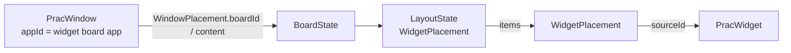
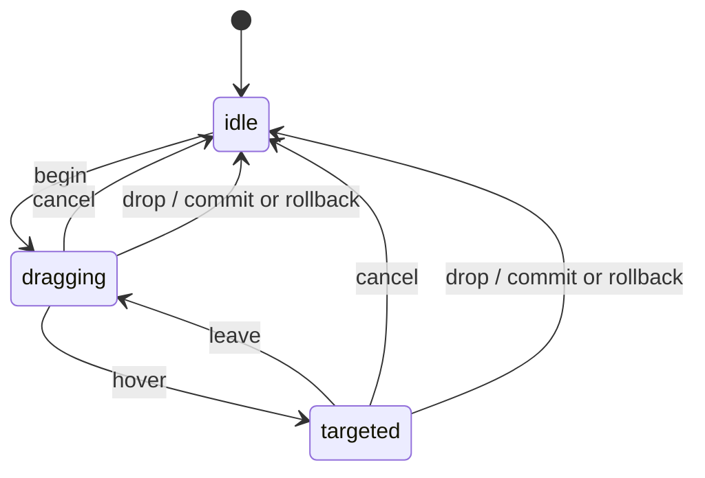
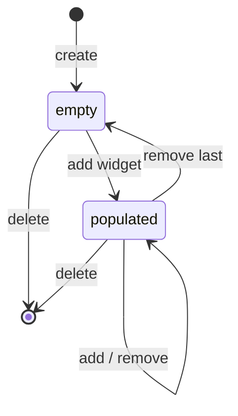

# Technical widget / board — data, layout root, drag, dock, reset

> 技术设计 L2；根见 [tech-architecture](./2026-11-05-tech-architecture.md)；UI 数据见 [tech-ui](./2026-11-05-tech-ui.md)；行为见 [product experience](./2026-11-05-product-experience.md)。
> 本文给 board / widget 的字段级数据、API、拖拽 / dock / reset 状态机、并发、错误、测试。
> 验收由 James 签字。

## 1. 覆盖与边界

**本 note 覆盖**：

- board / widget 的数据模型与不变量；
- board root（LayoutState<WidgetPlacement>）；
- widget registry / board store / drag service；
- 跨 board / window 的 move；
- dock 拖拽；
- reset location / Reset All；
- 持久化 / 并发 / 错误 / 测试。

**不在本 note**：board 视觉样式 → [product experience](./2026-11-05-product-experience.md)；widget 来源内容 → [tech-ide](./2026-11-05-tech-ide.md) / [tech-agent](./2026-11-05-tech-agent.md)；window 的 WM → [tech-ui](./2026-11-05-tech-ui.md)。

> **约定**：“不在本 note”表示由其他 note / 系统拥有，不等于 prac 不做；真正的 non-goal 见 [product design](./2026-11-05-product-design.md) §7。

## 2. 数据模型

```ts
interface PracWidget extends PracWidgetDef {
  source: string;             // "vscode:view" / "dsh:slot" / "prac:changed-files"
  actions?: () => ReactNode;
  content(): () => ReactNode;
}

interface WidgetPlacement {
  kind: "widget";
  region: string;             // board root region id
  order: number;
  hidden: boolean;
  collapsed?: boolean;
  size?: number;
  sourceId: string;
}

interface BoardState {
  id: string;
  root: LayoutState<WidgetPlacement>;
  active?: string;            // active widget id
  defaultRegion?: string;     // optional; placement policy
}
```

`PracWidget` 是 runtime；声明对应 `PracWidgetDef`（[tech-extension](./2026-11-05-tech-extension.md)）。extension registry 把 `PracWidgetDef` + `hostFor` 变成 `PracWidget`。

命名与 tech-ui 对齐：`PracWidget` 是运行时记录，`WidgetPlacement` 是 board layout 的 placement 记录；不再用 `WidgetItem`。



- **board 不是 window**：board 是内容；board window 是 content 为 board 的 window（`tech-ui` 的 `PracWindow` + `contentId` / `boardId`）。
- **widget 不是 window**：widget 只存在于 board root；不直接进 window group。
- **board root**：`LayoutState<WidgetPlacement>`；与 frame / space root 共用 LayoutEngine，但 root 独立、单写者。
- **board window 不是 `PracWindow` 的子类**：它是 `PracWindow`（`appId` = widget board app）加上 `WindowPlacement.boardId` / `contentId`；board 只是 content，WM 不需要知道 board 类型。需要 lookup 时用 `{ windowId, boardId }` 的引用，不新增 window 子类。

### 2.1 Invariants

- 一个 widget 同时只在一个 board root。
- `WidgetPlacement.region` 必须存在于 BoardState.root.tree。
- `BoardState.active` 必须是该 board 的 widget；否则忽略 / heal。
- board root 同时只有一个 writer（drag / reset / layout）。
- board window 的 `boardId` 必须存在；board 可被多个 window 显示时，只有显式声明才允许（open）。
- 跨 root 只允许 move；split 只在目标 board root 内。

## 3. Services

### 3.1 widget registry

`ctx.pracWidgets` 是 widget registry + widget 操作入口。它持有 `PracWidget` 的注册 / 身份，负责 `open` / `move` / `reset`；不拥有 board layout（`BoardStore`），也不拥有 window（WM）。`register` 来自 extension 的 `PracWidget`；duplicate id → `DUPLICATE_WIDGET`。所有写 board 的操作最终落到目标 `BoardStore` 的单写者。

```ts
interface PracWidgets {
  register(widget: PracWidget): () => void;
  list(): readonly PracWidget[];
  get(id: string): PracWidget | undefined;
  open(widgetId: string, boardId?: string): void;
  move(widgetId: string, targetBoardId: string, placement: {
    region: string; order?: number; split?: "left" | "right" | "up" | "down";
  }): void;
  reset(widgetId: string): void;
  resetAll(): void;
}
```

- `register`：来自 extension 的 `PracWidget`；duplicate id → `DUPLICATE_WIDGET`。
- `open`：无 board → 当前 board / default board；有 board → 放进去并 active。
- `move`：跨 board / 同 board；不改 source；目标 root 单写。
- `reset` / `resetAll`：见 §6。

### 3.2 board store

`BoardStore` 持有 `BoardState` 与 board root（`LayoutState<WidgetPlacement>`）。它只写自己的 board root；一次 `update` 原子替换；board 删除先 detach widget，再删 state；不销毁来源，也不动 window。

```ts
interface BoardStore {
  get(id: string): BoardState | undefined;
  create(id: string, root?: LayoutState<WidgetPlacement>): BoardState;
  remove(id: string): void;
  update(id: string, updater: (state: BoardState) => BoardState): void;
  subscribe(id: string, listener: () => void): () => void;
}
```

- 一次 update 原子替换；失败保留旧 state。
- board 关闭 / 删除时，先 detach widgets（不销毁来源），再删 state。

### 3.3 drag service

`DragService` 是 transient session：不持有 board 状态，只在 `drop` 时提交；同一时刻只允许一个 session；`hover` 只改高亮 / 展开，不写 board。

```ts
interface DragService {
  begin(widgetId: string, sourceBoardId: string, pointer: Point): DragSession;
  hover(session: DragSession, target: DropTarget): void;
  drop(session: DragSession, target: DropTarget): void;
  cancel(session: DragSession): void;
}
```

- 同一时刻只允许一个 drag session；`begin` 时已有 → `DRAG_BUSY`。
- `hover` 只改高亮 / 展开；不写 board。
- `drop` 才提交；提交失败回滚。
- `cancel` 删除本次新建的空 board（如果有）。

## 4. 状态机

### 4.1 drag



- `dragging`：源 widget 仍可见 / 灰显；源 board 不改。
- `targeted`：目标 board / dock 高亮；hover 300–500ms 可激活已有 board。
- `drop`：
  - 目标 board → move；
  - dock 图标 → 默认区域；
  - dock 空白 → 新建 board window + move；
  - 非 drop 区 → cancel。
- **提交时机**：drop 时提交；取消 / 失败删除新建空 board。

### 4.2 dock

- hover 已有 board 图标 300–500ms → 激活该 board window。
- drop 图标 → 默认区域；drop 内容区 → 具体落点。
- drop dock 空白 → 新建 board window + move；新 board 在 drop 时提交。
- 取消 / 失败 → 删除空 board，避免孤儿。

### 4.3 board lifecycle



- 空 board：保留 / 隐藏 / 删除是 open；MVP 保留，避免丢布局；上图的 `delete` 是显式删除，不是 empty 自动删除。
- board window 关闭不改变 board 状态；board 仍可由其他 window / 默认 board 打开。
- board 删除：detach widgets；不销毁来源。

## 5. Move / split

- **跨 root**：只 move；source 不变；目标 board root 写。
- **同 board**：move / split left/right/up/down；split 在目标 root 内创建 region。
- **不跨 window 合并**：两个 window 的 widget 不拼成一个跨 window region。
- **顺序**：move 先移除源 item，再插入目标；失败回滚。
- **active**：目标 board 的 active 设为被移动 widget；源 board active 回退。
- **多 window 显示同一 board**：open；写入必须单写者 / 冲突策略（open）。

## 6. Reset location

- **widget 级**：`reset(widgetId)` 回 default board + default order；不改 size。
- **单 widget board**：代理该 widget 的 reset；显示条件 = 当前 board != 默认 board。
- **默认 board**：role / type 还是具体 instance 是 open；MVP 用 role/type + 实例选择。
- **Move To**：非默认 board 时，reset 回默认 board 并 append。
- **Reset All**：所有 widget 回默认；board 本身不变；不改 size。
- **不重置**：size、window 几何、board 几何。

## 7. 持久化

- key：`prac-board/v1/<scope>/<board>`；scope = `?workspace=` 哈希。
- 内容：widget 顺序 / region / collapsed / size / active；board root tree / weights。
- board window 的 window 记录由 frame key 持久化；board 内容由 board key 持久化。
- heal：未知 widget → 丢；未知 region → 放默认；active 无效 → 清。
- 原子性：一次 board update 一个 key；失败保留旧值。

## 8. 并发 / 顺序

- drag 单 session；drop 提交前不写 board。
- reset 与 drag 冲突：reset 先取消 drag，或 drag 期间禁用 reset（MVP：取消 drag）。
- board 关闭 / 删除与 drag：取消 drag；不写已删 board。
- 多个 window 显示同一 board：写入串行；冲突策略 open。
- 跨 Space：拖动只在本 Space 的 board / dock；跨 Space 是 open。

## 9. Errors

| 错误 | 触发 | 处理 |
|---|---|---|
| `UNKNOWN_WIDGET` | move / reset 未注册 | reject |
| `UNKNOWN_BOARD` | 目标 board 不存在 | reject |
| `INCOMPATIBLE_BOARD` | 目标不接受该 widget | reject |
| `DUPLICATE_WIDGET` | register 重复 | reject |
| `DRAG_BUSY` | 已有 drag | reject |
| `DROP_OUTSIDE` | drop 非目标 | cancel |
| `BOARD_BUSY` | 多 writer | 拒绝 / 排队（open） |

## 10. Testing

- **unit**：move 跨 board、split、active 回退、reset / Reset All、未知 / 冲突、持久化 heal。
- **L2**：drag begin → drop → board state；cancel → 源不变；new board → 提交 / 回滚。
- **live**：board / containers；planned：widget:move / widget:window / isolation:mixed。
- **matrix**：跨 board、同 board、dock 图标 / 空白 / 非目标、单 widget board reset、多 window。

## 11. Open

1. **default board 身份**：role / type vs instance；多实例选择。
2. **multi-instance widget**：同一来源多个实例的 id / key。
3. **copy 语义**：copy 只在显式能力下；默认 move。
4. **跨 Space**：是否允许；目标 Space 的 board / dock。
5. **dock overflow**：很多 board 时的滚动 / 分组。
6. **empty board**：保留 / 隐藏 / 删除。
7. **board 多 window**：同一 board 多 window 的写冲突。
8. **reset index**：default order 的 index 语义。
9. **size reset**：不改 size 是否最终确定。

## Related

- [tech architecture](./2026-11-05-tech-architecture.md)：进程 / 模块 / 协议根。
- [tech-ui](./2026-11-05-tech-ui.md)：window / group / layout / persistence。
- [tech-extension](./2026-11-05-tech-extension.md)：PracWidgetDef / catalog / runtime。
- [product experience](./2026-11-05-product-experience.md)：拖拽 / dock / reset 行为。
