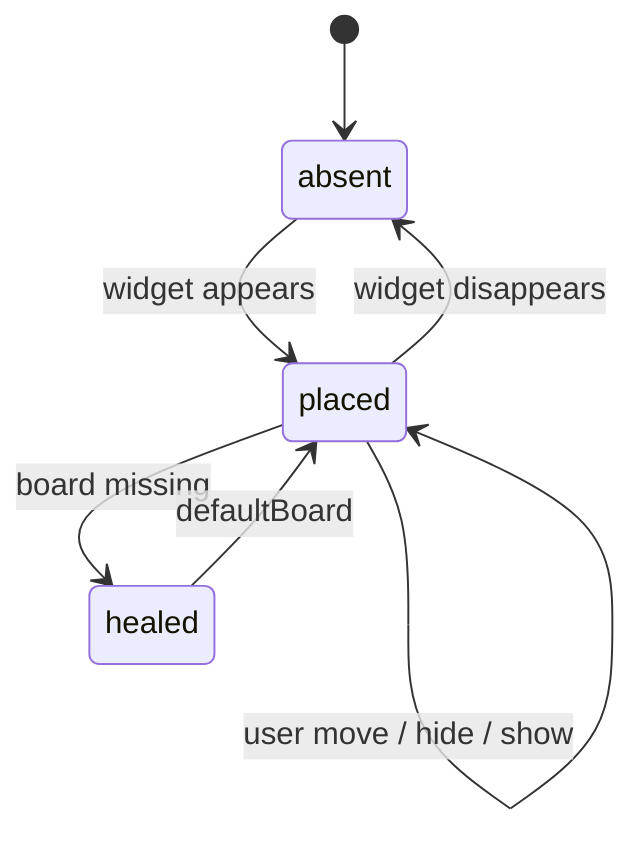
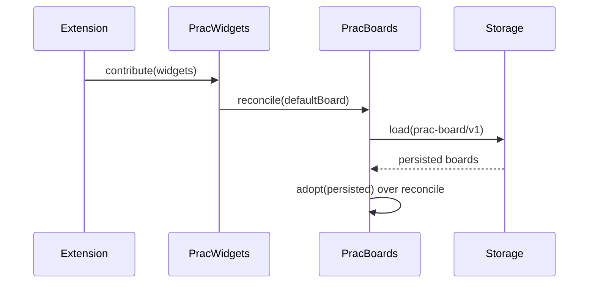

# Technical widget / board — composition, reconcile, recovery

> app 见 [tech-app](./2026-11-05-tech-app.md)；窗口与布局见 [tech-ui](./2026-11-05-tech-ui.md)；dock 见 [tech-dock](./2026-11-05-tech-dock.md)。

## 1. 范围与不变量

### 1.1 范围

widget 是什么、board 是什么、board 怎么从 widget 推导、怎么恢复。

### 1.2 不变量

| id | 不变量 | 验证 |
| --- | --- | --- |
| **I1** | widget 是单例：一个 widget 只在一个 board（`boardId` 唯一）。 | unit：`boardId` 唯一 |
| **I2** | board 属于 prac core：extension 只贡献 widget，不贡献 board。 | 类型：`PracExtension` 无 board 贡献 |
| **I3** | `PracBoard.widgets` 与 `root.items` 的 id 集合相等（隐藏的也算成员）。 | unit：reconcile 后校验 |
| **I4** | `hidden` 是视图状态，不是成员关系。 | unit：hide 后仍在 `widgets` |
| **I5** | `defaultBoard` 只是首次落点，不是当前归属。 | unit：移动后 `defaultBoard` 不变 |
| **I6** | board root 只有一个 writer；跨 board 只允许 move，split 只在目标 root 内。 | unit：`move` / `split` |
| **I7** | 空 board 保留，显式删除才移除。 | unit：移走最后一个 widget |

## 2. 数据模型

### 2.1 widget

```ts
interface PracWidget {
  readonly def: PracWidgetDef;   // id / title / icon / defaultBoard / defaultRegion
  readonly source: string;       // "vscode:view" / "dsh:slot" / "prac:…"
  readonly boardId: string;      // 唯一当前归属
  content(): () => ReactNode;
  actions?(): ReactNode;
}
```

### 2.2 board

```ts
interface PracBoardDef {
  readonly id: string;
  readonly title: string;
  readonly appId: string;        // "prac.board"
  readonly defaultRegion?: string;
}

interface PracBoard {
  readonly def: PracBoardDef;
  readonly widgets: readonly string[];  // 成员，按 tab 顺序（权威）
  readonly root: LayoutState;           // 位置 + 几何 + 可见性
  readonly active?: string;
}
```

### 2.3 没有 `WidgetPlacement`

board root 是 `LayoutState`，它的 `items` 就是 `ItemRecord`（`region` / `order` / `size` / `collapsed` / `hidden`）。widget 没有 `LayoutState` 之外的字段（对照 `WindowPlacement` 的 `contentId` / `boardId` / `max` 是窗口独有的）。

所以 board root 的 item id = widget id；成员由 `PracBoard.widgets` 显式给出；**不产生第三个真相源**。

## 3. 接口

```ts
interface PracWidgets {
  register(widget: PracWidget): () => void;
  list(): readonly PracWidget[];
  get(id: string): PracWidget | undefined;
  onDidChange(listener: () => void): () => void;
  open(widgetId: string, boardId?: string): void;
  move(widgetId: string, targetBoardId: string, placement: { region; order?; split? }): void;
  show(widgetId: string): void;
  hide(widgetId: string): void;
  reset(widgetId: string): void;
  resetAll(): void;
}

interface PracBoards {
  list(): readonly PracBoard[];
  get(id: string): PracBoard | undefined;
  update(id: string, updater: (board: PracBoard) => PracBoard): void;
  subscribe(listener: () => void): () => void;
  reconcile(widgets: readonly PracWidget[]): void;  // 幂等
}
```

- registry 只认身份与操作；board 的布局写入只经 `PracBoards.update`；
- `PracBoards` 不做 window——board window 由 `prac.board` app 的 `start` 打开；
- **pin 不归 board**：谁被固定在 dock 上是 [tech-dock](./2026-11-05-tech-dock.md) 的数据（I1），board 不持 `pinned`。

## 4. 生命周期


### 4.1 contribute

extension 贡献 `PracWidgetDef`；registry 得到 `PracWidget`（`boardId` 待 reconcile 确定）。

### 4.2 reconcile



| 情况 | 结果 |
| --- | --- |
| widget 首次出现 | `defaultBoard` 的 board 存在则加入，否则创建 |
| 已有 `boardId` | 不动（尊重用户移动） |
| `boardId` 指向不存在的 board | 回 `defaultBoard`（heal） |
| widget 消失 | 从 `widgets` 与 root 移除 |
| board 变空 | 保留 |

关键：`defaultBoard` 只在“首次出现”和“heal”时生效。

### 4.3 place / show / hide

`place` / `move` / `split` 写 `ItemRecord.region` / `order` / `size`；`show` / `hide` 写 `ItemRecord.hidden`；三者都不改 `widgets`。

### 4.4 open

board 的窗口由 `prac.board` app 的 `start` 打开（见 [tech-app](./2026-11-05-tech-app.md) §4），窗口带 `boardId` 的 `instanceId`。

### 4.5 move / split

- 跨 board：只 move，改 `boardId`，源 board 移除 item；
- 同 board：move / split（left / right / up / down）；
- 顺序：先移除源再插入目标，失败回滚；
- active：目标 board 的 active 设为被移动 widget，源 board 回退。

### 4.6 reset

- `reset(widgetId)`：回 `defaultBoard` + 默认顺序，不改 size；
- `resetAll()`：所有 widget 回默认，board 不变；
- 不重置：size、window 几何、board 几何。

## 5. 持久化与恢复

- 策略见 [tech-quality](./2026-11-05-tech-quality.md)；
- 本域 key：`prac-board/v1/<scope>/<board>`；内容：`widgets` 顺序、`root` 的 tree / items、`active`、`pinned`；
- 恢复顺序：



- 优先级：persisted 的 `boardId` / region / order / size / `pinned` **高于** reconcile 的 `defaultBoard`；后者只在 persisted 缺失或 heal 时生效；
- heal：未知 widget 丢弃、未知 region 回默认、active 无效清空、persisted 中无对应 widget 的 item 丢弃。

## 6. 错误与测试

| 错误 | 触发 | 处理 |
| --- | --- | --- |
| `UNKNOWN_WIDGET` | move / reset 未注册 | reject |
| `UNKNOWN_BOARD` | 目标 board 不存在 | reject |
| `DUPLICATE_WIDGET` | register 重复 | reject |
| `DROP_OUTSIDE` | drop 非落点 | cancel |

测试：reconcile 的四种情况、move / split、active 回退、show / hide 不改变成员、reset、持久化 heal、recovery 的优先级。

## 7. Open

1. board 的 `def` 随 extension 卸载消失时，board 是否保留；
2. `reset` 的默认顺序（index 语义）；
3. 一个 widget 的 `defaultBoard` 指向的 board 不存在且未持久化时的创建时机（contribute 时还是 reconcile 时）；
4. **从未被打开的 board 是否存在**（能否被 pin、能否出现在 dock 的初始 pins 里）——这决定 dock 的初始数据来源。在它成为阻塞之前不裁决。

## Related

- [tech-app](./2026-11-05-tech-app.md)：app / 实例 / 启动。
- [tech-ui](./2026-11-05-tech-ui.md)：窗口 / placement / layout。
- [tech-dock](./2026-11-05-tech-dock.md)：pins / intent。
