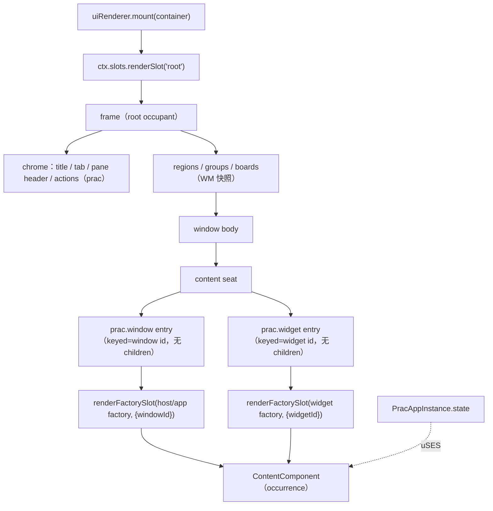
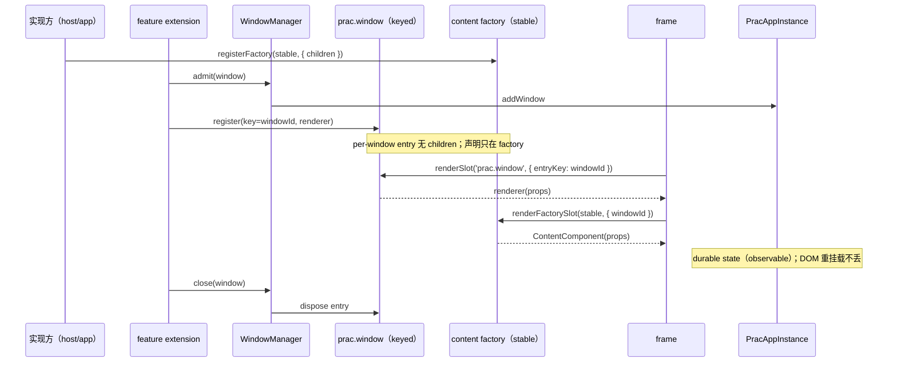

# Rendering engine — content composition and the render path

> **本文只写渲染引擎。** 窗口 / 容器 / 布局的模型（region 对象、space、`WindowGroup`、window、两棵树的接合点）以 [tech-ui](./2026-11-05-tech-ui.md) 为准；本文只写引擎的边界、渲染路径、内容组合与运行时。

## Summary

prac 的渲染引擎是 DSH `ui-renderer` + `ui-slots`，负责**内容组合与运行时**，不负责窗口 / 布局 / chrome：

1. **窗口 / 布局**：`WindowManager` + frame。模型、parent、space、`WindowGroup`、layout、chrome 规则见 [tech-ui](./2026-11-05-tech-ui.md)。
2. **内容组合**：entry 注册与授权、kind 派发（single / keyed / list / chain）、stable factory + occurrence、scope（root / session-maybe / session）、owner props、inject / store、locale、error boundary、`useSyncExternalStore` 绑定。

**所有权边界**：frame、窗口与 chrome 是 prac 的；app content 是 app 的。app 通过 `start` 请求创建窗口并给出该窗口的内容；窗口的身份 / 生命周期 / chrome 由 prac 拥有并渲染；content 注册不参与 chrome。**数据 / 状态归 app 实例**，不归窗口或组件。

**内容 = 一次 stable factory 声明 + 每窗口一个 occurrence。** factory 由内容的实现方注册（`registerFactory({ name: <stable>, scope, children }, ContentComponent)`）：`children` 是内容声明的 slot，声明一次、**不随窗口 id 变化**。每个窗口只注册一条**无 children** 的 `prac.window` entry（key = window id），其 renderer 渲染该 factory 的 occurrence（`renderFactorySlot(<stable>, { windowId, ... })`）。**`admit` 只创建窗口，不带 content / children。**

**归属**：`main` / `sidebar` / `rightbar` 是 DSH 的共享槽，归 **host 的 factory**（声明一次），不归各个 app——一个 slot 只能声明一次，chat / sidebar / rightbar 各自声明会撞；app（feature extension）只负责创建窗口、给出 occurrence 的 view key，并委托 host。app 私有 slot 也由 **app 的 stable factory** 声明（每 app 一个定义，不按窗口拆）。**window id 只出现在 `prac.window` 的 key 和 occurrence props 里，不进 factory name、不进声明。**

**实现可以不同**——自己注册 factory、委托 host（`dsh-host` / `vscode-host`）产出 factory + renderer、或用 DOM content host——但接口不分支，frame 不知道实现是哪种。

## Motivation

三个结构性张力决定了这个分层：

1. **声明必须稳定，窗口 id 是动态的。** 把 children 挂在 `prac.window`（key = window id）会让声明随窗口生死反复注册，且共享 keyed slot（`main`）在多个窗口间撞声明。声明挂在 stable factory 上、窗口只是 occurrence，才能一份声明服务 N 个窗口。
2. **注册时机。** 声明可以静态（插件 `apply`），内容不能。factory 是声明：在 `apply` 注册、不渲染任何东西；但 `prac.window` 的内容 entry / occurrence 必须由窗口创建触发——否则就会"没有窗口也有内容"，窗口的身份、生命周期、chrome 与内容脱节。
3. **引擎归属。** 自研内容注册 / 派发要么重造 slots 的语义（scope / owner / inject / error boundary），要么失去 DSH 插件体系；让 DSH slots 兼任窗口模型又会被 kind / 声明 / 授权绑住窗口身份。渲染器不该 fork，窗口模型也不该塞进 slot。

## The render path

**frame 的 resolve**：WM snapshot → frame 把 layout 位置解析成 container（region 对象 / space / `WindowGroup` / window）→ 渲染 region / chrome / window body / content seat。engine **从 seat 开始**：它只认 `prac.window` / `prac.widget` entry 与 factory occurrence，不参与 parent / space / group 的解析。

**创建 / 释放序列**

## Ownership

**角色**

| 角色 | 归谁 | 负责 |
| --- | --- | --- |
| Instance | app 运行时（prac 记录） | 一次 launch 的实例：身份、参数、**数据 / 状态**、它打开的窗口；窗口是它的视图 |
| Window | prac（WM） | id、appId、instanceId、parent、生命周期（模型见 tech-ui） |
| Chrome | prac（frame） | title bar、tab strip、container bar、pane header、窗口 actions 的渲染与策略；数据来自窗口记录 / app 定义 |
| Content | 实现方（host / app）/ adaptor | 只填窗口 body；stable factory（children 声明）+ 每窗口 renderer |
| Frame | prac | 布局、region、space grid、`WindowGroup` tab order、chrome、内容座位与隔离 |
| App renderer | DSH ui-renderer | 唯一的 React root、React contexts、slot registry 的 React 绑定 |

**不变量**

- **R1 无窗口无内容。** factory 是声明，可以在插件 `apply` 注册（静态、不渲染）；内容 entry / occurrence 由窗口创建触发，只有 occurrence 才渲染；窗口关闭，entry 释放。插件激活不产生可见内容。
- **R2 frame 不认识 producer 词汇。** frame 不知道 `main` / `sidebar` / `rightbar` / VS Code view id；它只按窗口的内容身份渲染内容座位，不区分实现是 renderer 还是 factory occurrence。
- **R3 内容 = stable factory + 每窗口 occurrence。** 声明（children）挂在 factory 上、name 不含 window id；`prac.window` entry 无 children、key 是 window id、renderer 渲染 occurrence。共享槽归 host factory，私有槽归 app factory；app 只提供窗口与 view key。
- **R4 WM 拥有窗口。** slot entry 不是窗口；content entry 不是窗口。窗口身份、parent、placement、生命周期、chrome 的渲染与策略不写在 slot / content 里。
- **R5 唯一 renderer、唯一 `root`。** prac 用 DSH `ui-renderer` 作为 app 的唯一 React root（`ctx.uiRenderer.mount` → 唯一一次 `renderSlot('root')`）；frame 是 `root` 的 occupant，在自己的 children 里声明内容座位、chrome、overlay 并渲染。frame 本身也是一个 slot entry；分层是职责分层，不是两个 renderer。
- **R6 chrome 由 prac 决定并渲染。** content entry 的 `label` / `icon` / `paneHeader` / `actions` 不作为 chrome 来源；chrome 数据来自窗口记录 / app 定义，由 frame 决定怎么画。
- **R7 数据 / 状态归 app 实例。** durable state 由 instance 拥有（observable / store），renderer 通过它绑定（uSES）；DOM 卸载 / 重挂载（region 移动、hide/show、isolation 重挂）不丢状态。组件本地 state 只放临时 UI 状态。
- **R8 窗口 / 容器 / 布局模型不在本文。** region 对象、space、`WindowGroup`、window 的 parent 与两棵树的接合点见 [tech-ui](./2026-11-05-tech-ui.md) §2；engine 只认 entry / occurrence，不参与 parent / space / group 的解析。

## Where DSH slots + renderer fit

**作为应用渲染器：是。** `root` 是唯一 ctx-level 渲染；`ui-renderer` 提供唯一的 React root、`HostContext` / `RootStandardProvider`、locale / session 绑定；DSH 客户端插件通过 `ctx.slots` 注册并依赖这套上下文。替换它意味着重造 slot 绑定、scope、factory、错误边界，或放弃 DSH 插件体系。

**作为内容组合引擎：是。** 需要组合语义的生产者需要 typed owner props、children 声明与授权、kind 派发、scope、inject / store、错误边界、factory occurrence。这些正是 prac 自研会重造的东西。

**作为窗口 / 布局引擎：不是。** slot 的 kind / 声明 / 授权是**组合**语义，不是窗口身份 / parent / placement / 生命周期语义。把窗口塞进 slot entry 会产生两个身份（WM 窗口 + entry）、两个生命周期、两个 catalogue。

**frame 的位置。** frame 不是引擎之外的宿主：它占 `root`，从这一棵入口树展开 region / space / window / chrome，并把内容座位作为自己的 children 声明和渲染。两类"引擎"共用同一个 renderer 和 registry，区别只在职责。

## Reference-level

**内容（目标）**

- **factory（stable，归实现方）**：在插件的 `apply` 里 `registerFactory({ name: <host/app-stable>, scope, children, slots? }, ContentComponent)`，由 `ctx.effect` 随插件卸载释放。children 是内容自身的 slot（DSH 的 `main` / `sidebar` / `rightbar`；app 的私有槽）；name 不含 window id，每 host/app 一个定义。factory 组件拿到 `renderSlot`（children）、`renderFactorySlot` / `useFactorySlot`、occurrence props（`windowId`、`viewKey`、`width`、`viewportWidth`）。
- **每窗口（动态）**：`admit(window)` 只创建窗口；feature extension 随后 `register({ name:'prac.window', key: windowId }, renderer)`——无 children；`renderer = (props) => renderFactorySlot(<stable>, { windowId, ...props })`。`PracWindowRenderer` 是这条 entry 的组件，props 带 owner（`width` / `viewportWidth`）+ 标准 kit。
- **组合**：app 的 renderer 渲染 app factory 的 occurrence（私有槽），occurrence 里再渲染 host factory 的 occurrence（共享槽）；或 renderer 同时渲染两个 occurrence。声明都在 stable factory 上。
- **`PracAppImpl` 不再有 `content`**：app 级 content 没有窗口上下文，且是第二条渲染路径。
- `prac.window` entry 随窗口释放；factory 随插件（`apply` 的 effect）释放。seat 只提供 `registerContent(windowId, renderer)` 薄封装，避免 app 手写 slot 名 / kind。**删掉** `windowContentFor`、`ApplicationSlotRenderer`、`render` / `view` 参数、`LayoutItem.windowContent` 分支。

**座位约定**

- `prac.window` / `prac.widget` 都用 **keyed 且不带 children**：窗口 / widget 的动态 id 只做 key；两者都是"取这个窗口 / widget 的 body"，不是渲染集合。list 的默认行为（不给 `only` 就全渲染）对 body 内容既危险又浪费；keyed 的 `KindOptions` 没有 `label` / `order` / `paneHeader`，正好让 chrome 不能从 content entry 泄漏（R6）。list 留给真正"可叠加、全渲染"的槽（`shell.overlay`、`conversation.view`）。
- 内容在窗口的 isolation root 内渲染；slot outlet 的 `data-slot` 锚点保留。

**状态**

- `PracAppInstance` 持有 durable state：`PracAppInstanceState = { getSnapshot(); subscribe(fn) }`，由 app 在 `start` 里 `ctx.pracAppInstances.setState(instance.id, state)` 挂上；renderer 用 uSES 绑定，随 instance 释放。
- 窗口 / 内容 entry 不是状态所有者；slot 的 store 轴不装 app 业务数据。
- instance 生命周期与释放策略见 [tech-app](./2026-11-05-tech-app.md) 的 Open。

**frame / chrome**

- frame 渲染窗口树与 chrome；chrome 数据来自窗口记录（`admit` 的 title / icon）与 app 定义，不读 content entry options。
- catalogue / recall 是 WM 窗口与内容 id 的 join；chrome 事实不来自 content entry。
- frame 只认识内容 id 与座位，不认识生产者 slot；布局 / 容器的解析见 [tech-ui](./2026-11-05-tech-ui.md) §2.6。
- 空 `WindowGroup` 的 placeholder（watermark）是 **frame 的 chrome**，不注册 content entry；见 [tech-ui](./2026-11-05-tech-ui.md) I10。

**DSH host**

- host 注册**一个 factory**，声明 `main` / `sidebar` / `rightbar`（一次，不按 app 拆）；每个窗口渲染一个 occurrence，`entryKey` 由窗口的 view key 决定。app 不声明这些槽，只提供窗口与 view key 并委托 host。
- 注册发生在第一个窗口被创建时，不是插件激活；多个 `main` key 的窗口共享这一次声明。
- host factory 也带 app 私有槽时，app 的 occurrence 嵌套在 host occurrence 里；否则 app 自己注册 app factory。

**VS Code**

- editor 的内容是普通 renderer（或 factory occurrence）；VS Code view 是 `prac.widget` 内容。两者都在窗口 / 内容座位内，不在 frame 级。

## Alternatives

| 方案 | 做法 | 代价 |
| --- | --- | --- |
| **A. 本提案（分层 + stable factory）** | WM 管窗口；DSH renderer 做 app root；stable factory 声明 + 每窗口 occurrence；实现可委托 host | factory 需要注册 / 释放规则；instance state 与生命周期待定 |
| B. children 挂在 `prac.window` 上 | 每窗口声明自己的 children | 动态 window id 让声明不稳定；共享 keyed slot 多窗口撞声明；内容在没有窗口时也能渲染 |
| C. 只有 app renderer | app 自己渲染一切；DSH 面板需要嵌套 renderer / portal | 重造或绕开 DSH 组合；scope / 错误边界丢失 |
| D. 只有 DOM content host | frame 给 DOM，生产者各自 mount | DSH 需要自己的 React root（renderer 不是为多 root 设计的）；组合语义丢失 |
| E. 替换 ui-renderer | prac 自己的 renderer | 重造 slots / 上下文，或放弃 DSH 插件体系；成本最高 |

## Drawbacks

- factory 作为新契约需要注册 / 释放规则；多实例 app 的 naming 需要明确。
- `PracAppInstance` 增加状态持有；instance 生命周期与关窗策略见 [tech-app](./2026-11-05-tech-app.md) 的 Open。
- board 是 window 的 content（已定）；widget 的 factory 归属见 [tech-widget](./2026-11-05-tech-widget.md) 的 Open。
- 多窗口 + 共享 keyed slot 的 live gate 还缺。

## Open questions

1. **factory 的命名与多实例**：factory 在 `apply` 注册、随插件释放；多实例 app 共享同一个定义（occurrence props 带 `instanceId`）还是每实例一个 name？关闭条件：两个 app 实例、多个窗口，factory 不重复注册（同 name 第二次会抛）也不泄漏。
2. **多 `main` key 窗口**：一次声明、两个窗口 occurrence（不同 view key）的 live gate。

## Validation

- 单元：无窗口时 producer 不注册内容；`start` 后注册；窗口关闭释放；同一 factory 两个窗口不同 view key；DOM 卸载 / 重挂载后 instance state 保持。
- live gates：`default-screen`、`views`、`stack`、`split` 保持绿；新增"双 main key 窗口"与"无窗口无内容"的 gate。
- 观察点：catalogue / recall 只列 WM 窗口与内容 id，不出现 factory 的伪 view id；catalogue 的 chrome 事实不来自 content entry。

## Future possibilities

- 所有内容生产者统一到 factory 实现（VS Code view、DSH 面板、board、app 内容），窗口只做 occurrence。
- factory 级热替换 / 错误隔离与窗口生命周期对齐。
- 多显示器 / 多 tab 时 occurrence 与窗口一一对应。

## Related

- [tech-ui](./2026-11-05-tech-ui.md) — 窗口 / region / space / `WindowGroup` / 两棵树；模型权威。
- [tech-app](./2026-11-05-tech-app.md) — app / 实例 / 状态 / 生命周期。
- [tech-widget](./2026-11-05-tech-widget.md) — board 与 widget 的 content / factory。
- [tech-extension](./2026-11-05-tech-extension.md) — feature extension 的 app / 内容注册。
- [tech-extension-dsh](./2026-11-05-tech-extension-dsh.md) — DSH host 的 factory 与 occurrence。
- [tech-extension-vscode](./2026-11-05-tech-extension-vscode.md) — VS Code 侧的 renderer。
