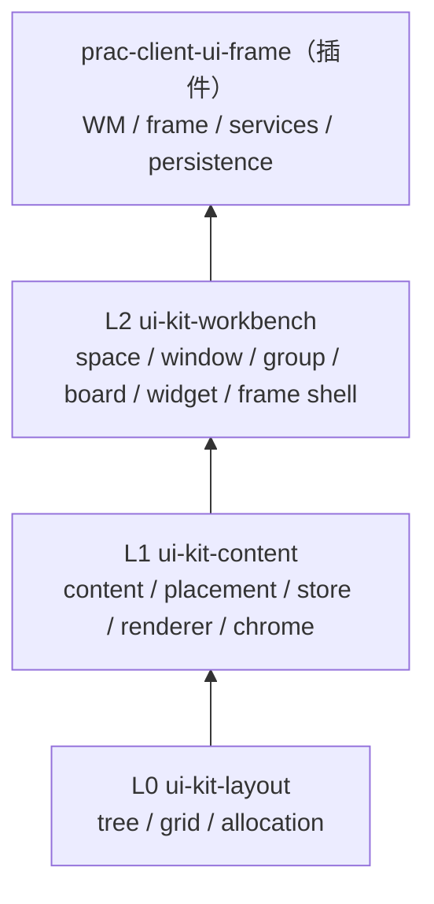

# Technical UI kit — L0/L1/L2, the workbench model, and the L2 refactor

> 这份 note 是 **ui-kit 的规范化设计**：它是什么、分几层、各层拥有什么、最新 UI 模型下哪些层要改。
> 模型本身以 [tech-ui](./2026-11-05-tech-ui.md) 为准；渲染引擎边界见 [rendering-engine](./2026-11-12-tech-rendering-engine.md)；VS Code 投影见 [tech-extension-vscode](./2026-11-05-tech-extension-vscode.md)；board / widget 见 [tech-widget](./2026-11-05-tech-widget.md)。

## Summary

ui-kit 是 prac 的 **UI 引擎库**：不依赖 DSH、不接插件生命周期，提供布局内核、内容组合、workbench 模型与渲染。它分三层：

| 层 | 包 | 职责 |
| --- | --- | --- |
| **L0** | `prac-ui-kit-layout` | 纯布局内核：tree / grid / allocation / geometry |
| **L1** | `prac-ui-kit-content` | 内容组合内核：content root/group/item、placement、store、renderer、chrome、isolation |
| **L2** | `prac-ui-kit-workbench` | workbench 模型：Space / Window / WindowGroup / Board / Widget、frame 绑定与 shell |

**定位**：L0/L1 是**通用的、可独立复用的内核**（无 DSH、无产品决定）；L2 是 prac 的 workbench 模型层（**类型 / 契约 + frame shell 的渲染原语**）。L2 **不是第二套 UI 模型**——模型权威是 [tech-ui](./2026-11-05-tech-ui.md)，实例由 `ui-frame` 的 WM 持有；L2 只提供类型与通用渲染，不定义产品语义之外的第二份模型。

**最新 UI 模型只要求重构 L2 的 workbench 模型层；L0 / L1 保留。** L2 当前把“组”实现成 region content 的 board 组（`WindowGroupModel` 的 primary board、`RegionContent`、`WindowGroupBindings`、`group-bridge` 的 write-back、per-region runtime）——这些与 [tech-ui](./2026-11-05-tech-ui.md) 的“组是 WM 容器树节点、board 是 window content”冲突，是本 note 要收敛的部分。

## Motivation

原来分层的理由仍然成立：

1. **L0/L1 可独立复用**：布局/内容协议不需要 workbench 的 window/space/board 模型；headless 消费者也能用。
2. **kit 无 DSH 依赖**：`ui-kit-*` 不 import DSH、不写 `apply/inject`；DSH 的 store / catalogue / services 由 `prac-client-ui-frame` 供给。
3. **L2 是产品模型**：window / space / board / widget 的对象关系与 placement，属于 workbench 层。

但 L2 的实现偏离了 `docs/window-model.md` 与最新 tech-ui：

- `WindowGroupModel` 要一个 **primary board**，board 被当成组的“主窗”；文档说 board 是 **window 的 content**，group 只装 window；
- `RegionContent` / `window-group` / `widget-board` 把组当成 **region 的 content**；`WindowGroupBindings` + `WindowGroupLayoutBridge` 再把组的 placements **写回** layout items；
- 于是同一组有三份身份（组数据 / region content / runtime-adapter），同步问题表现为：切换 tab 时 file item 被 bridge 移除、center 组注册导致 frame 启动失败、chat 是 group-less 的 arrangement item；
- `WindowGroupRuntime` / `WindowGroupAdapter` 是 frame 为 region content 服务的 per-region runtime/adapter；新模型里 frame 读 WM 快照渲染，不需要第二份 runtime。

## Scope

**In**：

- L2 的 workbench 模型：Space / Window / WindowGroup / Board / Widget 的类型与所有权；
- L2 的 frame 绑定/shell：region content、bindings、group bridge、layout root、content host；
- 与 `prac-client-ui-frame` 的接缝：WM 快照、frame 渲染、editor 的模型投影。

**Out**：

- L0 的 tree/grid/allocation/geometry；
- L1 的 content/placement/store/renderer/chrome/isolation；
- DSH 插件生命周期、DSH slots、prac catalogue/arrangement；
- VS Code 上游的行为与 patch。

## Guide-level design

### 层的依赖

- L2 只依赖 L0/L1，不依赖 DSH；
- frame 插件拥有 store / catalogue / DSH services，把快照交给 L2/frame 渲染；
- L2 不拥有 DSH 的 slot 声明、客户端 graph、HMR。

### 对象与所有权（模型见 tech-ui）

- window / group / space / region / board / widget 的对象关系、parent、placement、chrome 规则**以 [tech-ui](./2026-11-05-tech-ui.md) 为准**；
- kit 的 L2 只提供这些对象的**类型 / 契约**与通用操作（纯函数/接口）；**实例与生命周期归 `ui-frame` 的 WM**；
- L2 不定义第二份模型：不得在 kit 里再写一套 space/group/region 语义。

### 渲染职责（边界）

- **frame**（`ui-frame`）读 WM 快照，渲染 region → group → tab strip + active window 的 content seat（模型见 [tech-ui](./2026-11-05-tech-ui.md)）；engine 渲染 frame 的整棵树；
- **kit L1** 提供 content seat 的挂载、isolation、chrome registry、layout tabs/stack/sash/container-bar；
- **kit L2** 提供布局根 / 内容宿主 / board root 的**原语**（不拥有 window/group 的写权）；
- **window content** = `prac.window` entry 的 renderer（editor pane / DSH / board / component）；engine 的边界见 [rendering-engine](./2026-11-12-tech-rendering-engine.md)；
- **chrome** 归 prac；group 的 chrome 由 parent 决定；window 的 chrome 数据来自窗口记录 / app 定义。

### VS Code

- VS Code 的 **editor group 是模型投影**（无 UI）；每个 prac `WindowGroup` 一个；每窗口一个 input（非 vscode = `PracWindowInput` 身份，无 pane）；frame 的 `WindowGroup` 渲染 tab strip/body，engine 渲染 frame 的整棵树；
- VS Code 的 **editor pane 是 file window 的 content**；
- kit 不认识 VS Code；投影在 `vscode-host` / `ui-vscode-editor` 层。

## Reference-level

### L0（不改）

`ui-kit-layout`：tree / grid / allocation / geometry。space 的 grid 直接复用；frame 的 region/cell 也是 L0 的树。

### L1（不改）

`ui-kit-content`：content root/group/item、`PlacementRecord`/`LayoutState`、`LayoutStore`/`useLayout`、`LayoutRenderer`、tabs/stack/sash/container-bar、grid/resize、chrome registry/intents、isolation、content-host-mount、workspace-scope。这些是“内容组合 + 布局渲染”的通用层，最新模型不需要改它们的语义。

### L2（重做）

**保留**（类型/原语，不是第二份模型）：

- `Space` / `Window` / `Board` / `Widget` 的对象类型与内容模型（与 [tech-ui](./2026-11-05-tech-ui.md) 一致；实例在 WM）；
- `layout-root` / `content-host-registry` / `boardLayouts` 的“根 + 内容宿主”思路（board root 作为 window content 的 layout hole）；
- `frameState` 的 frame/space 组合 store 思路（root 的 writer 边界）。

**改掉**：

| 现状 | 目标 |
| --- | --- |
| `WindowGroupModel` 的 primary board / `owned` placements | 普通 window 容器（parent / order / active / windows）；board 是 window content |
| `RegionContent` / `window-group` / `widget-board` 的 region content 抽象 | frame 从 WM 读组；region 的渲染走 frame 的 group/chrome；board 作为 window content |
| `WindowGroupBindings`（register/barItems/order sync） | frame/WM 的组查找；快照读取；无 bindings 写入 |
| `WindowGroupLayoutBridge` 的 placements → layout items **write-back** | 组的 order 是权威；layout items 只表达位置/几何，不反向覆盖组 |
| `WindowGroupRuntime` / `WindowGroupAdapter`（frame 侧 per-region runtime/adapter） | frame 直接读快照；editor group 只是 VS Code 模型投影 |
| `docs/window-model.md` 的“`WindowPlacement` 可暂不在 group” | 每个 window 有 parent group；不存在 group-less 的 stage window |

### 渲染与写作边界

| 事实 | writer | 读者 |
| --- | --- | --- |
| container tree（region / space / group / window） | WM（`ui-frame`） | frame、kit 渲染 |
| space 的 grid / board root | WM（`ui-frame`） | kit `LayoutRenderer` |
| group 的 order / active | WM | frame tab strip |
| chrome 数据（title/icon/pane header/actions） | 窗口记录 / app 定义 | frame |
| VS Code editor 模型（inputs / active） | `vscode-host` 投影 | VS Code services |

**没有任何 kit 层写 WM 的组/顺序/active；也没有 layout item 反向覆盖组 order 的桥。**

### 持久化

- frame root、space root、board root 的 key 不变（`prac-frame/v1`、`prac-space/v1/<space>`、`prac-board/v1/<board>`）；
- space root 的 `WindowPlacement` 与 group 的 parent/order 一致；恢复时先建容器树，再按 id 连接 placement；
- 序列化用 id；**渲染/view 句柄不持久化**（`prac.window` entry 的 renderer、widget view、editor pane 都不进 store）。

## Drawbacks

- L2 重构会同时动 `ui-kit-workbench`、`ui-frame`、`ui-workbench`、`ui-widget`、`vscode-host`；左侧 sidebar/board 依赖最深；
- 迁移期会短暂出现“旧 region content 路径 + 新 frame 快照路径”并存；必须先保证四条 gate 绿，再逐块切；
- kit 的 L2 文档/README 需要同步（本 note 是设计，README 仍描述旧 L2）。

## Decisions

1. **L0/L1 保留，只重构 L2**；
2. **group 是普通 window 容器**（parent / order / active / windows），没有 primary board / owned；
3. **board 是 window content**，board window 是普通 `PracWindow`；
4. **没有 region content 的组抽象**；frame 从 WM 快照渲染；
5. **没有 layout → group 的 write-back 桥**；group order 是权威；
6. **每个 window 有 parent group**；不存在 group-less 的 stage window；
7. **VS Code editor group = 模型投影**；editor pane 是 window content；`PracWindowInput` 是身份；
8. **kit 不依赖 DSH**；DSH store/services 由 frame 插件供给。

## Open questions

1. **L2 group 数据的归属**：`WindowGroup` 类型定义在 kit L2，实例由 `ui-frame` 的 WM 持有——kit 是否只提供类型/接口，还是也提供 group 的不可变操作（纯函数）？关闭条件：WM 与 kit 的职责边界写死在类型上，frame 不 import kit 的 WM 实现。
2. **board root 作为 window content 的 hole**：L0/L1 的 `LayoutRenderer` 如何把 board root 嵌进 window content 的座位；board 的 writer 仍是 WM 的 board 布局 store。关闭条件：一个 board window 的 board 可 drag/split/size，且 board root 的 writer 唯一。
3. **sidebar/panel 的 container chrome**：从 region/group 的 parent/kind 渲染（container bar / stack），不再走 region content 的 board 组。关闭条件：sidebar 的四个 view、stack 折叠、sash 都走新路径且 gate 绿。
4. **编辑器投影**：editor group 的模型如何在 prac 组创建/切换/关闭时同步；`PracWindowInput` 的身份在 editor model 里 per window。关闭条件：chat + file 同组、来回切、`verify-chat-file` 绿。
5. **多 space**：space 的 grid 与 active space；切换只换 stage 的 grid（sidebar/panel 不动）。关闭条件：多 space 的 live gate。

## Validation

- 单测：kit 的 L0/L1 保持；L2 的新 group/space/board 类型与纯函数；group 的 parent/order/active；board as content；
- live gate：`default-screen` / `views` / `stack` / `split` 保持绿；
- 新 gate：`chat-file`（chat + file 同组、来回切）；
- **无 DSH 依赖**：`ui-kit-*` 的 import 检查（README 的承诺）保持；
- 观察点：没有 group-less 的 stage window；没有 layout → group 的 write-back；catalogue/recall 的 chrome 事实来自 prac 自己的模型。

## Related

- [tech-ui](./2026-11-05-tech-ui.md)：最新的 UI 模型（region/space/group/window、两棵树）。
- [rendering-engine](./2026-11-12-tech-rendering-engine.md)：渲染引擎边界。
- [tech-widget](./2026-11-05-tech-widget.md)：board / widget 内容。
- [tech-extension-vscode](./2026-11-05-tech-extension-vscode.md)：VS Code 投影。
- [tech-app](./2026-11-05-tech-app.md)：app / 实例 / 启动。
- [tech-packages](./2026-11-05-tech-packages.md)：包职责。
