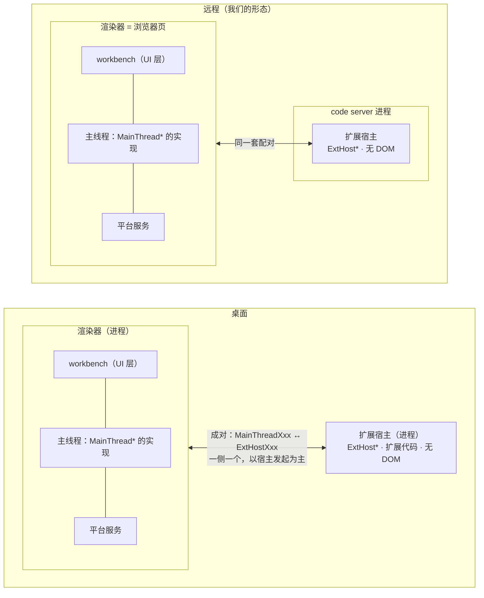
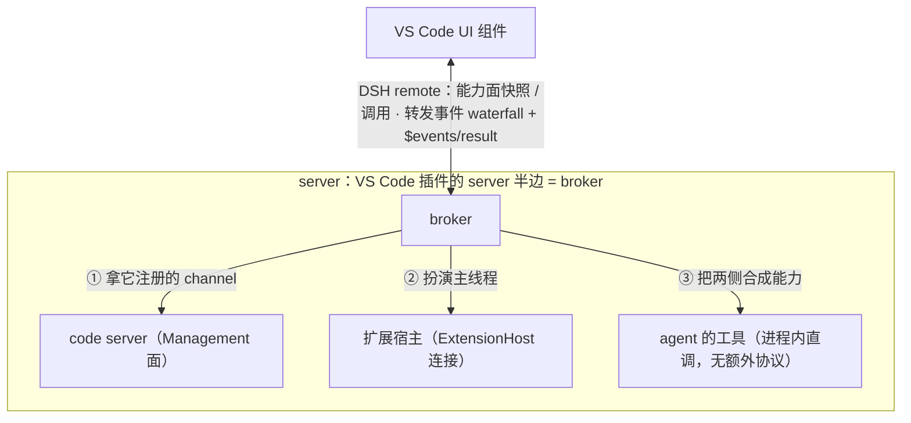
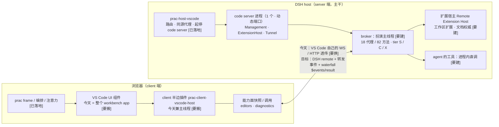

# Agent Note: VS Code 集成进 prac 的通信协议

> 下面的数字与行号都指 pinned VS Code **1.137.0** checkout 与 DSH checkout（事实核实于 2026-09-16 / 09-17）；更细的依据（协议清单、踩坑、决定台账）在[工作记录](../../worklog/2026-09-09-vscode-dsh-integration.md)。

## 问题

prac 的目标（`docs/architecture.md` §1.2）要求：**IDE 能力在 server 侧**（agent 要能用），**UI 组件在 client 侧**。而 VS Code 的两个半边按它自己的切法通信（渲染器 ↔ code server），中间还有一层"主线程 ↔ 扩展宿主"的关系。

现状是**透传**（`/prac-vscode` 静态 + 把 VS Code 自己的 WS/HTTP 原样转发），浏览器直接讲 VS Code 的协议 ⇒ 能力与状态被页面把关，agent 够不着。这正是 [umbrella §4](../in-progress/2026-09-09-vscode-dsh-integration.md) 里那两行差距：**两半之间的通信层还是透传**、**client 侧嵌的是整个 workbench app 而不是 UI 组件**。

要设计的是：**两半之间走什么、谁回答什么、消息什么形状。**

## 背景

### 三个角色：渲染器 / 扩展宿主 / 主线程

**名字最容易误会的是"主线程"：它不是线程概念，是那套 RPC 的*角色名***。`extHost.protocol.ts`（`api/common/`，168 个代理标识）里成对出现：`MainContext.MainThreadXxx` ↔ `ExtHostContext.ExtHostXxx`——一侧是扩展宿主，另一侧就是"主线程"。**主线程是渲染器进程里的一层**：渲染器 = workbench UI + `MainThread*` 的实现 + 两者共用的平台服务；扩展宿主在另一个进程，两侧按协议逐个成对（见下图）。调用以扩展宿主发起为主，主线程另有 `$accept*` 一类推送。

| 词 | 是什么 | 住在哪（桌面） | 住在哪（远程 / 浏览器） | 上游落点 |
| --- | --- | --- | --- | --- |
| **渲染器（renderer）** | 跑 **workbench**（UI）的那个进程/页面：编辑器、视图、命令面板都在这里 | Electron renderer 进程 | 浏览器页 | `src/vs/workbench/**` |
| **扩展宿主（extension host）** | 跑**扩展代码**的独立进程：只有 `vscode.*` API，**没有 DOM、没有 UI** | 主进程拉起的 utility 进程 | **code server 里** `cp.fork` 的进程 | `api/common/extHost*` + `api/node/**` |
| **主线程（main thread）** | 扩展宿主协议的**另一端**：在 workbench 里替扩展宿主做 UI / 编辑器 / 存储 / 诊断那套实现 | 渲染器里 | **渲染器里**（= 今天的页面） | `api/browser/**` 的 `@extHostNamedCustomer(MainContext.MainThreadXxx)` 实现——**上游没有 server 侧的那一份**（计数见「上游协议清单」） |

**两种形态下主线程都在渲染器里**——远程形态搬走的只有扩展宿主。

#### 平台服务在哪一层

`src/vs/platform/**` 是**服务层**：与 UI 无关的能力实现——文件、配置、存储、命令、遥测、日志、诊断等，每个服务一个目录，下分 `common/` 与 `browser/`（或 `node/`、`electron-main/`）。`src/vs/workbench/**` 是**UI 层**：workbench 的视图与贡献，主线程的 `MainThread*` 实现也在这一层。依赖单向——workbench 大量 import platform，而 **platform → workbench 的真实 import 是 0 处**（`grep -rn "from '.*vs/workbench" src/vs/platform --include=*.ts` 为空）。

DI 的来法：服务先由 `createDecorator<T>('id')` 换出一个 `ServiceIdentifier`（`src/vs/platform/instantiation/common/instantiation.ts:109`），实现于启动时注册（`registerSingleton(IMarkerService, MarkerService, InstantiationType.Delayed)`，`src/vs/workbench/workbench.common.main.ts:189`），再由 `IInstantiationService`（接口 `instantiation.ts:52`，实现 `instantiationService.ts:28`）按构造参数注入。platform 下共 **233 个** `createDecorator` 标识（1946 个 `.ts` 文件，不含 test）。所以"平台服务"是这批按 id 注入的服务，不是某一层框架。

**主线程实际用到多少**：`src/vs/workbench/api/browser/mainThread*.ts` 共 **97 个文件**，其中从 `platform/**` import 的服务接口 **42 个 / 166 处**（按 `I*Service` 计）。Top：

| 服务（import 处数） | 代表 file:line |
| --- | --- |
| `ILogService` (22) | `api/browser/mainThreadAuthentication.ts:23` |
| `IConfigurationService` (14) · `IInstantiationService` (14) | `mainThreadAuthentication.ts:35` · `mainThreadCLICommands.ts:16` |
| `IUriIdentityService` (13) · `IFileService` (7) · `ITelemetryService` (7) | `mainThreadBulkEdits.ts:11` · `mainThreadDocuments.ts:13` · `mainThreadAuthentication.ts:15` |
| `IStorageService` (5) · `ICommandService` (5) · `IMarkerService` (1) | `mainThreadStorage.ts:6` · `mainThreadCommands.ts:8` · `mainThreadDiagnostics.ts:6` |

扩展宿主的 `$` 调用最终就落到这些服务上。一条完整的链：`ExtHostDiagnostics` 调 `$changeMany`（`api/common/extHostDiagnostics.ts:170`）→ `MainThreadDiagnostics.$changeMany`（`api/browser/mainThreadDiagnostics.ts:69`）→ `IMarkerService.changeOne`（`:51`）/ `changeAll`（`:93`）→ Problems 视图——整条链都在渲染器里，终点是平台服务。

#### 渲染器 ↔ 扩展宿主怎么通

**协议层**：`IRPCProtocol` 在 `src/vs/workbench/services/extensions/common/proxyIdentifier.ts:8`，实现 `RPCProtocol` 在同目录 `rpcProtocol.ts:115`；两端各一个实例——渲染器侧 `extensionHostManager.ts:258`，扩展宿主侧 `api/common/extensionHostMain.ts:176`。消息是一帧一消息的二进制：帧头 `uint8 type` + `uint32 req`（`rpcProtocol.ts:518-522`），type 枚举 12 个（`:940-953`）——请求 4 种（1–4，JSON 参数 / 混合参数 × 是否带取消）、`Acknowledged=5`、`Cancel=6`、回复 6 种（`ReplyOKEmpty`/`VSBuffer`/`JSON`/`JSONWithBuffers` = 7–10，`ReplyErrError=11`/`ReplyErrEmpty=12`）。请求体 = `rpcId`（代理标识）+ `method` + `args`（`:783`）；`req` 是关联 id，取消发 `serializeCancel(req)`（`:833`），回包 `serializeReplyOK/Err`（`:837`/`:915`），收到请求先回 `Acknowledged`（`:378`）。**`$` 的派发**：代理是 `Proxy`，取属性时若名字首字符是 `$`（`name.charCodeAt(0) === CharCode.DollarSign`，`:252`）就现造一个函数发 `_remoteCall(rpcId, name, args)`（`:461`）；对端收到帧后 `_doInvokeHandler` 按 `rpcId` 取本地对象、按 `method` 取方法并 `apply`（`:449`）。所以 `$` 只是"经 RPC 的方法"这个命名约定，派发靠 `rpcId` + `method` 两个字符串。

**载体层**：两端都不碰物理通道——`RPCProtocol` 只吃一个 `IMessagePassingProtocol`（`send(buffer)` / `onMessage` / `drain?`，`src/vs/base/parts/ipc/common/ipc.ts:99-106`）。

- **桌面**：扩展宿主是 Electron **utility process**（不是 `child_process.fork`），由主进程 `utilityProcess.fork` 拉起（`platform/utilityProcess/electron-main/utilityProcess.ts:261`）。通道是 **MessagePort**：渲染器先 `writeExtHostConnection(new MessagePortExtHostConnection(), env)`（`localProcessExtensionHost.ts:416`，env key `VSCODE_WILL_SEND_MESSAGE_PORT`，`extensionHostEnv.ts:47-55`），响应 channel 是 `vscode:startExtensionHostMessagePortResult`（`:251`），随后 `port.onmessage` / `postMessage` 就是协议收发（`:436-446`）；扩展宿主侧对称（`api/node/extensionHostProcess.ts:183-203`）。另有命名管道与 socket 两种备选连接（`IPCExtHostConnection` / `SocketExtHostConnection`，`extensionHostEnv.ts:17-44`）。
- **远程 / web（我们的形态）**：渲染器用 **WebSocket** 连 code server（`new WebSocket(url)`，`platform/remote/browser/browserSocketFactory.ts:80`）。服务端把它 `upgradeToISocket` 成 `NodeSocket | WebSocketNodeSocket`（`server/node/remoteExtensionHostAgentServer.ts:237`），按这条 WS 建 `ExtensionHostConnection`（`:502`）并 `cp.fork` 扩展宿主进程（`server/node/extensionHostConnection.ts:290`），再把这条 WS 桥到扩展宿主进程的管道/socket：桥的一端是 `ConnectionData.socket`（即这条 WS，`server/node/extensionHostConnection.ts:73`），另一端是扩展宿主的 socket——`_pipeSockets` 双向对拷字节（`:180-183`），或把 socket 经 `child_process` IPC 发过去（`_sendSocketToExtensionHost`，`:190-200`，消息 `VSCODE_EXTHOST_IPC_SOCKET`，`:99`；扩展宿主侧收，`api/node/extensionHostProcess.ts:220-243`）。环境变量分两种：能传 socket 时 `SocketExtHostConnection`（key `VSCODE_EXTHOST_WILL_SEND_SOCKET`，`extensionHostConnection.ts:266`），不能时监听命名管道并 `IPCExtHostConnection(pipeName)`（key `VSCODE_EXTHOST_IPC_HOOK`，`:269-271`）。`VSCODE_EXTHOST_IPC_SOCKET` / `_READY`（`:322`）/ `_REDUCE_GRACE_TIME`（`:208`）是 `child_process` IPC 上的控制消息名，不是环境变量。

**谁发起**：两种形态都是渲染器。远程由渲染器发 `desiredConnectionType`（`platform/remote/common/remoteAgentConnection.ts:288`）且取 `ConnectionType.ExtensionHost`（`:362`，枚举 `:28`）才 fork（`remoteExtensionHostAgentServer.ts:461` → `:502`）；桌面由渲染器 `createExtensionHost()`（`localProcessExtensionHost.ts:225`）经主进程起 utility 进程。

一句总结：**同一套 `IRPCProtocol` 跑在不同载体上**——桌面 = utility 进程的 MessagePort，远程 = 渲染器 WS + 服务端到扩展宿主进程的 socket/管道桥；主线程与扩展宿主两侧只看得到 `IMessagePassingProtocol`，都不知道自己跑在哪种载体上。

**对 prac 的意义**：tier 的划线就是从这张图来的——扩展宿主能拿到的东西（文档、诊断、语言特性、搜索、终端、任务）是 **tier S**；只有主线程能答的（可见编辑器与选择、对话框、quick pick、进度）是 **tier C**。而在今天的形态里主线程**住在页面**，所以"页面不在 ⇒ 没有能力"。broker 要做的，就是把主线程这一角色从渲染器搬到 server 侧（形状见「设计」，最小面见「证据」）。

### 上游协议清单

**HTTP（同源）**：workbench HTML 与静态资源；`/vscode-remote-resource?path=…`（渲染器取文件/扩展资源字节）；`/callback`；`/web-extension-resource/*`。鉴权 `?tkn=<connectionToken>`，`--without-connection-token` 时跳过。

**WebSocket（一个端点，首消息分型，每型各开一条自己的连接）**：

| 型 | 服务端做什么 | 谁在两端 |
| --- | --- | --- |
| **Management** | `SocketServer extends IPCServer`，**服务端注册命名 channel** | 渲染器是 RPC **客户端** |
| **ExtensionHost** | `ExtensionHostConnection` **fork 扩展宿主进程**，把它与服务器之间的管道/socket 桥到这条 WS | 渲染器是 extHost 协议的**主线程**对端 |
| **Tunnel** | 按 `{host, port}` 连本机 socket 转发 | 端口转发 |

握手（三型共用）：`AuthRequest{type:'auth'}` → 服务端 `{type:'sign', data}`（vsda；native 缺失时我们跑 `--without-connection-token`）→ `ConnectionTypeRequest{type:'connectionType', commit, signedData, desiredConnectionType, args}`；服务端状态机 `WaitingForAuth → WaitingForConnectionType → Done`，**commit 不一致直接拒绝**。

管理面的 channel（服务端注册）：`remotefilesystem`、`remoteterminal`、`extensions`、`remoteextensionsenvironment`、`remoteextensionsscanner`、`userDataProfiles`、`request`、`telemetry`、`logger`、`mcpManagement`、`mcpGateway`、`sandboxHelper`、`NativeMcpDiscoveryHelper`、agentHost `RemoteProxy`、`extensionHostDebugBroadcast`。**没有 diagnostics channel**——marker 在渲染器的 `IMarkerService`。

**扩展宿主协议（renderer ↔ ext host）**：`api/common/extHost.protocol.ts`（**4218 行**）；代理标识 **168** 个 = `MainContext` **87** + `ExtHostContext` **81**；`MainThreadXxxShape` **86** 个接口 / **500** 个 `$` 方法；`ExtHostXxxShape` **81** 个接口 / **441** 个 `$` 方法。**数法**：代理标识按两个 `export const …Context` 表里的条目数，方法按 `interface XxxShape` 体内以 `$` 开头的方法数——这样任何一个数都能用一条命令复算。主线程那一侧由渲染器实现：`@extHostNamedCustomer(MainContext.MainThreadXxx)` 共 **78 个在 78 个文件里**（如 `mainThreadDiagnostics.ts:14`），另有 **9 个手工注册**（Documents / TextEditors / Webviews / WebviewPanels / WebviewViews / CustomEditors / NotebookDocuments / NotebookEditors / ChatOutputRenderer），全部落在 `src/vs/workbench/api/browser/**` ⇒ 87 个 `MainContext` 标识全部有实现，且**没有一个是 server 侧的**。

### 关键结构约束（设计就是围着它转）

1. **主线程对端是渲染器**。扩展宿主的一切（开文档、语言特性、诊断、命令）都要一个"主线程"回答，而上游的实现全在 `src/vs/workbench/api/browser/**`——**协议之外没有可复用的服务端实现**。
2. **扩展宿主由渲染器发起**：只有 `desiredConnectionType === ExtensionHost` 的连接才会 `new ExtensionHostConnection` 并 fork 进程 ⇒ **没有页面就没有扩展宿主**，也就没有任何扩展能力。
3. **DSH 的反向能力很窄**：remote 面是"host 声明方法、client 调用"；host→client 只有**转发事件**（`emit` 通知 / `waterfall` 可带回答），且**只有一个源**、由 DSH 的组装注册；流复用 `/api/remote.mux` 是**单向推送**（见「证据」·tier C 的载体）。

## 设计（broker：server 侧扮演主线程 + 三层回答）

### 形状

### prac 版对照（框位对着官方图；**这是我们的整理，不是上游原图**）

官方图：[Supporting Remote Development](https://code.visualstudio.com/api/advanced-topics/remote-extensions#architecture-and-extension-kinds) 的 architecture.png（本地 Extension Host / VS Code Server / Remote Extension Host 三块）。

图例：**[已落地]** 今天就是这样 · **[要搬]** 目标里换到 server 侧 · **[要建]** 目标里才有的框

对照表（官方图的每一块，在 prac 里对应什么）：

| 官方图 | prac 今天 | 目标 |
| --- | --- | --- |
| **VS Code Client（UI）** | 整个 workbench app 嵌进 prac 的 part host | 拆成 **UI 组件**（编辑器控件 / 视图 / 对话框），由能力面快照驱动 |
| **本地 Extension Host（UI 扩展）** | **没有对应物**：只有一个远程扩展宿主 | tier C 里"只有页面能答"的那些（可见编辑器与选择、对话框、quick pick、进度）由 client 半边答；要不要真的起一个 UI 扩展宿主，本文没定 |
| **VS Code Server** | `out-vscode-reh` 进程（已由主干起停） | 不变；broker 作为**客户端**连它的 Management 面 |
| **Remote Extension Host（工作区扩展）** | 由**页面**发起连接才 fork | 由 **broker** 发起 ⇒ 页面刷新不再重启扩展宿主 |
| **（官方图没有这一块）** | 渲染器**就是**主线程 | **broker 扮演主线程**（最小面见「证据」） |
| **（官方图没有这一块）** | agent 够不着任何 IDE 能力 | broker 的能力**直接注册成 agent 工具**（进程内，无协议） |

### 两条连接（①②）与三层回答（tier S / C / X）

**① 与 code server 的连接**：broker 作为**客户端**连 code server 的 Management 面（走它自己的握手与 RPC），拿它已经注册的那些 channel。这部分**不需要重新设计**——它天生就在 server 侧。

**② 与扩展宿主的连接**：broker 发起 ExtensionHost 连接并 fork 扩展宿主（**不再由页面发起**），然后按三个 tier 回答：

| tier | 内容 | 谁回答 | 怎么走 |
| --- | --- | --- | --- |
| **S（server 自己答）** | 文档内容与版本、语言特性与诊断、文件系统、工作区文件夹、搜索、任务、调试、终端 | broker | 进程内直答；同一批能力**直接注册成 agent 工具** |
| **C（转发给 client）** | 可见编辑器与选择、UI 提示（对话框 / quick pick / 进度）、编辑器装饰、窗口状态 | client 半边 | 经 DSH 的**转发事件 waterfall**（下节） |
| **X（明确拒绝）** | 既不该 server 答、client 也不会答的 | broker | **返回明确错误**，不许静默挂起（"装扩展永久挂住"就是反例） |

### DSH 上的通道与消息形状

- **能力面**（结构化数据）：DSH 的 remote 面——broker 声明方法，client 调用；状态变化用**转发事件**推送；`snapshot / subscribe / settled / version / actions` 五件套复用（`docs/architecture.md` §4.4 原则 3）。
- **tier C 的"host 问 client"**：DSH 的反向只有转发事件，其中 `waterfall` 带 `eventId` 与请求载荷、client 用一元调用 `$events/result` 回答（见「证据」·tier C 的载体）。所以走**转发事件的 waterfall**，不是自定义双工流（后者在这套协议里表达不出 host→client 的请求）。消息集合：

  | 消息 | 方向 | 字段 |
  | --- | --- | --- |
  | `call` | host → client | waterfall 事件：`{eventId, method, params}` |
  | `result` / `error` | client → host | `$events/result`：`{eventId, value}` / `{eventId, code, message}` |
  | `event` | host → client | `emit` 事件：`{topic, payload}` |

  规则：`eventId` 关联单次请求；`method` 是白名单（只允许 tier C 的方法）；**未知 method 必须回 error**，不许忽略。

### 文档权威

**权威在 broker，client 只做渲染副本**（tier S 的写路径）：

| 消息 | 方向 | 字段 |
| --- | --- | --- |
| `applyEdits` | client → host | `{uri, baseVersion, edits}` |
| `applied` | host → client | `{uri, version}` |
| `rejected` | host → client | `{uri, reason}`（版本不符 ⇒ client 重新拉 `snapshot`） |
| `changed` | host → client | `{uri, version, edits}`（外部改动，如 agent 写入） |

client 做**乐观回显**（本地先应用，等 `applied` 确认版本）；版本号单调，**错序与陈旧一律丢弃**。

上游的方向与这条**相反**（具体事实与出处见「证据」·文档），所以 broker 持权威 = 它要**接管推送侧**，并自己有一个文本模型——上游**没有** server 侧的文档模型可复用。

上面那张表只是 **client ↔ broker** 那一半；扩展宿主侧的推送是另一趟（「证据」1 表里那几行 `accept*`），两张要一起读。

**这条决定要一起接受的三个漏洞**（也就是「待裁」2 选项 ① 的代价）：

1. **版本分叉**：权威版本在 broker；client 的 `baseVersion` 只覆盖"它看过的那次"。broker 在收到 `applyEdits` 之前若已推过 `changed`，本地回显就与权威分叉——只能靠 `rejected` + 重拉收敛，表现是打字时文本跳变。
2. **位置型 edits 没有变换**：`applyEdits` 带的是 offset/range，而并发（扩展改写、agent 写入）会让位置失效。要么 broker 做变换（OT 级工作量），要么退化成整篇替换（长文件延迟高）。草案没写这一层。
3. **`applied` 不等于写盘**：`applied` 是内存版本确认；写盘是 `$trySaveDocument`（`extHost.protocol.ts:296`）那一趟，保存的时机、失败回执、与脏标记的关系草案都没写。

### 生命周期与重连（这条是设计的直接收益）

- broker 拥有扩展宿主 ⇒ **页面刷新/断线不再重启扩展宿主**。今天扩展宿主按 `reconnectionToken` 每连接一个，页面一刷新就换一个。
- 页面（重）连时：拉能力面 `snapshot` → 订阅事件 → 按需重建 UI 组件（原草案的 `hello` 握手随双工流一起作废，见「备选」F）。**权威状态全在 server，页面只是视图**。
- agent 侧同一时刻直调同一批能力对象，**不需要协议**——这是"能力在 server"的兑现方式。

## 证据

### 1. "broker 扮演主线程"的最小面：**18 个代理 / 82 个方法**起步

**启动到"可激活"不需要主线程实现任何东西。** init 是**主线程推给扩展宿主**的：`ExtHostConfiguration.$initializeConfiguration`（`extHostConfiguration.ts:126`）、`ExtHostWorkspace.$initializeWorkspace`（`extHostWorkspace.ts:268`）、`ExtHostTelemetry.$initializeTelemetryLevel`（`extHostTelemetry.ts:86`）；扩展宿主的 `initialize()` 卡在 `waitForInitializeCall()`（`extHostExtensionService.ts:242` → `extHostWorkspace.ts:274`）。⇒ broker 先要会**发**这三条，而不是实现什么。

**激活路径上扩展宿主往外只调两个代理**：`MainThreadExtensionService.$activateExtension`（`extHostExtensionService.ts:193`）、`MainThreadErrors.$onUnexpectedError`（`extensionHostMain.ts:52,156`）。

**按验收（无页面也能拿诊断与文档）补的**：

| 面 | 代理 | 方法数 | 证据 |
| --- | --- | --- | --- |
| 激活与错误 | `MainThreadExtensionService` / `MainThreadErrors` | 8 / 1 | 上一段 |
| 文档（扩展侧请求） | `MainThreadDocuments` | 3 | `$tryCreateDocument/$tryOpenDocument/$trySaveDocument`（`extHost.protocol.ts:294-297`） |
| 诊断 | `MainThreadDiagnostics` | 2 | `$changeMany/$clear`（`:254-257`），调用点 `extHostDiagnostics.ts:170` |
| 文档推送（**主线程 → 扩展宿主**） | `ExtHostDocuments` 侧接收 | 4 | `$acceptDocumentsAndEditorsDelta`（`mainThreadDocumentsAndEditors.ts:366`）、`$acceptModelChanged`（`mainThreadDocuments.ts:114`）、`$acceptModelSaved`/`$acceptDirtyStateChanged`（`extHost.protocol.ts:2401,2402`） |

**量级**：`ExtensionService 8 + Errors 1 + Documents 3 + Diagnostics 2 + Languages 5 + Configuration 2 + Workspace 20 + Commands 5 + MessageService 1 + Telemetry 2 + Storage 3 + SecretState 4 + BulkEdits 1 + FileSystem 12 + OutputService 5 + Window 3 + Progress 3 + StatusBar 2` = **18 个代理 / 82 个方法**。若扩展还注册语言特性，加 `MainThreadLanguageFeatures`（**47**）⇒ **19 个 / 129 个**。占全集（86 个 `MainThreadXxxShape` / 500 个 `$` 方法）约 **21% / 16%**（扩到 19 个代理时约 **22% / 26%**）。

**边界（必须先有）**：① 三条启动推送；② `ExtensionService` + `Errors`（激活本身与错误上报）；③ 文档三条请求 + 诊断两条（验收 1/3）。其余按扩展实际调用的 API 补齐；**没有任何一条是"纯 UI 才能激活"**。所以 tier 的划线是**按代理**，不是按机制。

### 2. tier C 的载体：`/api/remote.mux` 的流是单向的

`/api/remote.mux` 是 Typert Remote 的**流复用**（`REMOTE_STREAM_MUX_PATH`，`packages/api/gateway/src/stream-protocol.ts:6`；服务器 `RemoteStreamMuxServer` + `handleUpgrade`，`gateway/src/index.ts:206,220`）。流的方向是**单向的**：client → host 只有 `open` / `cancel`（`stream-protocol.ts:245,250`），host → client 是 `item` / `error` / `end`（`:261-263`）——**开流之后没有 client → host 的在带消息**。定帧是我们能定的，"双向"不是。

**现成能表达"host 问 client"的是转发事件里的 waterfall**：`{type:'waterfall', event, eventId, agentId, request}`（`:50-56`），client 用**一元 Remote 调用** `$events/result` 回答案（`:12`，处理点 `gateway/src/index.ts:357`）——有 `eventId` 关联，够做请求/响应。两份代价已核实：

- 转发源**只有一个**，由 DSH 的组装注册：`registerRemoteEvents` 第二次注册直接抛 `already registered`（`gateway/src/index.ts:237-248`），唯一调用点是 `packages/api/remotes/src/index.ts:41`；
- 白名单是**静态数组**：`API_REMOTE_FORWARDED_EVENTS`（`packages/api/remotes/src/remote-events.ts:16`，每项 `{event, mode: 'emit'|'waterfall'}`）。要塞我们的 tier C 方法进去，**必须改 DSH 的 `api-remotes`**（加数组项 + 客户端监听），不是插件本地能加的。
- 另外 waterfall 帧带 `agentId`，即它面向**按 agent 分区**的事件；prac 的 broker 是否总在某个 agent 作用域内，本文没有核实（列进"未能证实"）。

### 3. 文档：今天渲染器持有 model

**今天渲染器（主线程）持有 model，扩展宿主是镜像**：内容与脏标记由主线程推给扩展宿主（「证据」1 表里那 4 个 `accept*`），扩展宿主只会**请求**开/存/建（`MainThreadDocuments` 的 3 个方法）。所以"server 持有权威文档"= broker 要**接管推送侧**（实现那 4 个 `accept*` 的调用方），并自己有一个文本模型——上游**没有** server 侧的文档模型可复用。

### 本节没能证实的

- waterfall 的 `agentId` 是否覆盖 prac broker 的场景（它面向"按 agent 分区"的事件）；`prac` 的 client 是否是"某个 agent"的 client。
- `$events/result` 的**超时/取消**语义（只有 `cancel` 帧的字段，没查它的服务端处理与默认超时）。
- 18 个代理的**实际调用频率**：数字来自协议接口，不是运行时采样；cSpell 这种扩展可能比"最小集"多调、也可能少调。
- DSH 侧"插件注册 Typert 端点"的**完整签名与生命周期**（只确认了 gateway 有端点分发与 `registerRemoteEvents`，没读 typert 的注册 API）。
- 上游是否有**第二个** headless 主线程实现（只按 `@extHostNamedCustomer` 的实现位置判定；协议之外的路径没穷举）。

## 备选

| 方案 | 为什么不行 / 代价 |
| --- | --- |
| **A. 完整实现主线程**（87 个 `MainContext` 标识 / 500 个 `$` 方法） | 成本高且要跟着上游漂移；但**方向是对的**，我们按 tier 只做子集（最小 18 个代理，见「证据」） |
| **B. 保留渲染器当主线程**（今天的形态） | 能力与状态被页面把关，agent 够不着——正是要消除的 |
| **C. 不用扩展宿主，自建能力**（自己跑 LSP、自己读文件） | 放弃 VS Code 的扩展生态 ⇒ 违反目标（"利用 vscode 的生态"） |
| **D. 起一个隐藏浏览器当主线程**（Playwright 之类） | 荒谬：为了不实现协议而跑一个浏览器 |
| **E. 让 client 直接讲 extHost 协议**（经 DSH 透传） | 等于把 87 个 `MainContext` 标识的实现搬到浏览器，还让协议跨越 CS 边界 |
| **F. 自定义双工流当 tier C 载体**（本文原推荐） | **已否**：`/api/remote.mux` 的流是单向推送，client 只有 `open`/`cancel`（见「证据」·tier C 的载体） |

## 待裁

1. **broker 的边界** —— 由 server 半边扮演主线程、按 tier 回答。
   - 选项 ①（推荐）：**一次做齐 18 个代理**（激活 + 文档 + 诊断 + 工程面），页面只留 UI。代价：18 个代理要跟上游漂移；收益：验收 1–3 一次到位。
   - 选项 ②：**分两步**——先 6 个（三条启动推送 + `ExtensionService` + `Errors` + `Documents` + `Diagnostics`，够验收 1/3），UI 面继续走今天的透传。代价：两套通道并存一段时间。
   - 选项 ③：只做 tier S 的核心（文档/诊断），其余一律回 tier X 错误。代价：扩展一调 `window.*`、`commands.executeCommand` 就炸，等于只跑得了最窄的一类扩展。
2. **文档权威** —— broker 持有权威文档、client 只做渲染副本 + 乐观回显（`docs/architecture.md` §4.2 已经把"编辑器缓冲区与模型"判给 server，所以这一条问的是**怎么做**，不是要不要）。
   - 选项 ①（推荐）：**broker 权威**，并**明确接受**三件事一起做：实现 4 个 `accept*` 推送、3 个请求，broker 自带文本模型，并给位置型 edits 定变换策略（不做变换就得允许"整篇替换"这条退化路径）。三个漏洞见「文档权威」，不做的话它们就是已知故障面。
   - 选项 ②：**client 持模型**（今天的形态）+ broker 做镜像。代价：agent 看到的是镜像，与目标（能力在 server）冲突，也与 §4.2 冲突——除非只把"读"当能力、写完全归页面。
   - 选项 ③：**只在"页面没开这个文件"时 broker 才持有**（按文档粒度分工）。代价：同一文档两个权威、切换时要交权，竞态最难的一档。
3. **tier C 的载体** —— 转发事件的 waterfall + `$events/result`（原推荐的双工流已否）。
   - 选项 ①（推荐）：**加白名单**——在 `packages/api/remotes/src/remote-events.ts:16` 的数组里加 `{event, mode: 'waterfall'}`，客户端监听并用 `$events/result` 答。代价：改 DSH 的 `api-remotes`（一次），且要确认 waterfall 的 `agentId` 作用域适用（见「证据」·没能证实的）。
   - 选项 ②：**不动 DSH**，tier C 降级为"client 主动订阅 + 轮询"或"UI 提示延后/丢弃"，并在 tier X 明确报错。代价：对话框、quick pick、进度这类交互做不到位。
   - 选项 ③：**改 gateway 让流双向**（新帧 + 客户端 API）。代价：动 DSH 的传输核心，收益只是换个定帧方式，性价比最低。
4. **插件族的切分** —— broker（主线程 + 能力）与 UI 组件宿主。
   - 现状证据只够说"两边生命周期不同"：broker 要活到 code server/扩展宿主那一侧，client 半边随页面。**本文没有核实其它插件的注册面**（见「证据」·没能证实的），所以这条**只给形状、不给推荐**：
   - 选项 ①：**两个插件**（`prac-host-vscode-*` 与 `prac-client-vscode-*`），各自一行，broker 侧是新的那一族。
   - 选项 ②：**同族两半**（今天 `prac-host-vscode` / `prac-client-vscode-host` 的形态），扩展族仍是一行 + 一个 client 半边。

## 验收

1. **没有页面**时，agent 能通过工具拿到诊断与文档内容——今天的形态下不可能。
2. **页面刷新后**，扩展宿主与已打开的文档不重启（扩展不重新激活）。
3. **编辑能到扩展宿主**：client 里改一个字符，扩展（如 cSpell）在新文档版本上给出新诊断。
4. **tier X 报错**：请求不该由我们回答的东西，得到明确错误，而不是永久挂起。
5. 现有能力面（`editors` / `diagnostics`）在不改其对外形状的前提下换到新通道。

## Related

- [../../../docs/architecture.md](../../../docs/architecture.md)：§3.1（一组插件切成两半）/ §3.3（通信层，本文就是它）/ §4.2（编辑器缓冲区与模型归 server）/ §4.4 原则 3（能力面五件套）/ §7 第 1 件（本文是它的设计）。
- [2026-09-15-vscode-capabilities-into-prac.md](2026-09-15-vscode-capabilities-into-prac.md)：能力面 `Capability<T, A>` 的形态。
- [../in-progress/2026-09-09-vscode-dsh-integration.md](../in-progress/2026-09-09-vscode-dsh-integration.md)：主线与需求约束、与目标架构的差距（§4）；总纲是旧编号 `决定 22`（旧编号按[工作记录](../../worklog/2026-09-09-vscode-dsh-integration.md)的决定台账解析）。
- [../../worklog/2026-09-09-vscode-dsh-integration.md](../../worklog/2026-09-09-vscode-dsh-integration.md)：依据——「code server 的协议」「已核实事实」与决定台账。
