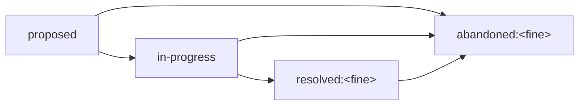

# Agent Note: prac 的定位、`.agents/notes` 形态与开发工作流模型

## Problem

prac 作为软件/产品的定位，以及它自身开发的记忆与工作流，需要一次明确的定义，好让后续开发（尤其用 prac 开发 prac）有稳定依据，也能应对「通用 agent」而非「coding agent」的目标。

## Decision

### 1. prac 的定位

- **prac = 通用 agent**：用于探索 agent 的能力边界；**自用**，服务使用者的工作，**按其经验演化**。
- **不是 coding agent**；prac 的目标与设计**不照搬 DSH**（DSH 是参考/灵感，不是模板）。
- **开发 prac 用 prac**（dogfood）：「开发 prac 的流程」本身就是通用 agent 流程的一次应用。

### 2. 两层

- **机制层**（通用 agent 的流程，task-agnostic，独立成文、可演化）：六条（决策优先 / 依据一等公民 / 可逆带检查点 / 审查为主界面 / 架构记忆 / 活的计划）+ 决策空间（选项·代价·推荐·验证计划）+ 认识论循环。作为活文档，非完美、可被现实证据击打后重修。
- **实例层**（机制在「开发 prac」任务上的形态）：`.agents/notes` + git 工作流。

### 3. `.agents/notes` 的定义

> **可执行的现行用法在 [AGENTS.md](../../../AGENTS.md)**（粒度 / 什么进 note / 状态轴 / no-index）——那是 agent 每次工作必读的**指令面**；本节保留**这条决策的原始表述与理由**。若两者不一致，**以 AGENTS.md 为准**。

- **对象**：prac 的**开发过程**记忆，不是通用笔记本，也**不是便签**。
- **灵活**：形式/大小不限（决策、设计(umbrella)、step、……可以是任何大小、从粗开始被实践细化）。
- **工作表面 vs note**：洞察/发现、观察、复盘、开放问题、障碍**不直接成 note**——它们没有「权威状态」，应作为**依据/证据**附在相关 note 里，或留在工作记录中；当一个开放问题被决断、一个洞察确立为影响 prac 方向的边界时，才凝结为 note（或并入所支撑的 note）。
- **粒度 / 合并**（James）：**一个工作 = 一条 note**——同一个工作的后续进展**在同一个 note 里进行**，修订就是编辑，不新开 note。只有**大的规划**才拆成 umbrella + 多个 step。**复盘 / 阶段综述不进 note**（它不是工作），要作为依据附在相关的工作 note 里。
- **状态 = 权威轴向**（唯一强制的轴）：表达「现在信不信它」，与内容、大小无关。

### 4. 状态机（4 粗分类 + 终态前缀空间）

| 粗分类             | 平铺/前缀    | 含义                                                        |
| ------------------ | ------------ | ----------------------------------------------------------- |
| `proposed`         | 平铺         | 在考虑，未裁决；note 是否成立还不确定。                     |
| `in-progress`      | 平铺         | 已裁决（接受为方向/结论），但**工作在进行中**；明确非终态。 |
| `resolved:<fine>`  | **前缀空间** | 走到**肯定的终态**；细值 = 结束的性质。                     |
| `abandoned:<fine>` | **前缀空间** | 终态非当前；细值 = 放弃的性质。                             |

**细值（开放集合，按需取用，示例）**

- `resolved:implemented`（代码落地+验证）· `resolved:settled`（决策定案）· `resolved:established`（结论成立）
- `abandoned:rejected`（被否）· `abandoned:superseded`（被更新取代）· `abandoned:frozen`（冻结）

- **高层查询按前缀匹配**（no-index 从树推导）：未完成的活 = `in-progress`；当前方向 = `in-progress` ∪ `resolved:*`；历史 = `abandoned:*`。
- `proposed` 与 `in-progress` **不细化**（进行中态的「怎么」不重要）；只有终态需要细值（「怎么结束/为何放弃」值得记）。
- **纯判断 note**（无后续工作）裁决即定案，可直接到 `resolved:settled`；有后续活则停 `in-progress`。
- `implemented` 不另设：代码类的 `resolved:implemented` 即「落地+验证」。

### 5. 组织：no-index

- **不设中央 index，不维护单一「当前状态」**（会把并行强制串行、成写入热点、易漂移）。
- 当前状态由「in-progress ∪ resolved:*」的并集从树上**衍生**。
- 导航靠**树 + 每条 note 自己的状态 + 搜索**；不维护手动同步的中心文件。

### 6. git 工作流（并行）

- **trunk 为主干**：`main` = 权威主干；`dev` 与 `feature/*` 是**平等 worktree**，`dev` 只是当前临时工作区，**无「开发基线」层**。
- **进入上游 = merge 到 `main`**；早期不 public，`main` 即权威（非发布公网）。
- **commit 粒度** = 一个逻辑自足改动（Conventional Commits；一条状态迁移 / 一个 step 各一 commit）。
- **PR 粒度** = 一条能独立验证、讲得清一件事的单位（可含多个 commit；进主干的闸门，非原子单元）。
- **非代码工作**：主产物是 note 本身，可无代码 commit。

### 7. 大设计与 step

- 起点**粗**、不预拆死；随讨论/实践细化（认识论循环）。
- **大设计 = umbrella note** 汇总多个 step；umbrella 与 step 都是 note；umbrella 可加 **tracker 行**记 step 状态；分解是**涌现**的。

## Alternatives considered

- **照搬 DSH 的 notes 组织**（status 目录 + 封闭 class + i18n 三元组 + no-index 规则）：DSH 是成熟参考，但 prac 是通用 agent、自用，设计应源自 prac 的原则，不做模板复刻；class/i18n 不套用。
- **note 绑死「决策」单元**：否决——note 是灵活容器，工作方法（决策优先）不限定 note 形态。
- **状态 frontmatter + 开放 topic 目录**：否决——状态就由状态机表达；组织不做开放 topic，也倾向 no-index。
- **权威轴 + 完成度轴（两正交轴）**：折叠成统一 4 态状态机更简单，且 `in-progress` 天然回答「哪些未完成」。

## Acceptance criteria

- 一条 `proposed` 笔记能清晰描述 prac 定位、`.agents/notes` 定义、4 态状态机、no-index、trunk 工作流。
- 用「找未完成的活 = 筛 in-progress」「当前方向 = in-progress ∪ resolved:*」能直接从树推出，无需中心 index。
- 状态字面量：`proposed`、`in-progress` 平铺；`resolved:<fine>`、`abandoned:<fine>` 用前缀空间。
- 现有已 `accepted` 的 note 结论不改；只按新结构标注/迁移（作为迁移一步）。

## Risks

- **单一状态机对不同内容（决策/代码/发现）的适配**：`proposed`/`in-progress` 平铺，终态 `resolved:<fine>`/`abandoned:<fine>` 用细值区分性质；若某类语义需更细，再扩展前缀空间，当前用示例集合。
- **no-index 的可发现性**：全靠树+搜索，初始可接受；若 notes 增长到难找，再考虑局部导航（不设全局单一 current-status）。
- **迁移成本**：把现有 `accepted` note 迁到新结构（状态字段/目录）是一次独立、向后兼容的步骤，不重写结论。

## Related

- [2026-09-08-first-increment-c1.md](2026-09-08-first-increment-c1.md)
- [2026-09-08-dev-environment-worktrees.md](2026-09-08-dev-environment-worktrees.md)
- [../../../docs/philosophy.md](../../../docs/philosophy.md)
