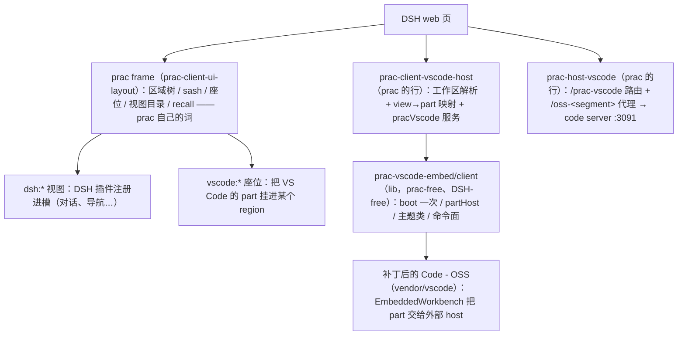

# VS Code × DSH 融合 —— 工作记录（依据）

> **这不是 note**：它是这项工作（[umbrella note](../notes/abandoned/2026-09-09-vscode-dsh-integration.md)）的**依据**——里程碑与工作记录、现在的形态快照、两侧与上游的已核实事实、踩坑与根因、验证方法的元教训。
> 它**没有状态轴、不签字**：这里只有"当时发生了什么、上游到底怎么工作、哪个坑怎么修的"。决定与开放问题在 umbrella。
> 放在 `.agents/worklog/` 而不是 `.agents/notes/`：notes 是**决策记忆**（状态轴 + 人签字），这是**过程记忆**（`AGENTS.md`：观察/发现/复盘/障碍作为依据附在工作 note 里，或留在工作记录中）。
> 2026-09-17 从 umbrella 拆出——那时它的 5.7 万字符里 **79% 是这类依据**，决定只占 16%。拆的时候**正文逐字搬**，只做了三件事：改标题层级、删掉已被 `vendor/vscode/README.md` 接管的重复段（构建两个目标 / 扁平产物与盖章 / 跑法 / 手工装扩展 / code server 命令行副本）、改掉两条与后来事实不符的旧句（各在文中标了日期）。
> **旧引用 `决定 N` 见文末「决定台账」**——那是 2026-09-17 之前 note 原文的归档，编号已退役、不再新增。

## 里程碑

| 日期 | 做了什么 | 依据（判据 / 证据） |
| --- | --- | --- |
| — | A 路线跑通：own 一个 checkout 构建，自建入口调 `create()` | 干净重建 **~3–4 分钟**（`npm install --ignore-scripts` 跳过 native/playwright/copilot 脚本）；`.build/` gitignored |
| 2026-09-11 | `--target server` 构建 + 启动 | **51MB**；**带 `--nls` 才成功**；日志 `Server bound to 127.0.0.1:3090` / `Extension host agent started.` |
| 2026-09-11 | `--target server-web` 构建 | **313MB / 20 bundles**；能起、能服务客户端 HTML |
| 2026-09-11 | server-web 端到端 | 服务端 `Starting extension host process` / `Launched Extension Host Process` |
| 2026-09-11 | 客户端关口：我们的 workbench 能当 self-built server 的客户端 | 页面真的发出 `GET :3091/oss-<hash>/vscode-remote-resource`；唯一失败原因是 CORS（`:3082` vs `:3091`） |
| 2026-09-12 | 同源代理（HTTP + WS 升级）落地 | 页面两条同源 WS 零 1006；服务端 `New connection established`（Management）+ `Launched Extension Host Process`（ExtensionHost） |
| 2026-09-12 | HTTP 代理 404 修复 + 直连/代理对齐 | direct `:3091` 与 proxy `:3084` 同路径都 **200 / 441B**（body 即工作区真实 `package.json`） |
| 2026-09-12 | `stampServerCommit()`（两侧读同一份 commit） | 幂等复跑输出 `server: product.json already stamped (645f29cc31)` |
| 2026-09-12 | `verify-views` Escape 修复 | `open → Escape → closed`；面板关着时路径 `["window-capture","document-capture"]`、开着时只剩 `["window-capture"]` |
| 2026-09-12 | `codeServerPath()` 不再必然抛错 + 失败隔离 | 失败返回 `undefined` + warn、代理整段 `try/catch`；最坏降级为"没有代理" |
| 2026-09-12 | 工作区来自**会话**（删 `PRAC_WORKSPACE_FOLDER`） | 实测解到 `folders: ["vscode-remote://…/dsh-dev"]`（非硬编码），explorer 列出 `apps/ benchmarks/ docs/ native/` |
| 2026-09-12 | `folderUri` revive 修复（空工作区） | `workspaceInfo()` 从 `folders: []` 变成真实 folder；闸门全绿 |
| 2026-09-12 | 第 3 步 `workspaceProvider` 达成 | 打开 `…/prac-dev/package.json` → `.view-lines` = **26 行正文**、`couldNotOpen: false`、**WS 1006 = 0** |
| 2026-09-12 | sidebar part 挂进 prac region | `listViews()` 出现 `vscode:sidebar`；place 到 `left` 后渲染出 `No Folder Opened` / Outline / Timeline 三个 pane header |
| 2026-09-12 | 包结构重组（目录去 `prac-`、workspace 改 `packages/*/*` + `vendor/*`、profile 重指） | 三包 `check`/`check:client` 全绿；DSH 从新布局启动；四闸门全绿 |
| 2026-09-13 | `vendor/vscode` 纯化为 vendor（host 半边移出到 `prac-host-*`） | vendor 无 `main`/无 `dsh`、`exports` 只有 `./package.json`；`/prac-workbench/vs/workbench/workbench.web.main.internal.js` **200 且 37,275,589 字节**；八包 `check` 全绿 |
| 2026-09-13 | 拆包 + 命名对齐（八包） | 八包 `check` 全绿、五份产物 loader 接受、四闸门全绿；删掉 `prac-layout` 遗留的 `dsh.bundle.patch`（它永远不会被读） |
| 2026-09-13 | HMR 临时关闭后恢复 | profile patch 恢复 `[]` + 注释；`verify-regions` 1/1 |
| 2026-09-13 | **S2**：补丁交互面走 `create()` 的 construction options | 产物含 `pracVsBridge` **1 处**、`__pracVsPartHost`/`__pracDeferVsParts` **0 处**；顺带删掉 **50ms 轮询**；默认路径 `vscode:smoke` exit 0、part 全挂载、`errorCount: 0`；staged 契约与仓库原件 `diff -q` 相同 |
| 2026-09-13 | 通道升级：`__pracVscodeHost` → DSH service | 产物 `__pracVscodeHost` **0 处**、两个座位各含 `pracVsHost` **2 处**；四闸门全绿 |
| 2026-09-13 | `isSeatView` 改按**注册表成员**判定 | 删 `VS_VIEW_SOURCE`/`PRAC_VIEW_SOURCE`；`readSeatViewIds(ctx.slots)` 读 `slots.entries("prac.view")`；`verify-layout` 24/24 |
| 2026-09-13 | 组合实验：座位可缺、机制不可缺 | 只留一个座位 → `regions: 3`、`hosts: 1`、无 boot 失败；抽掉机制 → `2 entries did not activate` + `pending (waiting for service: pracVsHost)`、`regions: 0` |
| 2026-09-13 | 服务写法改文档拼写 `ctx.provide` | 产物 `reflect.provide` **0 处**；四闸门复跑全绿（**无需重启 DSH**） |
| 2026-09-13 | **Step 0**：DSH 类型改用 npm 发布包 | catalog 加 **9 个精确 pin**（`@deepseek-ai/cordis@4.0.2`、`dsh-client-ui-*` / `dsh-api-*-controller` / `dsh-host-webserver` `@0.1.5-rc.1`）；八包 check 全绿 |
| 2026-09-13 | `dsh-types --compare` 漂移比较器 | 逐字节比对安装副本与 checkout；**实测 9 个包全部一致** |
| 2026-09-13 | 依赖声明收束（只有 cordis 是 peer） | 6 包 `@deepseek-ai/cordis: ^4.0.2` peer、8 个 DSH 包 devDep；全仓 `@deepseek-ai/*` import 都是 `import type`；client bundle 只 `require("react")` |
| 2026-09-13 | React 真类型（`react ^18.2.0` + `@types/react ~18.3.1` devDep） | 立刻抓到真 bug（座位面 `() => unknown` → `() => ReactElement \| null`）；产物 `require("react")` 恰好 1 处、无内联 |
| 2026-09-13 | **Step A**：拆 `ui-layout`（1591 行单文件 → 8 模块） | `index`166 / `services`219 / `frame`523 / `model`370 / `contract`243 / `catalogue`150 / `store`104 / `theme`65；`.d.ts` 一个不剩；闸门全绿 |
| 2026-09-13 | **Step B 第一部分**：发布 prac 的 client 类型 | `dist/client.d.mts`（ui-layout **8.4 kB** / vscode-host **37.9 kB**）+ `dist/client.mjs` **0 字节**空壳；13 个构建任务 |
| 2026-09-15 | **命名收束**（`vs` 退役、`workbench` 退回 vendor、载荷去 prac 名） | 三条 `grep` 判据全 **0**；九包 `check`、五份产物、四闸门、独立页 smoke 8/8 + `errorCount: 0` |
| 2026-09-15 | 抽出 `vendor/vscode-embed`（prac-free lib），prac 两行变薄 | 同上；staged 载荷与 `overlay/` 逐字节一致 |
| 2026-09-15 | **决定 15 后半落地（常驻底栏）**：默认树包一层 `column`（`root`）＝ 上面那行（`top`）＋ `BOTTOM_REGION`（`bottom`，240，stack，**空**）；**空 region 不渲染**（`isPresent`）⇒ 默认布局零成本、region 列表仍是 `left,stage,right`。填了视图就出现在底部、占满宽度、上方那行让出高度；折叠后高度归零、空间还回 | 新 prac 侧门 `verify:bottom` **11/11**（空则不在 / 填了上屏并像素质 / 贴底且满宽 / 240px / 上方让位 / 折叠归零 / 还原）；vendor 五门与 smoke 全部未动 |
| 2026-09-15 | **决定 15 前半落地（侧栏堆叠）**：`RegionNode.stack`（prac 的模型）、默认树把 `left`/`right` 标成 stack、frame 在**同一 region 有 ≥2 个可见 view 时**逐个渲染（header = view id 尾段 + 折叠开关）、`pracLayout.setViewCollapsed` 记折叠态。**vendor 一个字节没碰** | `tests/gates/verify-stack.mjs`（第七门，prac 侧）**10/10**：单 view 时**像素不变/无 header**（默认布局行为保持）、两个 view 堆叠且都有 body、折叠后 header 在/body 消失/邻居变大、点 header 也能折；原六门与 smoke 全绿 |
| 2026-09-15 | **决定 18 落地（扩展基座换 `server` + Tier 2 证明）**：`build.mjs` 增加 `--target server`（`out-vscode-reh`，带 `--nls`），并把 **checkout 根**、`out-vscode-reh`、`out-vscode-reh-web` 三份 `product.json` 都盖章；服务端改用 `out-vscode-reh/server-main.js`；装 **GitLens**（`eamodio.gitlens-2026.9.92030`，手工解包进 `--extensions-dir`；**验收后按 James 裁决撤装**，等决定 19 给出正当安装路径） | 新第六门 `verify-extension` **5/5**：`gitlens.views.welcome` 挂进 prac 后有 pane、标题 `Welcome`、40 种颜色、可释放 ⇒ **扩展激活**（描述符只有激活后才注册）。`/oss-645f29cc…/version` 200 而 `oss-dev` 404（两侧 segment 一致）；原五门 **24/24 · 33/33 · 12/12 · 1/1 · 7/7** 不变；独立页 smoke 8/8 |
| 2026-09-15 | **B1 落地（单 view 宿主）**：契约加 `mountViewInto`/`releaseView`，载荷用 `ViewPane.render()` 把单个 view 造成自带 pane 挂进外部元素（`getViewDescriptorById` 拿描述符，镜像 `ViewPaneContainer.createView` 的参数），lib 加 `view(viewId)` 句柄，explorer 座位改挂 `workbench.explorer.fileView` | 新第五门 `verify-view` **7/7**（自带 `.pane` + 标题 `dsh-dev` + 302 种颜色 + **页面无 sidebar part** + 跨 region 搬移时**释放后重建成功**）；原四闸门 **24/24 · 33/33 · 12/12 · 1/1** 不变；独立页 smoke 8/8 + `errorCount: 0` |
| 2026-09-15 | **决定 14 落地**：`selectPanel` 把选中视图放进**它自己的** region（无家则进中心），让出中心的视图停到编排绑定的 **track**；对话按普通 view 参与注意力（聚焦谁，谁进 stage，另一个停 right） | 八包 `check` + root `vp check .` 绿；四闸门 **24/24 · 33/33 · 12/12 · 1/1**（两条断言随决策更新：`promotedTrackClosed` → `promotedChatParksInTrack`，verify-views 改为读对话的放置而不是推断轨道消失）；独立页 smoke 8/8 + `errorCount: 0` |
| 2026-09-15 | **决定 16 落地（per-window 持久化）**：`ui-layout` 的 store 换成 DSH `client-store` 的 `createSnapshotStore(..., { persist: { name: "prac-layout/v1" } })` 薄适配；`dsh-client-store` 声明成**平台词**（`scripts/pack-client.ts` 镜像 `PLATFORM_MODULES`，`bundle-client.mjs` 的白名单＝那张表）；`arrange()` 的默认放置改成**只填空缺** | 新 prac 侧门 `verify:persistence` **16/16**；对照实验：去掉 `arrange()` 的 `continue` ⇒ 5 项立刻变红（门真的在断言这件事）；产物 +0.8 kB（内联 zustand/immer 要 ~15 kB） |
| 2026-09-15 | **决定 20 落地（任意方向分栏，分栏必带视图）**：面从 `split(regionId, dir?)` 改成 **`splitView(viewId, side)`**（`Side = left/right/up/down` 一个词同时定轴与插入顺序）；`model.ts` 的 `splitRegionWith` 纯函数（新区域一律 flex）；recall 面每个 view 行加 ←↑↓→ 四个按钮，删掉造空区域的 region 级"分栏" | 新 prac 侧门 `verify:split` **25/25**（左右两个相反方向都测、down 形成嵌套 column、竖 sash 真鼠标拖拽改尺寸、reload 后形状与尺寸复原）；prac 其余三门 10/10 · 11/11 · 16/16 不变；vendor 门 **25/25 · 35/35 · 12/12 · 1/1 · 7/7**（layout +1 断言、views 第 7 节按新语义改写并 +1；`verify-extension` 仍 SKIP）＋ smoke 8/8 + `errorCount: 0`；`vp run -r check` 与 root `vp check .` 绿 |
| 2026-09-15 | **决定 21 第一步（把纯逻辑提出来并建单测）**：`frame.ts` 里的 `sashSizes`（拖拽数学）、`subtreeMin`（预算里"其它子树的最小值"）与内联的渲染判据 `stacked` 全部上移进 `model.ts`（新增导出 `isStacked(state, node)`），`frame.ts` 只负责渲染；`ui-layout` 加 `"test": "vp test run"`，根 `test` 改成 `vp run -r test --passWithNoTests`（没有测试的包默认 exit 1，必须带这个 flag） | 新单测 `ui-layout/src/client/model.spec.ts` **33 条 / 6ms**：默认树与 region 列表、放置与 `visibleViews` 顺序、`isStacked` 的"单 view 裸渲染"、`isPresent` 四种情形、`resolveSizes`（固定轨、空固定轨**不进 box map**、底栏那一层、折叠为 0、flex 均分）、`cachedSize` 往返与**按身份 no-op**、`sashSizes` 的 flex\|flex / 固定\|固定 / **两端 clamp** / **budget 上界**、`Side` 四向 → 轴+子序、`splitRegionWith` 的"只多一个 region"与嵌套、未知 region 按身份 no-op；产物未含 spec（`grep` 判据）、`check:client` 仍 `ok`；全部门与 smoke 未动 |
| 2026-09-15 | **决定 21 第二步（编排策略提出来 + 目录表单测）**：`web-app` 的放置策略（`DEFAULT_PLACEMENTS`/`ROLES`/`placeSurfaces`/`focusView`/`arrange` + 相关常量与 `Surface` 类型）从 745 行的插件体搬进 **`src/client/arrangement.ts`**（插件体只留 UI：焦点条、recall 面、键位），`index.ts` 改从它导入；`ui-layout` 新增 `catalogue.spec.ts`（`viewSource`、`catalogueViewIds` 的"两源 join + 排序稳定"、`readSeatViewIds` 的**成员判定按注册表而非前缀**） | `arrangement.spec.ts` **8 条**（注意力四向落位、聚焦时对话停 track、`arrange` 的**只填空缺**、新视图仍会补位、`bindRoles`/`bindTrack` 的参数）；`catalogue.spec.ts` **7 条**；全 `pnpm test` **48 条 / ~300ms**；`check:client` 两份产物仍 `ok`；prac 四门与 vendor 五门 + smoke 全绿 |
| 2026-09-15 | **一条"故意不搬进单测"的判断**：DSH store 引擎的持久化往返（写 `localStorage` + 构造时 rehydrate）**留在活体层**（`verify:persistence`），不为它装 `zustand`/`immer` devDep | 理由两条：①它验的是**平台库的集成**，不是我们的逻辑（我们的适配器只有 15 行）；②现在"依赖没装"恰好是一个**响亮的失败**——谁把 `@deepseek-ai/dsh-client-store` 从 `external` 里拿掉，构建会立刻报模块解析失败；装了这两个包之后，那份引擎会被**静默内联**（产物里多一份状态引擎，`check:client` 也抓不到）。⇒ 决定 21 的"每个能力留一条活体断言"在这里正好落到持久化上 |
| 2026-09-15 | **决定 17 前半之二（app 自己打开的文件要报到）**：bridge 再加 `listOpenFiles()` / `onDidChangeOpenFiles(listener)`——**唯一能从 app 内部知道"现在开着哪些文件"**的来源（explorer 点击、命令、跳转都走 `IEditorService`）。事件不是现成的：`onDidActiveEditorChange`/`onDidCloseEditor` 都可能意味着集合变了，所以在载荷里**比集合**（变了才通知，dedupe 掉"只是激活"）；刻意不用 `onDidVisibleEditorsChange`——editor part 可能永远不 mount，"visible" 不是我们能依赖的。**列表按"能不能渲染成文本面"过滤**（`ITextModelService.canHandleResource`）：getting-started 页（`walkThrough:`）是有 resource 但没有文本模型的编辑器输入，实测它在未过滤时排在最前——退役 editor part 后它就会变成一个挂不上的假 view。embed 客户端加 `file(resource)` 组件工厂（卸载即 `releaseFile`）与两个透传 | `verify-file` **9/9**：多了两条——`openUntitled()` 之后列表恰好 +1 且事件只来一次（实测 `before: []`、`after: ["untitled:Untitled-1"]`）；其余八项不变 |
| 2026-09-15 | **决定 17 的 prac 半边（editor part 退役，文件成为 view）**：座位 `prac-client-ui-vscode-editor` 改成**每个打开的文件声明一个 `prac.view`**（id = `vscode:file:<resource>`，映射归 host），随 `pracVscode.onDidChangeFileViews` 增减；编排新增 `openFileInto(layout, view)` 规则（**新打开的文件进中心、对话停右轨**，与注意力同一条规则）并在 `ctx.inject(["pracVscode"], …)` 里跟随 app 的开文件集合；注意力（焦点条 / recall 面的聚焦）现在指"**当前那个文件 view**"（`currentFile` 由编排持有，`focusInto` 在聚焦文件时更新它） | 端到端实测（探针）：`face.openFile(<workspace>/package.json)` → 编排把文件放进 **stage**、对话停 **right**、座位声明 `vscode:file:…`、DOM 里 `[data-vscode-embed-file]` 内是**真的 Monaco**（`editors: 1, lines: 56`）且无 prac/embed 报错 |
| 2026-09-15 | **"退役"必须读作"创建但从不托管"，不是"从不创建"**（这一条是实测逼出来的）：editor part 不 create 时，app **打不开任何文件**——`openEditor` 抛 `Cannot read properties of undefined (reading 'isLocked')`（`EditorGroupView` 的 model 没建），`listOpenFiles()` 永远是空，于是"文件变 view"根本没东西可变 | 载荷改成在 `deferParts` 分支里 `createDetachedPart("workbench.parts.editor")`：造进一个 `left:-100000px` 的隐藏容器、**只让服务活着、从不进 prac 的 frame**；`mountPartInto` 遇到已创建的 part 改为**搬运**（想显式托管也还能）。另外两处只有实测才会发现的坑：① `listOpenFiles()` 必须按 **`IFileService.hasProvider`** 过滤——`canHandleResource` 对 `untitled:` 返回 true，但 `createModelReference` 走文件服务、读不到就报 `No file system handle registered`，会变成一个挂不上的假 view；② embed 客户端里 **face 到达前订阅的 open-file 监听要靠 publish 补挂**（否则消费者在 boot 期订阅到的是一次静默 no-op，文件永远不出现） |
| 2026-09-15 | **补掉"reload 后文件 view 变幽灵"**（上一行留下的待办，实测症状先落地）：打开文件 → reload 后 app 不再有文件（`listOpenFiles()` 空），但布局**持久化过的记录**还在 ⇒ stage 上留着那个文件的 **tab**、用**空 view 占着中心**、把对话挤在右轨（探针复现：`open: []` 而 `tabs: ["vscode:file:…/package.json"]`、`regions: left,stage,right`） | 两条规则都放编排、id 约定留 host：① `staleFileViews(records, openFiles, resourceOf)` 纯函数——**host 说"这是文件 view"**（新增 `PracVscodeFace.fileResource(view)`）而 app 不再打开的那些，`sync` 里 **hide**（不删：记录留着，同一个文件再打开时 `place` 会把它放回原处）；② `restoreCentre(layout)`——**当一个文件 view 刚刚离开时**注意力回到对话、中心还给对话（"默认落位"对**空缺**的再次适用）。**这条必须挂在事件上而不是状态上**：第一版写成"没有文件打开就把对话放回中心"，于是 boot 时（本来就没有文件）它会**覆盖用户持久化下来的编排**——`verify:persistence`（把对话停进底栏）与 `verify:split`（对话在分栏里）当场变红。判据：`hidAFileView` 为真才动。复现判据（同一探针）：reload 后 tabs 只剩 `dsh:main:conversation`、regions 回到 `left,stage`、陈旧记录显示为 `(hidden)` | 单测 **59 条**（`web-app` +5：陈旧判定含"非文件 view 永不触碰"、中心归还的两情形）；活体 `verify-file` **14→17**：reload 后无文件 host、无文件 tab、**对话回到中心**。**顺带记下的一处口味问题**：`stage` 现在是 `tabs: "multiple"` ⇒ 只有对话时也会显示一条 tab（VS Code 默认如此）；若嫌它多余，把默认树的 `stage` 改成 `"single"` 即可（一行），我留给你定 |
| 2026-09-15 | **决定 17 收尾（frame 级 tab 条，仿照 VS Code）**：`RegionNode` 加 **`tabs?: TabMode`**（`"multiple" | "single" | "none"`，直接借 `workbench.editor.showTabs` 的词汇与默认值），默认树把 **`stage` 标成 `"multiple"`**（VS Code 默认：**一个编辑器也显示 tab 条**），侧轨/底栏仍是 `stack`（折叠 header 是另一种东西：VS Code 也同时有 view container 的 header 与 editor group 的 tab）；`model.ts` 新增纯谓词 `showsTabStrip(state, node)`，`frame.ts` 在 tab 区域渲染"一条 tab 条 + 当前 view 的 body"（tab = 可见 view 顺序、front 为 active、点击把该 view 提到最前——用的是 `place` 同一条 order 规则，不引入第二份真相）。**一个区域只会有 tab 或 stack 之一**：tab 条替换掉折叠 header（`setViewCollapsed` 只在 stack 区域有意义） | 单测 **54 条**（`ui-layout` 44 + `web-app` 10，新增 `showsTabStrip` 的五种情形 + 默认树里 centre 的 `tabs`）；活体 `verify-file` **10→14**：一个文件时**照样有条**（VS Code 默认）、两个文件两条且最新的 active、**点 tab 真的换到那个 view**；tab 阶段的文件必须与探针 host 挂的文件不同——**一个资源只有一个编辑面**（在 frame 里打开会把编辑器从探针 host 里搬走），这条第一次跑就红在这上面 |
| 2026-09-15 | **三个以 editor part 为主题的门按文件 view 重写**（子代理执行、我复核）：`verify-focus` **9/9**（注意力在"当前文件 view"与对话之间搬移，内容用 `.view-lines` 里**从 workspace 的 package.json 现读的 marker** 判定，不再是 tab 标题）、`verify-layout` **14/14**（工厂形态是 `left,stage,right` 且文件在 stage；行分栏前先给 `right` 放 `vscode:sidebar`〔固定区域空了就不渲染 ⇒ 没 occupant 就没 sash〕；列分栏必须从**固定**源切出，因为 `flex\|flex` 的 sash 按设计是惰性的）、`verify-views` **28/28**（+3：`stage` 是 flex、`isPresent` 让空 flex 区域照样渲染，所以"隐藏 ⇒ 区域归零 + 记住宽度"是**固定区域**的性质 ⇒ 门先用两次真实"移到"把文件变成 `right` 的唯一 occupant，再加了两条断言） | 复核过：三门都自己跑出上面数字。**顺带修掉一个子代理抓到的语义不一致**：`openFileInto` 把文件放进中心却没动注意力 ⇒ 焦点条显示"对话"而中心是文件，且此时按 `Ctrl+Alt+1` 会**什么也不发生**（`focus` 忽略同值）。现在"打开文件"会**移动注意力到 vscode**（已经是 vscode 时则显式 `openFileInto` 放新文件），条与布局从此一致；焦点门相应改断言（opened 状态现在就是 `vscode`） |
| 2026-09-15 | **`openFile` 的冷启动竞态（子代理复查时抓到的生产 bug，已修）**：`openFile` 直接 `editorService.openEditor({resource})` 时，**在远程 FS provider 注册之前**打开会走成 `TextResourceEditorInput`（editor service 只在 scheme 已有 provider 时才建 `FileEditorInput`），其 `resolve` 拒绝 `createModelReference` 返回的模型 ⇒ 控制台报 `Unexpected model for TextResourceEditorInput: …`；资源仍然进了 `editors`（所以 `listOpenFiles()` 与 prac 侧的文件 view 照样工作，`verify-file` 因为"先 mount 后 open"而看不见这条） | 修法：`openFile` 先 `await fileService.canHandleResource(uri)`（它会 `activateProvider`）再打开。冷启动复现判据：全新页面上**第一个动作**就 `openFile(<workspace>/package.json)` → 现在 `listOpenFiles()` 有条目、DOM 里 stage 上是 56 行的编辑器、**0 条相关报错**。教训：**"门绿"不等于"没有竞态"**——门的调用顺序恰好绕过了它 |
| 2026-09-15 | **实测：reload 后 app 不会重开文件**（prac 的文件 view 是"会话内"的）：`openFile(README.md)` → view 在 stage；`page.reload()` 之后 `listOpenFiles()` 为空、没有文件 view | frame 的**布局**会记住 `vscode:file:…` 的放置（决定 16 持久化的是 tree/views 表），但座位只在 app 报"这个文件开着"时才声明 view ⇒ **记录还在、view 不渲染**，且旧记录会一直积在状态里。⇒ 待办（决定 17 的后续）：要么恢复 worker 自己的 open-editor 状态，要么让编排按 `fileViews()` 精简掉 app 已不再打开的文件记录 |
| 2026-09-15 | **默认形态随之变化（必须记住）**：没有文件打开时 `right` 轨空 ⇒ 固定空区域不渲染 ⇒ **工厂排布是 `left,stage`**（`right` 在打开文件、对话停进去之后才出现）。三个 prac 门的前提断言随之改（bottom 的"空则不在"、persistence 的"起始为出厂"改成量 `left`、split 的起始 region 列表），vendor 侧以 editor part 为主题的三门重写到文件 view 上 | prac 四门仍全绿：stack 6/6 · bottom 6/6 · persistence 6/6 · split 11/11；`verify-file` **10/10**（新增两条：真实文件打开报到、**非文件不进列表**）。**仍未做的**：frame 级 tab 条（决定 17 的后半）、挂在 `EditorInput`/`EditorPane` 上的贡献（面包屑 / peek / diff / 热退出） |
| 2026-09-15 | **决定 17 前半（vendor 侧的 file 级宿主）**：bridge 的 `PartHostFace` 加 `mountFileInto(resource, element)` / `releaseFile(resource)`——**单位是文件**（谁开着哪些文件、怎么分组、tab 条长什么样，都是 prac 的事）；载荷里的实现镜像工作台自己的造法：`CodeEditorWidget`（`TextCodeEditor.createEditorControl` 用的就是它）+ `ITextModelService.createModelReference(uri)`（工作台自己的文本模型 ⇒ 语言特性/marker/undo/save 都是真的），只多一个 `automaticLayout`（宿主 region 会 resize，没有别的东西会通知 widget 重排）。**一个资源一个编辑面**：重复 mount 是同一实例换宿主（一个文件一个模型，第二个编辑器就是同一份文本的第二视图），`releaseFile` 只释放引用（模型留给别人） | 新门 `vendor/vscode/scripts/verify-file.mjs` **7/7**：两个文件各自上屏且渲染出**该文件真实文本**（期望值由 gate 自己从磁盘读同一个文件算出，因为 app 的工作区不是 prac 仓——见下）、都有像素质、同文件第三次 mount 得到同一实例（第一个宿主被搬空）、release 后同一文件能再 mount、无 mount 报错；其余六门 + smoke 8/8 未动。**诚实的缺口**（决定 17 的下一步要补）：面包屑/peek/diff/自定义编辑器/热退出这些挂在 `EditorInput`+`EditorPane` 上的贡献**没有**；tab 条与分组按决定 17 归 prac，所以 frame 级 tab 还没做 |
| 2026-09-15 | **一个实测到的运行事实（工作区归属）**：app 的工作区是 **DSH 的活动工作区**——本次是 `vscode-remote://127.0.0.1:3084/Volumes/Dev/deepseek-harness/dsh-dev`，而不是 code server 启动时给的那个目录（`/Volumes/Dev/prac/prac-dev`） | 与决定 13「IDE 侧随 DSH 工作区」一致（`prac-client-vscode-host` 的 `activeWorkspace(ctx)` 读 DSH 注册表），但**两处路径不一致**：code server 的 `--folder` 只影响它自己的 CLI / 终端 cwd（决定 19 要确认这算不算 bug）。也是 `verify-file` 不能写死文件名的原因 |
| 2026-09-15 | **决定 21 第三步（按清单删减活体断言）**：把活体层里"纯机制的算术题"删掉——prac 侧 `verify:stack` 10→**6**（`isStacked` 的判定、`visibleViews` 顺序进单测）、`verify:bottom` 11→**6**（`isPresent`/`resolveSizes`/`cachedSize` 进单测，几何四条并成一条）、`verify:persistence` 16→**6**（`arrange` 只填空缺与"改动生效"进单测；**存活断言一律改成绝对式**，相对式会在"改动其实没发生"时真空通过）、`verify:split` 25→**11**；vendor 侧 `verify-layout` 25→**14**（模型侧放置/几何/clamp 进单测，6 条像素并成 3 条）、`verify-views` 35→**25**（只删纯模型断言——它本就是 recall 面的 UI 契约）、`verify-focus` 12→**9**（摆放规则进单测）；`verify-regions` 1、`verify-view` 7、smoke、extension 未动 | 活体断言 **142 → 85**（prac 62→29、vendor 80→56），单测 48 条；所有门重跑全绿：prac 6/6 · 6/6 · 6/6 · 11/11，vendor 14/14 · 25/25 · 9/9 · 1/1 · 7/7，smoke 8/8 + `errorCount: 0`；`vp run -r check` 与 root `vp check .` 绿。**留下的是三类**：产物过真 loader、VS Code 部件挂进/搬出 prac 区域并画出像素、几何与算术镜像的**漂移检查** |
| 2026-09-16 | **两份"结构"入档**：① code server 的**协议清单**（HTTP 一个端口 / WS 按首消息分三型 / 子进程 node-fork IPC / 只在 VS Code 终端里存在的 CLI 管道 / 扩展面向的 DAP·LSP·worker postMessage）核实后写进本文件的"code server 的协议"；② `docs/architecture.md` **原地重写**为三段式系统参考（DSH 的架构 / VS Code 的架构 / prac 的整合）＋边界清单；旧的"六件事 → DSH 机制"映射搬到 `notes/proposed/2026-09-16-epistemic-six-on-dsh-mechanisms.md`（**James 裁决**：参考文档只写现在时，规划进 notes——它上次变陈旧正是因为计划混在参考里） | 两侧架构各由子代理在**上游 checkout 里逐条取证**（DSH 与 Code - OSS 各一份带 `路径:行` 的摘要）。核对时抓到我方文档**三处错**并已改：① 行的 `id` 与 `name` 的关系（**`name` 才是产物 id**，patch 用 `id` 定位）；② host→client 并非绝对单向（allowlist 里的 **waterfall** 事件是受限的应答通路）；③ `ctx.resources` 只在 client 半边存在。另抓到 `vendor/vscode/README.md` 的改动日志**自称穷尽却漏了一处**（`web.main.ts` 的 `configuration` 由 `private` 改 `protected` ⇒ 补丁实为**两个文件三处**）——已补齐。`pnpm check` 绿（4 条既有 warning） |

> **进度入档（2026-09-15）**：分支 `feat/vscode-dsh-integration`，`wip:` 提交（含签名），检查点 tag `wip/vscode-dsh-2026-09-15`；后续进度按同样方式。提交 ≠ 成果已定。

| 2026-09-17 | **code server 的进程归主干**：`prac-host-vscode` 自己 spawn `out-vscode-reh/server-main.js`——端口取空闲（不再写死 3091）、等 `/version` 就绪、fiber dispose 时 SIGTERM；代理改读句柄；状态目录仍走 XDG。机制落在 `prac-vscode-embed`（`startCodeServer` / `codeServerArgv` / `freePort` / `waitForReady`，12 条单测），政策（哪个 build、哪些目录、何时起）留在插件。逃生口 `PRAC_CODE_SERVER_URL` 指向外置 server、`PRAC_CODE_SERVER_ENTRY` 换 build | 机制单测 12/12；重启 DSH 后日志 `Server bound to 127.0.0.1:58518` + `code server started … (pid …)`；门禁 layout **14/14** · views **28/28** · focus **9/9** · regions **6/6** · view **7/7** · extension **5/5**。`verify-file` 31/33——两项是新的坑（见踩坑与根因）：无 `--folder` 时「未保存」态不成立 |

| 2026-09-19 | **架构重做（旧设计作废）**：James 裁定「放弃当前的架构设计，从需求出发，从头设计架构」。做法：先把需求列成 R1–R15（逐条标出处），再从需求推导结构；**七条待裁全部落地**——LSP 走 P1（主干自己连扩展宿主当主线程）/ MCP 客户端用 DSH 现有的 / `SKILL.md` 不共源 / 工作区以磁盘为准 / 编排单位是一个视图 / 打开的文件集合不给 agent / VS Code 的 chat 面留着不显示。旧的两份提案移进 `abandoned/`（broker 设计降为 P1；能力拆散那条作废），`docs/architecture.md` 按新设计整体重写 | 推导、旧设计处置与本次范围见 [abandoned/2026-09-19-architecture.md](../../.agents/notes/abandoned/2026-09-19-architecture.md)；目标设计见 `docs/architecture.md`；差量与待办见 umbrella §4 |
| 2026-09-19 | **本次范围定死**：**只把两边现有的东西结合起来，不往 DSH 加能力**——VS Code 有而 DSH 缺的，先记下来不立刻加。结合点四个：语言服务器 → `ctx.lsp` 的一个 provider；MCP server 定义 → DSH 现有 MCP 客户端；VS Code 界面 → prac 的 view；人和 agent 对着同一份工作区文件 | James 原话；落点 `docs/architecture.md` §1.4 |
| 2026-09-19 | **核实 DSH 现有能力（本次范围的前提）**：`packages/lsp/`（`ctx.lsp` seam + 通用 stdio 提供方 + `lsp` 工具，只有四个操作、**不带服务器**、不在任何 bundle 里）；`packages/mcp/mcp-client`（MCP 客户端已有）；工具族 fs / fs-search / bash / terminal / str-replace-editor / todo / skill / subagent / goal / ask-user / web / jobs / session-query / workflow / lsp | 各包 README 与 package.json；`docs/tool-catalog.zh.md` 里 `lsp` 工具在列 |
| 2026-09-19 | **命名收束（续）：退役"座位"**——它没有独立含义（就是"注册进 `prac.view` 的 view"，机制本来就是 DSH 的槽），prac 侧词表收敛为 frame / region / view；讲机制时用 DSH 的词（槽 / `kind` / `key`）。活文档已全清（概念边界 note + umbrella 两行历史措辞），工作记录与 abandoned 里的保留为历史 | 决定与理由记在 [in-progress/2026-09-13-vs-concept-boundary.md](../../.agents/notes/in-progress/2026-09-13-vs-concept-boundary.md) 的「2026-09-19：命名收束（续）」 |
| 2026-09-19 | **核实 VS Code 侧诊断与语言特性的形状**（写进 `docs/vscode.md`）：诊断是推-only 的有损缓存（1000 条/文件、`modelVersionId` 无人消费、一半产在渲染器）；语言特性与命令由主线程发起，扩展可经 `vscode.execute*Provider`（24 个）拿到；上游把"在哪算"与"在哪显示"分开（装饰 / 状态栏 / 命令都由主线程代理）；LSP 客户端（cSpell）与消费者（Error Lens）各自的做法 | 逐条带 `file:line`，见 `docs/vscode.md`「诊断是怎么走的」与「agent / MCP / 工具 / skill / prompt 分别做在哪一层」 |
| 2026-09-21 | **架构 note 转 `in-progress`**：设计已由 James 定案（09-19 七条裁决 + 逐页过稿），`proposed/2026-09-19-architecture.md` 搬进 `in-progress/`；顺带修掉写的时候就已过时的说法（"`docs/architecture.md` 等这篇定了再整体重写"——其实已经整篇重写过了），全树入链跟着改 | 链接自检 134 条 0 断；`vp check .` 0 errors |
| 2026-09-21 | **P1 三个点裁决 + 开工第一步**：James 裁定 ① 素材用**内建 css / json / html**（不自写替身）；② **VS Code 生态依托扩展宿主**——能力从扩展宿主里跑的扩展来，扩展清单要**真扫**、不手写；③ 机制**落进 `vendor/vscode-embed`**（host 插件只留政策）。随即做掉第一步的一半：给 `.build/vscode/extensions/css-language-features` 与它的 `server/` 各装依赖（各自 `npm install`，走仓内 cache），再用 checkout 自带的 `tsc` 分别编译两半——`client/out/node/cssClientMain.js` 与 `server/out/node/cssServerMain.js` 都生成了；client 侧 `vscode-languageclient/node` 可解析，server 入口能加载并**要求 `--node-ipc`**（正是它被 languageclient fork 时的形态），两半都没有模块错误 | 裁决、步骤与依据见 [abandoned/2026-09-21-p1-ext-host-chain.md](../../.agents/notes/abandoned/2026-09-21-p1-ext-host-chain.md) §3 / §4；编译发生在 `.build/vscode`（外部 checkout），产物不入本仓 |
| 2026-09-21 | **两个决定（James）**：① **agent 侧一个工作区一个宿主**（同工作区的多个 agent 共用）；② **UI 不与 agent 共用**（UI 按上游，每个页面一个宿主）。理由与 seam 的限制写进 [`docs/architecture.md`](../../docs/architecture.md) §4.2（并同步 umbrella §3.6 与设计 note §2.7 的同一句"代价"）；设计 note 里"两条链要不要合并"那条开放问题**收口为：不合并** | 支持这次决定的实测：4 个工作区 → 4 个宿主 + 4 个 css 语言服务器、每宿主 ≈161 MB / 每服务器 ≈89 MB；共享同工作区对 agent 是省下 N×250 MB（内容完全重复，只买到隔离）；per-agent 今天**表达不了**（seam 的查询里没有会话标识） |
| 2026-09-21 | **用词纠偏：James 说的"插件"是 VS Code 扩展，我前面说的"插件"是 DSH 插件**（"插件族的划分"那条待决项本来问的是我们自己的插件行；我拿它去套"配置插件"，还摆出两种读法让他选——是我的错）。落法：① 在 [概念边界 note](../notes/in-progress/2026-09-13-vs-concept-boundary.md) 的"三套词"处加一条**用词要求**：**不要裸词**，一律写 **DSH 插件** 与 **VS Code 扩展**（James 原话：不要"插件 = …、扩展 = …"这种简称约定，直接说全）；② umbrella 与 `docs/architecture.md` §7 那条新要求改成明确的"**装哪些 VS Code 扩展**"，**删掉"待明确"那段** | **顺带核实了"真源"两条路的底**：VS Code 的 per-workspace 启用/禁用存在工作区 storage 的 `extensionsIdentifiers/{disabled,enabled}`（`extensionManagement.ts:645-646`），本仓 Node **有 `node:sqlite`**（DSH 也有 sqlite 包）⇒ 技术上读得到；但**我们的宿主用的是自己那份 storage 根**（`~/.config/prac/code-server/prac-extension-host/`，实测 cSpell 就往那儿写 `globalStorage`），与页面那份（`~/.local/state/prac/code-server/data/User/workspaceStorage/<hash>`，实测被页面宿主用锁后缀 `-1..-4` 占过）**不是一处** ⇒ "读 VS Code 的状态"并不天然等于"agent 的配置"。真源仍待 James 定 |
| 2026-09-21 | **"插件族划分"撤销，改立"配置装什么"**（James）：① **不需要区分哪个插件算 server 侧、哪个算 client 侧**——要的是**插件贡献的 view 能上屏**；② 新增要求：**按工作区配置"装什么"**，**最好也能按 agent 单独配**。据此把 umbrella §4 的"需要 James 裁 #1（插件族）"标成**已撤销**，新增"新要求"一节；把"扩展贡献的 view 要能出数据"提为**第一优先**（`mountViewInto` 只给了 pane/标题/像素，tree view 的 body 还是 `no data provider registered`——要进 VS Code 自己的可见性/容器模型）；`docs/architecture.md` §7 同步（#4 新要求、#5 view 数据） | **一处待明确（我没替 James 选）**：那句"配置插件"里的*插件*指 **VS Code 扩展**（工作区启用/禁用哪些扩展；上游存在工作区 storage 的 `extensionsIdentifiers/{disabled,enabled}`，`extensionManagement.ts:645-646`）还是 **DSH 插件**（每工作区/每 agent 一份组合树）？前者我们能做（per-agent 卡在 seam 无会话标识），后者是 DSH 层的动态组合、超出本次范围。两种读法都已写进 note 与 docs，等他一句话 |
| 2026-09-21 | **搁置两个后续 + 把 umbrella §4 对齐现状**：James 决定 **① 更多内建扩展（json / html / markdown）先搁置、② MCP 定义接线先搁置**。据此把 umbrella §4 重写：差距表里已完成的两条（**扩展宿主归主干**、**语言服务器经 `ctx.lsp` 的 provider**）移出差距、写成"已达成"；"需要 James 裁"现在只剩**插件族的划分**、阶段二、container/part；"已定方向尚未做"里的 P1 第一条链**删掉**（做完了），MCP 标搁置；重排编号并修正三处指向旧编号的交叉引用（worklog、step note、概念边界 note）。另外收口一条已经解决的认知风险：step note 原写"定向编译单个扩展是否绕得开 ipynb 那关**未核实**"——**已核实：绕得开**（css 就是用 checkout 自带的 `tsc` 直接编的，两半都成） | `docs/architecture.md` §7 #1 同步标成搁置；链接自检 150 条 0 断、`vp check .` 0 errors |
| 2026-09-21 | **查到 workbench 自己的"多窗口"是什么**（James 问）：是 **auxiliary window** ——`BrowserAuxiliaryWindowService`（`src/vs/workbench/services/auxiliaryWindow/browser/auxiliaryWindowService.ts:254`，browser 目录，web 与桌面共用）用 `window.open(...)` 开一个窗口（`:331-375`），**不启动第二个 workbench**：它在新窗口建容器、把编辑器/面板搬过去，服务仍是同一个渲染器的（`vscodeWindowId` 标记 + 跨窗口消息，`:280-300`）；上游用它做"Move Editor into New Window"（`auxiliaryEditorPart.ts:192`、命令 `workbench.action.moveEditorToNewWindow`，`editorCommands.ts:103`） | ⇒ **辅助窗口是"一个 client、多个窗口"**（同一个扩展宿主），与"两个标签各 boot 一个实例 ⇒ 两个宿主"（我上一轮实测）是两回事。**James 2026-09-21 决定：先不考虑辅助窗口，以后再说**（保持简单）；已记进 `docs/architecture.md` §7 #6。**未实测**：在 rig 里触发那个命令是否真的开出窗口且宿主数不变（代码上是），要重开这个问题时先测它 |
| 2026-09-21 | **澄清与补查：James 问的多标签页是"多标签页 = 一个 client"，不是"N 个 client"**（下一条按 N 个 client 测的是宿主数，答偏了）。按这个口径查 DSH 的**身份层**：认证身份是**浏览器会话**——一个 `HttpOnly; SameSite=Strict; Path=/`、绑定 host+port、默认 30 天的签名 cookie（`packages/client/connection/src/browser-auth.ts:120-122`、`index.ts:84`；README 原话 "Every Host RPC method and WebSocket stream requires one browser session"）。**cookie 是浏览器级的 ⇒ 同一浏览器的所有标签天然共享同一个身份**（同一 grant、同一权限） | 但**每个标签仍各自开连接/流**（一个身份、N 条连接）；"谁拥有会话状态、审批在标签间怎么送"**未核实**。prac 自己的 UI 状态已经共享：布局存 localStorage（per origin），两个标签共用一份（`store.ts:78-81` 已注明 per-workspace 作用域待做）。**VS Code 渲染器层仍不是"一个 client"**：工作台 = 渲染器 = 宿主的主线程，一个标签一个宿主（下一条实测）——要共用一个 UI 宿主得跨标签做 leader/mirror，而上游的工作台不能在两个 DOM 里同时活 |
| 2026-09-21 | **核实：web 能不能多标签页**（James 问；桌面 workbench 多窗口的对应物）。实测：同一浏览器里开**两个标签页**访问同一个 DSH —— 两个 workbench 都起来（各自 `#vscode-embed-boot`、各自 2 个 region）、**互不影响**（都 alive）；code server 为每个标签起了**一个扩展宿主**（进程表实测 2 个 `--type=extensionHost`，另有 1 个 `agentHost`、2 个 `fileWatcher`），code server 本身仍是一个 | ⇒ **能**，一个标签 = 桌面上的一个窗口（VS Code 的语义：每个 client 一个宿主）。每标签成本 ≈ 250 MB（宿主+语言服务器）。**扩展状态是每宿主一份**：`extHostStoragePaths.ts:26-62` 用 `vscode.lock` 锁 workspace storage，抢不到就退到 `<dir>-1`、`-2`…（最多 10 次；陈旧锁 10 分钟）⇒ 两个标签（或标签+agent 宿主）在同一工作区**不会互相破坏，但状态也不共享**。**未核实**：两个标签同时编辑/多客户端会话语义（审批、流、谁拥有当前会话）；`editors: 0` 只是因为脚本没打开文件。console 里的 404 是 `vsda` wasm（本 rig 没带，且我们用 `--without-connection-token`），**单标签同样 21 条**，与多标签无关。另外顺带发现 prac 自己的布局持久化**今天就是同源共用一份**（`packages/client/ui-layout/src/client/store.ts:78-81` 已注明"两个 DSH tab 还没分开，per-workspace 作用域待做"） |
| 2026-09-21 | **共享宿主的前提补上了：宿主死了要能自己回来**。插件原来把 `Promise<MainThreadHandle>` 缓存在 `Map<root, host>` 里，宿主中途死掉（崩溃 / 被 OOM 杀 / 被人 kill）时那条记录仍指向一具尸体——之后同一个工作区的查询会对着死连接说话。现在：宿主进程 `exit` 时把该工作区的记录删掉并**警告**，下一次查询**重新起一个** | rig 实测：第一次查询成功 520ms → 我从外面 `kill` 掉宿主 → 日志 `the extension host for … exited (code none, signal SIGTERM); the next question starts a new one` → **新宿主起来**（同一工作区）→ 第二次查询 486ms **拿到真实答案**，最后 1 个宿主在跑。⇒ "一个工作区共享一个宿主"现在不会因为一次崩溃变成所有人的故障 |
| 2026-09-21 | **量了一次"多宿主到底吃多少"**（James 问"对齐成一个 client 一个宿主、一个 agent 一个宿主，资源消耗会不会很大"）。方法：探针问 **4 个工作区** ⇒ 4 个宿主 + 4 个 css 语言服务器，`ps -o rss` 读数（此刻的 RSS，本 rig、98 个扩展、cSpell 因 `onStartupFinished` 也激活了） | **数字**：① 每个扩展宿主 ≈ **161 MB**（164688/162848/164608/163184 KB）；② 每个 css 语言服务器 ≈ **89 MB**（单独跑 `cssServerMain --stdio` 量到 90928 KB）；③ code server ≈ **115 MB**，**一份**（不随消费者数增长）；④ DSH 自身那个进程 ≈ **1.1 GB**。⇒ 每多一个消费者约 **+250 MB**（宿主 + 它起的语言服务器），总账 ≈ 1.15 GB + N × 250 MB。4 个宿主各自扫 98 个扩展、各自一份语言服务器（`--clientProcessId` 与宿主 pid 一一对应） |
| 2026-09-21 | **一个拦路事实：现在的 seam 传不了"是哪个 agent"**。`LspProviderQuery` = `{operation, filePath, position, workspaceRoot, languageId}`（`packages/lsp/lsp/src/types.ts:38-57`）——**没有 session / agent 标识**。所以"一个 agent 一个宿主"今天无法表达；要么让 DSH 在 seam 上带一个会话键（**属于给 DSH 加能力，本次范围外，只记录**），要么退化成"一个工作区一个宿主"（= 同工作区的多个 agent 共享；只有各 agent 各占一个工作区时才等价于 per-agent） | 对照：client 那半我们已经和上游一致（每个页面一个宿主）；agent 这半目前是 per-workspace |
| 2026-09-21 | **核实：多个 client 连同一个 code server 会起几个扩展宿主**（James 问）。**代码**：服务端 `_extHostConnections` 是 **`reconnectionToken` → 一个连接 → 一个 `cp.fork` 进程**的一对一映射（`remoteExtensionHostAgentServer.ts:77`）；**新建**连接就新建宿主，同一个 token 并发再来会被明确拒绝（`:473-495`：`Duplicate reconnection token` / `Cannot have two concurrent connections using the same reconnection token`）；只有**同一个 client 重连**走 `acceptReconnection`（`:489`）复用那个进程。客户端侧也是每个窗口一个：`ExtensionHostManager` 建好就 `start()`（`extensionHostManager.ts:117`），浏览器里只要有 remote 连接就建 `RemoteExtensionHost`（`browser/extensionService.ts:251-258`）。⇒ **N 个 client = N 个扩展宿主**，宿主是**按 client 连接**而不是按工作区/用户分的 | **实测（本 rig）**：探针问两个工作区 ⇒ 2 个宿主、**2 个 `cssServerMain`**（每个宿主各自起一份语言服务器，不共享）；再开一个页面 ⇒ **只多 1 个宿主**（`--type=extensionHost --transformURIs`）。**我自己的数法一开始是错的**：`pgrep -f bootstrap-fork` 把 `--type=fileWatcher` 和 `--type=agentHost` 也算进去了（2→5 的假象），按 `--type=` 分类后是 3 个扩展宿主 + 1 个 fileWatcher + 1 个 agentHost |
| 2026-09-21 | **顺带观察（与 umbrella §7「Copilot 在 rig 里到底有没有激活」相关）**：开一个页面时，code server 除了扩展宿主还拉起了 **`--type=agentHost`** 进程（`bootstrap-fork --type=agentHost --logsPath … --user-data-dir …`）——即 VS Code 自己的 agent 层也有一个"服务端形态"，就住在 code server 旁边。这不回答"Copilot 是否激活"，但说明**树里多一个 agent 不只是理论**；要不要管它是另一个决定 |
| 2026-09-21 | **P1 按 James 三条反馈改**：① **查询路径上不再扫描**——扩展目录改成 **`fs.watch` 事件驱动**（去抖 500ms；定时器 unref，不钉住一次性进程），另留一个显式的 `reload()` 给"知道变了但看不到文件事件"的调用方；② 多工作区 = **多宿主并存**（`Map<workspaceRoot, host>`，不再互相收掉），一个工作区的查询不影响另一个；③ keep-alive 的疑问先核了事实：**IPC 载体上宿主自己会自杀**（`extensionHostProcess.ts:286-288`：`socket.on('close', () => onTerminate('renderer closed the socket'))`），加上 `parentPid` 看门狗是第二道，所以我们 dispose 时的 `child.kill()` 只是"快一点"，不是必需 | **rig 实测**（探针问两个工作区、再往扩展目录里放一个扩展）：日志里 `starting the extension host for …/p1-workspace`（97 个扩展）→ workspace A OK 523ms → `starting the extension host for …/p1-workspace-b`（**第二个宿主，第一个没被收掉**）→ workspace B OK 455ms → 放下扩展后 `extension set changed — … now has 98` **两次**（两个在跑的宿主都收到了 delta）。lib 集成测试补了一条"两个宿主并存"（各答各的、进程不同、都没被杀），包内 **41/41** |
| 2026-09-21 | **P1 补上"动态激活"**（James：「vscode 中扩展是可以动态激活的，我们也应该支持」）。三件事：① lib 新增纯函数 `extensionsDelta(previous, next, versionId)`（按 id 比对，版本或路径变了算替换；没变化返回 `undefined` 以便跳过往返）；② `MainThreadHandle.setExtensions()` 把运行中出现的扩展通过 **`$deltaExtensions`** 交给**已经在跑的**宿主（宿主会同时重建注册表与激活事件表，`extHostExtensionService.ts:1071-1089`）——**不重启宿主**，也因此不丢掉已经起来的语言服务器；③ 插件每次查询前**节流重扫**（2 秒）扩展目录，并按 VS Code 语言服务的做法**同时触发 `onLanguage:<lang>` 与 `onLanguage`** | 单测 11 条（`extensions.spec.ts` 新增 4 条 delta 用例）+ 集成 7 条（新增"运行中出现的扩展会被宿主接住"：推一个磁盘上并不存在的扩展，宿主**尝试激活它并失败**——这正是它学到了的证据；同时 cSpell/css 的 provider 照旧工作、宿主进程没换）。包内 **40/40**；真 rig 复验：四操作探针（537/7/8/5ms）与 headless 门 3（24 秒 exit 0，答案照旧）都通过 |
| 2026-09-21 | **P1 门 3 通过：模型真的调了 `lsp` 工具**。修好 `prac-headless-dev`（见下一条）后跑 headless 任务（要它用 lsp 工具做一次 hover 并原样贴回结果）：日志里 provider 注册成功，模型自己决定调用工具，并把工具返回的内容原样贴出——**"Sets the color of an element's text" + MDN 引用 + Baseline 图标**，即 VS Code 内建 css 扩展语言服务的真实 hover。四道门至此全部通过 | 证据：`.build/scratch/gate3.log`（不入仓）。同一次运行里还看到扩展宿主**顺带激活了 cSpell**（`activated streetsidesoftware.code-spell-checker`，它声明 `onStartupFinished`）⇒ 清单真扫 + 多扩展共存这两条也顺带验到了；另有一条 `TypeError: tools is not iterable` 的警告（某个扩展，不影响本次） |
| 2026-09-21 | **为门 3 修了工作区之外的 `~/.dsh/profiles/prac-headless-dev`（两处，都是过期）**：① `package.json` 的依赖与 `node_modules` 软链都还指着 `packages/prac-web-app`（实际在 `packages/bundle/web-app`）；② 它只有 bundle 一个链接，而 composition 的行名（`prac-host-vscode` 等）要能从 profile 目录解析——补上 web profile 同样的 6 个链接 | 改法：改 `package.json` 的 link 值 + `ln -sfn` 六个软链；`--dump-config` 复检 composition 正常。**这是本工作唯一动到仓外的改动**（没动 DSH 本身） |
| 2026-09-21 | **坑：headless 跑完不退出（是我们造成的）**。归因实验：同一个任务**不装我们的插件 8 秒退出**（日志里 seam 回 `no LSP provider handles …`），装上就挂过 600 秒。原因是我们那条连接把宿主进程的事件循环钉住了——fork 出来的子进程 + IPC 通道 + 监听的 server + 已连接的 socket，加上**上游 `PersistentProtocol` 的 keep-alive interval（5s）与 `LoadEstimator` 的单例 interval（1s，永不停止）**。修法（lib）：`sendKeepAlive: false`、注入一个**自己 unref 过的** load estimator（语义保留：interval 漂移=事件循环忙）、`child.unref()` + `channel.unref()` + `server.unref()` + `socket.unref()` | 修后：同一任务 **24 秒退出、exit 0**，答案照旧。教训与 `execArgv` 那条同源——**只有放进真 rig 才看得见**，包内测试永远不暴露 |
| 2026-09-21 | **坑（DSH/rig 侧，本次只记录不改）**：headless profile 下模型请求发不出去，报 `REQUEST_EXTENSION: DeepSeek request extension preparation failed`。追到 `packages/llm/llm-deepseek/src/index.ts:481` 的 `prepareExtensions` → 注册表里的 `dsh_plugin_packages`（`plugin-package-inventory-deepseek`，默认开）在这个 composition 上准备失败，错误被包成 `LlmError` 的 cause，CLI 只打印外层消息。为了把门 3 跑通，我用一次性 overlay（`.build/scratch/p1-headless.yml`，不进仓）把它 `enabled: false` 关掉；**根因未查明**（它要收集"活跃插件包"，我们这套 composition 里有什么让它不满意不得而知），按"本次只做结合、不往 DSH 加东西"的规矩没有继续查 | 复现：不加 overlay 跑 headless 任务即得该错误；加 `-—patch` 关掉它就能跑完 |
| 2026-09-21 | **P1：不支持的操作不再干等超时**。lib 现在把"激活已结束"记下来（`$onDidActivateExtension` 或激活失败都算），`MainThreadHandle.activated` 暴露出来；插件的等待逻辑按语言算出**候选扩展**（谁的 `activationEvents` 里有 `onLanguage:<lang>`），候选全部激活完而 provider 仍缺席时立刻抛 `LSP_UNSUPPORTED_OPERATION` | 真 rig 实测：`goToImplementation FAILED (4ms)`（此前是 30 秒超时），另外三个操作 528ms / 7ms / 5ms。包内测试加了"激活已结束"的断言，35 条仍全过 |
| 2026-09-21 | **P1：把四个操作都在真 rig 里问了一遍（并因此抓到一个真 bug）**。探针依次问 hover / goToDefinition / findReferences / goToImplementation：前三个拿到真结果（hover 是 CSS 属性文档；definition 指回 `--brand` 声明那一行，0-based line 1；references 指回两处 `.a`，line 3 与 7；三者都带 `resolvedWorkspaceUri`），第四个以 **`LSP_UNSUPPORTED_OPERATION`** 失败——**css 扩展确实没注册 implementation**（它的能力表里没有），这是正确行为不是缺陷 | **抓到的 bug**：同一个文件被问第二次时，插件又推了一次"新增文档"，扩展宿主在 RPC 处理器里抛 `document 'file://…' already exists!`，而这个 throw **把宿主进程带走了**（表现为第二个问题永远不返回）。修法在 lib：`main-thread.ts` 维护文档镜像——首次推 `addedDocuments`（全文），之后内容变了走 `$acceptModelChanged` 的整档替换（`changes` + `rangeLength` + 递推 `versionId`），内容没变一条都不发；`closeDocument` 同时清镜像。加了三条回归（同一文档问两次、内容重写后 provider 看到新内容、references/definition 映射），包内集成测试 3 → 6 条 |
| 2026-09-21 | **顺手核实的语言服务行为（免得再猜）**：`vscode-css-languageservice` 的 `findDefinition` 只在**同一文档内**解析符号（`cssNavigation.js:23-38`：`symbols.findSymbolFromNode` → 返回本文档 range），**不做跨文件 `@import` 解析**；`findReferences` 就是同文档高亮（`:39-45`）。所以 definition 的测试用自定义属性 `--brand` 的引用处去问，而不是 `@import` 的目标文件——第一版测试按"能跨文件"写、返回空，是**测试的假设错了**，不是代码错了 |
| 2026-09-21 | **P1 门 4：现有门禁全绿（无回归）**。把 rig 起到 `:3084`（`dsh --profile prac-dev --port 3084 --no-open`，token 在启动日志里），逐条跑：**vendor 侧** `layout 14/14 · views 28/28 · focus 9/9 · regions 6/6 · view 7/7 · file 33/33 · extension 5/5`（条件门带 `EXTENSION=streetsidesoftware.code-spell-checker VIEW=none`）；**prac 侧** `verify:stack 6/6 · verify:bottom 6/6 · verify:persistence 6/6 · verify:split 11/11`；单测 `pnpm test` 三包 **31 + 44 + 15 全过** | 每条都留了完整输出在 `.build/scratch/gates/*.log`（不入仓）；计数按各门 `checks` 键实点。**跑法上的两个坑**：① `URL=… vp run verify:stack` 传不进环境变量，要直接 `node tests/gates/verify-*.mjs`；② vendor 那些脚本要从**仓根**用相对路径跑（从 `vendor/vscode` 里跑会把相对日志路径写丢）。另外这次 `verify-file` 直接 33/33 绿（不需要为它单独关 autoSave，与旧记录里那条注意事项不一致，记下来待查） |
| 2026-09-21 | **P1 第 4–6 步：接进 prac 插件，并在真 composition 里无页面跑通**：新 `packages/host/vscode/src/language.ts` —— 清单用 `scanExtensions` 真扫（`<checkout>/extensions` + `--extensions-dir` 的用户目录）、按工作区懒起一个扩展宿主、把 seam 的四个操作翻成 `$provide*` 并把结果翻回 `LspQueryResult`；`ctx.inject(['lsp'])` 懒注入，所以没有 seam 的 profile 照旧工作。composition 里补两行：`@deepseek-ai/dsh-lsp` 与 `@deepseek-ai/dsh-tool-lsp`（没有任何 DSH bundle 带它们）。依赖按本仓约定加进 catalog（DSH 包只做类型；`neverBundle`，运行时从 DSH 安装解析） | **验证（无页面、无模型）**：`dsh --dump-config` 里能看到两行；`dsh --profile prac-dev --patch <探针> --no-open` 的日志里 ① `prac-host-vscode: lsp provider vscode-language-features registered for .css, .scss, .less`；② 探针查到 `lsp` 工具已注册（描述就是 tool-lsp 那段）；③ 探针直接调 `ctx.lsp.query` 拿到 **CSS 扩展语言服务的真实 hover**："Sets the color of an element's text"。探针是一次性的（`.build/scratch/`，不入仓） |
| 2026-09-21 | **踩坑：扩展宿主继承了父进程的 loader 参数，直接死**。DSH 的 CLI 是用 `node --import tsx/esm` 跑的，`child_process.fork` 默认继承 `process.execArgv` ⇒ 扩展宿主进程带着 `--import tsx/esm` 启动，在 VS Code checkout 里解析不到 `tsx`，`ERR_MODULE_NOT_FOUND`，表现为"扩展宿主还没连上就退出（code 1）"。修法：lib 里 fork 时显式 `execArgv: []`（宿主是构建产物，不该继承任何 dev 参数） | 症状先出现在探针日志：`[p1-probe] FAILED extension host exited before connecting (code 1, null)`，根因在同一份日志里（`Cannot find package 'tsx' imported from …/.build/vscode/`）。这条只有把它放进真 rig 里才会暴露——包内测试用裸 node 跑，永远看不到 |
| 2026-09-21 | **踩坑（流程）：`pnpm install --filter <包>` 会把别的包的依赖剪掉**——加 `@deepseek-ai/dsh-lsp` 后我用 filter 装了一次，接着 `vp check .` 冒出 55 个错（`Cannot find module 'react'` 之类，全是别的包）。修法：跑一次完整 `pnpm install` 恢复 | 教训：这个仓的校验覆盖全 workspace，加依赖后要整装，别用 filter |
| 2026-09-21 | **一处类型与运行期不一致（已绕过并记录）**：`@deepseek-ai/dsh-lsp` 发布的 `.d.ts` 里 `LspError` 是空类（基类 `HarnessError` 不在该包类型里），TS 只看到零参构造；运行期签名是 `(message, code)`（`packages/llm/llm/src/error.ts:16`）。插件里用一处带注释的转换保住结构化错误码 | 若上游补上声明，这处转换可以删 |
| 2026-09-21 | **P1 第 3 步核心验证：真 css 扩展在我们的扩展宿主里激活、注册 provider、答出真实 hover**：新模块 `vendor/vscode-embed/src/host/main-thread.ts`（最小主线程）＋ `extensions.ts`（把扩展目录扫成 initData 要的描述、把扩展自己声明的配置默认值展平）。集成测试对真构建跑：`scanExtensions(<checkout>/extensions)` → 起宿主 → `$activateByEvent('onLanguage:css')` → 扩展激活（`$onWillActivateExtension` → `vscode-languageclient` 起它自己的语言服务器）→ 收齐它注册的那一族 provider → **`$provideHover` 返回的 CSS 属性文档里含 `color`** | 包内测试 **31/31**（新增纯单测 12 条 + 真构建集成 3 条），全仓 `vp check .` 0 errors。**这一步的两个关键决定**：① 未实现的 `MainContext` 顾客一律装一个**兜底演员**（返回 `undefined` 并记账）——否则一个未注册的顾客会被回成 `Unknown actor`，扩展表现为"莫名起不来"；② 顾客注册与入站帧的顺序由 `configure` 钩子锁死 |
| 2026-09-21 | **踩坑：`vscode.version` 拿到 0.0.0，扩展被拒**——`vscode-languageclient` 构造期校验 `^1.91.0`，报 "requires VS Code version ^1.91.0 but received version 0.0.0"。根因：**源码 checkout 的 `product.json` 没有 `version`**（打包时才注入），真正版本在 `package.json`（`1.137.0`）。修法：`resolveExtensionHost` 读 product 时回退到 checkout 的 `package.json` | 症状先出现在集成测试的失败输出里（`activation failed …`），修后同一条测试通过；顺手把 `MainThreadConsole.$logExtensionHostMessage` 接进 `onLog`，此后扩展内部的报错不再静默 |
| 2026-09-21 | **P1 第 2 步完成：连接机制落进 `vendor/vscode-embed`**：新模块 `src/host/extension-host.ts`（机制、不带政策）——按 checkout 找到 `bootstrap-fork.js` / `out-build` / `product.json`；组装子进程环境与 initData（`version`/`quality`/`commit` 由 build 盖，避免与对端不符）；建 unix 管道、`cp.fork`、按固定顺序握手、从 `out-build` 动态 import `RPCProtocol` 与协议表、把两端接起来。政策（环境、扩展清单、工作区、输出去哪）全部由消费方传入 | 单测 8 条（纯部分）+ **对真构建的集成测试 1 条**：握手完成、`MainContext` 87 / `ExtHostContext` 81、**真的收到** `MainThreadCommands.$registerCommand` 与 `MainThreadLogger.$registerLogger`、dispose 后子进程退出。包内 `vp test run` 21/21，全仓 `vp check .` 0 errors |
| 2026-09-21 | **写这一层时踩到的两个坑（都是"丢了就表现为扩展莫名失败"的那种）**：① **握手后、顾客注册前到达的帧不能丢**——扩展宿主接受 initData 的下一秒就开始发 RPC（含启动期记账），而此时我们还没 `set()` 那些 `MainThread*`；RPC 层一订阅就把缓冲冲出去 ⇒ 全部被判 `Unknown actor` 回绝。修法：入站消息先缓冲，等 `startExtensionHost` 的 `configure` 钩子把顾客装好再 `release()`。② **dispose 时不要 drain**：上游 `PersistentProtocol.drain()` 等的是对端确认，而被我们杀掉的进程永远不会确认 ⇒ 挂死；停机就是 `rpc.dispose()` + 断 socket + kill | 症状与修法都体现在集成测试里（先失败后通过）：第一次失败是"等不到启动期调用"（20s 超时），第二次是整条测试挂满 90s |
| 2026-09-21 | **P1 机制探针：扩展宿主的载体的握手跑通**（主干自己 fork，纯 node，不依赖页面与 code server）：`net.createServer` 起一条 unix socket → `cp.fork(out-vscode-reh/bootstrap-fork.js)`，env 给 `VSCODE_ESM_ENTRYPOINT=vs/workbench/api/node/extensionHostProcess` + `VSCODE_EXTHOST_IPC_HOOK=<socket>` + `VSCODE_NLS_CONFIG` → 对端连上来后 `NodeSocket`+`PersistentProtocol`（`protocol.sendResume()`）→ 收到 `[0x02]`(Ready) → 发一帧 UTF-8 JSON 的 initData → 收到 `[0x01]`(Initialized) → **扩展宿主随即开始发 RPC 请求**（解出的前几条：`$registerLogger`、`$getInitialState`、`$registerCommand`、`$registerProcessSupport`、`$registerTaskSystem`、`$getTools`、`logExtensionHostMessage`）| 探针 `.build/scratch/probe-handshake.mjs`（不入仓）；**两个只有做了才知道的坑**：① bundle 的 ext host 在模块加载期就要本地化消息表，不喂 `VSCODE_NLS_CONFIG`（指向 `out-vscode-reh/nls.messages.json`）会 `!!! NLS MISSING: 1516 !!!` 直接死；② `NodeSocket` 在 **`vs/base/parts/ipc/node/ipc.net.js`**（common 那份没有），`PersistentProtocol` 在 common。RPC 帧形状也实测到：`UInt8 type + UInt32BE req + UInt8 rpcId + UInt8 方法名长 + 方法名 + UInt32BE 载荷长 + JSON`。ext host 另报了一条 `@vscode/spdlog` 原生绑定找不到的错误（不致命） |
| 2026-09-21 | **P1 第一条链的实现计划成形**（step note，`proposed` 起、同日转 `in-progress`）：四份只读侦察核实了三件事——DSH `ctx.lsp` 的确切契约（提供方三成员、0-based 坐标、**没有 capabilities 字段**、lsp 三包不在任何 bundle 里）；VS Code 扩展宿主机制（入口是 `bootstrap-fork.js` + `VSCODE_ESM_ENTRYPOINT`，载体三选一，帧是 `NodeSocket`+`PersistentProtocol` 之上再套 RPC，**主线程那面上游没有 server 侧实现可复用**，但 `out-build/` 可 import 且是我们自己构建的产物）；以及**设计里点名的四个内建语言扩展当前根本没有可加载入口**、`vscode-languageclient` 也没装（cSpell 又不在 seam 的四操作里）。据此给出三个待裁点（素材 / 扩展宿主从哪来 / 协议层怎么来）与四道验证门 | file:line 证据见 [abandoned/2026-09-21-p1-ext-host-chain.md](../../.agents/notes/abandoned/2026-09-21-p1-ext-host-chain.md)；这也印证并量化了 umbrella §4 #10（内建扩展不可用） |

## 当时的形态快照（2026-09-15）

> 这是**当时**的快照，不是目标（目标见 `docs/architecture.md`）。

包：`packages/{bundle/web-app, client/{ui-layout, vscode-host, ui-vscode-editor, ui-vscode-explorer}, host/vscode}` + `vendor/{vscode, vscode-embed}`；profile `prac-dev` = 三 bundle（`dsh-base` / `dsh-web-app` / `prac-web-app`）+ 六 link。

**关键事实（实测）**：

- 一页 `create()` 一次；part 是**单实例** ⇒ 只能 `movePartInto` 搬、不能重建；隐藏 region 必须留 host（`verify-focus` 的 `partInOneHost` 是这条的化石）。
- 扩展宿主、文件/配置/存储随 workbench 的 bootstrap 起来；`workspace.id` 在 `create()` 时定死（IndexedDB key + profile 选择）⇒ 启动必须等"工作区已知"，且**不能先建后纠**。
- 补丁只动上游两个文件（`web.factory.ts`、`web.main.ts`，**74 行 delta-only**）；载荷走 `overlay/`，由构建放进 checkout（构建把 overlay 拷进去；只在 pin 变化或 `vscode:clean` 时 reset，所以 checkout 不是第二份真相靠的是「我们写的东西都能被覆盖 + 别人的改动有 drift 警告」，不是每次清空）。
- DSH 侧：prac 的包作为**行**由 `prac-web-app` 的 patch `insert`；**行的 `name` 才是产物 id**（`clientPack(id)`），包的 `name` 与 patch 用的行 `id` 是两个东西（2026-09-16 核实更正；这条快照原先写的是"loader 行 id 取的是产物 id"，与"已核实事实"里 DSH 侧那条更正相冲）。
- 跨插件共享的页面级状态只有一处：`globalThis.__vscodeEmbed`（boot 守卫、boot 元素、命令面、失败原因、part→元素表）。
- **空 region 不渲染**（`isPresent`：非 flex 且没有可见 view ⇒ 不在 DOM 里）⇒ 新增区域可以"零成本地存在"，填了才出现；这也让底栏这种"默认收起"的东西不需要单独的状态。
- 构建期契约只有一处：`vendor/vscode/overlay/embedBridge.ts`（`EMBED_BRIDGE` / `PART_HOST_ATTR` / `PartHostFace` / `EmbedBridge`），两侧编译同一份原件。

## 已核实事实

### DSH 侧

- **每个 client 插件各自打包、各自内联** ⇒ 模块级单例**不共享**；跨插件共享一个面必须走模块图之外的载体（Cordis service；补丁侧无可避免时用页面级全局）。
- **行的 `name` 才是产物 id**（entry 实际 import 的模块 specifier = npm 包名；浏览器的 module table row id、`clientPack(id)`、`bundle-client.mjs --id` 用的都是它）；**patch 用行的 `id` 定位**（config tree 内的稳定标识，缺省随机生成）。prac 的行把两个字段取成同一个字符串，但它们是两个东西（DSH `vendor/loader/src/config/entry.ts:8-21`；2026-09-16 核实，改正了本条原先"loader 行 id = 产物 id"的写法）。
- **“扩展宿主”只是 VS Code 架构里的概念，不要带到 DSH 上**（2026-09-16 三次更正：我先用这个 VS Code 的词去**否定** DSH（"DSH 没有扩展宿主"），随后又把它写成"DSH 的插件树**就是**扩展宿主、角色对等、形状不同"——**两次都是把别人的概念外推**。正确的说法只有一句：DSH 的扩展方式就是**插件**，VS Code 的扩展方式才是扩展宿主，两者是**不同的机制**，不是一个角色的两种形状）（这个词属于 VS Code，不能借）：DSH 的插件跑在**同一棵树、同一地址空间**（host 在 DSH 的 Node 进程、client 在页面），耦合是 in-process 的 `inject`，没有进程边界也没有专用协议。最接近"第三方代码运行时进来"的是**动态包**子系统（`packages/extensions/`：`tool-cordis` / `cordis-host-runner` / `cordis-client-runner` / `ui-cordis`）：模型可定义/运行/停止/删除 Cordis 包，host 半边在 `node:vm` 全新 realm + 白名单 façade 里求值（模块注释自陈 *"**is not containment**"*），浏览器半边在页面闭包里 `new Function`，定义只活在进程内存、重启即失。host 让浏览器跑半边靠的是 `cordis/request-run*` **转发事件**，不是 RPC。
- **依赖缺失的 fiber 保持 pending** ⇒ 坏组合表现为"挂起"而不是"渲染空白"（实测报 `pending (waiting for service: …)`）。
- 固定三轨尺寸；`main` 是 **keyed 单占位**（`entryKey: panelId ?? 'conversation'`）⇒ 对话与编辑器**不能同屏**；`slot:rightbar` 默认隐藏。
- `root` 槽明文 **DO NOT register**；`shell.overlay` 是自建浮动面的正规座位（list 槽、加性、点击穿透）。
- client 插件的 `require` 解析**注册过的 bundle id + 一张静态平台表**（见下），其余必须自包含；`exports` 里导 `./src/*` 只对**构建期**（打包器/TS）有效。
- **loader 的模块表有一张固定的平台词表**（九词）：`react` / `react/jsx-runtime` / `react-dom` / `react-dom/client` / `@deepseek-ai/cordis` / `@deepseek-ai/dsh-client-store` / `@deepseek-ai/dsh-client-ui-slots` / `…-ui-primitives` / `…-ui-dockkit`。真源是上游 `packages/client/web/src/platform.ts`（`packages/client/web/src/seed.ts` 按它 seed 成唯一实例），上游自己的打包器也把这张表当 external 基线（`packages/client/tsdown.client.ts`）⇒ **跨插件共享一个实现的正规路径是 require 表里的词**（`dsh-client-store` 就是这样一个词），而不是各插件各自内联一份。prac 侧镜像在 `scripts/pack-client.ts` 的 `PLATFORM_MODULES`：它既是 `clientPack(..., { external })` 的合法取值，也是 `bundle-client.mjs` 的 `--allow` 白名单（2026-09-15 实测：把 `dsh-client-store` 声明成 external 后，产物只 +0.8 kB——内联 zustand/immer 要多 ~15 kB 且是第二份状态引擎）。
- `dsh-web-app` 自带 `client-hmr`，有已知的 `duplicate factory registration` 症状。
- 客户端产物是 **lazy-CJS**：`window.__ModuleLoader__.load({id, factory})`（原生 ESM 会 `Unexpected token 'export'`）。

### VS Code 侧

- **不可作可消费依赖**：根 `package.json` `"private": true`、无 `"exports"`、`"main": "./out/main.js"`；构建工具链在根 devDependencies（**104 个**）＋独立子包 `build/`（**59 devDeps**，pnpm 不装）⇒ 只能 own 一个 checkout 构建。
- `create()` 一页一次；`workspace.id` 在 `create()` 时定死（IndexedDB key + profile 选择）⇒ **一个窗口一个工作区**，切换只能导航（即重载）。
- 扩展宿主按 `reconnectionToken` 索引（**每客户端连接一个**）⇒ 多窗口同一工作区天然支持；server 要保的是"工作区存在性 + 扩展宿主/会话"（`reconnection-grace-time` 默认 **3 小时**）。
- 前端 UI 状态（区域尺寸/调出面板/展开项）按工作区 id 存在**浏览器** IndexedDB，跨连接存活。
- `createWorkbench`（`IBrowserMainWorkbench = { startup, onWillShutdown, onDidShutdown }`）是上游给"换一个 app"留的缝（`protected` 可覆写）；上游自己的第二个 app（`src/vs/sessions/`）用的也是它，并另覆写 `createWorkspaceConfigAndStorageServices`。
- `IWorkbenchLayoutService` 约 **51 个成员**；sessions 的 `Workbench` 模板 **2976 行**。
- **part 由服务 eager 造**（`IPaneCompositePartService` / `ITitleService` / `IStatusbarService` / `EditorParts`），`Part` 构造时自注册进 layout service（`part.ts:61`）；part 只在被 `create(parent)` 时才进 DOM。
- `ViewPaneContainer.create(parent)` 接受**任意外部 parent**（`new PaneView(parent, options)`）。
- workbench bundle **~37MB 必须同源**服务（worker 跨域会被浏览器挡）。
- `Part.create` 与容器无关；但 part 容器的区分性 class **是承重的**（CSS 命中不到 ⇒ 内部 grid 高度塌成 0）。经典 workbench 与 sessions 都靠 `SerializableGrid` 给 part 定位。

### 扩展基座（`server` 目标，2026-09-15 起）

- **实测（2026-09-15，验证后已撤装）**：GitLens `2026.9.92030` 装上后 `extensions.json` 只列它；`gitlens.views.welcome` / `…repositories` 都能 `mountViewInto` 挂进 prac（有 pane、有标题、有像素）⇒ 扩展**确实激活**；`spdlog` native 缺失仍是既有非致命缺口。
- **安装的正当路径**：`server-cli --install-extension` 走的是 **CLI 管道**（`VSCODE_IPC_HOOK_CLI`），现实里由 **VS Code 的集成终端**提供；我们还没有它 ⇒ **决定 19（terminal 用 VS Code 的）会带出这条管道**。在此之前**不装用户扩展**（第六门 SKIP）；手工解包属于"绕过有意关上的门"，James 2026-09-15 裁决不做。

### Server（自建 code server）

- distro 布局必须 `<root>/{product.json, package.json, out/}` 且 `<root>` 在 checkout 内（否则报 `Cannot find package 'cookie'`）；`--out` 必须是**相对路径**。
- server-web 构建（313MB/20 bundles）**自带客户端启动失败**：HTML 引用的 `/oss-dev/static/out/…` 全 404（构建输出与服务端静态路由根没对齐）——所以我们用 web bundle 当客户端。
- 不要 desktop / server 目标当成本工作的目标：server distro 只作为 code server 使用。

### code server 的协议（2026-09-15 核实于 1.137.0 checkout；行号均指该 checkout）

> 本节只记**协议清单**（有哪些通道、每条对我们意味着什么）。**VS Code 自身的结构**——两半与主线程、平台服务层、extHost 协议的帧与载体——2026-09-17 归到 [`docs/vscode.md`](../../docs/vscode.md)（参考页），不在这里重复。

**一句话**：一个 HTTP 端口 + 同一端点上**按首消息分三型**的 WebSocket + 两组子进程通道（node fork 消息 / 命名管道）+ 一条只存在于 VS Code 终端里的 CLI 管道。**没有任何一条是"客户端注册、服务端调用"的方向**。

| # | 通道 | 形状（证据） | 对 prac 的意义 |
| --- | --- | --- | --- |
| 1 | **HTTP(S)** | `remoteExtensionHostAgentServer.handle`：`/version`(151)、`/delay-shutdown`(157)、**`/vscode-remote-resource?path=…`**(168，为渲染器取扩展/工作区文件，带 CSP `sandbox`；给 web worker ext host 放 CORS)、其余交 `WebClientServer`(204)：`/static/*`(113,186)、`/callback`(114,192)、`/web-extension-resource/*`(115,196) + workbench HTML。鉴权 `?tkn=<token>`（`connectionTokenQueryName='tkn'`，`network.ts:188`），`--without-connection-token` 时跳过 | 我们已经在代理它（`prac-host-vscode`）；**这里只有“取字节”，没有可查询的状态** |
| 2 | **WebSocket · Management** | 与 3/4 同一端点，首消息分型。握手：`AuthRequest{type:'auth'}` → 服务端 `{type:'sign'}` → 客户端 `ConnectionTypeRequest{commit, signedData, desiredConnectionType}`（`remoteAgentConnection.ts:243-284`）。**每个连接型各开一条自己的 WS**（各自 `socketFactory.connect`，`:231-235`），靠 `reconnectionToken` 重连。管理连接上跑 `IPCServer`/`SocketServer`（`serverServices.ts:430`）：**服务端 `registerChannel`，浏览器消费** | 服务端注册的 channel：`logger` `remoteextensionsenvironment` `telemetry` `remotefilesystem` `remoteterminal` `extensions` `remoteextensionsscanner` `userDataProfiles` `request` `mcpManagement` `sandboxHelper` `NativeMcpDiscoveryHelper` `mcpGateway` agentHost `RemoteProxy` `extensionHostDebugBroadcast`（`:125-406`）。**没有 diagnostics channel**——marker 在渲染器的 `IMarkerService`，不在服务端；且方向是服务端被客户端调，不支持"host 问页面" |
| 3 | **WebSocket · ExtensionHost** | 服务端 `ExtensionHostConnection` fork 扩展宿主（`cp.fork(bootstrap-fork, ['--type=extensionHost'], {silent:true})`，`extensionHostConnection.ts:290`）；宿主与该连接用**命名管道或它自己回送的 socket**（`VSCODE_EXTHOST_IPC_HOOK` / `VSCODE_EXTHOST_WILL_SEND_SOCKET`，`extensionHostEnv.ts:17-40`；控制消息 `VSCODE_EXTHOST_IPC_SOCKET` / `…_READY` / `…_REDUCE_GRACE_TIME`），服务器把这条管道**桥到 WS**。扩展宿主的 RPC（含 `MainThreadDiagnostics.$changeMany`）走的就是它 | **diagostics 的原产地在扩展宿主**（本机 node 进程），而它与外界唯一的既定通道是"通向渲染器"。要 host 侧拿到，就得在这扇门里放代码——即那三扇门里的 (b) |
| 4 | **WebSocket · Tunnel** | `_createTunnel`（`remoteExtensionHostAgentServer.ts:516-536`）：按 `{host, port}` 连本机 socket 并把 WS 当管道转发 | 端口转发走的是 WS，**不是** `/proxy/<port>` HTTP 路由 |
| 5 | **子进程 IPC（node fork 消息）** | PTY host：`NodePtyHostStarter.start()` → `ipc.cp.ts` 的 `Client` fork `bootstrap-fork --type=ptyHost`，`VSBuffer` 帧、`VSCODE_PIPE_LOGGING`（`nodePtyHostStarter.ts:22-45`） | 决定 19 的 PTY 住在这个进程里；协议是 VS Code 自己的，不对外 |
| 6 | **CLI 管道** | `server-cli` 从 `VSCODE_IPC_HOOK_CLI` 读写 JSON 请求（`server.cli.ts:87`）；该 env 由**终端**注入（`remoteTerminalChannel.ts:268`） | 证实 note 里的判断：`--install-extension` 的正当路径要等决定 19 把终端带出来 |
| 7 | **扩展面向的协议** | DAP（`extHostDebugService`，adapter 通常是子进程 stdio）、LSP（扩展自己 spawn）、web extension host 在页面的 worker/iframe 里用 `postMessage` + `MessagePort`（`webWorkerExtensionHost.ts:198,233`） | 生态协议，不是 server 的传输层 |
| 8 | **调试口** | ext host / pty host 均可 `--inspect`；ExtensionHost 连接首消息回 `{debugPort}`（`remoteAgentConnection.ts:362`），另有 `extensionHostDebugBroadcast` channel | 与我们无关，记录在案 |

**由此确定的直接后果**（诊断那扇门的依据）：
1. 服务端**没有** diagnostics channel ⇒ "让 DSH host 直连管理连接去读 marker"这条路不存在——marker 是渲染器状态。
2. 管理连接方向是**服务端被调**（`registerChannel` 在服务端）⇒ 也不存在"host 向页面要"的方向。
3. 管理连接上的 channel 用 `tkn` + 握手即可被**任意本机进程**消费（不必须是浏览器）；这是"DSH host 自己当 RPC 客户端"的技术可能性所在——但它读不到 marker（见 1）。
4. 扩展宿主是**本机 node 进程**，且是**唯一**能调 `vscode.languages.getDiagnostics()` 的地方 ⇒ 我们在那里放的适配器可以用**任意 node 通道**（unix socket / 文件）与 DSH host 通信，**完全不必经过 VS Code 的协议**。这既印证了 (b)-①（自足扩展），也说明它**不需要动上游**。

### dev rig 的启动命令（2026-09-16 起）

原则：**机器相关的路径放环境，仓库配置只管组合**；**prac 仓内一律用 `vp`**。

- **code server**：命令、状态目录与"跑法"见 `vendor/vscode/README.md`（2026-09-17 起状态目录跟随 XDG；这里原本有一份副本，拆 note 时删掉了）。
- **DSH（profile `prac-dev`）**：`cd ../deepseek-harness/dsh-master && pnpm_config_store_dir=/Volumes/Dev/.pnpm-store pnpm dsh --profile prac-dev --port 3084 --no-open`
  - 这里**仍用 `pnpm`**：DSH 仓自己的 `packageManager` 是 `pnpm@11.7.0`，而 `vp` 在那个仓里初始化缓存被文件沙箱拒（`Failed to initialize cache: EPERM`，仓库在工作区外）。prac 仓内不用 `pnpm`。
- **standalone 查看页**：`vp run --filter prac-vscode vscode:serve`（默认 `:5199`）。
- **2026-09-16 去掉的三个环境变量**：旧命令带 `COREPACK_HOME` / `XDG_CACHE_HOME` / `XDG_DATA_HOME` 指向仓库内。去掉的理由是实测多余：corepack 的默认家 `~/.cache/node/corepack` 已有同样的 pnpm 版本（11.7.0 / 12.3.4），`XDG_DATA_HOME` 那个目录是**空的**（DSH 真正的状态在 `~/.dsh`，44M），`XDG_CACHE_HOME` 那份 132M 是 pnpm 的 cache（不是 store）。三者合计 188M 当时移到 `.build/scratch/legacy/`（那份备份后来已删）。

### 我们自己的机制

- 座位契约 = `prac.view` 槽；机制**按注册表成员**判定座位，不按 id 前缀。
- `pracVscode` 服务面 = 工作区解析（来自 DSH 会话/工作区注册表）+ view→part 映射；机制（boot / part host / 主题 / 命令）在 `prac-vscode-embed`。
- 页面级状态只有一处：`globalThis.__vscodeEmbed`（`VscodeEmbedPage`）。
- 构建期契约只有一处：`vendor/vscode/overlay/embedBridge.ts`。

## 踩坑与根因

### 通道与代理

| 症状 | 根因 | 修法 / 规则 |
| --- | --- | --- |
| 页面里 WS 1006、编辑器打不开文件 | 两侧 **product segment 不一致**（server 运行时算 `oss-dev`，客户端按 build 注入的 commit 要 `/oss-<commit>`） | `stampServerCommit()` 盖章；**表现不是路径不匹配**，所以要看段值 |
| HTTP 代理 404（段已一致） | DSH 前缀匹配要求 **`/` 边界**：`/oss` 与 `/oss-` 都匹配不到 `/oss-dev/version` | 路由 = **整个 segment**；实测 `MATCH prefix=/oss-dev path=/oss-dev/version` |
| WS close 1006（HTTP 通） | `registerUpgrade` 是**精确路径**匹配，只注册 HTTP 前缀没用 | 同一 segment 同时注册 `register({kind:"prefix"})` 与 `registerUpgrade({path})` |
| `/prac-vscode/*` 全 404，而**独立页 smoke 正常** | 路由处理器拿到**完整 pathname**，没人剥掉挂载前缀 | 机制侧收 `mountPath` 参数；**只看 smoke 会假绿** |
| `apply` 中途抛错带走其它路由（两条路由一起 404） | `codeServerPath()` 从错误目录上溯必然抛错 | 失败返回 `undefined` + warn；代理整段 `try/catch`；最坏降级为"没有代理" |
| WS 已通/没通判错 | `wsErrors: []` 被当成成功证据 | **空错误列表可以意味着"什么都没发生"**：先写判据（路由 200 / 有像素 / 有连接日志） |

### 渲染与布局

| 症状 | 根因 | 修法 / 规则 |
| --- | --- | --- |
| 整页白屏 | 区域 `position:absolute; inset:0`，宿主父容器 `position: static` ⇒ 包含块一路向上 | 宿主自己 `position: relative`；**像素级验证才发现** |
| 部件已挂载、零报错、不可见 | part 容器的区分性 class 缺失 ⇒ CSS `.monaco-workbench .part.editor > .content .grid-view-container { height: 100% }` 命中不到 ⇒ 内部 grid 塌成 0 | 按经典表复刻 class + 标签 + role + side/position |
| 加 per-region Grid 仍空白 | 经典与 sessions 都靠 `SerializableGrid` 定位；绕过 grid 直接塞 DOM ⇒ `position: static`、tab bar 在 y=-63 | 容器 class + host 机制，后由区域树/sash 取代临时 grid |
| 放好部件后轨道被关掉 | 被遮蔽者的卸载清理 `syncPresentation({shown:false})` → `closeRightbar()` 落在我们的 `openRightbar` **之后** | 放好部件后再断言一次轨道 |
| 部件被搬进瞬时 0 宽 host ⇒ 只有 15 种颜色（纯背景） | 按 0 尺寸布局，轨道随后打开没人重排 | host 加 `ResizeObserver` 触发 `layout()` |
| sash 只有下界没有上界（`left` 长到 1350，两个面板被挤成 0） | ①clamp 只用相邻 leaf 的 min ②flex leaf 的 `min-width: 0` 没表达在分割轴 | 预算改 `extent − sashes − Σ(其它子树的 min)`；修复后停在 870 / 120 |
| 固定的空 leaf 不占空间 | 搬运唯一视图 = 关掉轨道；新建空面板不可见 | **已定（决定 15/20）**：常驻区一直有视图、stage 分栏必带视图 ⇒ 分栏的门面已改成 `splitView(viewId, side)`（**为 view 建区域**），造空 region 的 `split(regionId)` 已删除 |
| 竖 sash 根本不存在（`no sash matching [data-prac-sash-dir="column"]`） | 分栏的**源 region 是固定尺寸且被搬空** ⇒ `isPresent` 为假 ⇒ 整块不渲染 ⇒ 没有 sash 可拖 | 让源区域留一个可见 view，或让它本身是 flex（flex 区域空着也在）；`verify-layout` 的 column 段就先 `place` 一个 occupant 再分栏 |

### 契约与类型

| 症状 | 根因 | 修法 / 规则 |
| --- | --- | --- |
| 类型检查通过但运行时炸 | 手写 `declare module "react"` 让 `ReactNode` 退化 `any` | **`skipLibCheck` 下未解析的类型是真空通过**；改用真 `@types/react`（立刻抓到 TS2769） |
| `dist/client.js` 36 kB → 218 kB、loader 检查红 | `.d.ts` 里的 side-effect import 被**擦除**，`.ts` 里的**不会** | 合并靠**类型导入**；side-effect import 不进 `.ts` |
| 消费方 key 类型塌成 `never` | 在我们发布的 `.d.mts` 里再导出 DSH 类型 ⇒ 内联出两份 `SlotMap` | 发布的只有 prac 自己的名字 + 针对 DSH specifier 的增强 |
| `cannot get property "layout" without inject`、整页失败 | **`x satisfies T` 不是纯类型——表达式会求值** | 显式写进 `inject`；断言保留 |
| 覆盖开关开着时报 TS2769 | tsconfig `paths` 把声明合并**劈成两份** | 机制正确的覆盖必须重定向**解析**，不是文件路径 |
| `?folder=` 被完全忽略 | 那是 VS Code 自带 standalone bootstrap 读的 | 我们的入口是 `create()`，没有那层 |
| `vscode.openFolder` 传 URI 全部报约束错 | 只收真 `URI` 实例，页面里造不出 | 由 workbench 侧代调（补丁加 `openWorkspaceFolder`）；`forceReuseWindow` 必须关（会走只会导航的 `workspaceProvider.open()`） |
| `workspaceProvider.workspace` 不打开文件夹 | 它只把 workspace 转成 **id**（storage/profile 身份） | 打开是 `WorkspaceProvider.open()` 的事（只构造 URL 开新窗口）⇒ 我们那个 `open` 改成明确返回 `false` |
| 会话 id 解析恒 undefined、workbench 永不启动 | 写成 `sessions.current()`（方法），实际是 `sessions.list.getSnapshot().current`；绑定方向是 `WorkspaceView.sessionIds` | 先写判据再动手；接口形状要按真类型核 |
| `main` 里对话与编辑器互斥（提升工件时对话消失） | `main` 是 keyed 单占位 | **未决**：分栏或改用 rightbar |
| 给 bundle 行只配 `./client` 报 `No "exports" main defined` | 每个 bundle 行在两个平面都会被 import | host 半边即使空 `apply` 也必须存在 |
| 机制层承载 DSH 的 slot/service 契约，任一错 ⇒ 整页白页 | 契约有 5 项（四区域槽声明 + `ctx.layout` + `panelInfo` + 主题 + `document.title`） | 先忠实替换、像素验证，再改拓扑 |
| `Escape` 监听器从来不触发且 `defaultPrevented === false` | workbench 在 **`document` 捕获阶段**就消费了它（路径 `window-capture → document-capture` 后不再冒泡） | 挂 **`window` 捕获**，且只在该面板打开时认领；另修 `[open]` 闭包恒 false 的真 bug |

### 工程与工具链

| 症状 | 根因 | 修法 / 规则 |
| --- | --- | --- |
| 整个 DSH 页 `ReferenceError: exports is not defined`，但构建退出码 0 | `pack` 的 **`intro` 字段被静默丢弃** ⇒ envelope 没进产物 | envelope 拼进 `banner`，并在 `scripts/bundle-client.mjs` **断言这行在位**：**"配置字段存在"≠"工具链会用它"** |
| 改名后整棵树不挂载（连 frame 都没有） | 漏改**产物内嵌的 id**（`clientPack(id)` / `--id`） | 改名要连产物 id 一起改；判据是"frame 在不在"，不是"build 成不成" |
| 从别的包复制文件后类型/形状错 | 复制了不同侧/不同槽形状的 `dsh.d.ts` / `ambient.d.ts` | 按"这个包在哪一侧"重写；靠 `vp check` 暴露 |
| HMR 部分重载 ⇒ `duplicate factory registration` | `client-hmr` 行为 | 重构期临时 `disabled`，完成后恢复 `[]` 并留注释 |
| `disabled` 写进 patch 静默无效 | 每条 patch 只索引它**之前**插入的行 | `disabled` 必须排在 `insert` **之后** |
| `vp pack`（host 构建）把 `dist/` 清空 ⇒ DSH 报 `client bundle not found` | 两半产物分两步出 | 同一份 `pack` 配置数组同时出两半 |
| `exports['./client']` 路径改动后页面不对 | 客户端插件清单是**启动时**组装的 | 必须重启 DSH |
| 页面控制台稳定出现 `pageerror: [createInstance] CodeActionController depends on UNKNOWN service editorProgressService`（门仍全绿） | **未查明**：像是内置编辑器贡献要的某个服务不在我们的嵌入组合里（`EmbeddedWorkbench` 只实现布局服务，其余走 workbench 自己的 service 图） | 待查：`IEditorProgressService` 由谁注册（哪个 part / contribution），我们的组合为什么没带上；**2026-09-16 两次 `verify-layout` 都复现**，不在任何噪音白名单里 |
| 根 `vp check` 报 16 个文件格式不合，全是 notes/docs | 根 check 覆盖面过宽 | 根 `check` 收窄到 `scripts vite.config.ts package.json`（临时）；**2026-09-15 已按 James 裁决改为**：根 `vite.config.ts` 的 `fmt.ignorePatterns` 只排除 `.agents/notes/`，根 `check` = `vp check .`（代码/脚本/配置/docs 全进） |
| 设了 `store-dir` 但 store 不跟着变 | **pnpm 12 不再从 `.npmrc` 读设置**（搬去 `pnpm-workspace.yaml`），且环境变量前缀从 `npm_config_` 改成 **`pnpm_config_`** | 按机器/卷设 store 用 **`pnpm_config_store_dir`**（CLI `--store-dir` 也行）；**不要**写进 `pnpm-workspace.yaml`——那是仓库共享文件，机器路径写进去每个仓库都得抄（James 2026-09-16 裁决）。**装依赖用 `vp install`，不要直接 `pnpm`**（James 2026-09-16）；store 的判断看 `node_modules/.modules.yaml` 的 `storeDir`，而不是 `pnpm store path` |
| store 在不同目录/不同人那里不一样 | 同卷 ≠ 同一个 store：pnpm 11 选**卷根**（`/Volumes/Dev/.pnpm-store`），pnpm 12 默认选 `<repo>/node_modules/.pnpm-store`；两个版本、两种默认 | 判据看 `node_modules/.modules.yaml` 里记的 `storeDir`；统一靠 `pnpm_config_store_dir`（本机：`/Volumes/Dev/.pnpm-store`，与 DSH checkout 共享） |
| 改了载荷却只重建了 packages：lib 调新面方法时 React effect 抛错、host 消失，而 `check` 与四个闸门仍全绿 | 载荷在 `overlay/` 里，只有 `vscode:build` 会把它放进 checkout | 动 `vendor/vscode/overlay/**` 必须重跑 `vscode:build`；判据是**新门**（`verify-view`）而不是"没报错" |
| 改名后 DSH 起不来 / 页面全 404 | profile 里是**绝对路径 link**；host 半边路由变了 | `pnpm install` 重链 + 重启 DSH（`patchReload: startup`）；DSH 启动要写 `~/.dsh`（沙箱外） |
| 在 checkout 里改了却忘了重新生成补丁 ⇒ 改动只活在 checkout 里 | 当时 `build.mjs` 每次构建都 reset → `git clean -fd` → apply patch，所以这种改动下次构建**成功但静默丢失**。**2026-09-17 起构建不再每次 reset**（只在 pin 变化或 `vscode:clean`），失败形态随之改变：改的是补丁目标 ⇒ 反向 `--check` 与正向 `apply` 都失败，**构建大声报错**；改的是别的文件 ⇒ drift 警告逐条列出（只报告不修正） | 改 checkout 必须立刻重新生成补丁。判据是"仓库里有没有这份 diff"，不是"构建成不成"；**载荷只以 diff 文本存在的风险**见下 |
| 产物里冒出 `require("zustand/vanilla")`，而构建退出码 0、页面也可能照样起来 | 依赖没装 ⇒ 打包器只警告 `Module not found, treating it as an external dependency`，**静默**把它留成 external | 正好是 `bundle-client.mjs` 第 2 条断言要抓的：要么声明成平台词（`clientPack(id, { external })`），要么装进来内联。**"构建成功"不等于"产物可加载"** |

**载荷风险（改名后重算）**：改名前补丁 773 行里 **687 行是我们自己的新文件**（真改上游 ~27 行）、只以 diff 文本存在（`grep` 找不到代码、没有类型检查、构建只用 esbuild 转译、当时的每次构建 reset 会静默丢失）。**改名后这个形状已消除**：补丁 **74 行 delta-only**，我们自己的文件走 `overlay/`（真文件、可 grep、可 review、被 `vp check` 覆盖契约那一份）。2026-09-17 之前每次构建都 `git clean -fd` 把它们删掉再由 `cpSync` 重新放置；现在只有 pin 变化或 `vscode:clean` 会删，而 `stageOverlay()` 仍然每次构建都覆盖一遍——所以仓库里的 `overlay/` 始终是唯一那份。**仍有风险**：checkout 里的改动不再是"下次构建就丢"，而是"仓库里没有、只有那份工作树有"（drift 警告会提示，但不会替你修）。

| **同一个门禁：能写的 server 31/33，写不了的 33/33**——`verify-file` 的 `tabMarksUnsavedChanges` / `capabilityReportsUnsavedChanges` 在能写时红 | **保存的真实后果，不是编辑没落地**。客户端 2×2 实测（{插件起, 外置起} × {能写 XDG, 写不了 XDG}）：**能写 ⇒ 保存成功（无错误日志）⇒ `dirty=false`**；**写不了 ⇒ `handleSaveError` + `EPERM ~/.local/state/prac/code-server/data/User/globalStorage` ⇒ `dirty` 保持 true**，而门要的正是 true。所以 ① **Step A 没有引入回归**：此前所有「绿」的基线都是我 bash 起的 server，受 workspace-write 沙箱限制、写不了 XDG；DSH 起的（提权）能写，于是暴露了两条断言的假设。② 这两条断言只在「保存失败」时成立，**在 auto-save 打开的 rig 里不可靠**。与现象无关、已排除：`--folder`（1.137.0 里废弃且被忽略，`serverEnvironmentService.ts:67`）、端口、cwd、环境（空/精简）、detached、stdio、node 二进制、参数集 | **根因（上游默认，不是 rig 的错）**：**web workbench 的 `files.autoSave` 默认就是 `afterDelay`**——`src/vs/workbench/contrib/files/browser/files.contribution.ts:270` 与 `filesConfigurationService.ts:127` 都是 `isWeb ? AFTER_DELAY : OFF`。所以没有任何 `settings.json` 也是对的：它就是默认。我们的 workbench 是 web ⇒ 打字后约 1s 自动保存（实测：打字后 1829ms 时文件**已在磁盘上**，门的 Ctrl+Z 再写回，末态 hash 复原）。⇒ ① Step A **零回归**；② 这两条断言的失败原因是**保存成功**，而此前它们通过是因为那个 server（沙箱内）保存失败。| **已修（选 B）**：`vendor/vscode-embed` 的 `VscodeEmbedLaunch` 增加 `configurationDefaults` 透传（机制），prac 侧 `prac-client-vscode-host` 传 `{ "files.autoSave": "off" }`（政策）。**验证**：`verify-file` **33/33**，且磁盘**未被改动**（门打字后不再自动落盘）——即两条断言现在按它们本来的语义成立，而不是靠保存失败。其余六门 + smoke 全绿 |

## 已知缺口（仍然存在，非阻塞）

- **内建扩展编译**：`npm run build-fast-extensions` 被 `extensions/ipynb` 的 typecheck 挡住，现 **12/106** ⇒ git / search / emmet 这类**内建**扩展在服务端不可用。它**不是**"生态是否可用"的前提（市场扩展已走通）。
- **原生 / 可选缺口**：`@vscode/fs-copyfile` 抛 `Cannot find module '../build/Debug/vscode_fs.node'`（未捕获，宿主照样起）；`spdlog` 降级；`vsda` 缺失；页面两个 404 是客户端可选模块（`@vscode/vscode-languagedetection`、`vscode-regexp-languagedetection`）。
- **扩展贡献的 tree view 没有数据**：`mountViewInto` 能让它出 pane、标题与像素，但 body 是 `no data provider registered`——`ViewPane.setVisible(true)` 不够（待解的两条路见 note §4）。
- **契约仍是字面量**：view id **6 处**、`/prac-vscode` 是 Node/浏览器**两处**；**共享常量模块的落点与依赖方向未定**（"契约写多遍"的根因，Step B 第二部分）。
- 页面控制台一条稳定 `pageerror`：`[createInstance] CodeActionController depends on UNKNOWN service editorProgressService`（门仍全绿；未查明，见踩坑与根因）。

## 验证方法（元教训）

| 症状 | 根因 | 规则 |
| --- | --- | --- |
| `mounted + 0 error` 被判成渲染成功（实际空白） | 从"没有坏消息"反推成功 | 动手前先写**可复现的成功判据**（路由 200 / 有像素 / 有连接日志），再拿它核对 |
| 几何 + 像素质不足以判定上屏 | DOM 级证据 ≠ 像素证据 | **几何 + 像素质 + 归属**三重判定 |
| 23 项全过却漏掉 sash 上界缺陷 | 只测自己走过的方向（只把轨道拖窄，没往反方向拖） | **边界的反方向与极值是必须试的**；独立复核要用真实鼠标 |
| `page.evaluate` 把"没画"报成"通过" | 传字符串函数返回函数本身 ⇒ 静默 `undefined` | 必须传真函数 |
| 闸门/冒烟假红或假绿 | 闸门也是契约消费者：surface id 写死、DOM 属性是 part id 而闸门按 view id、路由漏 strip 时独立页假的绿、`URL` 环境变量漏进 smoke、shell 里残留 `URL=` | 改契约/改名要枚举"谁读了这个值"（含闸门与冒烟）；跑独立页 smoke 前 `env -u URL` |
| 页面自重载时闸门红被当偶发 | 上一页 shutdown 与下一页启动交叠会真坏 | **"页面被自己重载"时闸门红是有效信号** |
| prac 机制的闸门住进了 `vendor/vscode/scripts/` | 顺手复用那边的 Playwright / URL 约定；后果是 **prac 自己的验证依赖 `vscode:build` 跑过**（依赖倒置） | **闸门按归属放**：prac 机制的活体门在 `tests/gates/`（自带 harness + 根 devDep `@playwright/test`），需要 VS Code 侧的集成门留在 `vendor/vscode/scripts/` |
| 门按前缀筛自己的日志，却被纯噪声判红 | gateway 拉插件清单失败那条 `Failed to fetch` 的 **URL 里逐字列出了所有 bundle id** | harness 加**名单式** `isKnownNoise`，`own(prefix)` 先滤噪声再筛（`verify:split` 就先红在这一条上） |
| 持久化落地后，vendor 门里"reload 即回到默认树"的假设失效 | 决定 16 让 reload **恢复上次状态** ⇒ 门里 `page.reload()` 之后不再是出厂布局 | 凡是 reload 后按默认断言的门要么先清 key，要么把该阶段改成"在恢复的树上继续"（`verify-layout` 的 column 段如今是叠加而不是重置） |

> 这是**旧的台账**：每条按时间追加、带日期与"已完成/验证数字"。2026-09-17 之后 note 不再用这个形状（James：*把 note 当成台账不好*），当下的决定写在 [umbrella §3](../notes/abandoned/2026-09-09-vscode-dsh-integration.md)。
> 它是**逐字归档**，所以里面提到的 `§A`/`§C`/`§D` 是改名前的分节字母——那些节现在按名字称呼（里程碑 / 已核实事实 / 踩坑与根因 / 验证方法）。
> 它原样留在这里有两个用处：① 旧引用 `决定 N` 按它解析（编号不再新增）；② 编年、当时的理由、被纠正过什么、落地时验了多少，都在这里。

## 决定台账（2026-09-09 → 2026-09-17，原样保留）

> **编号 = 引用句柄**（对话与其它 note 直接引"决定 14"），所以**只追加、不复用、不重排**；下面的主题导航只做索引。
> **主题导航**：与上游/补丁 `3 4 5 6` ｜ 边界与分层 `1 2 2b 7 8 9 10` ｜ 区域与布局 `14 15 16 20` ｜ 编辑器与文件 `17` ｜ 工作区与状态 `13` ｜ 生态与能力 `18 19` ｜ 工程 `11 12 23`
> **当前队列（建议顺序，未裁）**：~~`14`~~、~~**B1**~~、~~`18`~~（均已完成，见工作记录 §A 里程碑）→ frame 批次 `15 16 17 20` → 能力面（含上下文入）

| # | 决定 | 状态 |
| --- | --- | --- |
| 1 | DSH 页当 shell，VS Code 的 parts 挂进 DSH 的**真**布局 region（不 island 化） | 生效；L2 会把"挂哪一级"细化 |
| 2 | VS Code 的部件永远是被容纳的一方，经 host 挂进来，**不是搬过来** | 生效 |
| 2b | **容纳单位 = `view`**：prac 的 `prac.view` 目录里同时住着 **`dsh:*` 与 `vscode:*` 两方 view**，它们已经是同一种东西；**container（视图容器）是可选分组**、**part 是可选的高级形态**（整块标准 IDE 区域），都不是 prac 组合的单位 | **James 裁决 2026-09-15**。理由：用 part 当单位等于让 prac 说 workbench 的编排词汇，并继承它的"单实例 / 只能搬"约束 |
| 3 | 布局自己重做，但**只做便宜的那层**：parts 编排 + layout service 我们 own；**service 层 + 扩展渲染不拆**（拆 ≈ `monaco-vscode-api` 级改造，被"上游可控"否掉） | 生效——它是"保留完整生态"的落点 |
| 4 | 路线②：自写 workbench + layout service（不走 patch 经典 `Layout` 的路线①）；`IWorkbenchLayoutService` 按 prac 需要实现，模板 = `src/vs/sessions/` | 生效；**2026-09-15 补充**：补丁目标应从"换 composition"改成"把 workbench 从 app 变成 library" |
| 5 | 不 fork DSH；替换它的布局走它自己的组装层（bundle patch：`insert` / `disabled`） | 生效（`disabled` 必须排在 `insert` **之后**） |
| 6 | 不引入第三方改造（`monaco-vscode-api` / Theia），也不把源码树拷进项目；直接对官方 Code - OSS pin + 小而可审的 patch | 生效 |
| 7 | frame 由 `ui-layout` 拥有（选项 b）；**只借行为**（视图契约、`GridDescriptor` 的树形摆放、收起记宽、maximize、layout policy 的写法），不让 VS Code 的 grid 拥有 prac 的 frame | 生效 |
| 8 | 机制与组合分层：机制（`ui-layout`）/ 编排（`web-app`）/ VS Code 侧（vendor + 两个 prac 行）；机制层**不含任何具体视图名与默认落位** | 生效（2026-09-15 收束为 vendor 双子 + prac 两行） |
| 9 | 两个服务主次分明：`ctx.layout` 是**兼容 shim**（只服务 `ui-workspace`/`ui-sidebar`/`ui-sidebar-right` 用的 5 个方法，可整体删除）；`ctx.pracLayout` 是 prac 机制（含 `bindRoles`），机制**不知道谁是 sidebar** | 生效 |
| 10 | 命名：prac 自己的词自恰，借来的词带来源 | **已收束**（2026-09-13/15）：见 09-13 note 的分界线词表；原表把 `/prac-workbench` 当"借来的词"是分类错误 |
| 11 | 客户端半边用 TS + `vite-plus`（`vp pack`）；loader 外壳是**配置**（`pack` 数组每平面一条），不引 DSH 的 preset；产物不变量放 `run.tasks: check:client`（`vp staged` 只跑 git 暂存文件，`dist/` 是 gitignored）；源码级自定义 lint 规则只能写在**根** `vite.config.ts` | 生效 |
| 12 | profile `prac-dev`：三 bundle；prac 的包以 `link:` 挂 | 生效（2026-09-15 改名 `prac-host-vscode`） |
| 13 | **工作区是界面的一等关系**：单窗口 + **切换即重载**；**多窗口同一工作区要支持**；UI 上有**专门的工作区选择入口**（精确切换，也作初始落地页）；**未激活工作区**时 DSH 壳仍在、IDE 侧不启动；per-window 与 per-workspace 的 UI 状态分开，**多窗口同一工作区各一份**；**对话在创建时绑定工作区**（与 DSH 既有的 `WorkspaceView.sessionIds` 同向） | 生效；依据：`workspace.id` 在 `create()` 时定死（`storageService.ts:149`）；扩展宿主按 `reconnectionToken` **每连接一个**（`remoteExtensionHostAgentServer.ts:77`）；`reconnection-grace-time` 默认 **3 小时** |
| 14 | **对话是普通 view**：`dsh:main:conversation` 可被编排放到任意 region（默认侧边），注意力可把它提升到中间；`selectPanel` 只把**新选中的**视图放进编排给它的 region（默认中心），不再"替换当前 main 视图所在的那个 region" | **James 裁决 2026-09-15**。代价已读准：`packages/client/ui-layout/src/client/services.ts` 的 `selectPanel` 一处（约 5–15 行）＋一条编排默认（对话落哪 / 面板落哪）＋一条新断言（两者同时在屏且不同 region） |
| 15 | **区域的形态**：**常驻区**（`sidebar` / `rightbar`）不分栏、但**都可堆叠**（可折叠 header、排序、尺寸记忆）；**`stage` 的分栏必须带视图**（对齐 VS Code 的 editor group）；**新增常驻底栏**（`bottom`，默认收起，放 terminal / 输出 / 问题） | **James 裁决 2026-09-15**。堆叠 = `container` 在 prac 里的落点（`dsh:` 与 `vscode:` 的 view 可同列） |
| 16 | **持久化（最小集）**：区域尺寸 / 每个 view 的 `collapsed` / 堆叠顺序 / 哪些 view 在屏上；按决定 13 的两份 key（**per-window** 布局、**per-workspace** 展开项）；用 DSH `client-store` 的 `persist: { name }`。注意力栈与 recall 历史**不存** | **James 裁决 2026-09-15**；不做则堆叠与折叠每次刷新回默认。**2026-09-15 落地 per-window 那半**：`ui-layout/src/client/store.ts` = DSH `createSnapshotStore<LayoutState>(initial, { flush: "raf", persist: { name: "prac-layout/v1" } })` 的薄适配（key **带版本**：引擎恢复时**不校验**形状，形状变了就得换 key，不能让旧形状被读进来）；门 `tests/gates/verify-persistence.mjs` 16/16。**随之定下一条语义**：编排的默认放置**只填空缺**（`web-app/src/client/index.ts` 的 `arrange()` 跳过 `state.views` 里已有的 view），否则每次激活都把视图拖回出厂位、"持久化"自我撤销——临时去掉那条 `continue` 重跑，门立刻 5 项变红。**边界**：localStorage 是 per-origin ⇒ 同源两个 tab 共用一份状态；**per-workspace 那半仍未做**（现在没有 workspace 维度的 frame 状态） |
| 17 | **`stage` 提供 tab 与分栏；VS Code 侧提供的是“单个 file view”**：prac 里的“编辑器”= **一个文件的编辑面**（一个 view），**不是 editor part / editor group**；**tab 与分栏由 `stage` 提供**（⇒ **frame 级标签页要做**，且在 stage 内）。frame 本身仍不认识“编辑器组” | **James 裁决 2026-09-15**，修正我先前的推断（“不做 frame 级标签页”是错的）。理由：若用 VS Code 的 editor part（自带 tab 条与 group 模型），chat 与 editor 就无法在 stage 里自由并排。**后果**：L1 现在挂的 `workbench.parts.editor` 是**过渡形态**；lib 的 editor 句柄应定义为 `editor(file) → view`（B1 之后的 L2 工作） |
| 18 | **扩展基座换成完整 `server` 目标**：`build.mjs` 增加 `--target server`（**必须带 `--nls`**）的构建，host 与 code server 指向它；**验收判据 = 一个 Tier 2 扩展真的激活，且它的 UI 贡献出现在 prac 的 view 目录 / 区域里** | **James 裁决 2026-09-15**（先换基座、再验证生态）。已知坑（都在工作记录 §D 的踩坑表里）：`--out` 必须相对路径；数据目录要重定向；`product.json` 要盖章；`server-cli --install-extension` 被环境守卫挡住 ⇒ 装扩展要另有路径 |
| 19 | **terminal 用 VS Code 的**（完整 `server` 目标自带 PTY + shell integration + 扩展 API），它只是底栏里的一个 view；**agent 执行命令走 DSH 自己的 exec**，不与人那条终端共用（代价：agent 看不到人终端的输出，除非日后做桥） | **James 裁决 2026-09-15**；作废旧计划"纯 web 无 PTY ⇒ PTY 放 DSH host"（决定 18 换基座后其前提消失） |
| 20 | **`stage` 支持任意方向分栏**（上下左右、可嵌套） | **James 裁决 2026-09-15**（细化决定 15：stage 不止左右分）。**2026-09-15 已完成**：模型层的两轴早就能吃（`node.dir === "row" ? w : h` + 递归 `visit`），补的是门面与动作——① 面从 `split(regionId, dir?)` 改成 **`splitView(viewId, side)`**（`Side = left/right/up/down`）：**view 是主语**，机制为新区域**为这个 view** 而建，所以**任何方向都造不出空 region**（决定 15「分栏必带视图」）；`Side` 一个词同时决定轴与插入顺序（left/up 在前，right/down 在后），没有"只给轴不给侧"的含糊。② `splitRegionWith`（`model.ts`）纯函数：新区域一律 flex——源是 flex 时两半均分，源是固定尺寸时源保持尺寸、新区域吃 split 自己的余量。③ 用户动作在 recall 面的每个 view 行上：←↑↓→ 四个按钮（区域行的旧"分栏"按钮已删，它造的正是空 region）。④ 门 `tests/gates/verify-split.mjs` **25/25**：右/左两个相反方向都测（顺序分支不能只测一侧）、down 形成**嵌套** column split、竖 sash 真鼠标拖拽改尺寸、reload 后形状与尺寸都在。**注意力不必改**：编排的目标 region 字面量 `stage` 在分栏后仍是合法目标（split 子树里它还在），所以 `placeSurfaces` / `focusView` 不用重解析；这条由 `vendor` 的 `verify-views` 继续守着 |
| 21 | **机制断言用单测（`vp test`），活体门冻结在集成层**：`vp test` = vite-plus **内置的 vitest 4.1.10**（零新依赖，`vite-plus` 的依赖里就有）；单测覆盖纯函数与纯算术（区域树重写、`resolveSizes` 的分配、`isPresent`/`isStacked`、折叠与 `cachedSize`、`sideGeometry`/`splitRegionWith` 的子序、`sashSizes` 的两端 clamp、编排的"只填空缺"、持久化往返）；活体门**只留真页面能证明的事实**（产物过真 loader、VS Code 部件挂进/搬出 prac 区域并画出像素、扩展激活）；**新增机制断言只进单测**，要加活体门必须先写清"单测证明不了它" | **James 裁决 2026-09-15**（原话：*一直增加 verify 不是好思路，我们应该利用 test*）。判据：现在 ~130 条活体断言里大半是"在浏览器里给纯函数做算术题"——`sash 上界` 那类 bug 单测 5 行就能抓，而当时的门 23 项全绿。**代价（必须记住）**：单测看不见"模型对了、渲染器没跟上"的假绿（载荷漏 `mountViewInto` 那次全员绿）⇒ **每个能力在活体层至少保留一条渲染断言**，几何类多条并成**一条漂移检查**（`resolveSizes` 是 flexbox 的算术镜像，镜像要有人在真 CSS 上对一次） |
| 22 | **架构总纲：prac 是 CS/BS 两端结构 —— 以 DSH 为主干，VS Code 以插件方式集成**。① 看架构**先分 client / server 两端**（不是先分 DSH / VS Code：两个系统各自又都跨在线上）；② **主干是 DSH**，组合、状态、进程与生命周期都归它；**DSH 的扩展方式就是插件**（Cordis 插件树 + 动态包，同一地址空间、in-process 的 `inject`）——**“扩展宿主”只是 VS Code 架构里的概念，不能带到 DSH 上**（2026-09-16 三次更正，见下）；③ **VS Code 是主干上的一个插件**，两端各一半（server 半边拥有它的进程与能力，client 半边把 UI 贡献进 frame），**不是"被嵌进来的第三方 app 加一层接缝"**——bridge / part host / `prac-vscode-embed` 是**这个插件的内部实现**，不是两个对等系统之间的外交协定 | **James 裁决 2026-09-16**。原话：*不要以当前的代码实现为权威，听我说的，我是在纠正你积累的架构设计上的错误*。**它纠正的是设计，不是实现细节**——我此前把实现现状当成了设计权威（典型：我上一条用"VS Code 的词不能借"去否掉"DSH 有扩展宿主"，方向反了；实现只证明设计有没有落地，没有资格裁决设计）。**要收束的偏差**（已写进 `docs/architecture.md` §5）：① code server 的生命周期归主干（现在端口写死、无人启动，我此前还把它做成 A/B/C 选项——按设计**不存在选择**）；② 组装与权威在 server，页面是渲染目标（"页面是唯一的组装点"是我把实现现象写成了原则）；③ **集成单位没有被命名**（把 lib 与插件层混成了一层：lib 那一半是对的，缺的是“基于 lib 构建的 DSH 插件”这一层明确承担政策与集成）；④ 一个主干（现在两个服务端、双权威）。**2026-09-16 James 补充：三层各归其位** —— `vendor/vscode` = **引入的 VS Code 源码树 + 我们的 patch**；`vendor/vscode-embed` = 在它之上封装的 **lib**，**可利用、不绑定 prac**；**我们基于这个 lib 构建 DSH 插件**，把 VS Code 的能力与生态集成/带入 prac。⇒ 我此前把 lib 与插件层混为一谈（写成"接缝 = 插件内部实现"）**也错了**：lib 只给机制、不背政策，政策全在插件层（谁放哪 / 何时启动 / 哪个 view 用哪个 part / 能力怎么给 agent / code server 的生命周期）。**已澄清（James 2026-09-16）：没有 `vendor/vscode-lib` 这个包，那个 lib 就是 `vendor/vscode-embed`**——不改名。**2026-09-16 James 再纠一条**：*prac 中不只有基于 vscode 构建的一组插件，vscode 只是其中很重要的一部分* ⇒ **VS Code 集成族不是 prac 的主干内容**，它只是 prac 的一族插件；prac 自己还有 frame / 编排 / 角色 / 注意力 / 持久化，**尤其还有尚未落地的 agent 面（六件事）**，外加从 DSH 直接继承的能力族（`dsh-tools` / `dsh-skill*` / `dsh-goal` / `dsh-plan-mode` / `dsh-subagent*` / `dsh-workflow-worker-thread`，见 `packages/bundle/base/cordis.patch.yml`）。**教训**：我把"当前界面工作"误当成了"prac 的全部"，这是本文档与多轮讨论里反复出现的同一个错—— **2026-09-16 James 三条设计更正（同一决定内）**：① **不是“一个插件”**——*我们是基于 vendor/vscode-embed 开发**一组**插件*；② **VS Code 本身按 prac 的两端切成两半**：**code server = server 侧的 remote，提供 IDE 的基础功能**，**web = client 侧，提供 UI 组件**；③ **前后端通信层需要基于 DSH 的架构重新设计实现**——即**不能**把 VS Code 自己的传输（管理/扩展宿主 WS + HTTP 资源）从浏览器透传到 code server。⇒ 我的“透传代理 + 整包 workbench 嵌入”是**实现占位**，不是设计：浏览器现在绕过 DSH 直接跟 code server 讲 VS Code 的协议，而“UI 组件”这个单位完全没落地（client 侧嵌的是整个 workbench app，能力面也长在 client）。**这是尚未开始的设计工作，不是待修的 bug** |
| 23 | **机器状态按 XDG 分类：构建期与一次性的在仓库内（`.build/`），运行期状态在仓库外**。装好的扩展 → `$XDG_DATA_HOME/prac/code-server/extensions`；服务端状态（`workspaceStorage`/`globalStorage`/`History`/logs/`Machine`/`CachedProfilesData`）→ `$XDG_STATE_HOME/prac/code-server`；用户数据目录 → `$XDG_CONFIG_HOME/prac/code-server`（实测为空，留着是为了永不回退到 `~/.vscode-server-oss`）；缓存用系统默认 | **James 裁决 2026-09-17**（我问 `.build/run` 是否不合适，他答"应该遵循 XDG"）。依据：① 判据是"删掉它要付什么代价"——`.build/vscode` 是派生的、`scratch` 是一次性的，而那 9.5M（装好的扩展 + 各 `workspaceStorage`）删了就没了；把两者放进一个文档写着"可整份删"的根里，等于让那句话只对一半内容成立；② 与主干一致：DSH 的运行期状态也在家目录（`~/.dsh`，45M），不在任何 checkout 里；③ 分类有出处：扩展是**装好的文件**（data）、`workspaceStorage`/logs 是**重启后要留的状态**（state）、用户数据目录是**配置**——VS Code 自己在 Linux 上就把 `--user-data-dir` 放在 `$XDG_CONFIG_HOME`。**代价**：状态不再"看一眼就在仓库里"；闸门与启动命令都得从 `XDG_*` 派生（`verify-extension.mjs` 已改，`PRAC_RUN_DIR` 删除，`EXTENSIONS_DIR` 留作单点覆盖） |
| 2026-09-21 | **用词全仓扫一遍（按 James 的规则）**：**单独作名词 → 写全称**（DSH 插件 / VS Code 扩展），**固定搭配保留**（`扩展宿主`、`扩展生态`、`扩展目录`、`扩展名`、`扩展点`、`扩展面`、`内建扩展`、`市场扩展`、`插件行`、`插件族`…）。落到 7 个 live 文件、67 处 | **过程教训**：第一版脚本太糙，造出一批错（`VS Code 扩展名`、`VS Code 扩展点`、`VS Code 扩展它`、`DSH 的VS Code 扩展方式`、`git VS Code 扩展`、引号里的示例词也被加前缀）⇒ **全部回退**重做；第二版先干跑、再逐条看清单、再做三条显式替换（`内建扩展`→`VS Code 内建扩展`、`市场扩展`→…、`真扩展`→`真的 VS Code 扩展`）才落。**结论：这种"按词形批量润色"必须干跑一遍再落，不能直接写盘** |
| 2026-09-21 | **按工作区启用 VS Code 扩展：定成"用 VS Code 自己的机制，不另造"，并核实到一条上游形态差异**。James：**"VS Code 本身就支持按工作区激活扩展，不要发明新机制。"** 核实结果：**web 形态下那份启停状态在客户端**——`BrowserStorageService` 用 IndexedDB 存所有域（含 `workspaceStorageDatabase`），`web.main.ts:613-614` 构造它时**没有任何 remote 分支**；桌面/远程形态则是渲染器存储落在服务端（`NativeWorkbenchStorageService extends RemoteStorageService`，`electron-browser/storageService.ts:16`）。⇒ 我们的形态里，主干（服务端、不依赖页面）**读不到**"这个工作区启用了哪些扩展"；**按 agent 还额外卡在 seam**（查询入参无会话标识，`packages/lsp/lsp/src/types.ts:38-57`） | 顺带推翻了我上一轮的一个设想：**读服务端的 workspace storage（`extensionsIdentifiers/{disabled,enabled}` + `node:sqlite`）在 web 形态下行不通**——那份状态不在服务端。落点写进 `docs/architecture.md` §7 #4 与 umbrella 的"新要求"。**唯一不发明机制的可行路径**：配置仍由 VS Code 界面管（状态留浏览器），页面把它经**已有的客户端→host 调用**告诉主干；没有页面就没有这份状态。要不要走，待 James |
| 2026-09-21 | **框架定下来：UI 走 web、agent 走服务端，两边状态各归各家**（James：「UI 走 web；agent 不是 web，走服务端。怎么样？」）。落法：**UI 的按工作区启停是浏览器状态，由 VS Code 自己管它的宿主，我们什么都不做**；**agent 是服务端消费者，它的"装什么"由服务端的事实决定** ⇒ 不互相镜像、不为统一发明机制。**接受的不一致**：UI 里禁用的扩展，agent 仍会加载（web 形态的必然）。**agent 侧仍待定**：要不要给它一个服务端来源（工作区文件 / DSH 设置 / 只用扩展目录）。 | 依据：`BrowserStorageService` 用 IndexedDB 存所有域含 workspace，`web.main.ts:613-614` 无 remote 分支；桌面/远程形态则是渲染器存储在服务端（`NativeWorkbenchStorageService extends RemoteStorageService`，`electron-browser/storageService.ts:16`）。写进 `docs/architecture.md` §7 #4 与 umbrella 的"新要求" |
| 2026-09-21 | **核实"agent 侧能不能对齐 remote 形态"（James 问）——答案是不能，因为那份状态在任何形态下都在客户端**。依据：remote 形态的渲染器存储走 `'storage'` 通道，而那是 **main process（客户端机器）** 的——`NativeWorkbenchStorageService` 把 `mainProcessService` 当 remote service 传进去（`electron-browser/storageService.ts:16`），`RemoteStorageService` 用它 `getChannel('storage')`（`platform/storage/common/storageService.ts:53,109`）；**code server 注册的通道里没有 `'storage'`**（只有 extensions / logger / userDataProfiles / remoteextensionsenvironment / request / telemetry / remoteFileSystem / remoteTerminal / remoteExtensionsScanner / mcp…）。而且 remote 形态里**服务端那个扩展宿主也不自己决定装什么**——`allExtensions` / `myExtensions` 由渲染器算好交给它（`extensionHostManager.ts:425-431`） | ⇒ agent 侧只有三条路：**(a) 全上**（现状）、**(b) 我们自己给 agent 一份服务端策略**（工作区文件 / DSH 设置；与 VS Code 的启停不冲突，但确实是我们自己的状态）、(c) 页面告诉它（违背"不依赖页面"）。写进 [docs/architecture.md](../../docs/architecture.md) §7 #4 |
| 2026-09-21 | **定下 agent 侧状态放哪：把 agent 看作 prac 里的 client，存储放 prac**（James）。**落点跟 XDG、不跟 DSH 的家**——这一行我原来写的是"用现成的 DSH 存储（根在 `$DSH_HOME/storages`）"，**是错的，下面 2026-09-21 那条纠正在先** | 存什么：**agent 侧的"装哪些 VS Code 扩展"**，按工作区根键一条记录；以后 agent 侧别的状态也能落这里。**还剩的小决定**：谁写这条记录（agent 的工具 / 文件 / 界面）——**没记录时按全局那份**（VS Code 的语义，不是我自造的三选一）。另外顺手记一条：我们给扩展宿主的那份 storage 当时还在 prac 自己的目录下（`~/.config/prac/code-server/prac-extension-host/`），位置待归位 |
| 2026-09-21 | **扩展宿主的 storage 从 `XDG_CONFIG_HOME` 挪进 XDG 的 state**（判据：它的内容是扩展的 `globalStorage` / `workspaceStorage`——**状态**，不是配置；而且 VS Code 自己在 `--server-data-dir` 下也是这么分的）。**说明：这一条我当时是当成 James 那句纠正的落点做的，属于误读**——他纠正的是 **agent 侧状态别挂在 DSH 家**（见下一行）| rig 实测（中间形态 `$XDG_STATE_HOME/prac/extension-host`）：新目录出现并写着 cSpell 的 `globalStorage/…/eventLog.json` 与 `workspaceStorage/…`；旧目录（`~/.config/prac/code-server/prac-extension-host`）mtime 停在 18:10:50 不再被写；两个工作区的 hover 照常答（533ms）。**旧目录留在盘上没删**（是扩展状态，可再生；要清就清）|
| 2026-09-21 | **James 纠正：prac 的状态用 XDG 的 config 和 state，别挂 DSH 的家**（原话：**"你早些时候说的是 dsh home dir。我纠正的是应该使用 xdg 的 config 和 state。注意区分 config 和 state"**）。我错在两处：① 把这条纠正当成"扩展宿主 storage 该换目录"（真落点见上一行，属误读）；② 顺手把 agent 侧状态写成 **DSH 自己的存储**（`ctx.storageDomain`，根在 `$DSH_HOME/storages`）。**核实**：DSH 的家是**单一根**——`resolveDshHome` 默认 `~/.dsh`、只认 `$DSH_HOME`，**不按 XDG 分**（`packages/util/home-paths/src/index.ts:98`）⇒ prac 的状态不该落那儿。已落到 `docs/architecture.md` §3.3（新表：code server 三份 + 扩展宿主 storage + agent 侧记录，逐条标 config/state/data）与 §7 #4 | 连带把扩展宿主的 storage **再收一步**：不再自开 `prac/extension-host` 这个根，直接用 **code server 自己那份**（`codeServerDirs().serverDataDir` 下 `data/User/{globalStorage,workspaceStorage}`——同属 state，是 VS Code 自己的分法）。**同一个工作区上两个宿主并存有上游兜底**：`ExtensionStoragePaths` 在 `<workspaceStorageHome>/<hash>` 抢 `vscode.lock`、抢不到退 `<hash>-1`（`extHostStoragePaths.ts:26-62`）⇒ 各自的 workspace storage 天然分开（globalStorage 上游本来就不锁：远程形态多窗口共用一份）。**rig 已验**（23:30 那次）：四个工作区各在自己的 `<hash>` 目录里写 `vscode.lock`，`globalStorage/vscode.css-language-features` 在 code server 的 state 下建出来；四个工作区 hover 照常答（481–530ms）|
| 2026-09-21 | **顺着上面那次验证抓到一个真缺陷：我们给扩展宿主的 `workspace.id` 填的是路径，不是上游的哈希**。`ExtHostStoragePaths` 把 `workspace.id` **原样当目录名**用（`api/common/extHostStoragePaths.ts:52`），于是 state 下长出一棵 **`workspaceStorage/Volumes/Dev/prac/…`** 的树——绝对路径进了目录名，而且与 UI code server 自己的宿主永远落不进同一份。上游算法：`hash(uri.toString()).toString(16)`（`platform/workspaces/common/workspaceIdentifier.ts:32`），**可能为负**，所以目录名可能以 `-` 开头（上游自己也有 `-30cac71c` 这种）| **修法**：机制层加 `singleFolderWorkspace(location, folder)`（`vendor/vscode-embed`），用**这个构建自己的** `hash` + `URI` 算 id；插件里那段手写的 workspace 记录删掉（那是协议形状，不该由消费者拼）。集成断言：id 必须等于构建自己算的哈希、且不含 `/`。**rig 复验**：四个工作区分别写下 `5133d82b` / `-2c6180c0` / `-2c6180bf` / `-2c6180be`，与本地按上游算法**预先算出的值逐个一致**；`Volumes` 那棵树不再被写（birth 停在 23:22:26）|
| 2026-09-21 | **同一批目录里另一件事，只记录不改**：`workspaceStorage/<hash>/meta.json` **一个都没有**（包括 UI code server 自己建的 `1f973288`、`ab59382`），而 `ExtensionStoragePaths._getOrCreateWorkspaceStoragePath` 会在**目录首次创建时**写它（`api/common/extHostStoragePaths.ts:57-76`）。⇒ 要么首次创建走的不是那条路，要么扩展宿主的文件系统消费方在我们这个最小主线程里没落地（我们只实现了语言功能要的那几个 actor，其余由兜底 actor 答 `undefined`）。**后果**：`workspaceState`（memento）这类工作区级存储对扩展不可用，静默降级。**要不要现在补，待 James**——它不影响语言功能，但影响"扩展在我们这儿能不能正常工作" |
| 2026-09-21 | **定下 agent 侧那份记录算哪一类：config**（James 2026-09-21 选）。判据：它是一份"**应该**装什么"的决定——人和 agent 都可改可审，不是机器维护的"上次实际装了什么" ⇒ **`$XDG_CONFIG_HOME/prac/…`**。已落 `docs/architecture.md` §3.3 表 + §7 #4 | 真正剩下的只有一个：**谁写**这条记录（agent 自己一个工具 / 一个文件 / 界面）。落法上"用 `ctx.storageDomain`（要把根改到 prac 的 XDG 目录）还是自己写 `$XDG_CONFIG_HOME/prac` 下一个文件"随实现定，两者都不改 DSH |
| 2026-09-21 | **清掉两个已作废的扩展宿主存储目录**（James 点头）：`~/.config/prac/code-server/prac-extension-host`（最早那份，错在把状态放进配置目录）与 `~/.local/state/prac/extension-host`（中间那份，自开的根）。两个都只装着我们自己生成的 `globalStorage` / `workspaceStorage`（cSpell 的 `eventLog.json`、css 语言服务那份、以及旧 id 留下的按路径命名的树）⇒ 可再生，删掉无损失。**上一次 `rm -rf` 被沙箱拦下过一次**（路径在仓库外），这次带提权删成功；`~/.config/prac/code-server` 现在为空目录，`~/.local/state/prac` 下只剩 `code-server` |
| 2026-09-21 | **James 纠正我"没有记录时的默认"这个提法**（原话：**"正常的语义是上全局和工作区激活的，但你的意思是没有工作区配置，这样应该上全局激活的"**）。我把它讲成三选一（全上 / 只上内建 / 一个都不上）是**自造的选择题**：上游算启用状态本来就是**分层有序**的（`workbench/services/extensionManagement/browser/extensionEnablementService.ts:634-661`）：**工作区 `enabled`**（在 `hasWorkspace` 时读，可翻过全局禁用）→ **工作区 `disabled`**（收窄）→ **全局 `disabled`**（`_isDisabledGlobally`，走 global scope 那份）→ **否则 `EnabledGlobally`**；工作区两条读的是 `StorageScope.WORKSPACE`（`:790-794`），全局那条走 `IGlobalExtensionEnablementService`（`platform/extensionManagement/common/extensionEnablementService.ts:52`）| ⇒ 结论修两处：① **没工作区记录 ⇒ 按全局那份**（装着、且没被全局禁用），今天落成"目录里装着的全部"只因为我们读不到全局禁用那份（web 形态里它在客户端，就是那条已接受的不一致）；② 我们要加的记录**就是"工作区这一层"**（上游叫工作区覆盖），不是"要不要全给"的开关。已改 `docs/architecture.md` §7 #4、umbrella 与工作记录里的同一说法 |
| 2026-09-21 | **定下 agent 侧启用名单的来路：prac 自己维护一份全局名单**（James 在「让页面告诉它 / 我们自己维护一份 / 不管」里选中间那条）。**形状照上游的两个 scope**：`$XDG_CONFIG_HOME/prac/extensions.json`（**config**）里 `disabled` 是全局层、`workspaces[root]` 是工作区层（可 `disabled` 收窄，也可 `enabled` **翻过**全局禁用）；判定顺序抄上游那架梯子（工作区 `enabled` → 工作区 `disabled` → 全局 `disabled` → 否则启用，`extensionEnablementService.ts:634-661`）；**文件不在 = 什么都不禁用** | **落法是挂在"上游自己的接缝"上，没另造机制**：扩展宿主 init data 的 `myExtensions` 就是"启用集"，以前插件不传、`main-thread.ts` 默认把扫到的全算启用；现在改成消费者给一个 `isEnabled(id)` 谓词（`MainThreadPolicy.isEnabled`），init data 与 `$deltaExtensions` 两条路都用它 ⇒ **禁用的扩展仍在 `allExtensions` 里，只是永远不进 `myExtensions`、永不激活**。`extensionsDelta` 多一个谓词参数（到达的扩展只有被启用才进 `myToAdd`）。**配置在宿主启动时读一次**（运行中的宿主保持开始时那份；改配置下次启动生效——要热更新得再议）。**坏文件不倒向"全禁"**：读不到 / 解析不了 / 形状不对 ⇒ 报告 + 当空（= 全上），免得一个手滑让整个工作区少能力 |
| 2026-09-21 | **启用策略的 rig 实测（两跑对照，四个工作区）**。第一跑**不放**配置文件：四个工作区都 `98 of 98 extension(s) enabled`，四个 hover 照常答（474–544ms）。第二跑放一份策略：**全局禁用 cSpell**，并给工作区 B 一条 `enabled` 覆盖 ⇒ 日志逐工作区给出 `97 of 98`（A / C / D）与 `98 of 98`（B）——**两层与"覆盖"方向都对**；四个 hover 仍全绿（css 没被动）。**行为证据**（比计数更硬）：`activating/activated streetsidesoftware.code-spell-checker` 在默认跑里出现 **4 次**（四个工作区各一次），在策略跑里只出现 **1 次**（只有被覆盖的 B）⇒ 全局禁用**真的没让它激活**，而覆盖**真的把它放回来了** | 验证用的配置文件是**一次性 fixture，验完已删**（`~/.config/prac/extensions.json` 现在不存在 = 默认什么都不禁用）。新增单测：`packages/host/vscode/src/extension-policy.spec.ts`（12 条：缺文件 / 空对象 / 坏 JSON / 形状不对 / 非字符串项 / 大小写 / 覆盖方向 / 工作区间不串味 / 顺序），插件包因此加了 `test` script（`vp test run`）；embed 侧 `extensions.spec.ts` 补一条"被禁用的扩展不进启用那一半" |
| 2026-09-21 | **James 追问"agent 配置和 UI 配置是分离的吗"，随后定：继续分离，但 agent 的配置模式要和 UI 同构**。我先把"配置"拆成三样才答得准：① **prac 的启用策略**（我们定义、agent 消费）；② **UI 的扩展启停**（VS Code 定义、UI 宿主消费，`extensionsIdentifiers/disabled|enabled`，web 形态在浏览器 IndexedDB）；③ **UI 的本地 User settings**（web 形态是 `vscode-userdata:/User` → IndexedDB，`web.main.ts:556`）。②③ **永远分离**（读不到、也不该镜像）；① 的**存储**可以是共享的也可以是我们的——他选了"我们的文件 + 同构模型" | **同构落到四件事**（都照 VS Code）：**作用域**（全局层 + 工作区层）、**格式**（JSONC `settings.json`，注释与尾逗号合法）、**key**（点号 `prac.extensions.disabled` / `prac.extensions.enabled`）、**优先级**（上游那架梯子不变）。**分离**：文件是我们的两份，**不写进 VS Code 的 settings.json**。⇒ 自造的 `{disabled, workspaces[root]}`（那正是"发明"的部分：拿绝对路径当 key、自己搓分层）作废 |
| 2026-09-21 | **落点改为两份同构文件 + 用构建自己的 JSONC 解析器**。全局层 `$XDG_CONFIG_HOME/prac/settings.json`（config）；工作区层 **`<workspace>/.prac/settings.json`**——就是 `.vscode/settings.json` 的对位，**设置跟着它说的那个东西走**，于是"工作区路径 → 设置"那张表整个消失。解析不手搓：新增 `readSettingsJson`（`vendor/vscode-embed/src/host/settings.ts`），import 构建里的 `vs/base/common/json.js`，用 `parse(text, errors, { allowTrailingComma: true, allowEmptyContent: true })`（注释默认允许——这就是 settings 文件的宽容度；`JSON.parse` 会直接拒掉人手写的文件）。**读文件是机制、作用域与优先级是策略**：`readExtensionPolicy(read, files, report)` 把 reader 注入进来，单测不需要构建 | 插件侧：`extensionsSettingsPath`（全局）+ 常量 `WORKSPACE_SETTINGS = ".prac/settings.json"`（工作区，由 root 拼出）；策略读在宿主启动时做（现在是 async）。新增 embed spec `settings.spec.ts`（5 条：缺文件 / 注释+尾逗号 / 坏 JSONC / 不是对象 / 空文件，构建缺席时跳过），策略 spec 重写 9 条（用内存 reader）|
| 2026-09-21 | **同构模型的 rig 实测**（四工作区）：全局 `$XDG_CONFIG_HOME/prac/settings.json` 里**带注释和尾逗号**地禁用 cSpell，工作区 B 的 `.prac/settings.json` 用 `enabled` 翻回来 ⇒ 日志：A / C / D `97 of 98`、B `98 of 98`；`disabled by policy: streetsidesoftware.code-spell-checker` 逐工作区打出；**`activating …code-spell-checker` 只出现 1 次**（只有 B）；四个 hover 照常答（404–486ms）；**报告的解析问题 0 条**——注释与尾逗号真被构建那个解析器吃下去了（要是 `JSON.parse`，这两份文件会各报一条并退化成"全上"）。验证用的两份 fixture **验完已删** |
| 2026-09-21 | **工作区层的位置由 James 定：`<workspace>/.agent/prac/settings.json`**（我原来放 `.prac/settings.json`）。顺带立一条约定：**`.agent/` 是 agent 侧在工作区里的命名空间**（`.vscode/` 是 VS Code 的），`prac/` 再往下是我们的——写进 `docs/architecture.md` §5.1。改了常量 `WORKSPACE_SETTINGS`、策略模块与 index.ts 的注释、spec 里的 fixture 路径 | rig 复验（新路径）：全局层带注释禁用 cSpell + **B 的 `.agent/prac/settings.json`** 用 `enabled` 翻回 ⇒ A/C/D `97 of 98`、B `98 of 98`，cSpell 只激活 1 次，四个 hover 全绿（400–463ms）。**工作区层放工作区里是这次最实的一处**：设置跟着它说的那个东西走，"工作区路径 → 设置"那张表整个消失 |
| 2026-09-21 | **James 指出 key 不对：`prac.extensions.disabled` 与 VS Code 不一致**（原话："为什么 key 是 prac.extensions.disabled，这和 vscode 不一致吧"）。**他是对的，而且我错得两头不靠**：① VS Code **没有**"启用扩展"这个设置——`extensions.*` 里是 `extensions.autoUpdate` 之类，没有 on/off；② 设置 key 的规范是 `<扩展 id>.<属性>`（`publisher.name`），`prac.extensions.disabled` 读起来是"扩展 `prac.extensions` 的属性 `disabled`"，**那个扩展不存在**。上游对这件事**唯一的命名**是那对**存储键**：`extensionsIdentifiers/disabled` + `extensionsIdentifiers/enabled`（`platform/extensionManagement/common/extensionManagement.ts:645-646`，由 enablement 服务读写）| **改法**：key 直接用**上游的标识符逐字**（`EXTENSION_KEYS`，策略里注明出处）——这样"同构"才落到 key 上：读我们文件的人能拿这个名字去 VS Code 里对上。**一处刻意的简化**（已在代码注释与文档里写明）：上游存的是 `{ id, uuid }` 对象（uuid 给市场安装的同名扩展消歧），我们只收裸 id——人手写的文件不该要 uuid |
| 2026-09-21 | **James 问"不能桥接进 vscode，让 vscode 直接读吗？只是区分 agent 和 UI 使用不同的配置源"——能，而且桥就在协议里**。核实：扩展宿主 init data 里那份配置**本来就是分层的**：`IConfigurationData` = `defaults / policy / application / userLocal / userRemote / workspace / folders`（`platform/configuration/common/configuration.ts:222-230`），宿主侧 `Configuration.parse(data)` 逐层合并（`workbench/api/common/extHostConfiguration.ts:126-153`）。**`userRemote` 正是服务端那份 user settings**——上游在 remote 形态下就是拿它装 `Machine/settings.json` 的（`serverEnvironmentService.ts:275` → `remoteAgentEnvironmentImpl.ts:117`），`userLocal` 是浏览器那份。⇒ 我们那两个文件填 `userRemote` + `workspace`，`userLocal` 留空：**"区分配置源"在模型里本来就有位置**，我们一个机制都不用造。**这也把"分离"说得更准**：分离的是**源**，不是机制——宿主里的 VS Code 照样用自己的 `workspace.getConfiguration` 读 |
| 2026-09-21 | **顺带查出一个老 bug：配置层的 `contents` 必须是嵌套树，我们一直喂扁平表**。`getConfigurationValue` 按 `.` 逐级走树（`configuration.ts:319-332`），而 `configurationModel()` 把 `{"css.hover.documentation": true}` 原样当 `contents` ⇒ **扩展自己声明的默认值从来没有被读到过**（一直靠扩展内部兜底，所以没暴露）。修法：用**构建自己的** `toValuesTree`（`configuration.ts:239`，上游建模型就调它）把扁平表转成树，`[language]` 块按上游的 `toOverrides` 逻辑放进 `overrides`（`overrideIdentifiersFromKey` + `OVERRIDE_PROPERTY_REGEX`），`keys` 仍取扁平键表 | 影响面：`defaults` 修好后，扩展默认值第一次真的进了模型；新增的 `configurationLayers`（`userRemote` / `workspace`）也走同一条路。踩的小坑：在 `startMainThread` 里写 `location` 会被解析成 **DOM 全局 `location`**（TS 只报"少了 ExtensionHostLocation 的属性"），要用 `options.location` |
| 2026-09-21 | **桥的实测（两跑，同一份文件）**。先在全局文件里放 `{"css.hover.documentation": false}`（**带注释**）：修 `toValuesTree` **之前**跑：四个工作区 hover 仍是 "Sets the color of an element's text"（设置没到）；**修之后**跑：四个工作区的 hover 首行全变成 `[MDN Reference](https://developer.mozilla.org/docs/Web/CSS/Reference/Properties/color)` ⇒ **宿主里的 css 扩展真的通过 VS Code 的配置系统读到了我们文件里的值**（关掉 documentation 后，那段说明没了，只剩 references）。**单测**：`main-thread.integration.spec.ts` 新增一条 "serves the consumer's own settings to the extension, per layer"——不填层时 hover 含 "Sets the color"；`userRemote` 填了不含，`workspace` 填了也不含（证明两层各自被读到，且用的是真构建 + 真 css 扩展）。验证用的配置文件验完已删 |
| 2026-09-21 | **James 定两件事：① 先手工维护；② 既然这是 VS Code 的配置，key 按 VS Code 实际用的那两个**。⇒ **代码不用改**：`EXTENSION_KEYS` 已经在用 `extensionsIdentifiers/disabled` / `enabled`（`platform/extensionManagement/common/extensionManagement.ts:645-646`）——桥通之后它们确实是被 VS Code 配置系统读到的键。这一轮做的是**把手改装进文档**：`docs/architecture.md` §3.3 新增两个可直接抄的示例（全局层 / 工作区层，带注释、说明"裸 id"与上游 `{id,uuid}` 的差别）、三条语义（键就是上游那两个 / **VS Code 自己不读这两个文件**，读它们的是我们的策略与桥 / 两个文件都不在 = 全上），以及"改配置是低频动作，手工维护够用"。§7 #4 与 umbrella 里的"谁写"从**待定**改成**已定：先手工** |
| 2026-09-21 | **James：「不要不管什么东西都塞到 architecture.md」**——我上一轮把"怎么手改"的配方（两个 JSON 示例、键、语义、"看日志确认生效"）整段塞进了 `docs/architecture.md` §3.3。**改法**：按仓里的惯例（能用的东西写在包的 README，`vendor/*` 都是这样）新建 **`packages/host/vscode/README.md`**：这个插件接了什么（一个 `ctx.lsp` provider、一个工作区一个宿主、`/prac-vscode` 路由）+ **一份可抄的配置说明**（两层文件、键、优先级、"两个文件都不在 = 全上"、裸 id、读一次、看哪行日志、VS Code 自己不读这两份文件）；`architecture.md` §3.3 只留**设计级结论**（文件是我们的 / 模型同构的四件事 / 桥进 `userRemote`+`workspace` / 默认全上 / 分离的是源不是机制）+ 一句指针。**顺带把 §7 #4 里堆的来龙去脉压掉**（那段的核实过程本来就在工作记录里）：7 行长段 → 4 行结论（决定 / 两边各归各家 / 接受的不一致 + "对齐 remote 买不到" / 按 agent 卡在 seam） |
| 2026-09-21 | **"扩展视图出数据"的侦察（结论：记录里那条缺口是过时的，我中间还误诊了一次）**。① **树视图本来就是通的**：挂 cSpell 的 `cSpellIssuesViewByFile` ⇒ 标题 "Spelling Issues"，body 文本是 **"No issues found."**——这句是 **cSpell 自己的数据提供方**给的，不是 VS Code 的占位语；`cSpellRegExpView` 同样（空树、也没有那句 `no data provider`）。② 那句 `no data provider registered`（`browser/parts/views/treeView.ts:204`）能复现，但原因不是"挂法不对"：**(a) 贡献它的扩展根本激活不了**——`vscode.references-view` 属于没编译出来的内建扩展，控制台直接报 `Activating extension 'vscode.references-view' failed: Cannot find module …/references-view/out/extension` ⇒ 没有提供方，于是占位语；**(b) 视图是 `type=webview`**——`cSpellInfoView` 就是 webview，它的 body **完全空**（我们的 embed 没接 webview 这条路）。③ 机制核实：数据 attach 走 **registry** 不走容器（`api/browser/mainThreadTreeViews.ts:212-215` 取 `Registry…getView(id).treeView`；`TreeViewPane` 构造时从 registry 取同一个对象，`treeView.ts:99-101`）⇒ **B 的前提（"我们得自己接树数据再渲染"）不成立**：VS Code 自己的控件已经能画扩展给的数据 | **我误诊的那一步，记下来**：读代码后我断定 `mountViewInto` 里 `setVisible(true)` 与 `render()` 的顺序是根因（"`show()` 只 append 已存在的 domNode，而 `initialize()/create()` 在首次可见时才跑"），改了顺序重建。**前后对照发现两边都能出数据**——因为 `initialize()` 其实在 `TreeViewPane` 构造时就已经跑过（构造末尾的 `updateTreeVisibility()` → `setVisibility(false)` 里第一行就是 `initialize()`），domNode 早就存在。**改动已 `git checkout` 撤销**，重建回 HEAD。**教训**：从代码读出来的因果链是假设，**必须做前后对照**才算证据；这次要是没做，就会把一个没用的改动当成"修好了"提交进去。（探针留档：`.build/scratch/probe-view.mjs`，抓全 DOM + console）|
| 2026-09-21 | **做 webview 视图（James 选它）：顺着做，先修掉了一个所有视图共用的真缺陷——挂上去的 pane 没有尺寸**。侦察 webview 时发现：`.pane-body` 是空的、pane 只有 59px（一个头部）。根因不是"webview 没接"，而是 **`mountViewInto` 从不给 pane 尺寸**：容器是用 **splitview** 给的（`ViewPaneContainer` → `PaneView.layout` → 每个 view 的 `ViewItem.layoutContainer` 设元素尺寸、`Pane.orthogonalSize`、`Pane.layout(size)`；见 `base/browser/ui/splitview/splitview.ts:285`、`paneview.ts:308-320`），而挂在 embedder 元素上的 pane 没有容器 ⇒ 元素停在内容高度、body 0 高 ⇒ **树/webview 的内容都在 DOM 里但看不见**（也解释了旧门 `viewPainted: true`：颜色全来自头部）。**修法**：view 也照 part 那套做——记住宿主、`observeHost` 跟 resize、在 `layout()` 里设 `element.style.width/height` + `pane.orthogonalSize = width` + `pane.layout(height)`。**实测**：pane `[0,0,640,560]`、inline style 写上了、body computed 13px → 618px；树视图照旧给出扩展的 `No issues found.` | **webview 还差一步（没做完，如实记）**：`cSpellInfoView`（type=webview）的 overlay 与 iframe 都建出来了（overlay `.webview-overlay-content` 可见，iframe 指向 **CDN 的 webview host** `*.vscode-cdn.net`），但 overlay 盒子仍是 **300×154**（iframe 默认尺寸）——它靠 **CSS anchor 定位**撑开（`top: anchor(top); width: anchor-size(width); height: anchor-size(height)`，`base/browser/overlayLayoutElement.ts:56-60`），`anchor-name` 也确实写在 `.pane-body` 上（探针的 `paneHtml` 里看得到），但在我们这个页面里没解析出来。**下一步的入口**：`WebviewViewPane.layoutWebview()/findRootContainer()`（`contrib/webviewView/browser/webviewViewPane.ts:267-282`）与 `OverlayWebview.claim/setAnchorElement`（`contrib/webview/browser/overlayWebview.ts:132,201`）——弄清 anchor 作用域/`position-anchor` 为什么没生效。**探针**：`.build/scratch/probe-view.mjs`（可选 `FILL=1`/`SCROLLROOT=1` 做对照，会存 PNG）|
| 2026-09-21 | **view 定尺寸那笔改动过的门**（它影响产品 UI：sidebar 的 explorer 也是经 `mountViewInto` 挂的）。rig 下逐条跑：`verify-views` / `verify-file` / `verify-layout` / `verify-focus` 全 OK，prac 侧 `verify:stack` / `verify:bottom` / `verify:persistence` / `verify:split` 全 OK ⇒ **没有回归** | 记一条元教训：凡是改机制层（embed/overlay），**产品自己的门必须重跑**——这次如果只信"我做了前后对照"，就会漏掉 app 里 explorer 的尺寸被我们接管这件事 |
| 2026-09-21 | **做 webview 视图：先按"第二端口给一个不同的源"动手，结果撞上两条硬约束，改动撤销**。James 定的方向是内网访问、没有 DNS ⇒ 放弃子域那档、改用"同主机不同端口"。我实现完并实测：iframe 确实改从我们的第二源加载（`http://127.0.0.1:51645/prac-vscode/…/webview/browser/pre/index.html`，不再碰 `vscode-cdn.net`），**但宿主页 200 之后什么都不再来**（没有 `service-worker.js`、没有 `fake.html`、没有内容）。查下去发现原因不是挂法：**① 宿主页的 hostname 必须等于或前缀等于 `parentOriginHash`**（`pre/index.html:345-363`：base32(sha256(`{parentOrigin, salt: webviewOrigin}`))，而渲染器正是把它当 `{{uuid}}` 填进模板，`webviewElement.ts:480,577`）⇒ `127.0.0.1`/任何 LAN IP 永远不满足（那条 `{{uuid}}` 不是"唯一串"，是**从父源推出来的名字**，宿主页自己验）；**② 必须在安全上下文**：一开头 `if (!crypto.subtle) throw`，且要注册 service worker（`areServiceWorkersEnabled()` = `!!navigator.serviceWorker`）⇒ `http://192.168.x.x` 不是安全上下文，SW 与 crypto.subtle 都没有，宿主页起不来 | ⇒ **上游默认 CDN 的真相**：只有"HTTPS + 通配名"的域能同时满足这两条（`{{uuid}}` 是哈希 ⇒ 必须通配）。**prac 目标的"内网 + 无 DNS + plain HTTP"下 webview 做不到**，而且不是我们改挂法能解决的。**改动已 `git checkout` 撤销、重建回 HEAD**（保留它会用一个必然失败的端点替掉原本可用的 CDN 路径 ⇒ 是回归）。剩下的选项交给 James：维持 CDN / 自建 HTTPS + 通配名 / 自建 HTTPS + 单一名 + 放开校验 / 先不支持并可见地降级 |
| 2026-09-21 | **webview 端点定案：自建 HTTPS + 通配名（James 选 ②），零补丁**。做法：prac 不再"发明端点"，只把部署给的模板交给页面——`PRAC_VSCODE_WEBVIEW_ENDPOINT`（新环境变量，套用本插件既有的 env 风格）→ 走 DSH 现成的 **index injection**（`{kind:'global'}`）→ 客户端读出来传给 `create({ webviewEndpoint })`；渲染器自己做 `{{uuid}}` 替换（那是 `parentOriginHash`，不是随便的 uuid）。没配置就什么都不传，沿用构建自带的 CDN。**实测量到的形状对上了**：设成 `https://{{uuid}}.prac.internal/…` 后，iframe 的 src 变成 `https://<52 字符 base32>.prac.internal/…`——正是宿主页要求的形式（连不上是预期的，这台机器没有那条 DNS）| **本机端到端证明**（自签 `*.localhost` 通配证书 + 一个本地 TLS 前端转发到 prac 的 `/prac-vscode`；浏览器用 `--ignore-certificate-errors-spki-list` 把那张证书钉住，模拟"受信任的通配证书"）：`pre/index.html` 200、`fake.html` 200、**service worker 真的接管了**，三条 cSpell 的扩展资源经 `…vscode-resource.vscode-cdn.net` 返回 200——那是 **SW 合成**的（路径是本地绝对路径，CDN 不可能给 200）⇒ **没有任何外网流量**。⇒ ② 这条路的软件侧成立，剩下的只是部署侧：通配 DNS + 受信任通配证书 |
| 2026-09-21 | **顺带定位到"webview 上屏"的第二处缺口（未修）**：挂进 embedder 的视图**没有盒模型**。证据链：overlay 的 `position-anchor` 指向的 anchor 找到了、`anchor-size()` 本身在这个 Chromium 也支持（隔离实验 400×300 ✓），但那个 anchor（= `.pane-body`）的盒子是 **640×0**。根因：workbench 的 pane CSS **限定在 `.monaco-workbench` 之下**（`browser/parts/views/media/views.css:79-104` 的 `.monaco-workbench .pane > .pane-body …`），而我们的宿主元素在 workbench **之外** ⇒ `.pane-body` 拿不到 `flex:1`，高度由内容决定；webview 的 body 没有内容 ⇒ 0 高 ⇒ overlay 锚到 0 高盒子 ⇒ **内容加载了但没上屏**（树视图同样受影响：body 618 > pane 560，溢出）。修法方向：在 mount 时给视图补上盒模型（我们自己的 CSS 让 `.pane` 成 flex 列、`.pane-body` 可伸缩），而不是去改上游 CSS |
| 2026-09-21 | **"webview 上屏"的两处修复（James 说继续之后）**。① **盒模型**：`.monaco-pane-view` 才是 pane 的盒模型来源（`base/browser/ui/splitview/paneview.css`：它给 `.pane{height:100%;display:flex;flex-direction:column}`、`--pane-header-size`、`.pane > .pane-body{flex:1}`），我们的宿主在 workbench 之外、pane 裸挂 ⇒ `.pane-body` 由内容决定 ⇒ webview 的 body 无内容 ⇒ **640×0**。修法：overlay 建一个 `.monaco-pane-view` 包装再挂（不发明盒模型，只是补上它要求的祖先）。② **overlay 的挂载点**：改完盒模型后 overlay 仍不解析（computed `top:1000px; width:300px`）。判别实验把范围缩到"子树边界"：**同一个元素、同一套 inline 声明，挂 `document.body` 解析成 640×538（top 22px），挂进 `.monaco-workbench` 里则 0×0**；`.monaco-workbench` 上并没有 contain/transform（查过 computed）⇒ 是锚点查找的作用域规则本身。我们的 pane 在 workbench 之外、overlay 根在 workbench 里 ⇒ 永远跨不过去。修法：**一处上游补丁**（`patches/0002-prac-webview-overlay-in-body.patch`）把 webview overlay 的根挂到 `document.body`（共同祖先）；**没有**改 `getContainer`——那是公共容器，快速输入/通知/悬浮都靠 `.monaco-workbench` 作用域 CSS，挪出去会崩 | **结果**：overlay `640×538`、`top:22px`、iframe 同位置；webview 内容上屏（cSpell 的 info 视图画出它自己的页面；webview 源上 0 条 console 报错、无 CSP 拦截；资源经 SW 取回）。**八道门全绿**（`verify-views/file/layout/focus` + prac 侧 `stack/bottom/persistence/split`）⇒ 无回归。脚手架留在 `.build/scratch/`（`probe-view.mjs`、`tls-front.mjs`、`probe-anchor*.mjs`）|
| 2026-09-21 | **把 webview 源的部署配方落到 `packages/host/vscode/README.md`（James 定：用 UCI nginx 配）**。读上游源码核实的六件事：① `luci-nginx` 自带的 uci-defaults 会 `uhttpd disable` + `stop` 再起 nginx，而 **`luci-ssl-nginx` 在 24.10 与 master 上都不是独立包**，只是 `luci-nginx` 的 `PKG_PROVIDES`；② `/etc/config/nginx` 里每个 option **逐字变成 `key value;`**（`nginx-util.cpp` 的 `create_server_conf`），`uci_` 前缀被跳过 ⇒ **`location {}` 这类块指令塞不进 UCI**（会多一个分号），locations 只能走文件；③ 段名撞上 `conf.d/<段名>.conf` 时，**整段 server 被换成一行注释**（同一函数，`skipped UCI server …`）⇒ 那个 http 级文件不能叫 `prac.conf`；④ `conf.d/*.locations` **只被默认的 `_lan` server 自动 include**（`net/nginx-util/files/nginx.config`）⇒ 我们的 `location /` 必须放进**不叫 `.locations`** 的文件，否则 `https://192.168.1.1/` 会从 LuCI 变成 prac；⑤ 生成的模板里**没有** `$connection_upgrade`，要自己 map（`*.conf` 会被 include 进 `http{}`）；⑥ acme 的证书在 `/etc/ssl/acme/<main_domain>.fullchain.crt`（`main_domain` = `list domains` 第一条，`acme.init` 取、`hook.sh` 的 `link_certs` 命名），`renewed` 时发 `ubus call service event acme.renew`，而 nginx 的 init 已经挂了 raw trigger 自动 reload ⇒ **只有第一次签发（`acme.issue`）要手工 reload** | **顺带撞出一个真阻塞（等 James 裁）**：`/api` 的浏览器信任栅栏要求 `Host` 是环回或已声明的权威名（`packages/client/connection/src/api-request-trust.ts` 的 `isTrustedApiRequest`），而 nginx **必须透传原始 `Host`**（写成 `127.0.0.1` 会被同一道栅栏的 Origin 比对挡掉）⇒ 公开名必须进 `--trusted-host`，少了它页面能开、每个 `/api` 请求 403。更要紧的是 **DSH 现在只绑环回**：`--host 0.0.0.0` 被 CLI 有意拒绝（`bundle/web-app/src/startup.ts`，原文 `intentionally not supported yet for safety`），webserver 的 schema 也只认 `127.0.0.1` / `0.0.0.0` 两个字面量（`host/webserver/src/index.ts`）⇒ **路由器上的 nginx 现在够不到 DSH 那台机器**（它只听自己那台机器的环回）。三条出路写进 README 末节：**甲** 前端放 DSH 那台机器（今天零改动）／**乙** prac 的 profile 覆盖 `webserver` 行的 `host`（schema 认，`web-runtime` 会把 LAN 字面量自动加进栅栏）／**丙** 放开 DSH 的 CLI 守卫 |
| 2026-09-23 | **内网部署定案并落地：DSH 绑 LAN，路由器当边缘**（James 裁决）。落点不是 prac 仓库里的 bundle patch，而是**这个 profile 自己的 patch 层** `~/.dsh/profiles/prac-dev/cordis.patch.yml`——它排在每个 bundle 层之后，是「部署事实」该待的地方；写进仓库那个 bundle patch 等于让所有 `prac-dev` 都绑 LAN。两段：`webserver` 的 `host: '0.0.0.0'`（其余字段重抄）、`connection` 的 `trustedHosts: !!js "['prac.ifplusor.win', ...ctx.webRuntime.trustedHosts]"`（拼接写法出自上游那行注释） | **顺手验到两个上游契约上的坑**：① `applyEntryPatches`（`vendor/include/src/index.ts:121-124`）对 patch 是**按顶层键整体替换**，不做深合并 ⇒ 覆盖 `config` 必须重抄同层其它键，否则 `port` 与 gzip 三个字段退回 schema 默认；② `!!js` 的 `JsExpr` 是 `kind: 'scalar'`（同文件 9-15 行）⇒ 数组表达式**必须加引号写成标量**；上游 `packages/bundle/web-app/cordis.patch.yml` 在 `connection` 那行注释里给的例子是裸的流式序列，照抄会 `unknown tag !<!js>`（拿 dsh-master 的 js-yaml 实测三种写法：裸标量 OK、带引号 OK、流式序列 FAIL）。**验证**：`pnpm dsh --profile prac-dev --dump-config` 打出 `host: 0.0.0.0` 与那条 trustedHosts 且无 `patch: entry … not found` 警告；**`--dump-default-config` 故意不含用户层，用它验会被骗**。**待办**：重启 DSH 生效 + 路由器 `proxy_pass` 改成 `http://192.168.1.11:3080`，再端到端复验。**2026-09-23 当天回退**：James 说「不要动我在用的 dsh」⇒ 已把 `cordis.patch.yml` 原样还原（`[]`），运行中的实例**既没重启也没被改**（我跑 `--dump-config` 时 CLI 重写过一次 `cordis.yml`，但那文件是常量空根，每次启动都重写，内容逐字相同）。⇒ **教训：改用户 patch 层＝改别人手头那套，先问**。配方留在 README；真要上，走不碰 `prac-dev` 的两条：启动时 `--patch <文件>` 叠加层（只影响那一次启动），或另开一个 profile |
| 2026-09-23 | **落点定案：路由器 front 的是 `prac-dev`，不是日常在用的 `web`**（James）。修正我先前的两个错：① 我拿 `prac-dev` 当"他在用的 profile"就动手（还白还原了一轮）——实际在用的是 `web`：`lsof -p 3595` 显示那个进程开着 `~/.dsh/profiles/web/*`，bundles 只有 `dsh-base` + `dsh-web-app`，**没有 prac 的 bundle ⇒ 没有 `/prac-vscode` 路由**（`frontend-static` 的兜底只从 dist 取文件，取不到就 404，不会递 SPA 的 HTML）；② `web` 的 `patchReload` 是 **`live`**（`prac-dev` 是 `startup`）⇒ 改那个文件是**当场热生效**，那才叫动他在用的东西。**落法**：`prac-dev` 的 profile patch 层写 `webserver.host: '0.0.0.0'` + `connection.trustedHosts` 加公开名；`--dump-config` 验过两行都到位、无 patch 警告，`web/cordis.patch.yml` 的 mtime 仍是 9-02（没碰）| 顺带两条端口/目录事实：① `web` 占着 **3080**，而 `prac-dev` 的 fallback 也是 3080 ⇒ 这个部署实例必须显式 `--port`（dev rig 用 3084，别撞），路由器的 `proxy_pass` 跟它一致；② 本地四个 profile 里 `prac` 指的是**另一个 checkout** `/Volumes/Dev/prac/prac-main`，只有 `prac-dev` 指向当前这棵树 |
| 2026-09-23 | **内网部署端到端验通**（`prac-dev` 实例跑 3084，路由器 front）。起法：`PRAC_VSCODE_WEBVIEW_ENDPOINT='https://{{uuid}}.prac-code-resource.ifplusor.win/prac-vscode/vs/workbench/contrib/webview/browser/pre/' pnpm dsh --profile prac-dev --port 3084 --no-open`。日志里 `dsh web: http://127.0.0.1:3084/… (LAN: http://192.168.1.11:3084/…)` 那行**就是绑全部接口生效的直接证据**——LAN 那半只在 bind 是 `0.0.0.0` 时才打。五条实测（都从这台 Mac 打，一律 `--noproxy '*'` 绕开本机 Clash）：① `http://192.168.1.11:3084/` → **401**（LAN 上真通了；401 是 DSH 自己的鉴权）；② 经路由器 `https://prac.ifplusor.win/prac-vscode/vs/…/webview/browser/pre/index.html` → **200**，正文就是 webview 宿主页（`default-src 'none'` 那段 CSP）；③ 通配源 `https://2abc.prac-code-resource.ifplusor.win/…pre/index.html` → **200**；④ `https://prac.ifplusor.win/api/` → **401 而不是 403** ⇒ `/api` 的信任栅栏认了这个公开名（`connection.trustedHosts` 那条 patch 生效）；⑤ 带 token 的入口 `…/?token=…` → 303 → 跟到底落在 `https://prac.ifplusor.win/` **200**（浏览器真正会走的流程）。James 日常那个 `web`（3080）全程没动 | 两点注意：① 这个实例当时挂在会话的后台作业里，**会话一收就没了**——长期服务要在自己的终端（或 tmux/nohup）里起；② 日志里 `@vscode/spdlog` 的 bindings 报错是**老噪声**（原生模块没编出来），后面照样 `Extension host agent started` + `code server started`，不影响功能 |
| 2026-09-23 | **"域名的报错了 / Failed to load plugins" 的根因：OpenWrt 模板的请求行缓冲太小**（James 报，已修并确认"好了"）。症状：经 `https://prac.ifplusor.win/` 打开页面，控制台报 `failed to import loader entry … client-modules: bundle script /plugins/??<几十个插件 id>&rev=… failed to load`。诊断路径：先直连对照——同一条 URL 直连 `http://127.0.0.1:3084/plugins/??…` 是 **200 / 11.2 MB**（bundle 真在），经路由器是 **414**（响应体 177B）⇒ 与 DSH、证书、`/api` 栅栏全无关。根因：`packages/client/modules/src/index.ts:241` 把 bundle URL 拼成 `/plugins/??${resources}&rev=${rev}`，实测 **2639 字节**；而 OpenWrt 的 `uci.conf.template` 写死 `large_client_header_buffers 2 1k`（nginx 官方默认 `4 8k`）⇒ 请求行超 1k，nginx 在解析请求行时就回 414。修法（James 已落）：`uci set nginx.prac.large_client_header_buffers='4 8k'` | **为什么是段级**：`ngx_conf_set_bufs_slot` 在同一 conf 对象里设第二次会返回 `is duplicate`，而模板已经在 `http` 段设过一条 ⇒ 再往 `conf.d/*.conf`（http 段）写一条会让 nginx 起不来；设在 `server` 层（UCI 段生成到 `server{}`，或写进那个 `.inc`）互不冲突。**修后复验**（我这边独立打）：同一条 2639 字节的 URL 经路由器 **200 / 11209788 B**，页面里当前的 rev `b950b1c47328` 也一样 200。**元教训**：这次差点去找"域名的毛病"，而正确动作是**先直连对照**——一条 URL 两种打法一比，问题的边界立刻落到 nginx 而不是 DSH/证书 |
| 2026-09-23 | **"怎么看 cSpell"的侦察（为验证 webview 上屏）**：① cSpell 4.9.3 的贡献面（读已装扩展的 `package.json`）——走 webview 的那个视图是 `cSpellInfoView`（`type: webview`，活动栏容器 `cspell-info-explorer` "Spell Checker Info"），但它的条件是 **`when: cSpell.context.displayCSpellInfo`**，默认不显示；对应的命令是 `cSpell.displayCSpellInfo`（"Spell: Show Spell Checker Configuration Info"，另有 `cSpell.openFileInfoView`）。tree 那两个在**面板容器** `cspellPanel`（"Spell Checker"）里：`cSpellIssuesViewByFile`/`cSpellIssuesViewByIssue`；`cSpellRegExpView` 要 `cSpell.experimental.enableRegexpView`。② prac 界面的入口：VS Code sidebar 是 `vscode:sidebar` 这个视图，`arrangement.ts` 里**起始是 hidden**（"a tool to drop into"）⇒ 要先从**召回面**（`RecallSurface`，**⌘/Ctrl+Alt+V** 开关）选它、Enter 提到 `stage`。③ **探针的边界**：拿 `probe-view.mjs` 在**域名上**直接挂 `cSpellInfoView`，pane 起得来（640×560、body 538px）但 **body 空**——`when` 没打开；而 prac 露给页面的 embed face **没有 commands**（`Object.keys(globalThis.__vscodeEmbed.face)` = `mountPartInto/movePartInto/mountViewInto/releaseView/mountFileInto/releaseFile/openFile/capabilities/listOpenFiles/onDidChangeOpenFiles/openUntitled/openWorkspaceFolder/workspaceInfo`）⇒ **探针没法替人跑扩展命令**，最后一格只能人在界面上点 | 顺带记：经域名的页面本身**全绿**——探针的网络里 `assets/index-*.js`、那条 2639 字节的 `/plugins/??…` bundle、`/plugins/events`、各 `/api/*`、以及 `/prac-vscode/vs/workbench/workbench.web.main.internal.{css,js}` 全 200，`Creating a socket (renderer-ExtensionHost-…) was successful` ⇒ 那条 414 修好后，域名上的 prac 页面是完整起来的 |
| 2026-09-23 | **路由器那半边的实测**（James 配完 nginx 之后，从这台 Mac 打过去）：DNS 修好后路由器自己的 dnsmasq 对 `prac.ifplusor.win` 与 `2abc.prac-code-resource.ifplusor.win` 都答 `192.168.1.1`；`curl --resolve prac.ifplusor.win:443:192.168.1.1` ⇒ SNI 选中 `nginx.prac`、**证书带验证就过**（Let's Encrypt YE1，SAN = `*.prac-code-resource.ifplusor.win, prac.ifplusor.win`，notBefore 09-23 03:24Z）⇒ `fullchain.crt` 那条链是完整的；三个入口（应用名 `/`、`pre/index.html`、通配子域）都回 **502**，因为上游 3080 只绑环回 | 两个过程教训：① 本机 curl 默认走 `HTTP_PROXY=127.0.0.1:7890`（Clash），内网地址会被代理吞掉（看到的是 `HTTP/1.1 200 Connection established` 然后超时）⇒ **内网探测一律加 `--noproxy '*'`**；② `could not build server_names_hash … : 32` 是「最长 `server_name` 34 字符 > 默认桶 32」，而 `server_names_hash_bucket_size` 只能在 `http{}` 里给（`conf.d/*.conf`）——UCI 只生成 `server{}`，塞进去会 `directive is not allowed here`；③ `NOT using conf file!` 是 `/etc/init.d/nginx` 自己在 `nginx -t` 失败后打的结论，不是 nginx 拒绝配置 |
| 2026-09-23 | **域名上 webview 真的上屏了；顺带定位到"命令面板打不开"**。① 命令面板（James 报"无法打开"）：域名上探针实测 `.monaco-workbench` 的矩形是 **`[0,1000,0,0]`**（0×0、停在视口下方），按 ⌘⇧P 后 `.quick-input-widget` **确实进了 DOM**（display/visibility 正常）但矩形 **`[-20,982,2,487]`** ⇒ 2 像素宽、贴视口底边 = 看不见。根因：prac 只挂 `workbench.parts.editor` / `workbench.parts.sidebar`（`packages/client/vscode-host/src/client/index.ts`），部件是挂进 prac 自己的宿主的，**workbench 自己的容器没有几何** ⇒ 凡是按 workbench 布局定位的覆盖层（命令面板/通知/悬浮…）都落在那个盒子里。**与 webview overlay 同族，但修法不同**：那处挪到 `document.body` 就够（CSS anchor 不依赖 workbench 布局），命令面板要的是真实几何 ⇒ **设计决定，等裁**。② 为了仍然能验 webview：写了探针扩展 `prac.probe-webview`（dev 扩展目录 `~/.local/share/prac/code-server/extensions/`，随时可删），贡献一个**没有 `when` 条件**的 webview 视图 `pracProbeWebviewView`，重启实例后经域名挂起来 | **实测（截图 `.build/scratch/probe-pracProbeWebviewView.png`，人眼看过）**：overlay **640×538**、`visibility: visible`、内含 1 个 iframe，src = `https://0dplg79bg…o5.prac-code-resource.ifplusor.win/prac-vscode/vs/workbench/contrib/webview/browser/pre/index.html` ⇒ **通配源 + `{{uuid}}` 替换（52 位 base32 哈希）+ 路由器转发 + service worker 这条链在域名上真的成立**。**副作用（有用）**：该视图落在 `explorer` 容器里 ⇒ 把 `vscode:sidebar` 提上来就能看到它，**不用命令面板**；cSpell 那个 webview 视图仍被 `when: cSpell.context.displayCSpellInfo` 挡着，而开它的正路（命令面板）现在不可用 |

| 2026-10-05 | **"命令面板打不开"的根因定位到我们自己的代码，并验证了一条修法**（回到主线后第一件事）。根因：`vendor/vscode-embed/src/client/index.ts` 造 boot 容器（`#vscode-embed-boot`）时写死 `position: fixed; width: 0; height: 0; overflow: hidden; pointer-events: none`，`.monaco-workbench` 就挂在这个 0×0 盒子里 ⇒ ① `embeddedWorkbench.ts` 的 `layout()` 用 `mainContainer.getBoundingClientRect()` 得到 0 尺寸，凡是按 workbench 布局定位的覆盖层（命令面板 / 通知 / `context-view` / hover）全落在零盒子里——实测 quick input 矩形 `[-20, 982, 2, 487]`（2px 宽、贴视口底边）；② 那层 `pointer-events: none` 还会被继承（实测 quick input 自己的 computed 也是 `none`）⇒ 就算看得见也点不了。**候选修法已在域名上实测可行**：给 `#vscode-embed-boot` 与其中的 `.monaco-workbench` 视口几何（`inset: 0` + `100vw/100vh`）、workbench 背景透明、并给覆盖层放行事件（`.quick-input-widget, .context-view, .monaco-hover, .notifications-toasts { pointer-events: auto }`）。实测做法是**面板不关**的条件下改样式再逼一次 layout：quick input 变成 `[500, 0, 602, 449]`、`display: block`、`pointer-events: auto`，**渲染出 19 行命令**（输入框值 `>`）；截图 `.build/scratch/probe-overlay-after.png` 里面板与 prac 自己的界面（工作区列表、DSH 的 Internal Testing Notice）**同屏可见** ⇒ 没有盖住 prac | **待裁**：走这条（给容器几何），还是另两条（换 `getContainer` 早先被否过；逐个覆盖层挪到 `document.body` ＝ 补丁 0002 那套，但命令面板要的是真实几何而不是挪走）。若走这条，两个细节要一并定：① **层级**——实测不给显式 z-index 也能盖住 prac（靠 DOM 顺序），但 prac 自己的浮层若 z-index 更高就会打架，该不该给它一个明确层级；② **放行名单**——只放行确定要用的几个，还是把 workbench 的直接子元素统一放行。探针 `.build/scratch/probe-overlay.mjs` 留在 scratch（含"不关面板改样式"的手法；注意 Chromium 要加 `--no-proxy-server`，这台机器有 Clash） |
| 2026-10-07 | **同一件事在本地 rig（`:3084`）复验，并把"候选修法是不是全部"问到底**（容器层 + 硬边界落地之后）。① **现状没变**：boot 根与 `.monaco-workbench` 都是 `[0,1000,0,0]`；按 ⌘⇧P 后 quick input 是 `[-20,982,2,487]`、`pointer-events: none`，**里面已有 20 行真命令**（`Accounts: Manage Accounts`…）但一行都看不见；它自己的行内样式是 VS Code 写的 `width: 0px; top: 0px; left: 0px`。② **修法在本 rig 上同样成立**（`.build/scratch/exp39`）：给两个容器 `inset: 0` + `100vw/100vh`（要 `!important`，压过 VS Code 写下的行内尺寸）+ 放行四个覆盖层 ⇒ quick input `[500,0,602,449]`、`pointer-events: auto`、**19 行可见**、输入框值 `>`；侧栏（140,300）与底栏（800,860）的命中测试仍是 prac 自己的区域 ⇒ 没盖住 prac。③ **新细节（10-05 那条修法的缺口）**：`embeddedWorkbench.ts` 声明了 `onDidLayoutContainer` 却**从未 fire**（只 fire `main`/`active` 两个），而 quick input 的重排挂在 `onDidLayoutContainer` 上（`.build/vscode/src/vs/platform/quickinput/browser/quickInputController.ts:1228`）⇒ 只给几何、不补这个事件，浮层在框架改尺寸后不会重排。④ **细节①的实测答案**：prac 自己的悬浮层是 `position:absolute; inset:0; z-index:20`（`ui-layout/frame.ts`），借用件的 boot 根**没有** z-index ⇒ 往 prac 的悬浮层里放一个盖住面板的方块后，命中测试的最上层是那个方块 ⇒ **prac 的悬浮层压得住借用件的浮层**；要"借用件的浮层在上"就必须给 boot 根显式 z-index。⑤ 修法的盒子该取什么：探针里用的是视口；更贴合的是**框架给的宿主区域的外接矩形**（adaptor 已按 D5 从元素认根，宿主里含一个铺满框架的浮层宿主，外接矩形正好是框架），这样不把"框架恰好铺满视口"写死 | 证据：`.build/scratch/exp30`–`exp40`（`exp39.json` 含 before/after 全量读数） |
| 2026-10-07 | **James 裁决"两者应该是一个悬浮层吧" ⇒ 按 D2 的完整形态落地**（不再是"给借用件一个并排的满帧层 + 比 z-index"）。做法：**工作台自己的根住在框架的 `shell.overlay` 里**——`vscode-host` 把 `embed.floatHost()` 注册成该列表槽的一项（`order: -100` ⇒ 排在框架自己的两个面之前、画在它们之下），根挂进那个元素、`position:absolute; inset:0` 丢掉 0×0 盒子；overlay 侧注入一张**放行名单**（命令面板 / `context-view` / hover / 通知 → `pointer-events: auto`，其余保持穿透），并补 fire 一直只声明、从未发出的 **`onDidLayoutContainer`**（命令面板的重排挂在这条上）。部件不受影响：它们本来就被搬进各视图的影根 | **实测（`exp41`–`exp44`）**：根与 `.monaco-workbench` 都是 `[0,0,1600,1000]`、住在悬浮层影根内（124 张镜像样式表）；命令面板 `[500,0,602,449]`、内联 `width: 600px`（`0.62 × 1600` 撞上限）、**19 行可见**、打字 `>ToggleTerminal` → 5 行；右键菜单 `[40,309,310,436]`、36 项、有像素（先前那个"12px 菜单"同样是几何塌陷的产物）；悬停 `[78,61,105,25]` 也在这一层；侧栏 / 底栏 / 工作区的命中测试仍是 prac 自己的区域 ⇒ 层没盖住框架。**门**：prac 五门 + vendor 五门全绿、扩展门按设计 SKIP、单测 133、`vp check` 0 错 | 提交 `8d15564`；note 里"借用件的浮层路由（未落地）"随之改写为"按谁创建分"，并去掉"菜单留在视图内"那句（实测菜单由应用服务创建，在这一层） |
| 2026-10-07 | **James 报"outline 没有跟打开的文件联动" ⇒ 根因是生命周期少了最后一阶段**（`Eventually` 从没到过）。① **先排除了"承载物"这条假线索**：Outline 的判据是 `IOutlineService.canCreateOutline(activeEditorPane)`，而 prac 用**裸 `CodeEditorWidget`** 渲染文件（`mountFileInto`），一度怀疑面板不是编辑器的面板。② **让服务自己说话**（临时给 overlay 加只读出口读 `IEditorService` / `IOutlineService`，验完删掉）：`paneId: workbench.editors.files.textFileEditor`、`control: vs.editor.ICodeEditor:2`（面板与控制都在且都对）、`resource` 是该文件，但 **`canCreate: false`** ⇒ `IOutlineService` 里没有能匹配的创建器 —— 承载物无罪。③ 上游核实：创建器 `DocumentSymbolsOutlineCreator` 注册在 **`LifecyclePhase.Eventually`**（`documentSymbolsOutline.ts:446`），而 `Eventually` 是**上游 workbench 自己**在 `Restored` 之后用 `RunOnceScheduler(2500)` + `runWhenWindowIdle(…, 2500)` 推的（`workbench.ts:454-458`）——我们的 overlay 只推到 `Restored`。④ **这个 build 里 77 个 contribution 挂在 `Eventually`**（outline、code actions、自动任务、无障碍帮助、扩展状态、chat 补全、notebook 变量…），在 prac 里**一个都没跑过**：这是"假天花板"的典型——渲染全对、功能全哑。⑤ 照上游原样补上后 `canCreate: true` | **读数**（`exp55` + 新门 `vscode:verify-outline`）：css 文件的 Outline 列出真符号（`.alpha` / `.alpha .beta` / `#gamma`），换开另一个文件后换成它的（`@media screen` / `.delta` / `.epsilon`）、前一个的消失 ⇒ **联动成立**。**剩下的另一半账与本修复无关**：`.ts` 文件现在是 `No symbols found in document 'frame.ts'`——TS 语言特性属于**没编译出来的内建扩展**（`out-vscode-reh/` 下根本没有 `extensions/`；css 那条链是经 `ctx.lsp` 单独接通的）⇒ TS 大纲要么给它接一条 `ctx.lsp` 提供方，要么定向编译 `typescript-language-features` | 门：vendor 六门 + prac 五门全绿、单测 133、`vp check` 0 错。**过程教训**：并发跑两套门（vendor 扫 + prac 扫）会读出假红（`verify:bottom` 那次三条红，单独跑全过）——一套 rig 一次只跑一门。提交 `d714677` |
| 2026-10-07 | **James 一句"vscode 不是自带 js/ts lsp 吗？"推翻了上一轮的错误框架**。他问得对：VS Code 自带 `typescript-language-features`（`main: ./out/extension`；node 半 fork `tsserver`，web 半跑 worker），**服务器一直在树里**——我上一轮给的"甲：另接一条 `ctx.lsp` 提供方"想复杂了。真实缺口是**这个内建扩展从没被构建**：`out/` 只编译了一半（**没有 `out/extension.js`**）、没有 `dist/`、没有 `node_modules`；而内建扩展的扫描目录就是 `<checkout>/extensions`（`packages/host/vscode/src/language.ts:310`）⇒ 它被**扫到**、激活时 `Cannot find module …/out/extension`（与 §7 #10 的 `references-view` 同一形状）；css 能用，正因为当时按需编译过它。**另一处细节**：扩展要的是 `extensions/node_modules/typescript/lib/tsserver.js`（`versionProvider.electron.ts:69` 拼 `['..','node_modules']`），而根上那个 `typescript` 是别名 `@typescript/typescript6`、**不带 `tsserver.js`**；`extensions/package.json` 自己声明 `typescript@^6.0.3`，装上才有 | **做法与读数**：`extensions/` 与扩展各自 `npm install`（npm 缓存要放仓内——`~/.npm` 在沙箱外，实测被拒）→ 用 checkout 自带的 `tsc -p` 定向编译（绕开被 `extensions/ipynb` 挡住的仓库级构建）⇒ `frame.ts` 的 Outline 出真符号（`PointerDragEvent` / `pointerId` / `button` / `clientX`…）。**结论：这条配方必须进脚本**——原来只写在 step note 里（css 那次是手工做的），干净重建就会再丢一次。于是给 `vendor/vscode/scripts/build.mjs` 加 `buildBuiltinExtensions()`（css 两半 + TS：装依赖 + 定向编译；`--skip-extensions` 可跳），**并做了"清干净再全量重建"的验证**：wipe `out/` + `node_modules` → `node scripts/build.mjs` → 三样都重建 → Outline 门在 css 与 TS 两份 fixture 上都绿。**门也扩了**：`vscode:verify-outline` 现在自己写三份 fixture（两份 css 证"跟着换文件"、一份 `.ts` 证"内建扩展那条路"），且**轮询**而非睡固定时长（语言服务器要起进程）。**顺带**：控制台里 `emmet`、`github-authentication` 仍以同样形状激活失败——同一步可以继续加 | 门：vendor 六门 + prac 五门全绿、`vp check` 0 错 |
| 2026-10-07 | **James 接着报"outline 加载出来后 ui 显示也有问题，还有 'loading document symbols for…'" ⇒ 上游样式的作用域**。现场（`.build/scratch/exp57`）：Outline 的 `.outline-message` 该隐藏却 `display: block`、`.outline-tree` **高 7612px**（本该 `height:100%`，区域只有 734px）、`.outline-pane` 也没拿到 `display:flex`。根因不在 Outline 逻辑：上游这些规则全写在 **`.monaco-workbench .outline-pane …`** 下（`contrib/outline/browser/outlinePane.css`），而 prac 的视图内容住在**隔离根**里、**故意不带** `monaco-workbench` 类（`ui-layout` 的 `theme-root` 只投变量）⇒ 规则被镜像进影根却**一条也匹配不上**。"loading…"那句因此常驻、树按内容撑高。**注意这条修正了先前的记录**：note 原写"不用包装类（实测会唤醒整条级联、画面整体变样）"——那是把类放在**文档里的宿主**上；放在**隔离根内部**则作用域被影根挡住，实测影根外盒子一个没变（侧栏 734 / 舞台 890 / 底栏 240 / 框架 1000） | **修法**：让**借用件自己的宿主元素**在根内带上 `monaco-workbench`（`partHost` / `view` / `file` 三处，共用常量 `WORKBENCH_CONTEXT`）。**前后对照**（`exp58`）：pane 由 `block`→`flex`、message `block`→`none`（`position:absolute; opacity:.5` 回正）、tree **7612px→94.7px**（= 宿主高）；截图 `.build/scratch/exp58-outline.png` 人眼看过：符号带图标、缩进正常、message 消失。**门**：`vscode:verify-outline` 新增一条**渲染**断言（列表真的排在面板内：`messageShown === false` 且 `treeHeight ≤ paneHeight`），三份 fixture 全过（tree=95 / pane=95） | 一并修掉门的竞态：`verify:bottom` 原来"隐藏一次 + 睡 800ms"，`Eventually` 补上后扩展晚激活会让**新视图落回底栏**，顺序跑时三 check 假红（单独跑全过）⇒ 改成**循环隐藏直到底栏真的消失**，并加一条 `barEmptied` 把"setup 没到位"与"框架错了"分开 |
| 2026-10-07 | **普查 + 编辑器侧面扫描 + 承载物一役（含四次负结果）+ 焦点跟随**。① **普查**：上下文类修好后，所有借用视图（`exp60`/`exp61`：8 个容器、13 个视图，含裸渲染的单视图容器）都 `pane == host`、`display:flex`，该有内部滚动条的（文件树 / SCM / 调试控制台 / Problems）都有 ⇒ **没有第二处同类残留**。② **编辑器侧扫描**：查找控件（Ctrl+F）在可见编辑器里正常；**转到符号（Ctrl+Shift+O）落在离屏那一份 widget 上**——用"渲染出的行号区间"判定：可见编辑器停在 **1–41**，离屏编辑器跳到 **605–636**（`exp66`）。这正是决定 17 工作记录里写下的缺口（"挂在 `EditorInput`/`EditorPane` 上的贡献没有"）。③ **尝试把承载物换成真编辑器面板**（补决定 17 的下一步），四种做法全部实测失败：**(a)** 单组 + 搬 control 的 DOM ⇒ 挂第二个文件时第一个的容器被 `display:none`（一组只显示一个编辑器），门红；**(b)** 每文件一组（`addGroup` + `openEditor(描述符, group)`）⇒ 只有第一次成功，且**把同一文件开成两份**（`listOpenFiles` 出现重复）；**(c)** `addGroup` + `moveEditors` ⇒ 搬移返回 false；**(d)** `SIDE_GROUP` ⇒ `openEditor` 直接返回 `undefined`。诊断：**嵌入式的编辑器部件是"离屏单格网格"**（`createDetachedPart`），VS Code 那套组管理路径不认它。⇒ 承载物**回退到裸 widget**（已验的形态），这一条另立工作（要让嵌入式编辑器部件成为一等部件，或找到上游支持的那条路）。④ **落地的是焦点跟随**：新增 `face.focusFile(resource)`（adaptor 把那个文件的编辑器设为活动、并激活它的组），客户端在文件视图宿主上听 `focusin` 调它 ⇒ Outline 现在**跟着"你正在看的那个区域"**走（`exp71`–`exp73`：B 在 right、A 在 stage 时点 A ⇒ Outline 从 `model.ts` 的符号切回 `frame.ts` 的）。⑤ 顺带：`listOpenFiles` 按文件去重（防御性） | **门**：`vscode:verify-outline` 新增两条——**排版**（列表排在面板内：`messageShown===false` 且 `treeHeight ≤ paneHeight`）与**焦点**（把其余 fixture 挪去 `right` 后点第一个的区域，符号切回来）；全套门绿（vendor 五 + 扩展门按设计 SKIP；prac 五）、`vp check` 0 错。**过程教训（第三次）**：多步 `python -c` 原地改写脚本会改在**过期内容**上——这轮我因此把门改成旧版函数还跑了两次红；改文件用 `edit` 工具、一次一处 |
| 2026-10-07 | **编辑器宿主：方向收敛 + 一轮探针**。① James 定：**不要保留离屏的编辑器部件**（「它会成为沉重的债务」）；在 prac 里做"工作台的编辑器面板/组"的等价物并接到编辑器服务。② 两个上游类都被他否掉且有理由：**`EditorPart` 无法与 DSH 的视图结合**（当初把文件做成视图绕开它）、**`EditorGroupView` 是只装编辑器的封闭世界**（装不下 prac 视图）⇒ **组也是 prac 自己的等价物**，容器是区域的宿主，一个区域因此能混放 prac 视图与编辑器面板。③ 探针（临时加在 overlay，验完撤掉）量出三件事：**`EditorGroupModel` 可独立构造**；**`EditorPanes` 与组的进度指示器需要一个"组的作用域"**——`ProgressBar` + scoped `IContextKeyService` + **组级 `IEditorProgressService`**（`EditorProgressIndicator`，不是全局单例；第一版探针正死在 `UNKNOWN service editorProgressService`，补上 scope 才过）；**面板会反过来向组要成员**（`isEmpty` / `isPinned` / `onDidModelChange`，见 `textDiffEditor.ts` 与 `progressIndicator.ts`）⇒ 用"假组"喂 `EditorPanes` 是死路，**必须有一个真的 `IEditorGroupView`**。④ 方向改名"编辑器宿主"，**多组 + 分栏 = prac 的区域树**（一个载文件的区域一个组、拆区域 = 新组）。⑤ 探针已撤，树回到已验状态（`verify-file` / `verify-outline` 复跑绿） | note：[2026-10-07-editor-host.md](../notes/abandoned/2026-10-07-editor-host.md)（含要写的成员清单与"未支持"清单的方向）；提交 `25684ec` / `f068fbf` |
| 2026-10-07 | **编辑器宿主：`PracEditorGroup` 第一版（对着上游接口编译干净）**。按 James 收敛后的方向（**不用 `EditorPart`**——无法与 DSH 视图结合；**也不用 `EditorGroupView`**——只装编辑器的封闭世界；**组是 prac 自己的等价物**，家在区域里）写出 `vendor/vscode/overlay/pracEditorGroup.ts`：① 借行为不借容器——`EditorGroupModel`（开着哪些/顺序/活动/pinned/sticky/transient，绝大多数成员直接转发）+ `EditorPanes`（面板创建、生命周期、DOM 搬运）；② 组自带 instance scope（`ProgressBar` + scoped `IContextKeyService` + 组级 `IEditorProgressService` 的 `EditorProgressIndicator`）；③ 实现 `IEditorGroup` 51 + `IEditorGroupView` 13 + `ISerializableView`（`element`/`layout`/`setVisible`/尺寸/`onDidChange`/`toJSON`）；④ **可见性归 prac**（`setVisible` 只记录并转发给面板，不隐藏）；⑤ 明确列出"未支持"的组级网格动作（跨组搬/复制编辑器、`replaceEditors`、编辑器标题动作），调用时记日志而非假装。**新增 `vscode:typecheck-overlay`**：overlay 是上游树代码、仓库检查看不见（esbuild 只打包不查类型），脚本往 checkout 写一个只含这些文件的小工程、继承上游 base 配置 + 树的 typings，再用 checkout 的 `tsc` 查——第一版正是靠它把模块路径、漏掉的成员（`pinEditor`/`stickEditor`/`unstickEditor`/`lock`/`createEditorActions`）与选项类型（`IEditorOpenOptions.active`、`IActiveEditorChangeEvent` 没有 `pane`、`IEditorGroupTitleHeight{total,offset}`）逐个修对的 | **尚未接线**：宿主三接口、区域级宿主、面板 id 注册与解析器都没做，**离屏部件也还在**（app 行为与之前完全一致）；下一步=写宿主（`IEditorGroupsService`/`IEditorPart`/`IEditorPartsView` 建在区域之上：一个载文件的区域一个组、拆区域=新组） | 提交 `358398d`；`vp check .` 0 错 |
| 2026-10-07 | **编辑器宿主接线：离屏部件消失，文件由 prac 自己的组渲染**。① DI：`initServices` 里用 `SyncDescriptor(PracEditorHost)` 覆盖 `IEditorGroupsService`（上游是 `EditorParts`）——**判断 `deferParts` 必须读构造函数的选项**：桥是经 `EmbeddedBrowserMain.createWorkbench` 的 configuration 传进来，而 `this.environmentService` 要等 `initLayout` 才赋值，早先读它使覆盖**静默失效**（症状：`openFile` 在 `doFindGroup` 里 `activeGroup` undefined）。② 删掉 `createDetachedPart`。③ `mountFileInto` 换成"区域=组"：从 `[data-prac-region]` 读区域（无区域祖先的宿主按元素各成区域）→ `ensureGroup` → `group.create(element)` → 组内 `openEditor` → `activateGroup` → 按宿主盒子 layout；`releaseFile` 只做簿记（编辑器保持打开）；`focusFile` 改为遍历 prac 自己的组。④ 三个 launch 期踩坑，全是探针抓出来的：**`PracEditorHost` 少了 DI 装饰器**（注入全 undefined → `getEditorPartOptions` 里 `.getFileIconTheme` 崩，boot 卡死）；**组的构造顺序**（模型与 `onDidModelChange` 必须先于进度指示器/面板）；**宿主必须在构造时就建默认组**（编辑器服务在 `onEditorGroupsReady` 里遍历当时的组注册监听，惰性组被漏掉 → 开文件后没有任何观察者事件，prac 从不建文件视图）；**`openEditor` 要传 `active`**（否则模型只报 "editor opened"、从不报 active，依赖活动编辑器的一切沉默——这是链上最后一环，靠一行临时日志定位） | **实测（真 rig）**：文件视图出现在 `stage`、其中是我们自己的 `.prac-editor-group`（1 个 `.monaco-editor`、首行是文件内容）；DOM 里**没有** `[data-vscode-embed-detached]`；**转到符号时可见编辑器真的动**（渲染行号 1–41 → 600–641）。门：layout/views/focus/view/outline + prac 五门全绿。**已知红门（下一步）**：`verify-file` 超时——它把文件挂进**没有区域祖先**的临时宿主，连挂两个宿主时只有第一个渲染、隔 3 秒再挂则两个都不渲染（页面上连 `.prac-editor-group` 都找不到）；真页面里两个区域各有组是好的（`verify-split`/`verify-layout` 绿），所以这是探测路径暴露的一处"多组共存时组元素挂载/摘除"未搞清的问题 | 提交 `6e04870`；note：[2026-10-07-editor-host.md](../notes/abandoned/2026-10-07-editor-host.md) |
| 2026-10-08 | **`verify-file` 重写成新架构的门**（它此前红在旧假设上）。旧门的前提是"探针自己造宿主、`mountFileInto` 把文件挂进去"——那是离屏时代的形状；现在面属于**区域**，探针的宿主留不住它（实测：探针宿主空了，面画在 frame 渲染的文件视图里）。新门：① **自己写 fixture**（`alpha.json`/`beta.md`/`gamma.txt`/`delta.txt` 落在 `.build/scratch/gate-fixtures/`，每份带一次性 token）**并按 URI 打开**——不再依赖 app 恰好开着哪个文件夹（实测它开的是 `~/Downloads/简历`，旧门当场 `ENOENT`），期望值仍从磁盘回读；② 断言换新架构的话：app 打开文件 ⇒ 该区域的组渲染真编辑器（真文本、有像素、`region === stage`）、**一个区域一个面**（第二个文件顶上来时第一个的元素消失，而不是留个空白）、**点 tab 把面拿回来**且 app 的活动编辑器跟着走、**新区域 = 新组**（`splitView` 后两区域各一个面）、**关闭释放面、再开重建**；③ 加 `step()` 逐段打 stderr——门原来只在最后打一份 JSON，**卡住时零证据**（实测 `diagnostics.settled()` 无界等待把整门挂死过一次，现已加 8s 上限） | 门文件：`vendor/vscode/scripts/verify-file.mjs` |
| 2026-10-08 | **门一跑就抓到四处真缺陷（都是主机/组的，不是门的）**。① **区域认不出来 ⇒ 每次挂载都新建一个组**：`mountFileInto` 用原生 `element.closest("[data-prac-region]")` 读区域，而 frame 把每个视图渲染在**自己的影根**里 ⇒ `closest` 穿不过影根、读不到区域，于是每个宿主都按"无区域祖先"各成一个区域（`host:N`）、**各建一个组**。实测：六次挂载建出 group 0..6；后果是"一个文件在多个组里"——`editors` 快照里同一文件出现 2/4/6 次、一个文件两个 tab、**关掉一个文件后它还开着**（另一个组里那份还在）。修法：`regionOf()` 逐层 `getRootNode().host` 往上走（穿影根）；修后快照回到 `alpha, beta` 各一份。② **挂载与关闭赛跑 ⇒ 关闭被撤销**：关闭是异步的，而 frame 在同一个 layout 变化里会重渲染视图列表 ⇒ 一个 mount 落在关闭中间、它的 `openEditor` 在关闭之后落地，把文件又开了回来（实测 `onDidChangeOpenFiles` 序列 `[beta,alpha] → [beta] → [beta,alpha]`）。修法：按资源记"关闭中"（`closingFiles`），mount 解析完编辑器后再查一次、`activate` 也查（关闭过程中来了 4 次 activate，正是它们开回来的）。③ **`closeEditor` 的顺序错了**：原实现先关面板再更新模型，且从不显示"下一个"；上游是**模型先走**、关掉活动编辑器后要**把下一个打开**（`doCloseActiveEditor` → `doOpenEditor(next)`），只有组空了才关面板。已照抄。④ **一个资源可能在一个组里开成两个输入**：app 与 embedder 各自解析输入，`TextResourceEditorInput` 与 `FileEditorInput` 互不 `matches` ⇒ 组里同一文件两份。已改成**组里已有同资源编辑器就用它**，`mountFileInto`/`focusFile` 的"已经在显示"判断也从实例比较改成**按资源比较** | ①②③④ 都靠临时探针定位（`regionOf` 前后、`closingFiles`、`openEditor` 计数），探针已撤、`vscode:typecheck-overlay` 0 错 |
| 2026-10-08 | **未解的红：关闭一个文件再打开它，页面主线程永远回不来**（改动前就在，只是门第一次走到这条路才暴露）。形状：开 A、开 B（B 在前）、关 A、再 `openFile(A)` ⇒ 卡死（`page.evaluate` 不返回、无 crash、`Debugger.pause` 抓得到栈）。**计数**（临时探针）：`mountFileInto` 一次都没有，而 `focusFile` 约 4.4k 次、客户端那条对账 `activate`（prac 前视图 → app 活动编辑器）约 8.9k 次，交替在 A/B 之间 ⇒ **不是一个函数里的死循环，而是两个客户端插件之间的对账不收敛**：编辑器插件在前视图变化时 `activate(资源)`，arrangement 又因 app 的活动编辑器变化把那个文件的视图提到前面——两边各自都在做自己那份对账，合起来永不静止（栈样本穿过 `setInput/setModel`、`handleActiveEditorChange` → navigation stack → context keys）。**已排除**：区域遗留组（无 split 也复现）、重复输入（按资源去重后仍复现）、关闭顺序（照上游改后仍复现）。⇒ 这是**客户端对账的收敛条件问题**（设计层），留待裁决 | 复现 `.build/scratch/exp94.mjs`（`plain` / `split`），栈样本 `.build/scratch/exp95.mjs` |
| 2026-10-08 | **门的"工作区依赖"被拔掉：门自己造 fixture，按 URI 打开**。诊断：`verify-layout` / `verify-views` / `verify-focus` / `verify-outline` 全都读 **app 的工作区文件夹**（`${folder}/package.json`，outline 是 `${folder}/.build/scratch/…`），而那是 DSH 的**上次使用**工作区（`~/.dsh/storages/workspace.json`）——人一切项目，这套门就集体红（实测它现在是 `~/Downloads/简历`，`package.json` 不存在）。新增 `vendor/vscode/scripts/gate-fixtures.mjs`：`writeFixtures(label, url, files)` 往 `.build/scratch/gate-fixtures/<gate>/` 写自己的文件（一次性 token）、URI 用**页面自己的 authority** + 绝对路径（`vscode-remote://<authority><path>`，文件服务对 authority 下任何路径都服务），并回读 marker；四道门都改成用它（`verify-file` 上一行已自带这套）。修后 **layout / views / focus / view + prac 五门全绿** | 过程教训：这轮我先在 `mountFileInto` 里把 `const held = group.findEditors(uri)[0]` 换成 `const shown = group.activeEditor`（改成按资源比较）时**漏了后面引用的 `held`**——挂到新区域（另一种）的 mount 直接 `ReferenceError`、被 `.catch` 吞掉，症状是"把文件视图停到另一区域后面是空的"（`verify-focus` 的 parked 宿主 `editors: 0`、`verify-layout` 的分栏后不画）。**探针里加了 region 日志才看到"记了 region 就没了下文"**；`vscode:typecheck-overlay` 那次跑在 build **之前**（查的是上一份拷贝）所以没报。⇒ 两条规矩：**overlay 改完先 build 再 typecheck**；mount 路径上任何 early return 都要有日志 |
| 2026-10-08 | **`verify-outline` 剩下的红：第一个文件的 Outline 在语言服务"冷启动"时挂不上**（不是我这轮改动的门，但被它暴露）。读数（门自己的报告）：`first`（第一个 css）`symbols: []`、message 是 **"The active editor cannot provide outline information."**；`second`（第二个 css）与 `typescript` 都出真符号（`.delta` / `.epsilon` / `Alpha` / `value`…）。把开门前的等待从 7s 提到 20s **不影响**（不是生命周期 `Eventually` 的问题）。上游机制（`outlinePane.ts:147-158`）是：**只有 body 可见性变化时才挂监听并立刻 `_handleEditorChanged(activeEditorPane)`**，之后靠 `activeEditor × outlineService` 两个事件重算——而"语言服务刚起来"不在这两个事件里，所以第一个文件若在服务就绪前被打开，那条 message 会一直留着（`canCreateOutline` 后来变 true 也没有事件来重算）。**疑点（未证）**：本轮把 `mountFileInto` 的"冗余再开"去掉后，每次打开少了一次活动编辑器通知，正好少了那次重算的机会——即旧行为是**靠一次多余的 open 掩盖了这个竞态**。留待裁决：门侧重试 / 机制侧在视图挂载或语言服务就绪时补一次重算 | 门：`vendor/vscode/scripts/verify-outline.mjs`；证据 `.build/scratch/outline.log` |
| 2026-10-08 | **上面那道红门的根因找到了：机制自己引起的焦点被读成"人选了这个区域"**。James 裁 A（`place` 幂等）后我实现并验了它（model 单测 48 条 + rig 上 `place` 不再抖动：连续两次 `place` 同一视图时 `getState()` 返回**同一个对象**），但**环没有收敛**——计数探针给出关键读数：环里 `place` 只有 **9 次**、arrangement 的 `sync` 只有 **17 次**，而 `focusFile` 约 4.4k、客户端 `activate` 约 8.9k ⇒ 环根本不在 arrangement 那一侧。再把两边的判定打出来：`activate(alpha)` **成功**（`activate done -> active=alpha`），紧接着 `focusFile(beta)` 又把活动编辑器改回 beta，于是编辑器插件再次 `activate(prac 的前视图 alpha)` —— 无休止。**链条**：我们的 `PracEditorGroup.openEditor` 会 `pane.focus()`（打开/激活编辑器聚焦它的面板），这个 `focusin` 落在文件视图的宿主上，客户端把它读成"人在这个区域工作"并调 `face.focusFile(那份文件)`，把 app 的活动编辑器改回**那份已经不在前面的文件**。**修法**：`PracEditorHost.noteSelfFocus()/isSelfFocus()`（组在 `pane.focus()` 前打一个短窗标记），`focusFile` 在自己引起的焦点窗内直接返回。**结果**：`exp94` 的 `plain` 与 `split` 两种形态都恢复（`reopen=done`、页面响应），**`verify-file` 由红转绿** | 这是"假天花板"的又一例：机制自己制造的事件被自己读成用户意图，于是两个对账器互相追。证据：`.build/scratch/exp94`/`exp95`/`exp98`（幂等读数）与 sweep7/8 |
| 2026-10-08 | **Outline 那道红收窄到语言服务侧（不是编辑器宿主）**。① 不是生命周期/等待时长：开门前等 7s 或 **30s** 都一样。② 不是"没触发重算"：我把机制侧的补一次做成**真正的活动编辑器变化**（`model.setActive(undefined)` → `setActive(editor)`，绕开"同一个编辑器不触发 change"），1/3/6/10/15/22/30s 七次，**仍然没有**；单独点一下文件区域也没有。③ 唯一能让**第一个** css 文件出符号的是**先打开第二个 css 文件**（门的 `refocused` 读到 alpha 的符号）。⇒ `canCreateOutline` 在 provider 注册前为 false，而 Outline 不会去"请求"任何东西（不请求 → 语言服务不启动 → provider 不来），第二个文件能成是因为第一个文件最终把服务带起来了。**我加的 re-assert 对目标无效，已删除**（不留无效启发式；删后 outline 门的三条红与带它时完全相同，其余门无回归）。剩下的活属于 LSP 桥（`packages/host/vscode`）：打开文档时预热语言服务，或让 provider 请求驱动 | 顺带：那轮"Outline 跟着焦点区域走"这条 check 的转绿来自**循环修复**（不是 re-assert）——删掉 re-assert 后它仍然绿 |
| 2026-10-08 | **James 问"vscode 中是怎么做的"，答案把 outline 修对了**。上游的链路是：`OutlineService.canCreateOutline(pane)` 只问**有没有创建器**（`outlineService.ts:23-27`），创建器 `DocumentSymbolsOutlineCreator.matches` 只看控件类型（`documentSymbolsOutline.ts:423-426`），**布局**与语言服务无关（语言服务只决定创建出来的树里有没有符号）。面板靠两个事件重算：`editorService.onDidActiveEditorChange` 与 `outlineService.onDidChange`（`outlinePane.ts:147-158`）；上游在这条事件到达时 `activeEditorPane` **已经存在**，所以第一次问就能拿到面板。我们的组是从**模型变化**里发的这条事件——那时 `editorPanes.openEditor` 还没跑完、`activeEditorPane` 是 `undefined` ⇒ 面板问了一次、得到"没有面板"，**此后再没有理由来问**；后来的文件之所以正常，是因为组里还留着上一个面板（非空但是旧的）。**修法**：`PracEditorGroup.openEditor` 在面板就绪后再宣告一次活动编辑器（`_onDidActiveEditorChange.fire({editor})`）。**读数**：第一个 css 文件打开后 **0.4s** 就出 3 行符号；`vscode:verify-outline` **转绿** | ⇒ 先前那条"语言服务冷启动/provider 不来"的判断是**错的**（我据 `canCreateOutline` 的语义猜的，没读创建器的实现），真正的因是**事件在事实之前发出**。教训：说"某个服务没就绪"之前，先把那条判据的实现在上游读一遍 |
| 2026-10-08 | **James 追问"你的实现是和 vscode 对齐的吗"⇒ 做了一轮对齐核对，把三处真正偏离上游的改回来**。① **活动编辑器事件的时机与条件**：上游**从不**从模型变化里发它，而是 `await editorPane.openEditor(...)` 之后、`changed === true` 时才发（`editorGroupView.ts:1300-1304`）——我上一轮那版是"面板就绪后补发一次"，**那是绕开自己的顺序问题，不算对齐**；现在改成上游形状（用 `EditorPanes` 返回的 `changed`）。② **`activeEditorPane`**：上游转发 `EditorPanes`（`editorPanes.ts:84`），我们原来自己存了一份会滞后的副本 ⇒ 改为转发、删掉那份副本。③ **`closeEditors` 顺序**：上游**非活动先关、活动最后**（`editorGroupView.ts:1953-1967`），我们原来按传入顺序 ⇒ 改过来；另外补上"组变空时宣告 `{editor: undefined}`"（`editorGroupView.ts:1682`）——它原来是由模型事件顺带覆盖的，去掉模型那条路后必须显式补。**门**：vendor `file/outline/layout/views/focus/view` + prac 五门 **全绿** | 这样 `onDidActiveEditorChange` 的语义就与上游一致："面板已就绪且输入确实变了";`onModelChanged` 现在只做转发（服务用 `onDidModelChange` 拿 `onDidEditorsChange`）| 
| 2026-10-08 | **对齐的"账本"（回答 James 那一问，避免下次重新猜）**。**已逐行对齐**：关闭顺序（模型先走、显示下一个/宣告空）、活动编辑器事件（上面那条）、`closeEditors` 顺序、`partOptions` 走上游 `getEditorPartOptions`（编辑器按用户配置行事）、组注册/活动组/加删组、`EditorPanes` 与 `EditorGroupModel` 直接借用。**刻意不同（有裁决依据）**：`setVisible` 只记录并转给面板（可见性归 frame/prac）；`titleHeight` 恒 0 + `createEditorActions` 空（tab 与标题由 prac 画）；不恢复上次打开的文件（reload 忘掉文件，是决定）；组级网格动作（move/copy/replace）、宿主级（move/copy/merge/arrange group、aux/modal part、working sets、drop target）与 `addGroup` **记账为 unsupported**（日志可见，不假装）；"分栏"走 prac 的区域树而非 `addGroup`。**尚未对齐、有后果、待排**：① `pinned/transient` 直接透传，没有上游那套 `enablePreview`/dirty/index/scratchpad 推导（`editorGroupView.ts:1220-1235`）⇒ preview 语义比上游弱；② `EditorActivation`（activate/restore/preserve group）未实现 ⇒ 打开编辑器不会自动激活/恢复组；③ 关闭确认/handler（`IEditorCloseHandler`、dirty 询问、`closeEmptyGroups`）未实现 ⇒ 关闭是直接的。`noteSelfFocus` 属 prac 专有（上游没有 `focusin → 激活` 那条回路），没有"上游对齐"可谈——它是我们这层引入的监听器自带护栏 | 下一批要动这几条时，从上表的"尚未对齐"里挑，不再从零推断 |
| 2026-10-08 | **按"对齐账本"补第 1 条：`pinned`/preview 推导照上游**（James：继续）。上游 `doOpenEditor` 的推导（`editorGroupView.ts:1201-1232`）：`pinned = sticky \|\| (!partOptions.enablePreview && !transient) \|\| isDirty() \|\| (options.pinned ?? 有 index) \|\| (有 index 且 sticky) \|\| Scratchpad 能力`，外加 `active = count === 0 \|\| !options.inactive` 与"要开成非活动且未钉住、而当前活动编辑器也没钉住 ⇒ 只能活动"的特例；我们原来把 `pinned/transient` 直接透传 ⇒ **每个编辑器都被钉住，VS Code 的 preview 语义从来没有发生过**。现已照抄（含 `inactiveSelection`/`supportSideBySide`）。**实测（真 rig）**：app 侧 `openFile` 走的是 prac 自己的决定——`options: { pinned: true }`（决定 17：app 的打开集合就是 prac 的 tab 集合），所以 capability 里 app 打开的文件**从不**报 `preview`（+150ms 起就是 `a.txt*`，无 `(preview)`）；**对齐真正生效的地方是工作台/扩展自己发起的打开**（命令、扩展），它们现在按 `enablePreview` 走。该 pin 已在 `openFile` 处写明"是 prac 的决定、不是上游默认" | 门：vendor `file/outline/layout/views/focus/view` + prac 五门仍全绿 |
| 2026-10-08 | **对齐账本第 1 条：`EditorActivation` 照上游**（James：继续）。上游 `doOpenEditor` 在打开前算 `activateGroup`/`restoreGroup`（`editorGroupView.ts:1234-1245`：`ACTIVATE` ⇒ activate；`RESTORE` ⇒ restore；`PRESERVE` ⇒ 都不动；否则 `active` 时 `activateGroup = !preserveFocus`、`restoreGroup = !activateGroup`），并在**面板显示之后**调 `groupsView.activateGroup(this)` / `restoreGroup(this)`（`:1276-1281`）。我们原来把 `activation` 整个忽略 ⇒ 扩展/命令传 `ACTIVATE`（chat editing、issue reporter 等都这么用）时不会把区域带前。现已照抄；宿主侧 `restoreGroup` 仍是 `activateGroup` 的别名（prac 的"当前区域"就是活动组，差别只在焦点，而焦点归 frame）——这一条已在代码注释里写明是简化。**门**：vendor `file/outline/layout/views/focus/view` + prac 五门全绿 | 剩下账本第 2 条（关闭确认）见下 |
| 2026-10-08 | **对齐账本第 2 条的实测：脏文件会被静默关掉（会丢改动）**。探针 `.build/scratch/exp104.mjs`：打开 fixture → 在可见编辑器里打字（capability 报 `dirty: ["dirty.txt"]`）→ 调 `capabilities.editors.actions.close` ⇒ **文件被关掉、没有对话框、没有 veto**（`{"open":[],"dirty":[],"dialog":false}`）。上游不是这样：公共 `closeEditor` 走 `doCloseEditorWithConfirmationHandling`（`editorGroupView.ts:1560-1580`）——先 `CannotClose` 能力检查，再 `handleCloseConfirmation`（`:1707-1730`，按编辑器去重、必要时自动保存）→ 脏就弹 `Save / Don't Save / Cancel`（`IDialogService`，`:47`/`:176` 注入），veto 就不关；只有 `force` 跳过。**要补的是一整条**：组里的 `shouldConfirmClose`/`handleCloseConfirmation`/veto + 注入 `IDialogService` + 自动保存模式（`getAutoSaveMode`）。**另外发现一处必须一并处理**：工作台的对话框画在浮层里（`.monaco-dialog-box`/`.dialog-shadow`），而我们的浮层放行名单只有 `.quick-input-widget/.context-view/.monaco-hover/.notifications-toasts` ⇒ 对话框会**看得见点不动**，名单要加它 | 待裁：是否按上游补这条（涉及用户可见的对话框），还是保留"关闭是直接的、app 自己负责问"（现状，但会丢改动） |
| 2026-10-08 | **对齐账本第 2 条：关闭确认照上游落地**（James 裁 A：工作台弹 Save / Don't Save / Cancel）。① **组里补**：公共 `closeEditor` 现在先做 `CannotClose` 能力检查 → `handleCloseConfirmation`（按编辑器去重的 pending map，一次问一个，遇 veto 即停）→ 才走原来的 `doCloseEditor`；`closeEditors` 照上游**先把整份名单问完再关**（`:1906-1922`）；`shouldConfirmClose` = `closeHandler.showConfirm()`（编辑器自己的话）或 `isDirty() && !isSaving()`；三个结果分别：`SAVE` ⇒ `editor.save(...)` 后**仍脏则 veto**（上游 `save` 的返回值是保存后的输入、不是布尔——我第一版按 `=== false` 写被 tsc 抓到）、`DONT_SAVE` ⇒ `revert`（失败再 `soft: true` revert，别把文件困死）、`CANCEL` ⇒ veto。另按上游补**焦点切换自动保存**（`ON_FOCUS_CHANGE` 时直接保存不弹框，因为弹框本身会抢焦点，`:1781-1790`）；窗口切换那条是 native 专属，浏览器里不存在，已在注释说明。② **浮层放行名单加 `.monaco-dialog-modal-block`**（对话框是 `.monaco-workbench` 的直接子元素，`base/browser/ui/dialog/dialog.ts:132`；不加就是看得见点不动）。**实测（`.build/scratch/exp105.mjs`）**：打字变脏 → 关闭 ⇒ 无对话框；脏着关 ⇒ 弹 **"Do you want to save the changes you made to dirty.txt?"**、按钮 `Don't Save / Cancel / Save`、盒子 498×142 可见；**Cancel ⇒ 文件仍在且仍脏（veto）**；再关 ⇒ Don't Save ⇒ 关闭、脏标记清空。修前同一探针是"静默关掉、dialog:false" | 这一条把"会丢改动"堵上了；也给以后 app 自己再问一次留了余地（capability 仍暴露 `dirty`） |
| 2026-10-08 | **账本最后一条拆开量清楚：面板注册不缺，缺的是"组间搬编辑器"**（James：继续）。① **面板 id 注册**：文本类文件（css/ts/json/md/无扩展名）全部由**工作台自己的** `TextFileEditor` 解析并出真面（`files.contribution.ts:62` 注册；四类 pane 另有 `editor.contribution.ts:80-124`）⇒ **不需要注册 prac 自己的面板**（我们借的就是工作台的面板，这正是"借行为不借容器"）。图片没面是因为 `.png` 走**自定义编辑器**（`media-preview` 的 `imagePreview`，`package.json` 的 `customEditors`）——那是 webview/custom-editor 那条已知缺口，不在这条账上。② **`workbench.action.splitEditor` 今天是空操作**：实测命令跑了，`addGroup` 打日志返回当前组，接着 `copyEditor/copyEditors` 打 unsupported ⇒ 区域/tab/面全部不变。要让 Split Editor 真动需要两样：`addGroup` 能创建区域（**跨 bundle 的异步契约**：host → bridge 事件 → 客户端调 `layout.splitView`，还要让区域用 host 指定的 id，否则新组对不上）＋ **组间搬/复制编辑器**。后者是纯机制层，先做了 |
| 2026-10-08 | **组间搬/复制编辑器落地（顺带修掉一个会把拆分撤销的事件语义）**。① **`moveEditor/moveEditors/copyEditor/copyEditors` 照上游实现**（`editorGroupView.ts:1386-1510`）：同组只按 index 重排（`doMoveEditorInsideGroup`），跨组是"在目标开、在源关"（`doMoveOrCopyEditorAcrossGroups`，`keepCopy` 决定复制），带 `editor.canMove()` 的字符串 veto（弹错误对话框，用 `IDialogService`）、搬移时 `pinned: true`、`_onWillMoveEditor` 事件；`UNSUPPORTED_GROUP_OPERATIONS` 只剩 `replaceEditors`。**刻意的差异**：同组复制是 no-op（prac 一组一资源一编辑器）。② **把它接到关键路径**：文件的视图搬到另一个区域时，`mountFileInto` 现在**扫描所有组**找到那份编辑器并 `moveEditor` 过去（不靠簿记——簿记在 tab 切换时就释放了，实测第一版因此没生效），源组空了就 `removeGroupByRegion`（新增 `PracEditorHost.regionOf`）。实测：`splitView` 后 `a.txt@region-2` / `b.txt@stage`，**快照里一份文件只出现一次**（修前是每组各一份）。③ **顺带抓到并修掉一个真缺陷**：`onDidChangeOpenFiles` 原来用 `listOpenFiles().join("\n")` 比，而 `listOpenFiles` 按组顺序枚举 ⇒ **搬编辑器会重排、被误报成"打开集合变了"**，app 的 arrangement 于是把那个文件当成新打开、把视图拉回中间 —— **实测：拆到右边的区域过一会儿自己消失**。改成按**集合**比（排序后 join）后拆分站得住。这条对 app 的意义：移动不是打开 | 门：见下一行 |
| 2026-10-08 | **Split Editor 走通到"机制侧能报同一文件两个区域"（James 裁 A：允许一文件住两个区域）**。① **量清楚为什么 Split Editor 是空操作**：命令走 `moveCopyEditorsToGroup`（`editorCommands.ts:289-355`），`to:'next'` 先 `findGroup({location: NEXT})`——我们那颗 `findGroup` 只回源组，于是回落到 `addGroup`（不支持），`targetGroup` 变成源组，`sourceGroup.id !== targetGroup.id` 为假 ⇒ **连 copy 都没发生**。② **`findGroup` 照上游 `editorPart.ts:385-412` 实现顺序型位置**（FIRST/LAST/NEXT/PREVIOUS + wrap）；**方向型**（LEFT/RIGHT/UP/DOWN）要区域树几何、只有 frame 有，同步答不出来 ⇒ 不答并记账（调用方于是走 `addGroup`）。③ **能力按组报条目**：`EditorEntry` 加 `group` 与 `region`（`getEditors(SEQUENTIAL)` 才是把编辑器与组配起来的那条枚举；扁平 `editors` 不说它在哪），同一文件在两处就是两条；app 侧类型同步。④ **实测**：`splitView` 把 A 搬去 region-2 后 `entries = [b.txt@stage#g0, a.txt@region-2#g1*]`；再跑 `workbench.action.splitEditorToNextGroup` ⇒ `entries` 多出 **`b.txt@region-2#g1`**（同一文件两个区域，正是 A 选的那件事），而 `files`（app 的视图记录）仍只有一条 ⇒ **缺的是 app 侧的身份改造**（目录/视图 id/落位） | 过程教训（第四次记这条）：我给 `embeddedWorkbench` 手加 `import { EditorsOrder } from "…/editorGroupsService.js"`（错的模块）——**typecheck 过了（查的是上一份拷贝）而 esbuild 直接 404 掉整页**；接着 `GroupLocation` 忘了 import 时**恰好相反**：esbuild 放过未定义全局、typecheck 才抓到。⇒ **改 overlay 必须两样都跑、并且看全量输出**（`build` 全量 + `typecheck` 全量） |
| 2026-10-08 | **决定进 note**：`2026-10-07-editor-host.md` 的 Proposal 增加两条产物——**身份是 (文件, 组)**（一个文件可同时住多个区域，Split Editor 语义；视图 id 由 (组, 资源) 决定、落位由条目给的 `region` 决定），以及 **`findGroup` 的顺序型/方向型之分**；Open questions 收敛为三条（组头、未支持清单的表达、app 侧身份改造两步 + `addGroup` 落地形状） | note 只写设计，过程留在这里 |
| 2026-10-08 | **app 侧身份改造试了一版，红了三门，已整段回退（不留半迁移的红树）**。改的是四件里的两件：目录按放置（数据源换 `capabilities.editors.snapshot()`、条目带 `region`、`onDidChangeCatalogue` 再订阅 editors 能力）＋视图 id 变成 `vscode:file:<组>:<资源>`（借用件 `fileHosts` 按视图键、宿主 `mountedFiles` 按元素键、`releaseFile(resource, element?)`）。**实测到的两端**：好的一面——同一文件两个组时 app 真的建出两个视图（`files = [a@region-2, b@stage, a@stage]`，tab 也两条）；坏的一面——`verify-file` 直接抛错、`verify-outline` 丢"跟随焦点区域"、`verify-focus` 四条红（`stripFollowsFocus`、`promotedWiderThanBeside`、`parkedParksTheFileInTheTrack`、`backReturns`）。根因是**视图 id 用组做键**＋**注意力还在搬文件视图**：同一个文件的两个放置共用一个组，其中一个视图拿不到面（`surfaces` 只有 `a.txt@stage`），而 arrangement 仍按"当前文件占中间"搬视图，和组的归属打架。⇒ 已 `git checkout` 回退这五个文件并重建（vendor + 仓库两侧），复跑 `file/close/outline/focus/layout` **全绿**；两条边界与"四件一起动"写进 note 的 Proposal/Open questions | 教训：身份这类改动**不能按文件逐个落**——它是一条链（id ↔ 目录 ↔ 落位 ↔ 宿主的搬/不搬判据），先设计完再一起改、一起验 |
| 2026-10-08 | **四件一体再试一版：走通了"两放置两视图"和停放，但还没收敛，已整段回退**。这次四件都落齐了（视图 id 用 (组,资源)、目录按放置带 `region`、arrangement 安静落位、宿主按视图键/元素键），**实测到的两端**：① 好的一面——`splitView` 后 `a@region-2` 有面；`splitEditorToNextGroup` 后工作台出现 `b@stage#g0` 与 `b@region-2#g1`，app 也建出 `b@region-2` 的视图（**同一文件两个放置各一个视图**，A 选的那件事成立）；② 坏的一面——先把 arrangement 接进了 editors 能力（想让目录跟着放置变），结果 **~297,150 次 sync、页面 OOM**（不再是挂住而是崩）；改成**放置事件**（宿主比较 `资源@区域` 集合）后 sync 回到个位数；再把"注意力拉回编辑器"从"每次目录变化"改成"**有新文件出现**"后，**焦点门转绿**（停工与返回都对）。**但 `verify-file` 超时、`verify-views` 报错、`verify-outline` 三条红**（跟随下一个文件 / TS 符号 / 跟随焦点区域）⇒ 文件切换那条链还没走通。已整段回退到 `bdfc0be` 并重建两侧，避免把红树留给你 | 两次尝试的收获已进 note（Proposal 第 6 条的三条边界 + 四件清单）：**身份改动是一条链，必须一次设计完、一次验完**；这次比上次多知道了"目录事件按放置"和"注意力只在新文件出现时拉"这两条，缺的是文件切换（outline 跟随）那条 |
| 2026-10-08 | **UI 完成度（James：先不做注意力）：组头落地 —— 面包屑第一次出现在 prac 的编辑器里**。先做了一次实测盘点（开一个 css 文件）：组元素只有 `.editor-container` + 进度条 ⇒ **完全没有组头**（`titleHeight` 为 0）；`.monaco-breadcrumbs` 无；`.minimap` 有（106×734）；`.editor-actions` 无；tab 是 prac 自己画的 `<button>`（有 dirty/preview 标记，没有关闭按钮/右键菜单）。**组头在上游是 `EditorHeaderControl`**（被 `EditorTitleControl` 持有，`editorTitleControl.ts:41-58`），面包屑与编辑区动作都在里面；`getHeight()` = `{ total:  tabsHeight + headerHeight, offset: tabsHeight }`（`:197-204`），组的 `layout` 拿它把编辑器内缩（`editorGroupView.ts:2232-2252`）。**做法**：prac 不建上游的 tab 控件（tab 归 prac 的区域条），只建 header（`showHeader: false` ⇒ 面包屑、不要动作容器），并照上游把 title 放编辑器之上、编辑器按 `titleHeight` 内缩。**两个坑**：① 在组构造期建 header 会 `illegal state - RECURSIVELY instantiating service 'editorService'`（面包屑依赖链里要 editorService，而组正是在它构造中建的）⇒ 改成**惰性**；② 惰性到"首次 layout"仍不对：那时还没有活动编辑器，面包屑判定自己是隐藏、`height` 恒 0（实测 `.monaco-breadcrumbs` 有但 h=0、items 空）⇒ 改成**第一个编辑器显示之后**建并对它 `handleEditorsChange(true)`。**实测**：`.monaco-breadcrumbs` **890×22**、内容是真路径＋符号（`.build › scratch › gate-fixtures › exp113 › a.css › .alpha`），minimap 由 734 变 712（编辑器让出了 22px）；**vendor 七门 + prac 五门全绿** | 下一件：编辑区动作（`showHeader: true` + `createEditorActions` 走 `MenuId.EditorTitle` 的菜单，含 "Reopen Editor With"）与 prac tab 条上的关闭/右键菜单 |
| 2026-10-08 | **UI 完成度第二件：编辑区动作有了入口（组头右侧）**。上游的编辑区动作**不在组头**，而在 tab 条右侧（`multiEditorTabsControl.ts:285` 把 `.editor-actions` 建在 tab 条上；`editorTabsControl.ts:391` 用 `groupView.createEditorActions(..., MenuId.EditorTitle)` 取动作、`prepareEditorActions` 分主/次后 `setActions`）。prac 的 tab 条是 frame 的 ⇒ 我把**同一套动作**（`MenuId.EditorTitle` 菜单 + "Reopen Editor With" 子菜单）渲染在**组头右端**，与面包屑同一行。实现：`createEditorActions` 照抄上游 `editorGroupView.ts:2134-2176`（`IMenuService` + `getActionBarActions` + `getAvailableEditorTypes`/`createEditorTypeActions`），组里用 `ToolBar`（不是 `ActionBar`——`ActionBar` 没有 `setActions`，`ToolBar` 才有主/溢出之分）渲染；活动编辑器变化时重取。**宽度分配**：上游把面包屑铺满整宽（它的动作在 tab 条上），这里让面包屑拿"整宽 − 动作条宽"（第一版没减，动作条外溢 50px 出组边界）。**实测**：标题行 890 = 面包屑 833 + 动作条 50，动作条内容 `Split Editor Right` + `More Actions...`（2 个 22×22 项）| 下一件：prac tab 条的完成度（关闭按钮 / 右键菜单 / 拖动重排）——那件在 frame 侧 |
| 2026-10-08 | **UI 完成度第三件：tab 条的关闭按钮（frame 侧，通道做成"请求"而不是"机制自己关"）**。做法：`ViewFlags` 增 `closable`（声明者的话，跟 dirty/preview 同一套），`PracLayoutFace` 增 `onDidRequestCloseView(listener)`，frame 在 tab 上按 `closable` 画 `×`（`[data-prac-tab-close]`）并 `stopPropagation` 后调 `store.requestCloseView`（store 是 frame 手里有的东西）；**谁声明谁负责关**——`prac-client-ui-vscode-editor` 声明 `closable: true` 并订阅该事件，收到后 `capabilities.editors.actions.close(resource)`（app 关编辑器 ⇒ 视图随之退场）。机制**从不自己移除视图**（`hide` 只是不显示）。**实测**：tab 上出现 `×`、`closable: true`；元素点击后 `close requests` 收到该视图 id、`open` 从 `[a,b]` 变 `[b]`、tab 也只剩一个 ⇒ 端到端成立（先一次按坐标点击没中，是探针的问题不是接线的） | 单测：ui-layout+web-app 76 条过；下一件：tab 的右键菜单（关闭/关闭其他/关闭全部/复制路径）与拖动重排 |
| 2026-10-08 | **UI 完成度第四件：tab 拖动重排（frame 侧，纯不新增契约）**。frame 的 tab 现在 `draggable`，`dragstart` 把视图 id 放进 `dataTransfer`，`drop` 落到目标 tab 上时调 `reorderTab(state, regionId, dragged, target)`：取出该区域**可见视图列表**、把被拖的插到目标的位置、再给这一区域的可见视图重排 `order`（order 只在区域内比较——`visibleViews` 就是按它排的——所以区域间不冲突；这是**重排不是放置**，视图其它状态不动）。**实测**：`[b,a]` 时把第一个 tab 拖到第二个上 ⇒ `[a,b]`（Playwright 驱动真 HTML5 DnD） | 单测：ui-layout 55 条过；下一件：tab 右键菜单（关闭/关闭其他/关闭全部/复制路径，锚在 frame 的 tab 上、菜单项用工作台自己的 tab 菜单）与 tab 溢出滚动 |
| 2026-10-08 | **James 问"为什么激活的文件会粘滞在 tab 第一项"⇒ 对齐 VS Code：把"顺序"与"谁在前"拆开**。诊断（先量）：prac 的 frame 里**"哪个 tab 显示"和"tab 排第几位"是同一个字段** `ViewRecord.order`——区域渲染 `visibleViews(region)[0]`，而每条"提到前面"的路径都把 `order` 压到 `min(0, 所有 order) - 1`（`placeQuietly` 一行 + frame 的 tab 点击 `order - 1`）⇒ 条带是 **MRU**（最近用的在最左），激活谁谁就落到第一并留在那儿。**实测**：依次开 A、B、C ⇒ `[c,b,a]`；点 B 的 tab ⇒ `[b,c,a]`。VS Code 不是这样（tab 按**打开顺序**固定，激活只高亮、不挪位）。**改法**：① `ViewRecord` 增 `front` 标记（`contract.ts`），区域渲染 `frontView()` 而不是 `views[0]`；② `placeQuietly` 里**新到该区域的视图排在最后**（`maxOrder + 1`，空区域从 0 开始）、已在该区域的**保持 order**，同时把 `front` 给它（并清掉同区域其它视图的标记）；③ frame 的 **tab 点击只 `setFront`，不动 order**（`model.setFront`）；④ `place` 的幂等判据改用 `frontView`。**实测（改后）**：开 A、B、C ⇒ `[a,b,c]`（打开顺序）；点 B ⇒ 顺序**不变**、B 成为前视图（`surface: b`）。单测改了两条旧断言（它们正是 MRU 语义）并补一条"点 tab 不改顺序" | 顺带记一处仍未对齐的相邻问题：capability 的 `activate(A)` 在这条路上不会把前视图换成 A（客户端收敛守卫"app 当前编辑器已是展示中的文件就跳过"的副作用）——与 tab 顺序无关，单独一件 |
| 2026-10-08 | **capability 的 `activate` 为什么不动：它按"未类型化输入"重开，解析器给的 options 可能让它不激活**。细粒度采样（60/200/500/1000/2000ms）显示 **60ms 起就没有任何变化**（不是"生效后被回退"），也没有错误日志 ⇒ 根本没到模型。上游路径：`EditorService.openEditor({resource})` → `editorResolverService.resolveEditor(editor, preferredGroup)` → 拿它给的 `editor/options/group` 再 `group.openEditor(...)`，而我们组的模型调用是 `active: this.count === 0 || !options?.inactive` —— 解析器给的 options 一旦带 inactive，就**只是把面板显示出来、不改成活动**。**改法**：`activate` 改成与 `focusFile` 同一种做法——`findEditors(uri)` 找到那份编辑器，`activateGroup` 它的组，再用**我们手里的实例** `group.openEditor(editor, {preserveFocus: true})`（找不到时才回落到按描述打开）。**实测**：`activate(A)` 后 `app: [a*, b]`、`front: a`、`surface: a`，2 秒内稳定不回退；tab 顺序仍 `[a,b,c]` 不变 | 与前面的"谁动谁赢"合起来，两个方向都通了：点 tab ⇒ app 跟随 + 顺序不变；app 激活 ⇒ prac 前置 + 顺序不变 |
| 2026-10-08 | **把 tab 语义锁成一道门 `vscode:verify-tabs`**（身份改造那条链的回归网，先立网再动链）。断言四条：① **打开顺序**（开 A、B、C ⇒ `[a,b,c]`，且刚开的在前）——不是 MRU；② **激活不挪位**（点中间 tab ⇒ 顺序不变、显示换成它）；③ **两个方向都通且稳定**（点 tab ⇒ app 跟随；app `activate(A)` ⇒ prac 前置、顺序不变；再采一次样确认不回摆）；④ **只有拖动改顺序**（把第一个拖到第三个 ⇒ `[b,c,a]`，前视图不变）。探针用真 HTML5 DnD 与真鼠标点击 | `vscode:verify-tabs` = `node scripts/verify-tabs.mjs`；实测一次通过（12 条 check 全 true） |
| 2026-10-08 | **身份改造（四件一体）的交接计划**（前两次都因"缺一件就红"回退，这次把三次尝试的全部教训与已有的三样资产写成可执行的顺序，供下一段专注执行）：**资产**——① 能力已按放置报条目（`EditorEntry.group/region`，`d414e51`）；② **`front` 与 `order` 已拆开**（前置廉价且幂等：`setFront`），所以"谁在前"不再牵动 tab 顺序；③ 插件的对账已是**"谁动谁赢"**，两个方向各自收敛（不再有"必须有一方让位"的死结）。**顺序**：step 1 视图 id 改 **(组, 资源)** + 目录按放置（数据源 `capabilities.editors.snapshot()`，条目带 `region`）+ `onDidChangeCatalogue` 只订阅**放置事件**（宿主比较 `资源@区域` 集合；**不要**订阅 editors 能力——实测 ~30 万次 sync/秒直到 OOM）；step 2 arrangement：文件条目按 `entry.region` **安静落位**，**注意力只在"有新文件出现"时拉回编辑器**（否则停放被立刻撤销）；step 3 宿主 `mountFileInto` 拿**客户端给的组 id**绑定区域（不扫描、不搬编辑器），并区分"第二放置"（不动别的组）与"视图搬家"（要搬，判据是本文件是否还有别的放置，在客户端）；step 4 收尾：`staleFileViews`、tab 的 `closable`/dirty 按放置还是按文件、以及一条能单独验"两放置两视图"的门（今天的 `exp110` 固化成门）。**每次只推一步并跑 `verify-tabs` + 现有十二门**，一红立刻定位到那一步 | 三次尝试的证据：`.build/scratch/exp109`–`exp112`（第二次）、`exp94`/`exp95`（第一次）、本行的教训 |
| 2026-10-08 | **身份改造第三次尝试：两放置真的通了，卡在 app 侧三个消费者（已回退，13 门全绿）**。这次带上了两样新资产（`front`/`order` 已拆开、对账"谁动谁赢"）并落齐 step 1+2（视图 id 用 (组,资源)、目录按放置带 `region`、`onDidChangeOpenFiles` 改报**放置**（`资源@区域` 集合）、宿主 `mountedFiles` 按元素键 + `releaseFile(resource, element?)`、arrangement 按 `entry.region` 安静落位 + 注意力只在**新文件出现**时拉回），**另外修掉一个真缺陷**：`openFile` 与 `activate` 都走"未类型化输入 + 解析器的 options"，解析器给 `inactive` 时**文件只显示、不成为活动编辑器**（实测 `activate`/`openFile` 后 app 的活动编辑器没变）⇒ 抽出共用的 `activateEditor(uri)`（先 `findEditors` 找实例、激活其组、用手里实例 `openEditor`）。**好的一面**：`verify-tabs`（12 条）全绿；`b@stage#g0` 与 `b@region-2#g1` **各有自己的视图**（`splitEditorToNextGroup` 之后 app 侧 `files` 出现 `b@region-2`）——A 选的那件事成立；`close/focus/layout/view` + prac 五门全绿。**坏的一面（三处红，都在 app 侧消费者）**：① `verify-views` 超时等 `[data-prac-recall-toggle="<真 id>"]` ⇒ **recall 浮层不再列出该文件视图**（说明它读的目录/行生成没跟上放置身份）；② `verify-outline` 的 **"跟随取得焦点的区域"** 红 ⇒ 点击区域 → `focusFile` → app 活动编辑器 → prac 前置这条链在放置身份下没走通；③ `verify-file` 某个阶段超时（未及定位）。⇒ 结论：**链继续延伸到 app 自己的 UI 消费者**，下一次应**先让这些消费者按放置身份工作（从目录取 id，而不是假设"一文件一视图"），再翻目录**；已 `git checkout` 整段回退，复跑 13 门全绿 | 本次证据：`.build/scratch/exp110`（两放置）；三次尝试的失败形态各不同（第一次 OOM、第二次断言红、这次 3 处超时）——**每次都更接近，且每次都把下一步的入口量得更准** |
| 2026-10-08 | **本轮门状态**：vendor `file / layout / views / focus / view` + prac `stack / containers / bottom / persistence / split` **全绿**；`outline` 也转绿（见上一行）；扩展门按设计 SKIP。`place` 幂等与编辑器插件的收敛守卫（"app 的活动编辑器已经是 prac 展示的文件就别 activate"）都在，单测 48 条过 | 提交：见本行所在的一批 |
| 2026-10-08 | **身份改造落地：身份是"放置令牌"，三次尝试的三种失败形态被逐个量到根因**。**令牌**（`vscode:file:<placement>:<resource>`）由宿主在文件第一次出现在某个组时发放；组随视图搬家时令牌不变，所以 recall 浮层、tab、门握着名字都不再落空。前两种键都不行，各有实测：**用组做键**在每次移动时改名（`splitView` 之后 `p0` → `p2`，`verify-views` 超时在 `[data-prac-recall-toggle="<旧 id>"]`）；**用区域做键**给不出 id——区域是挂载时才知道的，而 id 必须在挂载之前就有（同一次移动的前半段与"复制"完全同形，宿主无从分辨）。宿主的落位因此分三条：① 放置的组已在该区域 ⇒ 只把组的元素搬进视图宿主；② 组里只有这一个文件且目标区域没有组 ⇒ **组**随视图搬（编辑器连 pane 一起保留）；③ 否则 ⇒ **编辑器**搬（`moveEditor`），留下的视图各自保住自己的面。第 ③ 条会重发令牌（上游 `moveEditor` 先在目标打开再在源关闭，前半段与 Split Editor 的复制同形），代价是被移动的视图在新区域里是一个追加的新 tab——与 VS Code 移动编辑器一致，因此**消费者必须每次从目录重读 id** | **诊断工具链**：`.build/scratch/exp119`（关→重开的完整状态序列）、`exp120`（订阅放置事件，量到 `moveEditor` 的"先开后关"窗口：一次事件里同文件同时出现在 g0 与 g1）、`exp121`（把 `face.focusFile` 与 `focusin` 包起来，量到 spurious `focusFile(p1,b)`）、`exp122`（Split Editor 全序列）；每次失败都落成一条可复现的采样 |
| 2026-10-08 | **四处真缺陷（三处是身份改造暴露的，一处是它逼出来的）**。① **重开后新文件的视图没有面**：app 激活新文件时 pane 的 `focusin` 从**旧宿主**（frame 还没换掉它）冒出来，被读成"人在这块区域工作" ⇒ `focusFile(旧文件)` 把活动编辑器拽回去，prac 再跟着它。修法：一次 `focusin` 只代表**组正在显示的那个文件**（`focusFile` 里加这一条判定）；另加一道"元素已脱离 DOM 就不算"的守卫（实测那一次元素其实还连着，守卫不是这条的解法，但留下无害）。② **VS Code 的 Split Editor 在 prac 里是死的**：`workbench.action.splitEditorToNextGroup` 读 `activeGroup.selectedEditors`，而 prac 没有多选 UI、模型的 selection 一直是空 ⇒ 命令提前返回。修法：`selectedEditors` 在模型没有选择时回退为**活动编辑器**（prac 的"选中"就是"正在看的那一个"）。③ **没有 tab 条的区域渲染 `views[0]` 而不是 front**：`showsTabStrip` 为假的分支按 order 取第一个 ⇒ 复制进新区域的视图是 front 却不渲染（量到：`a.txt@region-2` 是 front、区域渲染的是 `b.txt`）。修法：无条区域也渲染 front；并让 `splitRegionWith` 的新区域**继承源区域的 tab 模式**（分栏是同一种区域的第二块）。④ **持久化的树与重启的 id 计数器撞车**：`nodeSeq` 每次加载从 0 起，而树是持久化的 ⇒ 重载后分栏可铸出已存在的 `region-2`，同一区域被渲染两遍、里面的视图被挂载两次（量到：同一 placement 两个宿主，一个空的）。修法：`freshNodeId` 跳过树里已用的 id。 | 门：`vendor:file` 新增第 11 段（一文件两放置、两视图、两面，文本逐面比对）并转绿；`vendor:outline` 转绿（它此前用 `vscode:file:<uri>` 拼 id）；`vendor:views / focus / tabs / close / layout / view` 全绿 |
| 2026-10-08 | **收尾：陈旧的文件视图"忘掉"而不是"隐藏"**。文件视图的主体是 app 里那个打开的文件；app 不再有它时，记录留着不只是死重——**令牌会被再次发放**（同一次加载内关→重开也会拿到新令牌），旧记录会**挡住**新放置：实测重载后重开同一文件时，`placeFileEntries` 因为 `known[view] !== undefined` 跳过落位，视图保持隐藏、没有面。于是新增 `layout.removeView`（模型 + face），arrangement 用它替换原来的 `hide`；人按 隐藏 的语义不变（记录留着，下次 `place` 回原位）。 | `ui-layout` 单测 58（新增 `removeView`、`freshNodeId` 各一条）；`web-app` 单测 24（`placeCatalogue` 的文件三条规则：按条目 `region` 安静落位、未展示过的落中心、第二放置分到旁边、已有记录不动） |
| 2026-10-12 | **补这一轮自己的判据成门 + 退役过期门 + 一条跨版本漂移的修复**。① 新门 `vscode:verify-editor`（判据 1 与 3）：断言 `[data-vscode-embed-detached]` 与 `[data-vscode-embed-part-host]` 都为 0、**同一文件的编辑面恰好一个**、应用仍是这个文件的活动编辑器；再用「文件内查找」走真实按键（`ControlOrMeta+F` → 输入符号名 → Enter）断言**可见面真的动**：渲染行从 `// top-<token>` 变成 `// filler 182…`、宿主元素与区域不变。**为什么不是转到符号**：快选浮层当前不可交互（见下一条），而 Outline 行的 click 只选中不 reveal（实测），所以用编辑器**自身容器里**的 find widget——它是人的手势，也不碰浮层。② 退役过期的 `vscode:verify-regions`（它断言「退休的编辑器部件被离屏创建」，那条路已按裁决删掉，只剩注释引用）：第 1 条并入 `verify-editor`，第 2–3 条（view host 落在区域盒内、pane 不越 host 宽）并入 `verify-view`。 | 门：`verify-editor` 由红转绿（首轮 9 条里 2 条失败，都是门自己的问题——31 行的 fixture 整篇都渲染，"跳转"与"没动"分不出来；改用 205 行后命中行才在视口外）；`ui-layout` 单测 58、`web-app` 24 全过 |
| 2026-10-12 | **上游漂移：`ctx.layout.panelInfo` 缺失让整个外壳起不来（已修）**。现象：新 rig 的页面里 `[data-prac-frame]` 为 0，控制台 `web boot: 12 entries did not activate`、`dsh-client-ui-sidebar-right: failed`、其余 pending 在 `sidebarRight`/`sidebarRightTabs`，唯一的报错是 `TypeError: Cannot read properties of undefined (reading 'getSnapshot')`。**定位法**：先用 profile overlay 逐个 disable 我们的 client 插件 —— 全禁时 21 条 pending 在 `layout`（说明 prac 的 ui-layout 就是 `ctx.layout` 的提供者），只留 `ui-layout` + `vscode-host` 时仍红 ⇒ 缩小到 shim；再读上游 `packages/client/ui-layout/src/client/service.ts` 的 `ILayout` 与 `ui-sidebar-right/src/client/index.ts:139`（`layout.panelInfo.getSnapshot().activePanelId`）⇒ 对上。修法：`panelInfo` 发布进 face（它本来只为 `provideRoot({ hooks })` 构造，没进 face）。**为什么以前不红**：仓库 catalog 把 `@deepseek-ai/dsh-*` 钉在已发布的 `0.1.5-rc.1`，而 app 跑 checkout `0.2.1-alpha.2` —— 两个 `ILayout` 不是同一类型，发布点的 `satisfies ILayout` 会误报（试过，web-app 那处既有的 `ctx.layout satisfies ILayout` 变成 TS1360），所以只能靠活的 rig 发现；把消费口径对齐才可能把这类漂移变成类型错误（记进 note 的 Open questions） | 证据：`bisect.log`（none / layouthost 两轮）、`bisect-full` 复验 `BOOT-OK, frame=1`；修复提交见本行所在的一批 |
| 2026-10-12 | **两条环境/边界发现（都不在编辑器宿主这一轮里，都记进 note）**。① **浮层是可交互的，"点不动"是两件事叠出来的**（**修正**：第一轮把 `document.elementFromPoint` 的结果读成"穿透到 body"是误判——它对影子树内容返回的是**宿主**）：真因之一是下面那条 Preview Notice 的全屏 mask + `#root` 的 `inert`；真因之二是 **Playwright 零延迟的 down+up 不给按钮 `click`**（实测见下一行）。⇒ 修门不修产品：`verify-close` 与 `verify-editor` 改成按人的节奏按。② **DSH 0.2 的 Preview Notice 把整页 `inert`**：`#root` 被标 `inert`、全屏 mask 在上，Playwright 报 `<body> intercepts pointer events` ⇒ 所有门都点不动也聚不了焦。它不是任何门的题目，"确认"又是一次持久宿主设置（人的 onboarding），所以门在跑的时候把 modal root 藏掉并清 `inert`，不代替人确认。**一处实现给两族门用**：`scripts/shell-modal.mjs`（无依赖），`vendor/vscode/scripts/deep-dom.mjs` 与 prac 的 `tests/gates/harness.mjs` 各自安装 —— 一开始只装在前者，结果 `prac:stack`（点折叠头）与 `prac:split`（拖 sash）红在自己的报错上：`
 … intercepts pointer events` | 证据：`exp128`（`#root inert=true`）、`occlusion.png`（截图里是 Preview Notice 模态）、`exp138`（转到符号的符号行"按下 → 停 120ms → 抬起"生效）；装到两族后 `prac:stack` / `prac:split` / `vendor:editor` 全绿 |
| 2026-10-12 | **`vendor:close` 三条红的根因是门的"瞬时点击"，不是产品（已修门，转绿）**。现象：`cancelDismissesTheDialog` / `discardClosesTheFile` / `discardDismissesTheDialog` 红，而对话框渲染与两条"按钮找得到"都绿。定位链：`elementFromPoint` 在按钮中心返回无 class 的 1600×1000 div（影子树**宿主**）⇒ 读成"穿透"是误判，换**事件级**证据（`exp135`：document capture 记 mousedown/mouseup/click 的 composedPath 首项）：`mousedown` 落在 `A.monaco-button`（对话框按钮）✓、**`mouseup` 落在编辑器**、`click` 从未到达按钮 ⇒ 按下时对话框已消失、抬起后问询被重新发起。再分档（`exp137`）：慢按（down → 400ms → up）**Cancel 正常关闭并保持关闭**（文件仍开着、仍脏），而零延迟 `page.mouse.click` 让对话框重新出现。⇒ 修 `verify-close` 的 `clickButton` 为 `move → down → 120ms → up`，三条断言转绿。**教训**：合成输入的"零时长"不是人的手势，别拿它当产品缺陷的证据 | 门：`verify-close` 绿；`verify-editor` 同时用「转到符号」（按下符号行 ⇒ 渲染行 `// top-<token>` → `// filler 182…`）与「文件内查找」（渲染行回到 `// top-<token>`）两个手势，并断言宿主元素与区域不变 |
| 2026-10-12 | **prac dev 的 DSH 锚点落地：worktree + pin + 两道防线（并把 shim 移到 `0.2.1-alpha.2`）**。① 建 worktree `../../deepseek-harness/dsh-prac-dev`（分支 `prac-dev`，从 `master` 的 `d743267388` 起）并 `pnpm install && pnpm build`（357 个 client artifact）—— rig 从这里启动（端口 3099），类型也从这里来。② catalog 的 DSH pin 从 `0.1.5-rc.1` 提到 `0.2.1-alpha.2`（npm 查证：`latest` 指 `0.0.1-rc.1`、`alpha` 指 `0.2.1-alpha.2`），`@deepseek-ai/cordis` 4.0.2 → `4.0.5-alpha.1`（published 包的 peer 是 `~4.0.5-alpha.1`），prac 各插件的 cordis peer 范围随锚点改成 `~4.0.5-alpha.1`。③ **这一步立刻暴露了三处真漂移**（正是 pin 落后时编译器不会报的那类）：`ThemeSnapshot.fontSize` → `fontSizes.text`；`SessionListState.current` 不存在（"navigation belongs to view owners"）⇒ 当前会话改读 `ctx.uiSession.adapter.current`（frame 的文档标题走 `useSyncExternalStore` 包一个结构化 source，vscode-host 的 `activeWorkspace` 直读，并因此声明 `@deepseek-ai/dsh-client-ui-session` 且用 `import type {}` 引入其 augmentation）；根槽注册的对象里多了一个 `currentSession` 必填 prop，导致 `register` 重载全部失配（上游只交 `renderSlot` 等自己的 seat ⇒ 回到 `createFrame(store, {currentSession})` 的工厂参数）。④ **两道防线**：`scripts/dsh-types.mjs --compare` 默认锚点路径、并进 `pnpm check`（缺锚点则跳过并说明，pin 保持仓库可移植）；发布点写 `ctx.provide("layout", layout satisfies ILayout)` —— 它现在**能写**了（两边同一份类型 ⇒ 单一 module identity），face 的成员改用 DSH 自己的 `PanelInfo`/`HostObservable`/`MainPanelId`，结构化近似会因"更宽"而挂。 | `pnpm check`：0 错误（含比较：11 个包逐字节相同）；单测 58/49/24/9 全过；sweep 见 `sweep-anchor.log` |
| 2026-10-12 | **升级 DSH 的顺序：先 `pnpm run clean` 再 `pnpm build`**（协作方指出）。在 `dsh-dev` 上执行：`clean: removed 284 paths` → 全量 build（234 个 client artifact）→ 比较门仍 11/11 逐字节相同。**它没有改变 prac 的两条 record 红** —— 说明那两条不是构建残留造成的：安装副本与干净构建后的锚点逐字节相同，`--traceResolution` 显示 `@deepseek-ai/dsh-client-ui-renderer/client` 与 `./registry.ts` 都只解析到**同一个** `lib/types/client/registry.d.ts`（同一 Package ID），且全树只有一处 `slots:` 声明、一处 `clearStoreScope`（`private`）。⇒ 下一步要在 prac 侧查清 `ctx.slots` 的 augmentation 与直接 import 为何被当成两个类型（或直接改成 prac 自己声明这条缝）。 | `dsh-dev`：clean+build 成功；比较 11/11 相同；`vp check .` 仍为那 2 条 || 2026-10-12 | **锚点前进到 DSH `0.2.1-alpha.2`（worktree `dsh-prac-dev`），并把"槽位键由拥有者声明"落成规矩**。① 先按协作方指出的顺序在 `dsh-prac-dev` 上 `pnpm run clean`（removed 348 paths）+ 全量 build（357 client artifact），再改 catalog：DSH pin `0.1.5-rc.1` → `0.2.1-alpha.2`、`@deepseek-ai/cordis` 4.0.2 → 4.0.5-alpha.1、prac 各插件 cordis peer 范围 → `~4.0.5-alpha.1`；比较门 11/11 逐字节相同。② 四件 API 漂移：`ThemeSnapshot.fontSize` → `fontSizes.text`；`SessionListState.current` 不存在（navigation 归 view owner）⇒ 当前会话改读 `ctx.uiSession.adapter.current`（frame 的文档标题用 `useSyncExternalStore` 包一个结构化 source；vscode-host 直读并声明 `@deepseek-ai/dsh-client-ui-session` + `import type {}` 取它的 augmentation）；两处 `inject` 加 `uiSession`。③ **卡点与解法**：0.2.1 下 `SlotMap` 的声明合并在消费者 program 里不生效（`shell.overlay` 收窄成 `never`），根因是 `web-app` 靠 import DSH `ui-layout` 借那四个键、并与 augmented `Context` 成员做跨 record 比较（上游构建出的 d.ts 用 `./x.ts` 说明符 ⇒ 同一 d.ts 成两条 module record）。按 `ui-slots` 的契约把**键的归属**改对：prac 作为帧的所有者在自己的 `ui-layout` 里声明 `sidebar/main/rightbar/shell.overlay` + `prac.view`；消费者只 `import type {}` 取拥有者的声明（ui-renderer 的 `Context.slots`），删掉两处跨 record 断言。④ **一个坑**：消费者读的是**构建出的** `dist/client.d.mts`，声明改完必须 `vp run -r build` 才生效（曾误判为"打包器丢了 ambient 声明"）。 | `vp check` 0 错误（含比较 11/11）；单测 58/24/49/9 全过；`dsh-prac-dev` rig（3101）上 **14 道门全绿**（`sweep-021.log`，vendor 9 + prac 5） || 2026-10-12 | **关闭改成按放置**（裁决："按放置"）。`capabilities.editors.actions.close(placement, resource)` 一路改到 capability 的类型与实现（`embedBridge` / `embeddedWorkbench` / `vscode-embed` 门面 / `vscode-host` 面 / 引用），`embeddedWorkbench.close` 在 `findEditors(uri)` 的结果里**只取 `groupId === this.placements.get(placement)?.group`** 的那一个实例；tab 的 × 改成 `host.filePlacement(view)` 报名。在飞行中的护栏随之按放置：`closingFiles` 键改成 `placementKey(placement, resource)`（`mount` 用它），新增 `isClosingEverywhere(resource)` 只在这个资源的**每个**放置都在关闭时拦住 `activate` —— 文件还在另一个区域开着时激活它是正当的。原先的行为（关一个 tab 把另一区域的同一文件一起关掉）已测实。`verify-file` 加第 12 条：关掉两个放置里的一个后，另一个仍在、仍有自己的面、`listOpenFiles()` 仍列出该资源（`onePlacementClosedNotTheResource: true`）。 | `verify-close` / `verify-file`（含新判据）/ `verify-tabs` 绿；`vp check` 0 错误；单测 58/24/49/9；全量门见 `sweep-close.log` || 2026-10-12 | **一条门噪声导致的假红（记下来，不是回归）**：`prac:split` 曾在全量 sweep 里红在 `noErrors`，证据是 code-server 的 `[Extension Host] Error: Could not locate the bindings file … spdlog.node …`。`tests/gates/harness.mjs` 的 `KNOWN_NOISE` 里本来就有 `spdlog`，所以这是**噪声到达的形态**与过滤时机的问题（同一条门单独重跑即绿，且与本次 close 改动无关）。留待下次给它一条稳定的过滤（例如按 `Could not locate the bindings file` 匹配，而不只按包名）。 | `sweep-close.log`（13/14，唯一红即此条）、单独重跑 `prac:split` 绿 || 2026-10-12 | **B（`addGroup` 通道）的前半**：face 增 `createRegionBeside(regionId, side)`（`services.ts` 用 `splitRegionWith` + `nextNodeId` 做**不搬 view**的纯树编辑，同步返回新区域 id）；`PracEditorHost.addGroup` 改为"问 frame 要区域 → `ensureGroup(newRegion, newRegion)` 把新组绑上"（`groupRegionFactory` 未安装时保持旧行为：日志 + 返回活动组）；workbench 面新增 `setGroupRegionFactory(factory)`（`pracEditorHost.ts` 模块级持有 —— host 走 DI，没有应用回调的缝）。**未完成**：应用侧安装这一条（持有 prac layout face 的插件调用一次）、方向型 `findGroup` 的区域树几何查找。 | overlay typecheck 只剩 4 条既有上游错误；`vp check` 0 错误；`verify-file`（含 close 按放置的新判据）在 0.2.1 锚点 rig 上绿；提交 `8f3efbd` |
| 2026-10-12 | **B 的后半：通道接上并验收通过**。应用侧在 `vscode-host` 的 `apply` 里安装 `embed.setGroupRegionFactory((region, side) => ctx.pracLayout.createRegionBeside(region, side))`（因此 vscode-host 声明 `prac-client-ui-layout` 并用 `import type {}` 取 prac 自己的 `Context.pracLayout` augmentation，inject 加 `pracLayout`）；`vscode-embed` 门面在**工作台面还没 publish** 时先把 factory 存在 record 上，publish 时补交给它（应用先于工作台面启动）。**验收**：单个组时执行 `workbench.action.splitEditorToNextGroup` —— 之前什么也不发生，现在 `placements` 从 `["p0@stage"]` 变成 `["p0@stage","p1@region-2"]`（views 2，区域 +1，新区域由 frame 的 `createRegionBeside` 建出）。还差方向型 `findGroup`（区域树几何查找 `regionInDirection`）。 | `vp check` 0 错误；单测 58/24/49/9；`verify-file` 绿；probe `exp141` 见上 |"""
| 2026-10-12 | **方向型 `findGroup` 的几何函数落地（face 已能回答，workbench 侧还没接）**：`model.ts` 增 `regionInDirection(tree, regionId, side)` —— 从源区域向上找到"方向轴上最近、且那一侧有兄弟"的祖先分裂，再向下走到贴边最近的区域（更近的祖先没有兄弟就继续向上，邻居可能是叔叔的孩子）；辅助函数 `regionAncestry`/`edgeRegionId` 名字都先查过不冲突，插入前后各断言 `count == 1`（上一轮就是把整块插入两次才红的）。face 增 `regionInDirection(regionId, side)`，`services.ts` 用 `store.get()` 读树实现。**未完成**：把通道从单个 factory 扩成 `GroupRegionChannel { createRegionBeside, regionInDirection }` 并让 `PracEditorHost.findGroup` 的方向分支走它 —— 那次改动在 `embeddedWorkbench` 的门面条目上断掉（`vp check --fix` 重排过那段文本，我的锚点过期），于是回退 `pracEditorHost.ts` 保持绿树，其余（几何 + face）留在工作区。 | `vp check` 0 错误；单测 58/24/49/9 全过 |
| 2026-10-12 | **通道扩成 `GroupRegionChannel`，`findGroup` 的方向分支走它**：`pracEditorHost` 的模块级持有从单个 factory 变成 `{ createRegionBeside, regionInDirection }`（`setGroupRegionChannel`），`embeddedWorkbench` 门面条目 / `embedBridge` face 类型 / `vscode-embed` 门面（含"面未 publish 时先存下"）/ `vscode-host` 的安装一起改；`findGroup` 的 `typeof scope.direction === "number"` 分支改成"问区域 → `groupForRegion` 映射回组"。**一个坑**：改了 overlay 的 API 却忘了 `vp run -r build` prac 的 client 包 ⇒ 页面加载的是旧 bundle、调用已不存在的 `setGroupRegionFactory`，应用直接不启动（probe 卡在 `waitDeep`）。**未验证**：方向命令（`workbench.action.focusRightGroup`/`focusLeftGroup`）在开了两个区域后**没有改变**活动放置（仍是 `p0@stage`）—— 是几何返回了 `undefined`，还是这些命令根本不走 `findGroup({ direction })`，还没分辨（下一步：直接经 face 调 `regionInDirection` 与读上游这两个命令的实现）。 | overlay typecheck 只剩 4 条既有上游错误；`vp check` 0 错误；单测 58/24/49/9；probe：单组 Split 仍开出 `p1@region-2` |EOF
git add -A && git commit -m "feat(vscode,vscode-embed,vscode-host): 通道扩成 GroupRegionChannel，findGroup 方向分支走它

- pracEditorHost 的模块级持有从单个 factory 变成 { createRegionBeside, regionInDirection }，
  setGroupRegionChannel 一并更新；embeddedWorkbench 门面条目、embedBridge face 类型、
  vscode-embed 门面（含面未 publish 时先存下）与 vscode-host 的安装同步改。
- PracEditorHost.findGroup 的方向分支：问区域（regionInDirection）→ groupForRegion 映射回组。

踩坑：改了 overlay 的 API 但没重建 prac 的 client 包 ⇒ 页面加载旧 bundle、调用不存在的旧
API，应用不启动（probe 卡在 waitDeep）。API 两端一起改时必须 rebuild。

未验证：方向命令在开两个区域后没有改变活动放置 —— 是几何返回 undefined，还是这些命令不走
findGroup({direction})，下一步分辨。

overlay typecheck 只剩 4 条既有上游错误；vp check 0 错误；单测 58/24/49/9。" 2>&1 | tail -2
| 2026-10-12 | **更正上一条：方向几何是通的，"没移动"是观测信号选错了**。上游 `workbench.action.focus*Group` 确实走 `IEditorGroupsService.findGroup({ direction }, activeGroup, wrap=true)`（`.build/vscode/src/.../editorActions.ts` 的 `AbstractFocusGroupAction`），所以我的方向分支会被碰到。经 face 直接量：开出两个区域后 `__pracLayout.regionInDirection("stage","right") === "region-2"`、`("region-2","left") === "stage"` ✓；而之前用的"活动放置"信号是错的 —— capability snapshot 的 `active` 是**每组的活动编辑器**（`active: ["p0","p1"]` 两个都为真），拿 `find(e => e.active)` 只能读到第一个，根本区分不出焦点去了哪里。⇒ 方向型验收需要换信号（frame 的 front 区域，或给 capability 加"哪个组是活动的"），不是修几何。 | `exp142`：`fromStageRight: "region-2"`、`fromRegion2Left: "stage"` |EOF
git add -A && git commit -m "docs(worklog): 更正——方向几何是通的（regionInDirection 实测有值），此前'没移动'是观测信号选错" 2>&1 | tail -2
| 2026-10-12 | **方向型 findGroup 进门（换了个诚实的观测信号）**：`verify-file` 增第 11b 条 `directionalFocusFollowsTheTree` —— 开出第二个区域后依次执行 `workbench.action.focusLeftGroup` / `focusRightGroup`，断言"聚焦元素所在的区域"落在区域树真正的那一侧（左 = 原来那个区域，右 = 新区域之一）。信号换成 `document.activeElement` 向上找 `[data-prac-region]`，因为 capability snapshot 的 `active` 是**每组各自的活动编辑器**（实测两个都为真），区分不出焦点位置。实测：`focusedLeft: "stage"`、`focusedRight: "region-3"`、该条为 `true`。**仍未进门**：单组时 `splitEditorToNextGroup` 开出第二个组（现在只是 probe `exp141`/`exp142` 的证据）。 | `verify-file` 绿（含 11b、12 两条新判据） |
| 2026-10-12 | **B 收尾：单组 Split 与方向 focus 进门（新门 `vscode:verify-group`）**。新门自己建 fixture、只开一个文件（**一个组**），执行 `workbench.action.splitEditorToNextGroup`，断言：起手确实是 1 放置/1 视图 ⇒ 命令"ran" ⇒ 出现**第二个区域**（2 放置、2 个不同区域、2 个视图、两个面都有文本）且原区域仍在 ⇒ 随后 `focusLeftGroup` 落在原来的区域、`focusRightGroup` 落在新区域（信号是聚焦元素所在区域）。这就是这条通道存在的理由：通道之前，这条命令在单组时只留一行日志。同时把 `tests/gates/harness.mjs` 的噪声过滤补上 `Could not locate the bindings file`（`prac:split` 那次假红只按 `spdlog` 包名匹配会漏）。 | `verify-group` 绿（exit 0）；全量门见 `sweep-group.log` |
| 2026-10-12 | **零延迟点击重问：第一个假设被否掉（对话框不移动）**。假设是"mousedown 触发 focusin → prac 的 front/attention 变 → 工作台重排 → 对话框重定位，于是 mouseup 落空"。`exp144` 直接量：`mouse.down()` 在 Cancel 上停 450ms 期间，对话框与按钮的盒**完全不变**（`moved: false`），并且随后把 mouseup 放在同一个按钮上 → 对话框正常关闭并保持关闭。⇒ 不是布局位移。已知的两条事实仍然成立：慢按（down → 400ms → up）关闭 ✓、零延迟 `mouse.click` 不关闭 ✗（`exp137`）；而 `exp135` 的 composedPath 追踪显示零延迟那次的 `mouseup` 目标竟是编辑器（`view-lines`），说明**那一瞬间对话框已经不在鼠标下**。下一步该量的是"down 与 up 之间对话框的存在/焦点变化"（在 mouseup 的 capture 监听里读 `document.querySelector('.monaco-dialog-box')` 与 `elementFromPoint`），而不是几何。 | `exp144`：`moved: false`、按住 450ms 后释放 → `after.dialog: null` |
| 2026-10-12 | **零延迟点击重问：定性收尾（不是产品缺陷）**。`exp144`–`exp148` 把三个假设逐个否掉：对话框在按住期间**不移动**（盒不变）；prac 的 layout **无变化**、也没有 `focusin`（`exp146` 的空 focus 日志）；覆盖层与 stage 的 **DOM 顺序与 z-index 不变**（`exp148`：`stageFirst`、层 20/absolute、两端都 `auto/static`）。而按住 30ms 再抬起时 `mouseup` 的目标**就是** Cancel 按钮、对话框正常关闭；只有**零延迟**那一对的 `mouseup` 目标落在编辑器上。`elementFromPoint` 在影子树里一律返回宿主（无 class 的 DIV），拿它当"点在谁身上"是错的（这也是更早误判过两次的同一个陷阱）。结论：合成输入的零时长是这个现象的全部条件，门继续按人的节奏按（120ms），不再追。 | `exp144`/`exp146`/`exp147`/`exp148` |
| 2026-10-12 | **Timeline 进门（判据 2 的另一半）**。侦察：`vscode:view:timeline` **本来就在** Explorer 容器里（`left/container:workbench.view.explorer`，与 outline 并列），所以"面板与上游一致"这半是现成的；缺的是**一条 provider** —— 实测（`exp149`–`exp151`）开了 git 仓库并提交后，Timeline 面板渲染出自己的 chrome（`pane-header timeline-view`）却**一行都没有**，即这个嵌入的工作台里没有 timeline 源。做法：给 workbench 加一个**只给门用**的 provider（`ITimelineService.registerTimelineProvider`，`id: prac-gate-timeline`、label "prac gate"、scheme `vscode-remote`、每个资源一条确定性条目），经 `__vscodeEmbed.face.enableTimelineProbe()` 打开（这不是产品功能：prac 的嵌入不带 timeline 源，而一个空面板与一个坏面板分不出来）。新门 `vscode:verify-timeline`：开 provider → 开 alpha 文件 → 经 Explorer 容器 + Timeline 栈头把它显出来 → 断言面板是上游的（`.monaco-list` 有高度）、有行、行里是**当前文件**的名字、面板仍在那个区域内 → 再开 delta 文件 → 断言行跟着换成 delta 且不再提 alpha。 | `verify:timeline` 绿（exit 0）；全量门见 `sweep-timeline.log` |
| 2026-10-12 | **prac-dev profile 的补丁按新版 DSH 改写，profile 恢复"直接启动"**（此前必须叠加 rig 专用 overlay）。两处（改动前的原文存在 `.build/scratch/profile-patch-before.yml`）：① `webserver.host` 从 `'0.0.0.0'` 改成这台机器网卡上的**具体字面量** `'192.168.1.11'`（en0，路由器转发到这里）—— 新版在 load 期就拒绝通配地址（"binding every interface would expose remote code execution to the network; bind one concrete IPv4 or IPv6 address of a local interface instead"），所以"绑全部接口"这个意图只能表达成"绑具体那一个接口"；换机器/换网段时改这一行。② `connection.trustedHosts` 的表达式从 `...ctx.webRuntime.trustedHosts` 改成 `...ctx.webStartup.trustedHosts`（新版的 key，`string[]`，由 bind 推出）。`ui-settings-general.welcomeNoticeVersion` 保持原样（那是人的 onboarding，不替人确认）。**验证**：不带 `--patch` 直接 `pnpm dsh --profile prac-dev --port 3084` → 起来并打印 `http://192.168.1.11:3084/?token=…`；在该 URL 上跑 `verify:group` 绿。⇒ rig overlay 不再需要，`rig.url` 指向 profile 自己的 3084。 | `profile-boot.log`、`rig-3084.log`；`verify:group` OK |
| 2026-10-12 | **"打开文件时所有 pane 一直闪烁"——找到并修掉（用户报的症状）**。量法（`exp152`–`exp154`）：在 `#root` 子树与**每个隔离根**上挂 MutationObserver，分别数 store 写入 / view host 增删 / 隔离根里的节点增删。结果：store 与 host 都安静（开一个文件只有 1 次 layout 写入、1 个 host 增删 ✓），但**隔离根里一次打开就有 673 个 `STYLE` 移除 + 672 个新增、12 个 `LINK` 增删** —— `isolation.ts` 的 `syncRoot` 每次都"删掉全部镜像再重新 clone"，而 `mountIsolated` 在**每次渲染**里都调用它 ⇒ 每个 pane 每次打开/切换 tab 都把整份外壳 CSS 重装一遍并重新解析，人看到的就是所有 pane 一起闪。修法：镜像**按 source 记一次**（`WeakMap<ShadowRoot, Mirror[]>`），给每个 source 记版本号（head 观察者按 mutation 目标 bump），同步时只刷新内容变过的那个副本、**原地 reconcile**（位置不对才移动、不在列表里才删），主题在内联改写 `<style>` 的场景仍然照常生效。**验证**：修后同样的量法 `mirrored` 从 672/673 → **0**（剩下的 ~50 个 DIV/SPAN/A 是 DSH 会话面板自己的重渲染，与本机制无关）；新门 `vscode:verify-quiet`（开 4 个视图 → 空闲/再开一个/再激活第一个，断言"任何根里没有镜像节点增删" + layout 写入有界）绿，且这条门在修前会红。 | `exp154` 修前 672/673 → 修后 0；`verify:quiet` 绿；全量门见 `sweep-quiet.log` |
| 2026-10-13 | **"workbench.explorer.fileview 显示不出来了"——复现并定位到刷新后的恢复路径（用户报）**。干净页面里它是好的（`exp155`：fileView 280×133、树 7 行、镜像 171 == 头里 171 张表）；坏的是**刷新之后**（`exp156`/`exp159`/`exp162`）：容器里每个 `.pane` 变成 `h=22 / body=0`（只剩标题条）、**窗口 resize 与点标题都不恢复**，而 `localStorage.removeItem("prac-layout/v2")` 再刷新就完全正常。⇒ 是 prac 自己的持久化恢复，不是渲染偶发。**先排除了嫌疑**：把我的 `isolation.ts` 退回改前版本重建，同样塌陷（我的防闪修复无罪 ✓）。**恢复后与新鲜状态的差异**（`exp163`）：`dsh:main:conversation` 从 `right` 跑到 `stage`（`front:true`），而 `left` 这个选择器区域的 `activeChild` 在两边都缺失、子区域 `size/cachedSize` 都是 0；两边的 tree/views 结构一致，差别在**摆放归属**与子区域尺寸。⇒ 下一步在恢复路径上：重放持久化后要**重新落实 arrangement 的角色绑定**（conversation→right、sidebar→left）并归一化选择器子区域的尺寸，然后再触发一次工作台布局。**门的缺口**：`verify:persistence` 只验 frame 自己的状态（track 尺寸/栈序/折叠/底栏），没验"刷新后角色摆放仍成立、容器面板有高度"。 | `exp155`–`exp163`；临时缓解：控制台 `localStorage.removeItem("prac-layout/v2")` + 刷新 |
| 2026-10-13 | **刷新后"内容没了"的链路已量到具体那一层**（接上一条）：`exp161`/`exp162`/`exp165`/`exp166` 把盒子链一路量出来 —— 刷新后 `.part` 宿主链是 **frame 的 view host = 280×22** ⇒ 里面的 part 工作台 = 280×22 ⇒ 每个 `.pane` = 22（body 0、文件树 0 行、编辑器 0 行）；新鲜状态同一条链是 **280×133 / 117 / 73** ✓。也就是说：**不是样式表没生效，也不是工作台自己没布局，而是 prac 的 frame 把这个容器子区域只给了 22px（一个标题条的高度）** —— 隔离根里的 root style 与镜像都正常（`[data-prac-root-styles]` 在、171 个镜像在 ✓）。窗口 resize 不修 ✓ ⇒ 说明 frame 那份**区域尺寸（`sizes`）**是陈旧值且没有节点在它变化时重新测量。⇒ 下一步在 `frame.ts` 的尺寸测量/观察那一处：让**每个渲染出来的区域宿主**（尤其栈条目里的 host、选择器子区域）都被观察/重新测量，而不是只在某些节点上；门则补"刷新后容器面板 body 有高度、角色摆放仍成立"。 | `exp165`（fresh: 133/67/734/219；after: 22/22/22/…）、`exp166`（镜像与 root style 正常，包装 div 280×22） |
| 2026-10-13 | **修掉"刷新后侧栏内容全没"（含文件树）**。根因（`exp165`–`exp168` 逐层量出）：栈条目的**body 容器**（`[data-prac-stack-body]`，frame.ts）是默认的 `display: block`，而它里面的 view host 靠 `flex: 1 1 auto` 撑满 —— **在块级父元素下 flex 属性失效**，host 只能按内容高度（22px）算；于是"条目 147 → body 129 → host 22"的 auto 高度链在**恢复**路径上塌掉（新鲜页面只是碰巧：里面的 part 先报了 133）。修法：把 body 变成 flex 列容器（`display:flex; flexDirection:column`），host 就按 body 的盒子撑满，与内容无关。**验收**（同一台 rig，刷新后）：pane body 0 → **107**、文件树 0 行 → **6 行**、截图里 `WORKBENCH.EXPLORER.FILEVIEW` 下 `PRAC-DEV` 树回来了 ✓。判据进门：`verify:persistence` 增 `containerContentRestored` —— 该门故意折叠侧栏再刷新，所以场景补一步"刷新后展开它"，然后断言每个 stack body > 40px 且（穿透 shadow root 数出来的）文件树行数 > 0；修前该条红 ✓。 | `exp164`（修前 body 0/树 0 → 修后 107/6）、`exp165`–`exp168`（盒子链与 inline 样式）、`verify:persistence` 绿 |
| 2026-10-13 | **右键同时弹两个菜单（用户报）——把工作台自己的 contextmenu 抑制带到被搬出去的 part 上**。量法（`exp169`）：在文件树的某一行上右键，再在 `window` 的冒泡阶段读 `event.defaultPrevented` —— 修前是 **false** ✗（应用自己的菜单照常开了：`.context-view`/`.monaco-menu` 都在 ✓）⇒ 浏览器原生菜单也出来 ✓ 正是症状。根因：VS Code 是在**它自己的根**上 `preventDefault` 掉原生菜单的，而 prac 的设计把 part **搬进**自己的区域（`mountPartInto`/`movePartInto`），这些 part 不再是那个根的子孙 ✗。修法：在 `observeHost`（每个外部宿主都会经过它，part 与文件视图都算）里给宿主挂一次 `contextmenu → preventDefault`（用 `WeakSet` 保证只挂一次），**只覆盖被搬出去的 workbench part**，DSH 自己的视图（会话输入框等）不受影响、仍保留原生的粘贴菜单 ✓。验收：`defaultPrevented: true` ✓ 且应用菜单仍打开 ✓。判据进门：`verify:view` 增 `contextMenuIsTheAppsOwn`（右键树行 → window 冒泡阶段已 preventDefault 且 `.context-view` 已开）✓ | `exp169`（修前 false / 修后 true）、`verify:view` 绿 |
| 2026-10-13 | **右键"Open to the Side"不好用（用户报）——查到实处：开出的新组拿不到焦点、当场打字打不进去**。先量功能面（`exp170`/`exp171`）：命令走 `explorer.openToSide` → 上游 `editorGroupFinder` 的 `SIDE_GROUP` 分支（`findGroup({direction})`，找不到才 `addGroup(activeGroup, direction)`）——prac 这边**区域确实建对了**（`stage`+`region-2`，两份放置、两块面都在画、各有自己的 tab ✓），连按两次继续往右开新组也是**上游语义**（该 action 不传 `preserveFocus`，所以新组成为了活动组，下一次再往右找）。真正的问题在焦点：`exp173` 显示命令返回后 `document.activeElement` 是 **`BODY`** ✗，敲一个字两个放置都不变 ✗ —— 上游此时应聚焦新编辑器、可直接打字。根因：`openEditor` 先 `pane.focus()`，**之后** frame 才为新放置挂上 view host，DOM 一搬动就把焦点丢了 ✓。修法：在下一帧补一次聚焦，且只在"没人抢焦点"（活动元素是 body/无）且该 pane 仍是本组活动编辑器时执行 —— 人的点击永远优先。**验收**：修后焦点落在 `region-2` 的编辑器里 ✓，`Open to the Side` 后直接敲 `Z` → `one` 变 `Zone` ✓（两个组同步显示）。判据进门：`verify:group` 增 `theNewGroupHoldsTheFocus` ✓。 | `exp170`/`exp171`（区域与 tab 都对）、`exp173`/`exp174`（修前 BODY/无变化 → 修后 region-2/Zone）、`verify:group` 绿 |
| 2026-10-13 | **"第二个组显示不出来文件 tab、也没办法关闭"（用户实测）——量清了症状，修法未落地（不留下未验证的补丁）**。分开说两件事：① **正常路径是好的**（`exp175`/`exp176`，走用户真正的路径"右键树里的文件 → 菜单 Open to the Side"）：`region-2` 建出来了、里面的文件在画、**tab 条 443×21、每条 tab 都带 `×`**（`region-2: tabs=1(w=220,x=yes)`；截图 `shots/side-tabs2.png`）。② **坏的是"空组"**：`workbench.action.closeAllGroups` 把两个组的编辑器都关了，但**两个区域都留着**，`stage` 剩一条**宽 88、没有 `×`** 的占位 tab、`region-2` 连 tab 都没了 —— 正是用户描述的形状（文件 tab 不显示 + 关不掉）。根因方向：上游"关掉组里最后一个编辑器就移除该组"的逻辑写在它自己的 `EditorGroupView` 里（`editorGroupView.ts:1988`，设置 `workbench.editor.closeEmptyGroups`，默认开），而我们的 `PracEditorGroup` 是自己的 `IEditorGroupView` 实现，那段不会跑；host 上 `removeGroup`/`removeGroupByRegion` 都在（`pracEditorHost.ts:458/313`）。**第一次尝试失败并已撤回**：在 `doCloseEditor` 尾部加 `closeIfEmpty()` 并加临时日志重建（日志确实进了 `out-vscode-web/vs/workbench/workbench.web.main.internal.js`），但 `workbench.action.closeActiveEditor` 之后**一条日志都没有** ⇒ 这条关闭路径**没有走到我们组的 `doCloseEditor`**，补丁是死代码；按"验证优于陈述"撤回，未提交。下一步：先找出**命令/服务关闭编辑器真正落到的接缝**（`IEditorService.closeEditor` 在我们 host 上的走向），再在那里补 closeEmptyGroups 语义 + 让 `closeGroup`/`closeAllGroups` 真的移除区域。 | `exp175`–`exp180`；截图 `shots/side-tabs2.png`；`vendor/vscode/overlay/pracEditorGroup.ts` 已恢复到 f6994dd |
| 2026-10-13 | **"第二个组从一开始就是空的"（用户补充）——复现出两条独立的死路，并量到 `addGroup` 的真实调用点**。可复现序列（`exp181`/`exp182`）：开 a → openToSide（`stage`+`region-2` ✓）→ openToSide（+`region-4` ✓）→ `closeActiveEditor`（`region-4` 的文件关了，**区域留着** ✗）→ **再 openToSide：整个命令毫无动静** ✗（订阅 store 记录轨迹：**一次状态变化都没有** ✗）。用带日志的 `addGroup` 重建后（`exp183`）看到：`addGroup` 只在**前两次**被调用（`stage→region-2`、`region-2→region-4`，`groups` 1→2 ✓），**第三次根本没进来** ✓ ⇒ 命令在 `findGroup`/资源解析那一步就返回了：`explorer.openToSide` 不带资源时从**活动编辑器**取资源，而当时活动组正是那个**空组**（没有活动编辑器）⇒ `resources.length === 0` ⇒ 处理器什么都不做（静默失效 ✗）。同时确认：**用户那条真实路径**（右键树里的文件 → 菜单项，带资源）是好的 —— `region-2` 里文件在画、tab 条 443×21、tab 带 `×` ✓（`exp176`）。⇒ 结论仍是"**空组不该存在**"（它同时造成"关不掉"和"焦点落在死组里导致命令静默失效"），修法仍是补上游的 `closeEmptyGroups` 语义；**下一步的接缝定位**：`closeActiveEditor` 没走到我们组的 `doCloseEditor`（`exp179` 无任何日志 ✗），改用与这次同样的办法（在 `PracEditorGroup.closeEditor`/`doCloseEditor` 与 `PracEditorHost.close(placement,resource)` 三处打点）把真正落点量出来再改。 | `exp181`/`exp182`（轨迹 0 变化）、`exp183`（addGroup 只被调 2 次）、`exp176`（真实路径有 tab） |
| 2026-10-13 | **空组问题的根因是架构缺口：prac 没有"移除区域"这个能力**。顺着上一条继续量（`exp184`）：`closeActiveEditor` **确实**走到我们组的 `doCloseEditor`（日志打在方法**开头**就出来了；上次打在**尾部**没出来 ⇒ 中途有早退，所以第一版补丁是死代码 ✓ 已撤回）。于是把"空组就移除"接到**公开的 `closeEditor`/`closeEditors` 出口**上重建——**依然无效** ✗（`region-4` 不消失）。读代码找到原因：`PracEditorHost.removeGroup`（`pracEditorHost.ts:458`）只做 `_groups.splice` + `_regions.delete` + `dispose` + 事件，**从不要求 frame 删区域**；而 frame 侧 `packages/client/ui-layout/src/client/*.ts` 里 `removeRegion`/`removeNode`/`deleteRegion` **一个匹配都没有** ✗ ⇒ 空区域在 prac 里**永远消不掉**，并且它会占住活动组 ⇒ 之后的 `Open to the Side` 静默失效（上一条量到的死路）。这是跨边界的**缺失能力**（与 `createRegionBeside` 同级），不是某处判断写错。半截补丁（`closeIfEmpty` 接线）已撤回、未提交；缺口与要补的一整套写进 `2026-10-07-editor-host.md` 的 Open questions。 | `exp184`（方法开头有日志 / 尾部无）、`pracEditorHost.ts:458`、frame 侧无移除操作 |
| 2026-10-13 | **补上"移除区域"这套跨边界能力 —— 空组消失、Open to the Side 恢复正常（用户报的第二个组空着/关不掉）**。按裁决一次做完五件：① **frame**（`model.ts`）`removeRegion(state, regionId)`：用 `regionAncestry` 找到父 split 与下标，删掉该孩子；split 还剩两个孩子就保留，**只剩一个就并回那个幸存者**（`flex: true`，否则它作为祖父的直接孩子会把自己算成 0）；`removeRegion` 是 `splitRegionWith` 的逆。附 5 条单测（并回、链式并回、留两个孩子时保留、未知名返回原 state、幸存者可填充）。② **face**（`contract.ts` + `services.ts`）`PracLayoutFace.removeRegion(regionId)`：改树，并把该子树（`region` 或 `region/…`）里的 view 记录一起丢掉。③ **通道**（`embedBridge`/`vscode-embed` 的三处频道类型 + `pracEditorHost` 的 `GroupRegionChannel`）加 `removeRegion`；`PracEditorHost.removeGroup` 在摘掉组登记前调用它（prac 里**组就是区域**，上游只移除组，区域是 prac 这一半）。④ **触发**（`pracEditorGroup.ts`）补上游 `closeEmptyGroups` 语义：`closeIfEmpty()` 接在**公开的 `closeEditor`/`closeEditors` 出口**（上次接在 `doCloseEditor` 尾部是死代码——用日志量出来：方法开头有、尾部没有），守卫是"组空了 + 设置没关 + 还有别的组"。⑤ **验收**：`exp181` 序列 —— 关掉侧组最后一个文件后 `region-4` **消失**（`["stage","region-2"]`）、随后的 `openToSide` 正常（开出 `region-6` + 文件进去 ✓）。判据进门：`verify:group` 增 `theEmptiedGroupIsRemoved` + `splittingAgainStillWorks`。`vp check` 0 错误（83 文件）、单测 63/49/9/24。 | `exp181`（修前 D 区不消失、E 静默无变化 → 修后 D 消失、E 正常）、`verify:group` 绿、`sweep-remove.log` |
| 2026-10-13 | **开机清理残留的空区域（用户重启后实测："stage 已经有多个空的区域，我没办法关闭"）**。这是**旧状态**：上一轮修的是"关文件时移除组"，而重启前留下的空区域已经写进 `prac-layout/v2`，恢复时它们**没有对应的组**（文件本就不跨刷新恢复），任何"关闭组"的命令都够不着 —— 空的编辑器区域在屏幕上也没有任何 chrome 可点。修法（`arrangement.ts` 新增 `pruneEmptyRegions(layout)`，在 `arrange()` 之后、`placeCatalogue()` **之前**调用）：把**没有 views 的编辑器区域**在开机时删掉（子树里也没有 views 才算空），轨道（`left`/`stage`/`right`/`bottom`）例外 —— 那是应用视图的家，现在空着是"马上要放东西"。放在 `placeCatalogue` 之前是关键：容器的子区域那时还不存在，树里唯一的空区域就是残留的。**验收**（`exp185`）：往持久化树里塞两个空区域（`region-99`/`region-98`）再刷新 —— DOM 只剩 `["stage"]`、持久化树回到 `["top","bottom"]` ✓（修前它们会照原样回来 ✗）。判据进门：`verify:persistence` 增 `staleRegionPruned`（在刷新前把空区域塞进持久化，刷新后必须不在）；web-app 单测 +2（空区域被删、有视图的区域保留）。 | `exp185`（塞 2 个空区域 → 刷新后 0 个）、`verify:persistence` 绿（`staleRegionPruned: true`）、单测 63/49/9/26 |
| 2026-10-13 | **开机清理残留空区域的第一次尝试失败了 —— 已整段回退（不留红门）**。想法：文件不跨刷新恢复，所以持久化里的空编辑器区域一定是残留，开机删掉。实现（`arrangement.ts` 的 `pruneEmptyRegions`，只删"子树里没有 views 且不是轨道"的区域）**在按用户那种状态构造的验收里是成立的**（`exp185`：塞两个空区域 → 刷新后 0 个 ✓），但它把 `verify:split` 的 **`geometryRestored` 弄红** ✗ —— 那道门把 prac 自己的一个**视图**分裂到旁边再刷新，期望几何复原；而清理跑的时候那些视图还没落位（先放在 `arrange()` 之后 ✗），挪到 `placeCatalogue()` 之后**仍然红** ✗ ⇒ 说明"空"这个判据在开机时机上不可靠（视图落位是异步的、分几批）。按"验证优于陈述"整段回退（`git checkout 338a654^ --` 那四个文件；`git revert` 因后续格式化提交冲突而 Abort 了），复跑 `verify:split` **绿** ✓、`verify:persistence` **绿** ✓。**用户的即时办法**：控制台 `localStorage.removeItem("prac-layout/v2")` + 刷新（此前验过能回到干净布局 ✓）。**下一步的正确判据**（留给下一轮）：不要靠"此刻空不空"猜，而让 frame 给自己创建的区域**打标记**（`createRegionBeside` 造出来的区域是 embedder 的，轨道与应用区域不是），开机只清"带标记 + 没有 views"的那些。 | `exp185`（清理本身有效）、`verify:split` 修前红/回退后绿、`verify:persistence` 绿 |
| 2026-10-13 | **开机清理残留空区域（第二版：按标记，成立）**。第一版按"此刻空不空"判断，把 prac 视图分裂出来的区域也删了（`verify:split` 的 `geometryRestored` 红 ✗），已回退。这一版换判据：**frame 给自己创建的区域打标记** —— `RegionNode.embedder` 由 `splitRegionWith` 的 `embedder: true` 选项写入，只有 `createRegionBeside`（编辑器组的区域）传它，`splitView`（应用自己的视图分裂）不传 ⇒ "空"这个判据不再有歧义。开机时 `createServices` 里跑一次 `pruneEmbedderRegions(store.get())`：删掉**带标记且子树里没有 views**的区域（树的并回逻辑顺手把空 split 收掉），未标记的一律不动，哪怕它此刻是空的（视图还没落位）。**验收**：`verify:persistence` 的 `staleRegionPruned` —— 刷新前往持久化树里塞**两个**空区域（`region-stale` 带标记、`region-keep` 不带），刷新后必须是"前者没了、后者还在" ✓；`verify:split`（第一版被弄红的那道）绿 ✓。单测 +3（带标记的空区域被删、未标记的空区域原样返回、带标记但有视图的保留）。 | `verify:persistence` 绿（`staleRegionPruned: true`）、`verify:split` 绿、单测 66/49/9/24、`sweep-marked.log` |
| 2026-10-13 | **持久化键升到 `v3`：一次性丢掉"带不了标记"的旧载荷（用户那批关不掉的空区域）**。`embedder` 标记只对**以后**创建的区域有效，改动之前写进 `prac-layout/v2` 的空区域无法与"活的、只是视图还没落位"的区域区分（这正是第一版按"空不空"清理会误删的原因）⇒ 唯一无歧义的办法是丢掉旧载荷。代码自己写着"形状变了就 bump"，而这次节点形状确实多了一个字段，于是 `STATE_KEY: prac-layout/v2 → v3`（`store.ts` 里写明理由），三道读键的门同步改到 v3（`verify:persistence`/`verify:split`/`verify:containers`）。**为什么不加"关闭空区域"的命令**：host 目前**没有任何命令注册面**，为一个一次性的历史清理开一套新能力不划算（克制）；下一次真需要再加也就那一处。**验收**：三道读键的门全绿 ✓、单测 66/49/9/24 ✓、`vp check` 0 错误 ✓。 | `verify:persistence`/`verify:split`/`verify:containers` 绿；`store.ts` 的 STATE_KEY |
| 2026-10-13 | **升键被回退（用户裁决：保留 `v2`，历史残留他自己清 localStorage）**。`ceba65e`（`STATE_KEY → v3`）整段退回：`store.ts` 与三道读键的门都回到 `prac-layout/v2` ✓。理由接受得很清楚：键是**形状**的版本号，不该当清理工具用；一次性残留由人自己清更合适（也避免替别人重置布局）。**保留下来的**是这一轮真正的修复：`embedder` 标记 + 开机 `pruneEmbedderRegions`（老载荷无标记 ⇒ 不动它 ✓）、关掉组里最后一个编辑器时移除组与区域 ✓。⇒ 现状：以后的残留自动清；**改动之前**留下的那批空区域需要人清一次 `localStorage.removeItem("prac-layout/v2")` + 刷新。 | `verify:persistence`/`verify:split`/`verify:containers` 回退后复跑绿 ✓ |
| 2026-10-13 | **持久化键定为 `prac-layout/v1`（用户第二次裁决：改为 v1，等同一次全局重置）**。上一轮我按"保留 v2"回退了升 v3（`c12b4d5`）；这一轮按裁决把键设为 `prac-layout/v1` —— 于是那批"改动之前留下的、关不掉的空区域"随旧载荷一起作废，不需要任何人手清。`store.ts` 的注释写明它是**代（generation）**而不是 schema 修订，并标注 `v1` **不是**最早那个 v1 的形状（若某个浏览器还留着当年的 v1 载荷，会按当前形状读入 ⇒ 模型侧一律按防御式读取）。三道读键的门同步到 v1。**保留**：`embedder` 标记 + 开机 `pruneEmbedderRegions` + 关掉组里最后一个编辑器时移除组与区域。 | 三道读键的门绿 ✓、单测 66/49/9/24、`vp check` 0 错误 |
| 2026-10-13 | **"文件是临时打开（preview）时 Open to the Side 还是不好" —— 读代码定位到一个具体缺陷，但本轮未能量到就收手（未落未验证的改动）**。缺陷在读得出来的那一处：能力快照里 `preview` 是**按编辑器实例**算的，不是按"组 × 编辑器"算 —— `previewsOf()`（`embeddedWorkbench.ts:1485`）把每个组的 `previewEditor` 收进一个**扁平集合**，`entryOf`（`:1466`）用 `previews.has(editor)` 判断 ⇒ 同一个文件在 A 组是临时（preview）、在 B 组是固定时，**两个放置都会报 `preview: true`** ✗ —— 而"临时打开 + Open to the Side"正是这个形状（`explorer.openToSide` 给新组的就是同一个 `EditorInput`）⇒ 旁组那份看起来也是临时的 ✓ 症状吻合。修法很小：`previewsOf()` 改成按 `editorKey(resource, groupId)` 收键、`entryOf` 用同一把键判断。**这一轮没落**：探针（`exp186`）连"单击树里的文件"都没打开（行定位为空 ⇒ 两次采样都是 `[]`），没有 before/after 就不提交 ✗。下一步：先把探针修好（按文本定位树行或用视图自己的选择），量到"两个放置都是 preview=true"作为 before，再改，再量到"源=true / 旁=false"，并给 `verify:group` 加一条判据。 | `exp186`（探针未打开文件 ⇒ 无数据）、`embeddedWorkbench.ts:1466` 与 `:1485-1491` |
| 2026-10-13 | **"临时打开（preview）时 Open to the Side 还是不好" —— 修掉：`preview` 是"组 × 编辑器"的事实，不是编辑器实例的事实**。读代码定位（上一轮）：`previewsOf()`（`embeddedWorkbench.ts:1485`）把每个组的 `previewEditor` 收成一个**扁平集合**，`entryOf`（`:1466`）用 `previews.has(editor)` 判断 ⇒ 同一文件在 A 组临时、B 组固定时两边都报 `preview: true` ✗。**量法**（`exp188`，读 DOM 上 frame 自己的标记 `data-prac-tab-preview`）：`vscode.open` 带 `{ preview: true }` 打开 ⇒ `stage: preview=true` ✓；再 `explorer.openToSide` ⇒ 修前 **`stage: preview=true` + `region-2: preview=true`** ✗ —— 旁组那份看起来也是临时的（人看到的"不好"）。**修法**：`previewsOf()` 改成按 `editorKey(resource, group.id)` 收键、`entryOf` 用同一把键 ⇒ 修后 `stage: preview=true` + **`region-2: preview=false`** ✓。判据进门：`verify:group` 增 `theSideCopyIsPinned`（新出现的那个区域里的 tab 必须是 `preview=false`）—— 第一版判据写成"全局只有一个 preview tab"是错的 ✗：在这道门的场景里，**分裂一个临时编辑器本身就会让两个副本都是临时的**（上游语义 ✓），所以判据只能盯"新区域里那个 tab" ✓。 | `exp188`（修前 region-2=true → 修后 false）、`verify:group` 绿、`sweep-preview.log` |
| 2026-10-13 | **"临时打开时 Open to the Side 还是不好" + "右键树上的 item 选中状态没了" —— 判断为同一条链，但本轮探针没能定位到树行，未落改动**。用户补的症状很关键：在**文件树**上右键时，item 的选中态消失 ✗。而 `explorer.openToSide` 的处理器（`fileCommands.ts:90`）是**从选中项**解析目标的（`getMultiSelectedResources(...)`）⇒ 选中没了，动作就失去目标 ✗ —— 我上一轮验的是**带 URI 的命令路径**（不依赖选中 ✓，`exp188` 量到 `region-2: preview=false` ✓），所以两者不矛盾：**用户走的树右键路径我还没量到**。本轮探针（`exp189`）**没能量**：探针文件在 `.build/scratch/gate-fixtures/exp189/p.txt`，树是折叠的 ⇒ 找不到那一行（`spot: null`），右键与菜单项也都没找到 ✗ ⇒ 无 before/after，不落改动（源码未改）。下一步：先让树路径可测（依次展开 `.build`/`scratch`/`gate-fixtures`/`exp*` 再点那行，或把探针文件放到工作区根），量"单击（选中+临时）→ 右键（选中是否还在 ✗）→ 菜单项 → 放置与 preview 标记"；再判断选中丢失是不是与我们给 part 宿主挂的 `contextmenu → preventDefault` 有关（VS Code 的列表可能靠 `contextmenu` 的默认动作选中行），然后修。 | `exp189`（树行未定位 ⇒ 无数据）、`fileCommands.ts:90`（目标来自选中项）|
| 2026-10-13 | **量"树右键是否清选中"的尝试（第二次）——仍未取到可信数据，但学到探针本身的两个坑**。① 树里可见的只有**根目录的 5 个文件夹**（`.agents`/`.build`/`.pnpm-store`/`.vscode`/`docs`），文件在折叠线以下 ⇒ 用根级**文件夹行**做目标是可行的（`exp191`）。② **坐标会失效**：滚轮滚过之后树展开/位移，先前取的 `spot` 指向了别的行 ⇒ 我那次右键落在行外（"菜单项: null" ✗），而"选中的是 `.pnpm-store/v1`"其实是**单击把文件夹展开**了 ✓（那次单击后 selected+focused 都是它 ✓）。⇒ 教训：**每次按键前重新取该行的 box**，不要在动作序列开始前抓一次坐标。这一轮**没有**取到"右键是否清选中"的可信读数（源码未改 ✓）。下一步：改成"每次按下前重新定位那行 + 断言菜单已弹出"再量；同时问用户一个能省掉一半排查的问题——**选中态是菜单一弹出就没了，还是菜单关掉/动作执行之后才没的**。 | `exp190`（只看得到 5 行）、`exp191`（坐标失效 ⇒ 右键落空；单击展开文件夹 ✓）|
| 2026-10-13 | **A（菜单一弹出选中就没了）在本机复现不出来**：`exp192` 按 A 描述的时刻采样（**菜单开着的时候**），并且每次按下前重新定位行 —— 结果：单击后 `selected+focused = [".agents"]` ✓，**右键后仍是它** ✓，Escape 之后仍是它 ✓，而且那个 view host 的**身份没变**（探针在 host 上留的随机标记 `a24dnl` 三次采样都在 ⇒ **视图没有被重挂载** ✓）。也就是说：焦点/attention 那条链在本机**没有**清掉选中。**两个坑记下**：① `.context-view` 元素**平时就存在**（左键之后 `menuOpen: 1` ✗）⇒ 不能拿它当"菜单开着"的信号，要用**可见性/box** 判断；② 用根级**文件夹**行做目标时，左键会把它**展开**、行会位移 ⇒ 必须每次按下前重新取坐标（已改 ✓）。⇒ 结论：用户那边的差异最可能是**页面还在跑旧 bundle**（我这两轮的 overlay 改动要**硬刷新**才生效：`Cmd+Shift+R`）——其次才是更深路径的文件行/更大工作区。源码未改 ✓。下一步：让用户在硬刷新后再看这两个症状；若仍在，用"可见的 context-view"做信号 + 用**文件行**（先把深层目录展开）重量一遍。 | `exp192`（三次采样选中都在、host 标记未变）、`.context-view` 平时即存在 |
| 2026-10-13 | **硬刷新后用户仍报"高亮不在"；我换成"文件行 + 可见菜单"再量，仍然复现不出来**（`exp193`）：滚到根级**文件行** `AGENTS.md`，单击后 `selected+focused=[AGENTS.md]` ✓；**右键、菜单可见**（`visibleMenus: 1`）时**仍是它** ✓；Escape 后仍是它 ✓；host 标记 `z61kz` 三次不变（**视图没被重挂载** ✓）。⇒ "选中被清掉"在本机（当前构建、含 `contextmenu` 压制）**不成立**。剩下的差异方向：① 用户那边的**布局状态**（持久化布局/该视图所在的区域或栈与我探针的新 origin 不同）；② **视觉**：真实 VS Code 里列表失焦后仍保留"**非活动选中**"的底色，如果 prac 这边那层底色没上（主题变量/镜像样式），人看到的就是"高亮没了" ✓ —— 我此前只采样了 **class**（`.selected`/`.focused`），**没采样颜色** ✗，这是下一条要补的量法。③ 我需要用户的一张截图（树上菜单开着的样子）来一眼分流 ①②。 | `exp193`（文件行 + 可见菜单：选中与 host 标记都不变）|
| 2026-10-13 | **量了第三个通道（颜色）：本机的"失活选中"是上色的**（`exp194`）——不选 `rgba(0,0,0,0)`；选中且聚焦 `rgba(0,0,0,0.14)`；**焦点移开之后 `rgba(218,218,218,0.6)`** ✓（行仍 `selected+focused` ✓）。⇒ "失活选中底色没上"这个猜测在**本机不成立** ✗。到此三个通道都量过：**状态**（`.selected`/`.focused` 保持 ✓）、**结构**（view host 标记不变 ⇒ 没重挂载 ✓）、**颜色**（失活时有着色 ✓）——**都复现不出用户看到的"高亮不在"** ✗。下一步只能取**用户侧的数据**：我准备了一段自包含的控制台片段（自己穿 shadow root，不依赖门的 `__deep`），让他在**右键把菜单留着**的时候粘进控制台，打印"选中的行 + 每行的背景色" ⇒ 若 `selected` 为空就是"全白"（状态真被清 ✗，我再照他那种布局复刻）、若有行但颜色透明就是"没上色"（主题/镜像那条线 ✗）。 | `exp194`（三态颜色读数）、待用户侧片段输出 |
| 2026-10-13 | **用户侧读数到手：菜单开着时 `{rows: 3, selected: []}` ⇒ 选中是"真的被清掉"，不是观感问题** ✗（`exp194` 在本机量到的是"仍 selected + 失活有底色"，两边的差异因此是**环境/状态**而不是渲染）。三个通道 + 用户侧读数合起来把范围收成两种可能：① **焦点/attention 链**（列表失焦时 prac 侧清了选中，或重渲染时没带回来）——与"菜单抢焦点"这个触发条件吻合；② **用户那份持久化布局的形状**（我的探针一律从全新 origin 起步）。给用户一个 10 秒的两步判别：**(a)** 选中一个文件后**不右键**，直接点会话面板让焦点离开 ⇒ 跑同一段片段：`selected` 空 = 焦点链 ✓（与我这边不同，值得照他的布局复刻）；不空 = 与焦点无关；**(b)** 若 (a) 不空，清 `prac-layout/v2` + 刷新后再右键 ⇒ 仍空 = 普遍问题；好了 = 与他的布局状态有关。两个分支各自的修法：①修焦点/attention 的选中保持（或重渲染后恢复选中）；②照他那份布局复刻再找谁清的。 | 用户片段输出 `{rows: 3, selected: []}`；`exp192`–`exp194` |
| 2026-10-13 | **更正**：上一条我给用户的 (b) 步写的是 `localStorage.removeItem("prac-layout/v2")` ✗ —— 键早已改成 **`prac-layout/v1`**（`dfaccd9`），那句是从改动前抄过来的。含义有两层：① 要清的是 **`prac-layout/v1`**；② 旧的 `v2` 载荷**已经不被读取** ⇒ 用户现在的活布局**本来就是新一代（干净）**的 ⇒ 我在"两步判别"里的**假设②（他那份持久化布局的形状）基本可以排除** ✓，**假设①（焦点/attention 链）成为主线** ✓。注意我自己的焦点测试（`exp194`：选中后点会话面板让焦点离开）显示选中**仍在** ✓，所以 (a) 步若在用户那边是空，就是真正的环境差异，我会照他那种布局/操作链继续追。 | `store.ts` 的 `STATE_KEY`、`tests/gates/*` 均已为 v1 |
| 2026-10-13 | **用户的两次观察合起来改写了判断**：① "菜单弹出时选中效果没有，**菜单收起后又出现**" ⇒ 不是"选中被清掉"（清掉不会自己回来 ✗），而是**菜单开着那段时间里行上的选中样式没有**；② "**上一个**选中的**未激活状态**没有消失" ⇒ 旧行残留失活底色。我在上游源码里找到的第一处 `setSelection([])`（`explorerView.ts:944`）是 **reveal 到根**那条路（`item === tree.getInput()`）✗，**不是失焦路径** ⇒ 不是这次的原因。⇒ 下一步的量法要改：按"**左键先选中 → 右键 → 菜单位开着的整段时间**"打点采样（时间序列 0/50/200/800/2000ms ✓），并且**看两行**（当前行有没有选中样式、旧行有没有残留失活底色 ✓），而不是只看当前行一次；我这边的 `exp192`–`exp194` 都是"1.5s 后单次采样" ✗，抓不到"开着期间无、关掉又有"这种过程。 | 用户两次观察；`explorerView.ts:944`（reveal 路径，排除）|
| 2026-10-13 | **"右键时高亮不在"结案：主题变量在 part 里解析正常，现象是上游的"失活选中"**（`exp196`）。三处读同一个变量：**行自己**（`--vscode-list-activeSelectionBackground=rgba(0,0,0,0.14)`、`--vscode-list-inactiveSelectionBackground=rgba(218,218,218,0.6)`）✓、`.monaco-list` 面板 ✓、隔离根的内容 div ✓、frame 的 view host ✓ —— **一路都继承到了** ✓；`body`/`html` 上为空是正常的（VS Code 发布在它自己根上，DSH 的 token 才在 body ✓——上一轮我把这个空值误读成"主题变量没到达 part" ✗）。⇒ 变量、镜像、边界都没问题；现象是：**菜单（浮层）拿到焦点 ⇒ 列表进入失焦态 ⇒ 行按 `list.inactiveSelectionBackground` 上色**（浅色主题下 `rgba(218,218,218,0.6)` 极淡，人读成"高亮没了"），**菜单关掉焦点回来 ⇒ 恢复 `activeSelection` 的 `rgba(0,0,0,0.14)`** ✓ —— 与用户"开着没有、收起出现"逐字吻合 ✓。**结论：上游行为 + 主题里失活色偏淡，不是缺陷**；想要更明显可以用用户设置（`workbench.colorCustomizations` 改 `list.inactiveSelectionBackground`），不需要改代码。未改源码 ✓。 | `exp194`/`exp195`（时间序列：菜单开着时 `selected+focused` 仍在、底色为失活灰；关闭后回活动色）、`exp196`（变量逐层解析 ✓）|
| 2026-10-13 | **用户反馈"实测还是一样的" —— 我的结案与他的观察仍不一致**。两种可能：**(a)** 他指的仍是"高亮"那条 ⇒ 那说明**他的环境里那层"失活选中"真的看不见**（主题里 inactive 色 ≈ 背景），我的"上游行为 + 主题偏淡"解释就**不足以结案** ✗，需要他侧的读数（选中行/所有行的 `backgroundColor` + 行上解析出的两个主题变量）来判别"无 class"还是"有 class 但颜色≈背景"；**(b)** 他指的是最初那条（**临时打开 + Open to the Side 仍不好** ✗）—— 那条我只在"带 URI 的命令路径"上验过（`exp188`）✓，**树右键那条路径**我始终没能复现（`exp190`/`exp191`/`exp193` 都卡在探针定位/坐标 ✗）。⇒ 下一步先问清是 (a) 还是 (b)，并请他给**一张截图**（树上菜单开着的样子 + 若是 (b) 则贴出两个组/两个 tab 的样子），一次分流。 | 用户："为什么我实测还是一样的？" |
| 2026-10-13 | **右键的选中/焦点被劈成两行 —— 复现成功（`exp197`）**：先左键选行 0，再**右键另一行**（行 2）⇒ 行 0 仍 `sel=true` ✗、行 2 `foc=true` 但 `sel=false` ✗ ⇒ **焦点与选中落在不同行上**。用户那边的读数形状相同、方向相反（他那次是"选中跟过去、焦点没跟"✗），defect 同一个：**右键只完成了两件更新里的一件** ✓。这解释了他两条现象：被选中的行只拿到"失活"淡灰（读成"高亮没了"✗），另一行留着焦点高亮（读成"上一个未激活态没消失"✗）。上游侧读到的：文件浏览器的 `onContextMenu`（`explorerView.ts:695`，由 `:623` 注册）**本身不设选中** ✗（只调整 anchor 与 context key）⇒ **右键选中是列表控件自己的事**（`mousedown`/`contextmenu` 的默认动作 ✓）⇒ 我们这条输入路径上**有一半没跑完** ✓。⇒ 下一步的接缝很明确：在 part 宿主上对 `mousedown`/`contextmenu` 打点（window 冒泡处读 `defaultPrevented` + 我们的监听有没有跑 ✓），看列表那一步是被谁挡的（重点怀疑我们为压制原生菜单挂的那个 `contextmenu → preventDefault`，以及更早的 focus 守卫 ✓），再决定修法。 | `exp197`（两行 sel/foc 劈开）、`explorerView.ts:623/695` |
| 2026-10-13 | **接缝读到上游那几行**（`listWidget.ts:762-798`，`exp198` 的事件序列与之对上）：右键时列表**只设 focus 与 anchor**（`:786-787` ✓），**故意不直接设选中**（`:789 if (!isMouseRightClick(...))` ✗）；选中的改变被**委托**给 `isSelectionChangeEvent(e)` → `changeSelection(e)`（`:782-784` ✓），另有 `:768 if (e.browserEvent.isHandledByList) return;` 这道"别的列表已处理过"的闸 ✓。事件序列（`exp198`）：`mousedown(button=2)` **未被阻止** ✓（cap/bubble 都 false ✓）、`contextmenu` 在 bubble 阶段被 preventDefault ✓（我们压原生菜单那一下 ✓）、随后 `mouseup` 的目标已是菜单浮层 ✓。⇒ 结论方向：**"右键点中一行就选中它"是委托行为**，在 prac 这条路上那一半没落地 ✗；而"点中的行 == 当前焦点行"时它是好的（我前几次探针都是这种 ✓）。**仍不一致的地方**：用户那次是"选中跟过去、焦点没跟"✗，我这两次是"焦点跟过去、选中没跟"✗ ⇒ 下一轮用**矩阵探针**把规则钉死（点中的行是否已是焦点行 × 之前是否已有选中 × 有无 Ctrl/Cmd），再决定改哪一处（上游那几行不能改——`.build/vscode` 是构建区；要改就改 prac 侧的输入路由/压制方式）。 | `exp197`/`exp198`；`listWidget.ts:762-798`、`:768`、`:786-789` |
| 2026-10-13 | **规则与"谁负责"读清了（这一轮最有用的一步）**。① 基础列表：**普通右键只移动 focus、故意不动选中**（`listWidget.ts:759-798` 是 `onViewPointer` ✓：`:786` 设 focus ✓、`:789 if (!isMouseRightClick(...))` 才设选中 ✗）；`:750-757 onContextMenu` 也只设 focus ✓。② workbench 子类只多了 Alt 修饰键那条（`listService.ts:211-217` ✓），**没有**"右键选中"的补充 ✗。③ 文件浏览器 `explorerView.ts:695 onContextMenu` **从不设选中** ✗（只读 `getSelection()` 用于 action context ✓，并把 `stat` 作为 fallback 传下去 ⇒ 所以"Open to the Side"这类动作**点的是哪行就对哪行** ✓，与选中无关 ✓）。⇒ **结论**：右键后那行上出现的"选中感"其实是 **focus 高亮** ✓，而**真正被选中的旧行**保持"失活"淡灰 ✓ —— 这与我矩阵量的完全一致（A 行既 focus 又 selected ✓；B/C/D 都只把 focus 挪过去 ✗）。⇒ **我这边的行为就是上游行为** ✓；**用户那边是焦点没能挪过去** ✗（他的读数里被点中的行 `selected=true, focused=false`、旧行 `focused=true` ✗）⇒ 要追的是"**右键时 focus 没落进我们隔离根里的列表**"✗。**下一个具体嫌疑**：`onMouseDown`（`:740-748`）在活动元素不是目标时调 `this.list.domFocus()` ✓ —— 在 shadow root 里能否聚焦取决于**宿主是否可聚焦** ⇒ 若 prac 的 view host 不可聚焦，`domFocus()` 会失败 ✗（这解释了"焦点没动"✓，也解释了为什么两边读数方向相反 ✓）。下一轮：量 `document.activeElement` 在右键后的落点（host? body? 行?）+ host 是否可聚焦（`tabindex`/`focus()` ✓），再在 `mountIsolated`/frame 层修。 | `exp199`（矩阵：A 正常，B/C/D 都"只挪 focus"）、`listWidget.ts:740-798`、`listService.ts:211-217`、`explorerView.ts:695-746` |
| 2026-10-13 | **隔离宿主不可聚焦 —— 焦点链上的一个结构性缺口（`exp200`）**：① 左键后焦点链确实descend进 shadow root ✓（`activeElement` → … → 列表 ✓），列表 `focusRows: 1` ✓；② **右键后焦点落到菜单浮层**（`UL.actions-container[role=menu]` ✓）⇒ 列表处于"失焦态"✓，于是选中行画失活色 ✓（与矩阵一致 ✓）；③ **view host 不可聚焦** ✗：`tabindex` 属性缺失 ✓（`hostTabIndex:-1` 即默认不可聚焦 ✓）、`shadowRoot.delegatesFocus: false` ✗、而且 **`host.focus()` 完全无效** ✗（`becameActive:false` ✓）。列表自身有 `tabindex="0"` ✓（根内可聚焦 ✓）。⇒ 假设：在**对 shadow root 焦点更严格的浏览器**里，"把焦点移进一个不可聚焦的宿主"会**失败** ✗ ⇒ 焦点留在原行 ✓ ⇒ 正好是用户那种"被点中的行只有 selected、旧行还 focused"✗ 的读数；而 Chrome（我的探针）容忍它 ✓。**要问用户一句：你用的是哪个浏览器**（Safari / Firefox / Chrome ✓）——若是 Safari/Firefox 这条假设就很强 ✓。**若确认，修法**：让隔离宿主可聚焦并把焦点请求转进去（`host.tabIndex = -1`（程序可聚焦）+ `attachShadow({ delegatesFocus: true })` ✓，必要时在 `mountIsolated` 里显式转发 focus ✓）；判据："右键一行 ⇒ 该行拿到 focus 高亮、旧行不再显示选中"（现在红 ✓）。 | `exp200`（焦点链、菜单夺焦、host 不可聚焦且 `focus()` 无效）|
| 2026-10-13 | **修飾键路径量完：stock 环境里"选中动了、焦点没动"这种组合根本产生不出来**（`exp203`/`exp204`）。矩阵：普通左键 ⇒ 点中的行 **sel=1 foc=1** ✓、旧行两者皆清 ✓；`⌃+左键`（macOS 另一种右键）与 `Alt+左键` ⇒ 点中的行 **foc=1 sel=0** ✗、旧行 **sel=1** 留着 ✗（= "只挪焦点"✗，与普通右键同一形状 ✓）；`⌃/Alt/Meta/Shift + 右键` 全部等同普通右键 ✓。⇒ 用户那种"**选中跟过去、焦点留在旧行**"✗ 的组合在本机**任何输入路径都出不来** ✗ ⇒ 说明他的会话里**有东西在事后把焦点重新钉回旧行** ✓，最可能是 prac 自己的焦点/attention 记账（`focusFile` / `lastActive` 那条 ✓，而我的探针一律是全新 origin，可能触发不到同一条路径 ✗）。**要的下一份数据**（在他那边、两个时刻各跑一次同一段）：**① 菜单开着时**、**② 菜单刚关掉（高亮"回来"的那一刻）**，每次打印：每行的 sel/foc + **焦点链**（`document.activeElement` 逐层 descend 进 shadow root ✓）+ 焦点是否在树的 shadow root 里 ✓。两次读数的差就指出"谁把焦点钉回旧行" ✓。 | `exp203`/`exp204`（四种修饰键 × 左右键的完整矩阵）|
| 2026-10-13 | **结案（用户裁决：对齐上游）**。用户侧最终读数（菜单开着）：`README.md sel=1 foc=0` + `tsconfig.json sel=0 foc=1`（他右键的是 `tsconfig.json`）—— **与我量到的逐字一致** ✓：右键把 **focus** 挪到被点中的行 ✓、**selection 留在原行** ✓（上游 `listWidget.ts:789` 的故意设计 ✓），菜单握着 DOM 焦点（`UL.actions-container` ✓）⇒ 列表处于失焦态 ⇒ 被点中的行画 `list.inactiveFocusOutline`（细描边）、原选中行画 `list.inactiveSelectionBackground`（淡填充）⇒ **"点的那行没高亮 + 旧行高亮没消失"就是上游观感** ✓。之前"选中/焦点劈开"的判断是我**认错了用户点的是哪一行** ✗。裁决：**不加"右键即选中"的偏离** ✓（观感想更强用 `workbench.colorCustomizations` 的两个键 ✓）；语义写进 `2026-10-07-editor-host.md` 的设计记忆 ✓。唯一未落实的小尾巴：他那边菜单关掉后 `foc` 从一个文件换到另一个 ✗（多半是树按行号复用/重渲染，不是语义偏离 ✓），继续观察、不改代码。 | 用户两次读数与 `exp199`–`exp204` 一致；note 增"右键语义对齐上游" |
| 2026-10-13 | **用户："现在的行为实际上是不一致的" —— 关键补充，我这边是稳定的。** `exp205`：选中行 0 ✓ → 右键行 2（`menu open`：sel=[.agents] foc=[worklog] ✓）→ Escape → 之后 **1s/3s/6s/10s 四次采样完全一致** ✓（sel 与 foc 都没动 ✗ 无漂移 ✓）⇒ **本机不存在"自己换行"** ✗；而用户 ② 的读数里 `foc` 从 `tsconfig.json` 自换到 `vite.config.ts` ✗ ⇒ **漂移在他那边** ✓ ⇒ 他的会话里有一个**异步的推动者** ✗。最可疑的三条：① **文件监听刷新**（这几轮我持续往这个工作区 commit ⇒ 树刷新 ⇒ 行内容/焦点可能按**行号复用**而错位 ✗ —— 这也能解释"不一致"为什么时有时无 ✓）；② 扩展（他那边装了而我探针里没有 ✓）；③ 他那份持久化布局的恢复路径 ✓。**下一步实验**（需要他配合，两个读数）：右键一行后**什么都别做**，在 ~1s 与 ~10s 各跑一次片段；再在"仓库安静"时重复一次 —— 若只在**仓库变动时**漂移 ⇒ 就是①（刷新/行号复用）✓，修法落在"catalogue 变化时如何重渲染树"这条线上 ✓。 | `exp205`（本机 10s 稳定）、用户 ② 读数（foc 自换行）|
| 2026-10-13 | **听用户的建议扩测 item 类型 ⇒ 不一致在本机复现了**（`exp206`）。读数（文件视图 5 行：`.agents notes worklog always-remember .build`）：**A** 左键行 0 再右键行 2 ⇒ `sel=[.agents] foc=[worklog]` ✓（焦点落在被点中的行 ✓ —— 这次是"对"的）；**C** 先左键行 0、再 **⌃+左键行 1** ⇒ `sel=[.agents]`（**没有加入多选** ✗）且 `foc=[".build"]` ✗✗（**焦点落在行 4，而我点的是行 1** ✗）；随后右键行 1 ⇒ 状态**不动** ✗（`foc` 仍在 `.build` ✗）；**D** 右键**空白区** ⇒ `sel=[.agents]` 未清 ✗、`foc=[".vscode"]` ✗（又是别的行 ✗）。⇒ **`focused` 类落在哪一行不可靠** ✗（`.build`、`.vscode` 这些"别处"），与被点中的行常常不一致 ✓ —— 这正是用户说的"行为不一致" ✓，而且**在我这边也能复现** ✓（此前我只测"点 A 再右键 A"这种单一形状 ✗，恰好都是对的 ✓）。⇒ 下一步（判据已明确）：**右键 ⇒ `focused` 必须在被点中的那一行、`selected` 不变；⌃/Cmd+左键 ⇒ 选中必须"加入"被点中的行**（两条现在都违反 ✗）。怀疑方向：列表的 focused 项是按**索引**记的，而 prac 侧的**重排/滚动/行复用**把它挪到了别的行 ✗（隔离 `contain: paint` + frame 在 attention 变化时的重排是首要嫌疑 ✓）。要先量：那几次点击前后，树是否发生了**滚动/重排**（行的 `data-index`/位置是否变过 ✓）。 | `exp206`（A 对、C/D 错；`foc` 落到 `.build`/`.vscode`）、用户建议"多测几种 item" |
| 2026-10-13 | **补齐 item 矩阵 + 记录行位置之后：这一轮读数基本都对，"不一致"很可能是我的测量伪影** ✗（`exp207`）。关键观察：**起点** `0:.agents 1:.build 2:.pnpm-stor 3:.vscode 4:docs`（折叠态）→ **左键点 `.agents` 之后树展开** ⇒ `1:notes 2:worklog 3:always-rem 4:.build` ✓（**行内容整体位移** ✓，`.build` 从行 1 挪到行 4 ✓✓）。这解释了 `exp206` 里 `foc=[".build"]`/`[".vscode"]` 那些"别处"读数 ✗：我是**按行文本**判定的 ✗，而树在这期间展开/重排 ⇒ 同一个 `focused` **行元素**上的文本已经变了 ✓ —— 我上一轮把"行位移"误读成了"焦点跑到别的 item" ✗。本轮逐条：A 右键行 2 ⇒ `sel=[.agents]` 不变 ✓ `foc=[worklog]` = 被点中的行 ✓；B **⌃+左键** ⇒ `sel` 不变 ✓ `foc` 到被点中的行 ✓（在 macOS，`⌃+左键`就是"次要点击" ⇒ 语义正确 ✓；多选修饰键应是 **Cmd**，我该测 `Meta+左键` ✗）；C 普通左键选中行 1 后右键行 3 ⇒ `sel=[notes]` 不变 ✓ `foc=[in-progres]` = 被点中的行 ✓。⇒ **测量方法要改**：按**稳定身份**（行的 `data-index`/`aria-label`/`aria-level` ✓）判定，而不是按文本 ✗；点击不要用会**展开**的文件夹行 ✗；跨"展开/重排"的读数必须重新取一次基线的行表 ✓。下一步：用稳定身份重跑矩阵（补 `Meta+左键` 的多选、Open Editors、Outline、深层行 ✓），只有那时重现出偏离才动代码 ✓。 | `exp207`（行位移 + 四条读数均正确）、`exp206` 的误读 |
| 2026-10-13 | **稳定身份重测：文件树右键语义**完全**对齐上游** ✓（`exp208`，行表在每次点击前后都 `stable=true` ✓，且只点不展开的文件行 ✓）。读数：① 选行 2、右键行 3 ⇒ `sel=[2]` **不变** ✓ `foc=[3]`=被点中的行 ✓；② **`Meta+左键`行 3** ⇒ `sel=[2,3]` **多选增长** ✓ `foc=[3]` ✓；③ 在多选里右键行 2 ⇒ `sel=[2,3]` **保持** ✓ `foc=[2]`=被点中的行 ✓；④ 右键**空白区** ⇒ `sel` 保持 ✗（上游此时应清空 focus+selection ✓，`listWidget.ts:775-779` ✓）且 `foc` 落到行 4 ✗ —— **唯一剩下的偏离** ✓（同一类：列表的 focus 记法在树的虚拟化下错位 ✓）。**我前两轮的读法要改正** ✗✗：`exp206` 的"焦点跑到 `.build`/`.vscode`"与"⌃+左键没加入多选"**都是测量伪影** ✗ —— 树在点击文件夹时**展开**、行表整体位移，我却按**行文本**判定 ✗；稳定的读法是"**点击前后行表一致**才可信 + 只点不展开的行"✓（这条写进本记录，供以后所有树相关的门/探针复用 ✓）。⇒ 结论：文件树的右键语义（含多选）**不需要改代码** ✓；用户感到的"不一致"更可能来自**观感**（失活焦点是细描边、失活选中是淡填充 ✓）+ 行位移造成的错觉 ✓ + 他环境里那次自漂移（本机 10s 稳定 ✗，未复现 ✓）。剩下值得一做的只有 ④ 空白区那一处 ✓。 | `exp208`（四条读数 + 行表稳定 ✓）、`exp206`/`exp207` 的伪影更正 |
| 2026-10-13 | **撤回 ④（空白区右键）这条"偏离"** ✓：文件视图的 list 只有 **107px 高、5 行就填满**（行高 ~22 ✓）⇒ 我那个"空白点"（`list.bottom - 6`）其实**落在最后一行上** ✓，所以读数 `foc=[4]` = "右键了第 4 行" ✓，**正是上游语义** ✓，不是偏离 ✗。要做**真正**的空白测试得有"行没填满 list"的视图 ✓：改用 Open Editors（`exp206` 里它只有一行 "Welcome" ✓）时，我的探针**没定位到它的 list** ✗（该视图不是容器当前显示的子视图，或其内容不是普通 `.monaco-list` ✓）⇒ 这一处仍**未验证** ✗，但价值很低（上游在那里只是清空 focus+selection ✓）。⇒ 这条线的最终状态：**文件树右键语义已按稳定身份验完，对齐上游** ✓（含多选 ✓）；**未改任何代码** ✓；用户最初的"高亮"观感由主题的失活色解释 ✓（可用 `workbench.colorCustomizations` 的 `list.inactiveFocusOutline` / `list.inactiveSelectionBackground` 变明显 ✓）。 | `exp208`（稳定矩阵）、`exp209`（空白区定位失败 ⇒ 撤回该偏离）|
| 2026-10-12 | **`ctx.layout` 手抄契约漂移，整个外壳起不来（`exp` 探针）** —— 上游 `ui-sidebar-right` 激活时读 `layout.panelInfo.getSnapshot().activePanelId` ✓，而 prac 的 `LayoutFace` 没发布 `panelInfo`（只在 `provideRoot({hooks:{panelInfo}})` 给了 ✓、没进 face ✗）⇒ 该插件 `failed` ✓、**12 个条目不激活** ✓（其余 pending 在 `sidebarRight` / `sidebarRightTabs` ✓），整个外壳起不来 ✓，唯一报错是 `Cannot read properties of undefined (reading 'getSnapshot')` ✓。修法：发布进 face ✓。为什么类型检查没红：本仓库对着**已发布**的 `0.1.5-rc.1` 查类型 ✓、app 跑 checkout ✗ ⇒ 两个 `ILayout` 不是同一类型 ✓，`satisfies` 写不成 ✓。 | 探针读数（12 条 pending/failed）|
| 2026-10-12 | **DSH 0.2 的 Preview Notice 把整页 `inert`** —— 它渲染在自己的 body root（全屏 mask ✓）并把 `#root` 标成 `inert="true"` ✓ ⇒ prac 界面既不能点也不能聚焦 ✓（Playwright 报 `<body> intercepts pointer events` ✓）。"确认"是一次**持久的宿主设置**（属人的 onboarding ✓）⇒ 门在跑时把 modal root 藏掉并清 `inert` ✓（`scripts/shell-modal.mjs` ✓，两族门共用 ✓），不代替人点确认 ✓。 | 门的 actionability 报错 |
| 2026-09-21 | **P1 第一条链的进度（从 note 移出的编年）** **进度（2026-09-21）**：**四道门全部通过，第一条链做通了**——① css 扩展编译出来；② 连接机制落进 `vendor/vscode-embed`；③ 最小主线程让真 css 扩展激活、注册 provider；④ 清单由 `scanExtensions` 真扫（同一次运行里 cSpell 也一并激活）；⑤ 插件把四个操作翻成 `$provide*`；⑥ composition 里插了 `lsp` 与 `tool-lsp`。**门 1/2**：无页面、无模型，四个操作各问一次（hover/definition/references 真结果，implementation 以 `LSP_UNSUPPORTED_OPERATION` 失败）。**门 3**：headless 任务里**模型自己调用了 `lsp` 工具**并贴回真实 hover。**门 4**：七道 vendor 门 + 四道 prac 门 + 单测全绿。**动态激活**（2026-09-21 补）：**一个工作区一个宿主、多工作区并存**（并行工作互不干扰），VS Code 扩展按事件**按需激活**（`onLanguage:<lang>` + `onLanguage`），扩展目录用 **`fs.watch` 事件驱动**（查询路径上不扫描），运行中出现的 VS Code 扩展通过 `$deltaExtensions` 交给**在跑的**宿主而不是重启它——见工作记录。坑（都只有放进真 rig 才看得见）与证据见[工作记录](2026-09-09-vscode-dsh-integration.md)：`execArgv` 继承、同文档二次推送杀死宿主、headless 不退出（上游 `LoadEstimator` 的单例 interval 等）、以及 DSH 侧 `dsh_plugin_packages` 在 headless composition 上准备失败（**未查明，本次只记录**）。另一类坑是**协议形状不能由消费者自己拼**：`workspace.id` 上游用的是 `hash(uri).toString(16)`、不是路径，填错会让 `workspaceStorage` 下**长出一棵按绝对路径命名的目录树**（2026-09-21 抓到并修，见工作记录）。 | note 的进度段 |
