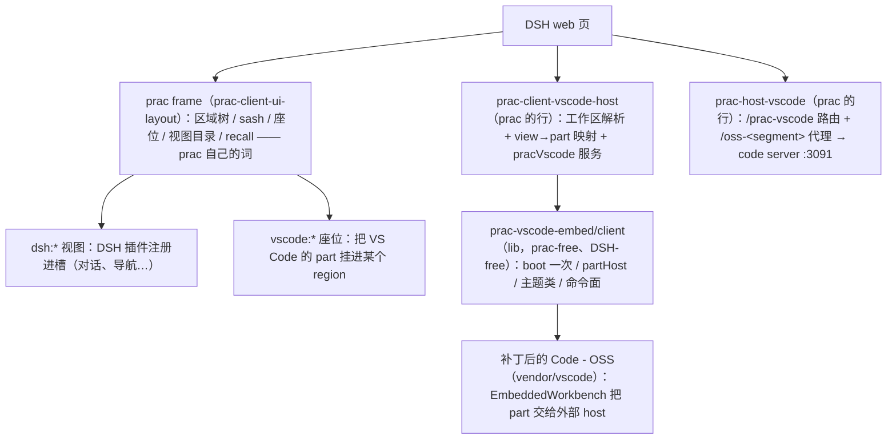

# VS Code × DSH 融合 —— 工作记录（依据）

> **这不是 note**：它是这项工作（[umbrella note](../notes/in-progress/2026-09-09-vscode-dsh-integration.md)）的**依据**——里程碑与工作记录、现在的形态快照、两侧与上游的已核实事实、踩坑与根因、验证方法的元教训。
> 它**没有状态轴、不签字**：这里只有"当时发生了什么、上游到底怎么工作、哪个坑怎么修的"。决定与开放问题在 umbrella。
> 放在 `.agents/worklog/` 而不是 `.agents/notes/`：notes 是**决策记忆**（状态轴 + 人签字），这是**过程记忆**（`AGENTS.md`：观察/发现/复盘/障碍作为依据附在工作 note 里，或留在工作记录中）。
> 2026-09-17 从 umbrella 拆出——那时它的 5.7 万字符里 **79% 是这类依据**，决定只占 16%。拆的时候**正文逐字搬**，只做了三件事：改标题层级、删掉已被 `vendor/vscode/README.md` 接管的重复段（构建两个目标 / 扁平产物与盖章 / 跑法 / 手工装扩展 / code server 命令行副本）、改掉两条与后来事实不符的旧句（各在文中标了日期）。
> **旧引用 `决定 N` 见文末「决定台账」**——那是 2026-09-17 之前 note 原文的归档，编号已退役、不再新增。

## 里程碑

| 日期 | 做了什么 | 依据（判据 / 证据） |
| --- | --- | --- |
| — | A 路线跑通：own 一个 checkout 构建，自建入口调 `create()` | 干净重建 **~3–4 分钟**（`npm install --ignore-scripts` 跳过 native/playwright/copilot 脚本）；`.build/` gitignored |
| 2026-09-11 | `--target server` 构建 + 启动 | **51MB**；**带 `--nls` 才成功**；日志 `Server bound to 127.0.0.1:3090` / `Extension host agent started.` |
| 2026-09-11 | `--target server-web` 构建 | **313MB / 20 bundles**；能起、能服务客户端 HTML |
| 2026-09-11 | server-web 端到端 | 服务端 `Starting extension host process` / `Launched Extension Host Process` |
| 2026-09-11 | 客户端关口：我们的 workbench 能当 self-built server 的客户端 | 页面真的发出 `GET :3091/oss-<hash>/vscode-remote-resource`；唯一失败原因是 CORS（`:3082` vs `:3091`） |
| 2026-09-12 | 同源代理（HTTP + WS 升级）落地 | 页面两条同源 WS 零 1006；服务端 `New connection established`（Management）+ `Launched Extension Host Process`（ExtensionHost） |
| 2026-09-12 | HTTP 代理 404 修复 + 直连/代理对齐 | direct `:3091` 与 proxy `:3084` 同路径都 **200 / 441B**（body 即工作区真实 `package.json`） |
| 2026-09-12 | `stampServerCommit()`（两侧读同一份 commit） | 幂等复跑输出 `server: product.json already stamped (645f29cc31)` |
| 2026-09-12 | `verify-views` Escape 修复 | `open → Escape → closed`；面板关着时路径 `["window-capture","document-capture"]`、开着时只剩 `["window-capture"]` |
| 2026-09-12 | `codeServerPath()` 不再必然抛错 + 失败隔离 | 失败返回 `undefined` + warn、代理整段 `try/catch`；最坏降级为"没有代理" |
| 2026-09-12 | 工作区来自**会话**（删 `PRAC_WORKSPACE_FOLDER`） | 实测解到 `folders: ["vscode-remote://…/dsh-dev"]`（非硬编码），explorer 列出 `apps/ benchmarks/ docs/ native/` |
| 2026-09-12 | `folderUri` revive 修复（空工作区） | `workspaceInfo()` 从 `folders: []` 变成真实 folder；闸门全绿 |
| 2026-09-12 | 第 3 步 `workspaceProvider` 达成 | 打开 `…/prac-dev/package.json` → `.view-lines` = **26 行正文**、`couldNotOpen: false`、**WS 1006 = 0** |
| 2026-09-12 | sidebar part 挂进 prac region | `listViews()` 出现 `vscode:sidebar`；place 到 `left` 后渲染出 `No Folder Opened` / Outline / Timeline 三个 pane header |
| 2026-09-12 | 包结构重组（目录去 `prac-`、workspace 改 `packages/*/*` + `vendor/*`、profile 重指） | 三包 `check`/`check:client` 全绿；DSH 从新布局启动；四闸门全绿 |
| 2026-09-13 | `vendor/vscode` 纯化为 vendor（host 半边移出到 `prac-host-*`） | vendor 无 `main`/无 `dsh`、`exports` 只有 `./package.json`；`/prac-workbench/vs/workbench/workbench.web.main.internal.js` **200 且 37,275,589 字节**；八包 `check` 全绿 |
| 2026-09-13 | 拆包 + 命名对齐（八包） | 八包 `check` 全绿、五份产物 loader 接受、四闸门全绿；删掉 `prac-layout` 遗留的 `dsh.bundle.patch`（它永远不会被读） |
| 2026-09-13 | HMR 临时关闭后恢复 | profile patch 恢复 `[]` + 注释；`verify-regions` 1/1 |
| 2026-09-13 | **S2**：补丁交互面走 `create()` 的 construction options | 产物含 `pracVsBridge` **1 处**、`__pracVsPartHost`/`__pracDeferVsParts` **0 处**；顺带删掉 **50ms 轮询**；默认路径 `vscode:smoke` exit 0、part 全挂载、`errorCount: 0`；staged 契约与仓库原件 `diff -q` 相同 |
| 2026-09-13 | 通道升级：`__pracVscodeHost` → DSH service | 产物 `__pracVscodeHost` **0 处**、两个座位各含 `pracVsHost` **2 处**；四闸门全绿 |
| 2026-09-13 | `isSeatView` 改按**注册表成员**判定 | 删 `VS_VIEW_SOURCE`/`PRAC_VIEW_SOURCE`；`readSeatViewIds(ctx.slots)` 读 `slots.entries("prac.view")`；`verify-layout` 24/24 |
| 2026-09-13 | 组合实验：座位可缺、机制不可缺 | 只留一个座位 → `regions: 3`、`hosts: 1`、无 boot 失败；抽掉机制 → `2 entries did not activate` + `pending (waiting for service: pracVsHost)`、`regions: 0` |
| 2026-09-13 | 服务写法改文档拼写 `ctx.provide` | 产物 `reflect.provide` **0 处**；四闸门复跑全绿（**无需重启 DSH**） |
| 2026-09-13 | **Step 0**：DSH 类型改用 npm 发布包 | catalog 加 **9 个精确 pin**（`@deepseek-ai/cordis@4.0.2`、`dsh-client-ui-*` / `dsh-api-*-controller` / `dsh-host-webserver` `@0.1.5-rc.1`）；八包 check 全绿 |
| 2026-09-13 | `dsh-types --compare` 漂移比较器 | 逐字节比对安装副本与 checkout；**实测 9 个包全部一致** |
| 2026-09-13 | 依赖声明收束（只有 cordis 是 peer） | 6 包 `@deepseek-ai/cordis: ^4.0.2` peer、8 个 DSH 包 devDep；全仓 `@deepseek-ai/*` import 都是 `import type`；client bundle 只 `require("react")` |
| 2026-09-13 | React 真类型（`react ^18.2.0` + `@types/react ~18.3.1` devDep） | 立刻抓到真 bug（座位面 `() => unknown` → `() => ReactElement \| null`）；产物 `require("react")` 恰好 1 处、无内联 |
| 2026-09-13 | **Step A**：拆 `ui-layout`（1591 行单文件 → 8 模块） | `index`166 / `services`219 / `frame`523 / `model`370 / `contract`243 / `catalogue`150 / `store`104 / `theme`65；`.d.ts` 一个不剩；闸门全绿 |
| 2026-09-13 | **Step B 第一部分**：发布 prac 的 client 类型 | `dist/client.d.mts`（ui-layout **8.4 kB** / vscode-host **37.9 kB**）+ `dist/client.mjs` **0 字节**空壳；13 个构建任务 |
| 2026-09-15 | **命名收束**（`vs` 退役、`workbench` 退回 vendor、载荷去 prac 名） | 三条 `grep` 判据全 **0**；九包 `check`、五份产物、四闸门、独立页 smoke 8/8 + `errorCount: 0` |
| 2026-09-15 | 抽出 `vendor/vscode-embed`（prac-free lib），prac 两行变薄 | 同上；staged 载荷与 `overlay/` 逐字节一致 |
| 2026-09-15 | **决定 15 后半落地（常驻底栏）**：默认树包一层 `column`（`root`）＝ 上面那行（`top`）＋ `BOTTOM_REGION`（`bottom`，240，stack，**空**）；**空 region 不渲染**（`isPresent`）⇒ 默认布局零成本、region 列表仍是 `left,stage,right`。填了视图就出现在底部、占满宽度、上方那行让出高度；折叠后高度归零、空间还回 | 新 prac 侧门 `verify:bottom` **11/11**（空则不在 / 填了上屏并像素质 / 贴底且满宽 / 240px / 上方让位 / 折叠归零 / 还原）；vendor 五门与 smoke 全部未动 |
| 2026-09-15 | **决定 15 前半落地（侧栏堆叠）**：`RegionNode.stack`（prac 的模型）、默认树把 `left`/`right` 标成 stack、frame 在**同一 region 有 ≥2 个可见 view 时**逐个渲染（header = view id 尾段 + 折叠开关）、`pracLayout.setViewCollapsed` 记折叠态。**vendor 一个字节没碰** | `tests/gates/verify-stack.mjs`（第七门，prac 侧）**10/10**：单 view 时**像素不变/无 header**（默认布局行为保持）、两个 view 堆叠且都有 body、折叠后 header 在/body 消失/邻居变大、点 header 也能折；原六门与 smoke 全绿 |
| 2026-09-15 | **决定 18 落地（扩展基座换 `server` + Tier 2 证明）**：`build.mjs` 增加 `--target server`（`out-vscode-reh`，带 `--nls`），并把 **checkout 根**、`out-vscode-reh`、`out-vscode-reh-web` 三份 `product.json` 都盖章；服务端改用 `out-vscode-reh/server-main.js`；装 **GitLens**（`eamodio.gitlens-2026.9.92030`，手工解包进 `--extensions-dir`；**验收后按 James 裁决撤装**，等决定 19 给出正当安装路径） | 新第六门 `verify-extension` **5/5**：`gitlens.views.welcome` 挂进 prac 后有 pane、标题 `Welcome`、40 种颜色、可释放 ⇒ **扩展激活**（描述符只有激活后才注册）。`/oss-645f29cc…/version` 200 而 `oss-dev` 404（两侧 segment 一致）；原五门 **24/24 · 33/33 · 12/12 · 1/1 · 7/7** 不变；独立页 smoke 8/8 |
| 2026-09-15 | **B1 落地（单 view 宿主）**：契约加 `mountViewInto`/`releaseView`，载荷用 `ViewPane.render()` 把单个 view 造成自带 pane 挂进外部元素（`getViewDescriptorById` 拿描述符，镜像 `ViewPaneContainer.createView` 的参数），lib 加 `view(viewId)` 句柄，explorer 座位改挂 `workbench.explorer.fileView` | 新第五门 `verify-view` **7/7**（自带 `.pane` + 标题 `dsh-dev` + 302 种颜色 + **页面无 sidebar part** + 跨 region 搬移时**释放后重建成功**）；原四闸门 **24/24 · 33/33 · 12/12 · 1/1** 不变；独立页 smoke 8/8 + `errorCount: 0` |
| 2026-09-15 | **决定 14 落地**：`selectPanel` 把选中视图放进**它自己的** region（无家则进中心），让出中心的视图停到编排绑定的 **track**；对话按普通 view 参与注意力（聚焦谁，谁进 stage，另一个停 right） | 八包 `check` + root `vp check .` 绿；四闸门 **24/24 · 33/33 · 12/12 · 1/1**（两条断言随决策更新：`promotedTrackClosed` → `promotedChatParksInTrack`，verify-views 改为读对话的放置而不是推断轨道消失）；独立页 smoke 8/8 + `errorCount: 0` |
| 2026-09-15 | **决定 16 落地（per-window 持久化）**：`ui-layout` 的 store 换成 DSH `client-store` 的 `createSnapshotStore(..., { persist: { name: "prac-layout/v1" } })` 薄适配；`dsh-client-store` 声明成**平台词**（`scripts/pack-client.ts` 镜像 `PLATFORM_MODULES`，`bundle-client.mjs` 的白名单＝那张表）；`arrange()` 的默认放置改成**只填空缺** | 新 prac 侧门 `verify:persistence` **16/16**；对照实验：去掉 `arrange()` 的 `continue` ⇒ 5 项立刻变红（门真的在断言这件事）；产物 +0.8 kB（内联 zustand/immer 要 ~15 kB） |
| 2026-09-15 | **决定 20 落地（任意方向分栏，分栏必带视图）**：面从 `split(regionId, dir?)` 改成 **`splitView(viewId, side)`**（`Side = left/right/up/down` 一个词同时定轴与插入顺序）；`model.ts` 的 `splitRegionWith` 纯函数（新区域一律 flex）；recall 面每个 view 行加 ←↑↓→ 四个按钮，删掉造空区域的 region 级"分栏" | 新 prac 侧门 `verify:split` **25/25**（左右两个相反方向都测、down 形成嵌套 column、竖 sash 真鼠标拖拽改尺寸、reload 后形状与尺寸复原）；prac 其余三门 10/10 · 11/11 · 16/16 不变；vendor 门 **25/25 · 35/35 · 12/12 · 1/1 · 7/7**（layout +1 断言、views 第 7 节按新语义改写并 +1；`verify-extension` 仍 SKIP）＋ smoke 8/8 + `errorCount: 0`；`vp run -r check` 与 root `vp check .` 绿 |
| 2026-09-15 | **决定 21 第一步（把纯逻辑提出来并建单测）**：`frame.ts` 里的 `sashSizes`（拖拽数学）、`subtreeMin`（预算里"其它子树的最小值"）与内联的渲染判据 `stacked` 全部上移进 `model.ts`（新增导出 `isStacked(state, node)`），`frame.ts` 只负责渲染；`ui-layout` 加 `"test": "vp test run"`，根 `test` 改成 `vp run -r test --passWithNoTests`（没有测试的包默认 exit 1，必须带这个 flag） | 新单测 `ui-layout/src/client/model.spec.ts` **33 条 / 6ms**：默认树与 region 列表、放置与 `visibleViews` 顺序、`isStacked` 的"单 view 裸渲染"、`isPresent` 四种情形、`resolveSizes`（固定轨、空固定轨**不进 box map**、底栏那一层、折叠为 0、flex 均分）、`cachedSize` 往返与**按身份 no-op**、`sashSizes` 的 flex\|flex / 固定\|固定 / **两端 clamp** / **budget 上界**、`Side` 四向 → 轴+子序、`splitRegionWith` 的"只多一个 region"与嵌套、未知 region 按身份 no-op；产物未含 spec（`grep` 判据）、`check:client` 仍 `ok`；全部门与 smoke 未动 |
| 2026-09-15 | **决定 21 第二步（编排策略提出来 + 目录表单测）**：`web-app` 的放置策略（`DEFAULT_PLACEMENTS`/`ROLES`/`placeSurfaces`/`focusView`/`arrange` + 相关常量与 `Surface` 类型）从 745 行的插件体搬进 **`src/client/arrangement.ts`**（插件体只留 UI：焦点条、recall 面、键位），`index.ts` 改从它导入；`ui-layout` 新增 `catalogue.spec.ts`（`viewSource`、`catalogueViewIds` 的"两源 join + 排序稳定"、`readSeatViewIds` 的**成员判定按注册表而非前缀**） | `arrangement.spec.ts` **8 条**（注意力四向落位、聚焦时对话停 track、`arrange` 的**只填空缺**、新视图仍会补位、`bindRoles`/`bindTrack` 的参数）；`catalogue.spec.ts` **7 条**；全 `pnpm test` **48 条 / ~300ms**；`check:client` 两份产物仍 `ok`；prac 四门与 vendor 五门 + smoke 全绿 |
| 2026-09-15 | **一条"故意不搬进单测"的判断**：DSH store 引擎的持久化往返（写 `localStorage` + 构造时 rehydrate）**留在活体层**（`verify:persistence`），不为它装 `zustand`/`immer` devDep | 理由两条：①它验的是**平台库的集成**，不是我们的逻辑（我们的适配器只有 15 行）；②现在"依赖没装"恰好是一个**响亮的失败**——谁把 `@deepseek-ai/dsh-client-store` 从 `external` 里拿掉，构建会立刻报模块解析失败；装了这两个包之后，那份引擎会被**静默内联**（产物里多一份状态引擎，`check:client` 也抓不到）。⇒ 决定 21 的"每个能力留一条活体断言"在这里正好落到持久化上 |
| 2026-09-15 | **决定 17 前半之二（app 自己打开的文件要报到）**：bridge 再加 `listOpenFiles()` / `onDidChangeOpenFiles(listener)`——**唯一能从 app 内部知道"现在开着哪些文件"**的来源（explorer 点击、命令、跳转都走 `IEditorService`）。事件不是现成的：`onDidActiveEditorChange`/`onDidCloseEditor` 都可能意味着集合变了，所以在载荷里**比集合**（变了才通知，dedupe 掉"只是激活"）；刻意不用 `onDidVisibleEditorsChange`——editor part 可能永远不 mount，"visible" 不是我们能依赖的。**列表按"能不能渲染成文本面"过滤**（`ITextModelService.canHandleResource`）：getting-started 页（`walkThrough:`）是有 resource 但没有文本模型的编辑器输入，实测它在未过滤时排在最前——退役 editor part 后它就会变成一个挂不上的假 view。embed 客户端加 `file(resource)` 组件工厂（卸载即 `releaseFile`）与两个透传 | `verify-file` **9/9**：多了两条——`openUntitled()` 之后列表恰好 +1 且事件只来一次（实测 `before: []`、`after: ["untitled:Untitled-1"]`）；其余八项不变 |
| 2026-09-15 | **决定 17 的 prac 半边（editor part 退役，文件成为 view）**：座位 `prac-client-ui-vscode-editor` 改成**每个打开的文件声明一个 `prac.view`**（id = `vscode:file:<resource>`，映射归 host），随 `pracVscode.onDidChangeFileViews` 增减；编排新增 `openFileInto(layout, view)` 规则（**新打开的文件进中心、对话停右轨**，与注意力同一条规则）并在 `ctx.inject(["pracVscode"], …)` 里跟随 app 的开文件集合；注意力（焦点条 / recall 面的聚焦）现在指"**当前那个文件 view**"（`currentFile` 由编排持有，`focusInto` 在聚焦文件时更新它） | 端到端实测（探针）：`face.openFile(<workspace>/package.json)` → 编排把文件放进 **stage**、对话停 **right**、座位声明 `vscode:file:…`、DOM 里 `[data-vscode-embed-file]` 内是**真的 Monaco**（`editors: 1, lines: 56`）且无 prac/embed 报错 |
| 2026-09-15 | **"退役"必须读作"创建但从不托管"，不是"从不创建"**（这一条是实测逼出来的）：editor part 不 create 时，app **打不开任何文件**——`openEditor` 抛 `Cannot read properties of undefined (reading 'isLocked')`（`EditorGroupView` 的 model 没建），`listOpenFiles()` 永远是空，于是"文件变 view"根本没东西可变 | 载荷改成在 `deferParts` 分支里 `createDetachedPart("workbench.parts.editor")`：造进一个 `left:-100000px` 的隐藏容器、**只让服务活着、从不进 prac 的 frame**；`mountPartInto` 遇到已创建的 part 改为**搬运**（想显式托管也还能）。另外两处只有实测才会发现的坑：① `listOpenFiles()` 必须按 **`IFileService.hasProvider`** 过滤——`canHandleResource` 对 `untitled:` 返回 true，但 `createModelReference` 走文件服务、读不到就报 `No file system handle registered`，会变成一个挂不上的假 view；② embed 客户端里 **face 到达前订阅的 open-file 监听要靠 publish 补挂**（否则消费者在 boot 期订阅到的是一次静默 no-op，文件永远不出现） |
| 2026-09-15 | **补掉"reload 后文件 view 变幽灵"**（上一行留下的待办，实测症状先落地）：打开文件 → reload 后 app 不再有文件（`listOpenFiles()` 空），但布局**持久化过的记录**还在 ⇒ stage 上留着那个文件的 **tab**、用**空 view 占着中心**、把对话挤在右轨（探针复现：`open: []` 而 `tabs: ["vscode:file:…/package.json"]`、`regions: left,stage,right`） | 两条规则都放编排、id 约定留 host：① `staleFileViews(records, openFiles, resourceOf)` 纯函数——**host 说"这是文件 view"**（新增 `PracVscodeFace.fileResource(view)`）而 app 不再打开的那些，`sync` 里 **hide**（不删：记录留着，同一个文件再打开时 `place` 会把它放回原处）；② `restoreCentre(layout)`——**当一个文件 view 刚刚离开时**注意力回到对话、中心还给对话（"默认落位"对**空缺**的再次适用）。**这条必须挂在事件上而不是状态上**：第一版写成"没有文件打开就把对话放回中心"，于是 boot 时（本来就没有文件）它会**覆盖用户持久化下来的编排**——`verify:persistence`（把对话停进底栏）与 `verify:split`（对话在分栏里）当场变红。判据：`hidAFileView` 为真才动。复现判据（同一探针）：reload 后 tabs 只剩 `dsh:main:conversation`、regions 回到 `left,stage`、陈旧记录显示为 `(hidden)` | 单测 **59 条**（`web-app` +5：陈旧判定含"非文件 view 永不触碰"、中心归还的两情形）；活体 `verify-file` **14→17**：reload 后无文件 host、无文件 tab、**对话回到中心**。**顺带记下的一处口味问题**：`stage` 现在是 `tabs: "multiple"` ⇒ 只有对话时也会显示一条 tab（VS Code 默认如此）；若嫌它多余，把默认树的 `stage` 改成 `"single"` 即可（一行），我留给你定 |
| 2026-09-15 | **决定 17 收尾（frame 级 tab 条，仿照 VS Code）**：`RegionNode` 加 **`tabs?: TabMode`**（`"multiple" | "single" | "none"`，直接借 `workbench.editor.showTabs` 的词汇与默认值），默认树把 **`stage` 标成 `"multiple"`**（VS Code 默认：**一个编辑器也显示 tab 条**），侧轨/底栏仍是 `stack`（折叠 header 是另一种东西：VS Code 也同时有 view container 的 header 与 editor group 的 tab）；`model.ts` 新增纯谓词 `showsTabStrip(state, node)`，`frame.ts` 在 tab 区域渲染"一条 tab 条 + 当前 view 的 body"（tab = 可见 view 顺序、front 为 active、点击把该 view 提到最前——用的是 `place` 同一条 order 规则，不引入第二份真相）。**一个区域只会有 tab 或 stack 之一**：tab 条替换掉折叠 header（`setViewCollapsed` 只在 stack 区域有意义） | 单测 **54 条**（`ui-layout` 44 + `web-app` 10，新增 `showsTabStrip` 的五种情形 + 默认树里 centre 的 `tabs`）；活体 `verify-file` **10→14**：一个文件时**照样有条**（VS Code 默认）、两个文件两条且最新的 active、**点 tab 真的换到那个 view**；tab 阶段的文件必须与探针 host 挂的文件不同——**一个资源只有一个编辑面**（在 frame 里打开会把编辑器从探针 host 里搬走），这条第一次跑就红在这上面 |
| 2026-09-15 | **三个以 editor part 为主题的门按文件 view 重写**（子代理执行、我复核）：`verify-focus` **9/9**（注意力在"当前文件 view"与对话之间搬移，内容用 `.view-lines` 里**从 workspace 的 package.json 现读的 marker** 判定，不再是 tab 标题）、`verify-layout` **14/14**（工厂形态是 `left,stage,right` 且文件在 stage；行分栏前先给 `right` 放 `vscode:sidebar`〔固定区域空了就不渲染 ⇒ 没 occupant 就没 sash〕；列分栏必须从**固定**源切出，因为 `flex\|flex` 的 sash 按设计是惰性的）、`verify-views` **28/28**（+3：`stage` 是 flex、`isPresent` 让空 flex 区域照样渲染，所以"隐藏 ⇒ 区域归零 + 记住宽度"是**固定区域**的性质 ⇒ 门先用两次真实"移到"把文件变成 `right` 的唯一 occupant，再加了两条断言） | 复核过：三门都自己跑出上面数字。**顺带修掉一个子代理抓到的语义不一致**：`openFileInto` 把文件放进中心却没动注意力 ⇒ 焦点条显示"对话"而中心是文件，且此时按 `Ctrl+Alt+1` 会**什么也不发生**（`focus` 忽略同值）。现在"打开文件"会**移动注意力到 vscode**（已经是 vscode 时则显式 `openFileInto` 放新文件），条与布局从此一致；焦点门相应改断言（opened 状态现在就是 `vscode`） |
| 2026-09-15 | **`openFile` 的冷启动竞态（子代理复查时抓到的生产 bug，已修）**：`openFile` 直接 `editorService.openEditor({resource})` 时，**在远程 FS provider 注册之前**打开会走成 `TextResourceEditorInput`（editor service 只在 scheme 已有 provider 时才建 `FileEditorInput`），其 `resolve` 拒绝 `createModelReference` 返回的模型 ⇒ 控制台报 `Unexpected model for TextResourceEditorInput: …`；资源仍然进了 `editors`（所以 `listOpenFiles()` 与 prac 侧的文件 view 照样工作，`verify-file` 因为"先 mount 后 open"而看不见这条） | 修法：`openFile` 先 `await fileService.canHandleResource(uri)`（它会 `activateProvider`）再打开。冷启动复现判据：全新页面上**第一个动作**就 `openFile(<workspace>/package.json)` → 现在 `listOpenFiles()` 有条目、DOM 里 stage 上是 56 行的编辑器、**0 条相关报错**。教训：**"门绿"不等于"没有竞态"**——门的调用顺序恰好绕过了它 |
| 2026-09-15 | **实测：reload 后 app 不会重开文件**（prac 的文件 view 是"会话内"的）：`openFile(README.md)` → view 在 stage；`page.reload()` 之后 `listOpenFiles()` 为空、没有文件 view | frame 的**布局**会记住 `vscode:file:…` 的放置（决定 16 持久化的是 tree/views 表），但座位只在 app 报"这个文件开着"时才声明 view ⇒ **记录还在、view 不渲染**，且旧记录会一直积在状态里。⇒ 待办（决定 17 的后续）：要么恢复 worker 自己的 open-editor 状态，要么让编排按 `fileViews()` 精简掉 app 已不再打开的文件记录 |
| 2026-09-15 | **默认形态随之变化（必须记住）**：没有文件打开时 `right` 轨空 ⇒ 固定空区域不渲染 ⇒ **工厂排布是 `left,stage`**（`right` 在打开文件、对话停进去之后才出现）。三个 prac 门的前提断言随之改（bottom 的"空则不在"、persistence 的"起始为出厂"改成量 `left`、split 的起始 region 列表），vendor 侧以 editor part 为主题的三门重写到文件 view 上 | prac 四门仍全绿：stack 6/6 · bottom 6/6 · persistence 6/6 · split 11/11；`verify-file` **10/10**（新增两条：真实文件打开报到、**非文件不进列表**）。**仍未做的**：frame 级 tab 条（决定 17 的后半）、挂在 `EditorInput`/`EditorPane` 上的贡献（面包屑 / peek / diff / 热退出） |
| 2026-09-15 | **决定 17 前半（vendor 侧的 file 级宿主）**：bridge 的 `PartHostFace` 加 `mountFileInto(resource, element)` / `releaseFile(resource)`——**单位是文件**（谁开着哪些文件、怎么分组、tab 条长什么样，都是 prac 的事）；载荷里的实现镜像工作台自己的造法：`CodeEditorWidget`（`TextCodeEditor.createEditorControl` 用的就是它）+ `ITextModelService.createModelReference(uri)`（工作台自己的文本模型 ⇒ 语言特性/marker/undo/save 都是真的），只多一个 `automaticLayout`（宿主 region 会 resize，没有别的东西会通知 widget 重排）。**一个资源一个编辑面**：重复 mount 是同一实例换宿主（一个文件一个模型，第二个编辑器就是同一份文本的第二视图），`releaseFile` 只释放引用（模型留给别人） | 新门 `vendor/vscode/scripts/verify-file.mjs` **7/7**：两个文件各自上屏且渲染出**该文件真实文本**（期望值由 gate 自己从磁盘读同一个文件算出，因为 app 的工作区不是 prac 仓——见下）、都有像素质、同文件第三次 mount 得到同一实例（第一个宿主被搬空）、release 后同一文件能再 mount、无 mount 报错；其余六门 + smoke 8/8 未动。**诚实的缺口**（决定 17 的下一步要补）：面包屑/peek/diff/自定义编辑器/热退出这些挂在 `EditorInput`+`EditorPane` 上的贡献**没有**；tab 条与分组按决定 17 归 prac，所以 frame 级 tab 还没做 |
| 2026-09-15 | **一个实测到的运行事实（工作区归属）**：app 的工作区是 **DSH 的活动工作区**——本次是 `vscode-remote://127.0.0.1:3084/Volumes/Dev/deepseek-harness/dsh-dev`，而不是 code server 启动时给的那个目录（`/Volumes/Dev/prac/prac-dev`） | 与决定 13「IDE 侧随 DSH 工作区」一致（`prac-client-vscode-host` 的 `activeWorkspace(ctx)` 读 DSH 注册表），但**两处路径不一致**：code server 的 `--folder` 只影响它自己的 CLI / 终端 cwd（决定 19 要确认这算不算 bug）。也是 `verify-file` 不能写死文件名的原因 |
| 2026-09-15 | **决定 21 第三步（按清单删减活体断言）**：把活体层里"纯机制的算术题"删掉——prac 侧 `verify:stack` 10→**6**（`isStacked` 的判定、`visibleViews` 顺序进单测）、`verify:bottom` 11→**6**（`isPresent`/`resolveSizes`/`cachedSize` 进单测，几何四条并成一条）、`verify:persistence` 16→**6**（`arrange` 只填空缺与"改动生效"进单测；**存活断言一律改成绝对式**，相对式会在"改动其实没发生"时真空通过）、`verify:split` 25→**11**；vendor 侧 `verify-layout` 25→**14**（模型侧放置/几何/clamp 进单测，6 条像素并成 3 条）、`verify-views` 35→**25**（只删纯模型断言——它本就是 recall 面的 UI 契约）、`verify-focus` 12→**9**（摆放规则进单测）；`verify-regions` 1、`verify-view` 7、smoke、extension 未动 | 活体断言 **142 → 85**（prac 62→29、vendor 80→56），单测 48 条；所有门重跑全绿：prac 6/6 · 6/6 · 6/6 · 11/11，vendor 14/14 · 25/25 · 9/9 · 1/1 · 7/7，smoke 8/8 + `errorCount: 0`；`vp run -r check` 与 root `vp check .` 绿。**留下的是三类**：产物过真 loader、VS Code 部件挂进/搬出 prac 区域并画出像素、几何与算术镜像的**漂移检查** |
| 2026-09-16 | **两份"结构"入档**：① code server 的**协议清单**（HTTP 一个端口 / WS 按首消息分三型 / 子进程 node-fork IPC / 只在 VS Code 终端里存在的 CLI 管道 / 扩展面向的 DAP·LSP·worker postMessage）核实后写进本文件的"code server 的协议"；② `docs/architecture.md` **原地重写**为三段式系统参考（DSH 的架构 / VS Code 的架构 / prac 的整合）＋边界清单；旧的"六件事 → DSH 机制"映射搬到 `notes/proposed/2026-09-16-epistemic-six-on-dsh-mechanisms.md`（**James 裁决**：参考文档只写现在时，规划进 notes——它上次变陈旧正是因为计划混在参考里） | 两侧架构各由子代理在**上游 checkout 里逐条取证**（DSH 与 Code - OSS 各一份带 `路径:行` 的摘要）。核对时抓到我方文档**三处错**并已改：① 行的 `id` 与 `name` 的关系（**`name` 才是产物 id**，patch 用 `id` 定位）；② host→client 并非绝对单向（allowlist 里的 **waterfall** 事件是受限的应答通路）；③ `ctx.resources` 只在 client 半边存在。另抓到 `vendor/vscode/README.md` 的改动日志**自称穷尽却漏了一处**（`web.main.ts` 的 `configuration` 由 `private` 改 `protected` ⇒ 补丁实为**两个文件三处**）——已补齐。`pnpm check` 绿（4 条既有 warning） |

> **进度入档（2026-09-15）**：分支 `feat/vscode-dsh-integration`，`wip:` 提交（含签名），检查点 tag `wip/vscode-dsh-2026-09-15`；后续进度按同样方式。提交 ≠ 成果已定。

| 2026-09-17 | **code server 的进程归主干**：`prac-host-vscode` 自己 spawn `out-vscode-reh/server-main.js`——端口取空闲（不再写死 3091）、等 `/version` 就绪、fiber dispose 时 SIGTERM；代理改读句柄；状态目录仍走 XDG。机制落在 `prac-vscode-embed`（`startCodeServer` / `codeServerArgv` / `freePort` / `waitForReady`，12 条单测），政策（哪个 build、哪些目录、何时起）留在插件。逃生口 `PRAC_CODE_SERVER_URL` 指向外置 server、`PRAC_CODE_SERVER_ENTRY` 换 build | 机制单测 12/12；重启 DSH 后日志 `Server bound to 127.0.0.1:58518` + `code server started … (pid …)`；门禁 layout **14/14** · views **28/28** · focus **9/9** · regions **6/6** · view **7/7** · extension **5/5**。`verify-file` 31/33——两项是新的坑（见踩坑与根因）：无 `--folder` 时「未保存」态不成立 |

| 2026-09-19 | **架构重做（旧设计作废）**：James 裁定「放弃当前的架构设计，从需求出发，从头设计架构」。做法：先把需求列成 R1–R15（逐条标出处），再从需求推导结构；**七条待裁全部落地**——LSP 走 P1（主干自己连扩展宿主当主线程）/ MCP 客户端用 DSH 现有的 / `SKILL.md` 不共源 / 工作区以磁盘为准 / 编排单位是一个视图 / 打开的文件集合不给 agent / VS Code 的 chat 面留着不显示。旧的两份提案移进 `abandoned/`（broker 设计降为 P1；能力拆散那条作废），`docs/architecture.md` 按新设计整体重写 | 推导、旧设计处置与本次范围见 [in-progress/2026-09-19-architecture.md](../../.agents/notes/in-progress/2026-09-19-architecture.md)；目标设计见 `docs/architecture.md`；差量与待办见 umbrella §4 |
| 2026-09-19 | **本次范围定死**：**只把两边现有的东西结合起来，不往 DSH 加能力**——VS Code 有而 DSH 缺的，先记下来不立刻加。结合点四个：语言服务器 → `ctx.lsp` 的一个 provider；MCP server 定义 → DSH 现有 MCP 客户端；VS Code 界面 → prac 的 view；人和 agent 对着同一份工作区文件 | James 原话；落点 `docs/architecture.md` §1.4 |
| 2026-09-19 | **核实 DSH 现有能力（本次范围的前提）**：`packages/lsp/`（`ctx.lsp` seam + 通用 stdio 提供方 + `lsp` 工具，只有四个操作、**不带服务器**、不在任何 bundle 里）；`packages/mcp/mcp-client`（MCP 客户端已有）；工具族 fs / fs-search / bash / terminal / str-replace-editor / todo / skill / subagent / goal / ask-user / web / jobs / session-query / workflow / lsp | 各包 README 与 package.json；`docs/tool-catalog.zh.md` 里 `lsp` 工具在列 |
| 2026-09-19 | **命名收束（续）：退役"座位"**——它没有独立含义（就是"注册进 `prac.view` 的 view"，机制本来就是 DSH 的槽），prac 侧词表收敛为 frame / region / view；讲机制时用 DSH 的词（槽 / `kind` / `key`）。活文档已全清（概念边界 note + umbrella 两行历史措辞），工作记录与 abandoned 里的保留为历史 | 决定与理由记在 [in-progress/2026-09-13-vs-concept-boundary.md](../../.agents/notes/in-progress/2026-09-13-vs-concept-boundary.md) 的「2026-09-19：命名收束（续）」 |
| 2026-09-19 | **核实 VS Code 侧诊断与语言特性的形状**（写进 `docs/vscode.md`）：诊断是推-only 的有损缓存（1000 条/文件、`modelVersionId` 无人消费、一半产在渲染器）；语言特性与命令由主线程发起，扩展可经 `vscode.execute*Provider`（24 个）拿到；上游把"在哪算"与"在哪显示"分开（装饰 / 状态栏 / 命令都由主线程代理）；LSP 客户端（cSpell）与消费者（Error Lens）各自的做法 | 逐条带 `file:line`，见 `docs/vscode.md`「诊断是怎么走的」与「agent / MCP / 工具 / skill / prompt 分别做在哪一层」 |
| 2026-09-21 | **架构 note 转 `in-progress`**：设计已由 James 定案（09-19 七条裁决 + 逐页过稿），`proposed/2026-09-19-architecture.md` 搬进 `in-progress/`；顺带修掉写的时候就已过时的说法（"`docs/architecture.md` 等这篇定了再整体重写"——其实已经整篇重写过了），全树入链跟着改 | 链接自检 134 条 0 断；`vp check .` 0 errors |
| 2026-09-21 | **P1 三个点裁决 + 开工第一步**：James 裁定 ① 素材用**内建 css / json / html**（不自写替身）；② **VS Code 生态依托扩展宿主**——能力从扩展宿主里跑的扩展来，扩展清单要**真扫**、不手写；③ 机制**落进 `vendor/vscode-embed`**（host 插件只留政策）。随即做掉第一步的一半：给 `.build/vscode/extensions/css-language-features` 与它的 `server/` 各装依赖（各自 `npm install`，走仓内 cache），再用 checkout 自带的 `tsc` 分别编译两半——`client/out/node/cssClientMain.js` 与 `server/out/node/cssServerMain.js` 都生成了；client 侧 `vscode-languageclient/node` 可解析，server 入口能加载并**要求 `--node-ipc`**（正是它被 languageclient fork 时的形态），两半都没有模块错误 | 裁决、步骤与依据见 [in-progress/2026-09-21-p1-ext-host-chain.md](../../.agents/notes/in-progress/2026-09-21-p1-ext-host-chain.md) §3 / §4；编译发生在 `.build/vscode`（外部 checkout），产物不入本仓 |
| 2026-09-21 | **两个决定（James）**：① **agent 侧一个工作区一个宿主**（同工作区的多个 agent 共用）；② **UI 不与 agent 共用**（UI 按上游，每个页面一个宿主）。理由与 seam 的限制写进 [`docs/architecture.md`](../../docs/architecture.md) §4.2（并同步 umbrella §3.6 与设计 note §2.7 的同一句"代价"）；设计 note 里"两条链要不要合并"那条开放问题**收口为：不合并** | 支持这次决定的实测：4 个工作区 → 4 个宿主 + 4 个 css 语言服务器、每宿主 ≈161 MB / 每服务器 ≈89 MB；共享同工作区对 agent 是省下 N×250 MB（内容完全重复，只买到隔离）；per-agent 今天**表达不了**（seam 的查询里没有会话标识） |
| 2026-09-21 | **用词纠偏：James 说的"插件"是 VS Code 扩展，我前面说的"插件"是 DSH 插件**（"插件族的划分"那条待决项本来问的是我们自己的插件行；我拿它去套"配置插件"，还摆出两种读法让他选——是我的错）。落法：① 在 [概念边界 note](../notes/in-progress/2026-09-13-vs-concept-boundary.md) 的"三套词"处加一条**用词要求**：**不要裸词**，一律写 **DSH 插件** 与 **VS Code 扩展**（James 原话：不要"插件 = …、扩展 = …"这种简称约定，直接说全）；② umbrella 与 `docs/architecture.md` §7 那条新要求改成明确的"**装哪些 VS Code 扩展**"，**删掉"待明确"那段** | **顺带核实了"真源"两条路的底**：VS Code 的 per-workspace 启用/禁用存在工作区 storage 的 `extensionsIdentifiers/{disabled,enabled}`（`extensionManagement.ts:645-646`），本仓 Node **有 `node:sqlite`**（DSH 也有 sqlite 包）⇒ 技术上读得到；但**我们的宿主用的是自己那份 storage 根**（`~/.config/prac/code-server/prac-extension-host/`，实测 cSpell 就往那儿写 `globalStorage`），与页面那份（`~/.local/state/prac/code-server/data/User/workspaceStorage/<hash>`，实测被页面宿主用锁后缀 `-1..-4` 占过）**不是一处** ⇒ "读 VS Code 的状态"并不天然等于"agent 的配置"。真源仍待 James 定 |
| 2026-09-21 | **"插件族划分"撤销，改立"配置装什么"**（James）：① **不需要区分哪个插件算 server 侧、哪个算 client 侧**——要的是**插件贡献的 view 能上屏**；② 新增要求：**按工作区配置"装什么"**，**最好也能按 agent 单独配**。据此把 umbrella §4 的"需要 James 裁 #1（插件族）"标成**已撤销**，新增"新要求"一节；把"扩展贡献的 view 要能出数据"提为**第一优先**（`mountViewInto` 只给了 pane/标题/像素，tree view 的 body 还是 `no data provider registered`——要进 VS Code 自己的可见性/容器模型）；`docs/architecture.md` §7 同步（#4 新要求、#5 view 数据） | **一处待明确（我没替 James 选）**：那句"配置插件"里的*插件*指 **VS Code 扩展**（工作区启用/禁用哪些扩展；上游存在工作区 storage 的 `extensionsIdentifiers/{disabled,enabled}`，`extensionManagement.ts:645-646`）还是 **DSH 插件**（每工作区/每 agent 一份组合树）？前者我们能做（per-agent 卡在 seam 无会话标识），后者是 DSH 层的动态组合、超出本次范围。两种读法都已写进 note 与 docs，等他一句话 |
| 2026-09-21 | **搁置两个后续 + 把 umbrella §4 对齐现状**：James 决定 **① 更多内建扩展（json / html / markdown）先搁置、② MCP 定义接线先搁置**。据此把 umbrella §4 重写：差距表里已完成的两条（**扩展宿主归主干**、**语言服务器经 `ctx.lsp` 的 provider**）移出差距、写成"已达成"；"需要 James 裁"现在只剩**插件族的划分**、阶段二、container/part；"已定方向尚未做"里的 P1 第一条链**删掉**（做完了），MCP 标搁置；重排编号并修正三处指向旧编号的交叉引用（worklog、step note、概念边界 note）。另外收口一条已经解决的认知风险：step note 原写"定向编译单个扩展是否绕得开 ipynb 那关**未核实**"——**已核实：绕得开**（css 就是用 checkout 自带的 `tsc` 直接编的，两半都成） | `docs/architecture.md` §7 #1 同步标成搁置；链接自检 150 条 0 断、`vp check .` 0 errors |
| 2026-09-21 | **查到 workbench 自己的"多窗口"是什么**（James 问）：是 **auxiliary window** ——`BrowserAuxiliaryWindowService`（`src/vs/workbench/services/auxiliaryWindow/browser/auxiliaryWindowService.ts:254`，browser 目录，web 与桌面共用）用 `window.open(...)` 开一个窗口（`:331-375`），**不启动第二个 workbench**：它在新窗口建容器、把编辑器/面板搬过去，服务仍是同一个渲染器的（`vscodeWindowId` 标记 + 跨窗口消息，`:280-300`）；上游用它做"Move Editor into New Window"（`auxiliaryEditorPart.ts:192`、命令 `workbench.action.moveEditorToNewWindow`，`editorCommands.ts:103`） | ⇒ **辅助窗口是"一个 client、多个窗口"**（同一个扩展宿主），与"两个标签各 boot 一个实例 ⇒ 两个宿主"（我上一轮实测）是两回事。**James 2026-09-21 决定：先不考虑辅助窗口，以后再说**（保持简单）；已记进 `docs/architecture.md` §7 #6。**未实测**：在 rig 里触发那个命令是否真的开出窗口且宿主数不变（代码上是），要重开这个问题时先测它 |
| 2026-09-21 | **澄清与补查：James 问的多标签页是"多标签页 = 一个 client"，不是"N 个 client"**（下一条按 N 个 client 测的是宿主数，答偏了）。按这个口径查 DSH 的**身份层**：认证身份是**浏览器会话**——一个 `HttpOnly; SameSite=Strict; Path=/`、绑定 host+port、默认 30 天的签名 cookie（`packages/client/connection/src/browser-auth.ts:120-122`、`index.ts:84`；README 原话 "Every Host RPC method and WebSocket stream requires one browser session"）。**cookie 是浏览器级的 ⇒ 同一浏览器的所有标签天然共享同一个身份**（同一 grant、同一权限） | 但**每个标签仍各自开连接/流**（一个身份、N 条连接）；"谁拥有会话状态、审批在标签间怎么送"**未核实**。prac 自己的 UI 状态已经共享：布局存 localStorage（per origin），两个标签共用一份（`store.ts:78-81` 已注明 per-workspace 作用域待做）。**VS Code 渲染器层仍不是"一个 client"**：工作台 = 渲染器 = 宿主的主线程，一个标签一个宿主（下一条实测）——要共用一个 UI 宿主得跨标签做 leader/mirror，而上游的工作台不能在两个 DOM 里同时活 |
| 2026-09-21 | **核实：web 能不能多标签页**（James 问；桌面 workbench 多窗口的对应物）。实测：同一浏览器里开**两个标签页**访问同一个 DSH —— 两个 workbench 都起来（各自 `#vscode-embed-boot`、各自 2 个 region）、**互不影响**（都 alive）；code server 为每个标签起了**一个扩展宿主**（进程表实测 2 个 `--type=extensionHost`，另有 1 个 `agentHost`、2 个 `fileWatcher`），code server 本身仍是一个 | ⇒ **能**，一个标签 = 桌面上的一个窗口（VS Code 的语义：每个 client 一个宿主）。每标签成本 ≈ 250 MB（宿主+语言服务器）。**扩展状态是每宿主一份**：`extHostStoragePaths.ts:26-62` 用 `vscode.lock` 锁 workspace storage，抢不到就退到 `<dir>-1`、`-2`…（最多 10 次；陈旧锁 10 分钟）⇒ 两个标签（或标签+agent 宿主）在同一工作区**不会互相破坏，但状态也不共享**。**未核实**：两个标签同时编辑/多客户端会话语义（审批、流、谁拥有当前会话）；`editors: 0` 只是因为脚本没打开文件。console 里的 404 是 `vsda` wasm（本 rig 没带，且我们用 `--without-connection-token`），**单标签同样 21 条**，与多标签无关。另外顺带发现 prac 自己的布局持久化**今天就是同源共用一份**（`packages/client/ui-layout/src/client/store.ts:78-81` 已注明"两个 DSH tab 还没分开，per-workspace 作用域待做"） |
| 2026-09-21 | **共享宿主的前提补上了：宿主死了要能自己回来**。插件原来把 `Promise<MainThreadHandle>` 缓存在 `Map<root, host>` 里，宿主中途死掉（崩溃 / 被 OOM 杀 / 被人 kill）时那条记录仍指向一具尸体——之后同一个工作区的查询会对着死连接说话。现在：宿主进程 `exit` 时把该工作区的记录删掉并**警告**，下一次查询**重新起一个** | rig 实测：第一次查询成功 520ms → 我从外面 `kill` 掉宿主 → 日志 `the extension host for … exited (code none, signal SIGTERM); the next question starts a new one` → **新宿主起来**（同一工作区）→ 第二次查询 486ms **拿到真实答案**，最后 1 个宿主在跑。⇒ "一个工作区共享一个宿主"现在不会因为一次崩溃变成所有人的故障 |
| 2026-09-21 | **量了一次"多宿主到底吃多少"**（James 问"对齐成一个 client 一个宿主、一个 agent 一个宿主，资源消耗会不会很大"）。方法：探针问 **4 个工作区** ⇒ 4 个宿主 + 4 个 css 语言服务器，`ps -o rss` 读数（此刻的 RSS，本 rig、98 个扩展、cSpell 因 `onStartupFinished` 也激活了） | **数字**：① 每个扩展宿主 ≈ **161 MB**（164688/162848/164608/163184 KB）；② 每个 css 语言服务器 ≈ **89 MB**（单独跑 `cssServerMain --stdio` 量到 90928 KB）；③ code server ≈ **115 MB**，**一份**（不随消费者数增长）；④ DSH 自身那个进程 ≈ **1.1 GB**。⇒ 每多一个消费者约 **+250 MB**（宿主 + 它起的语言服务器），总账 ≈ 1.15 GB + N × 250 MB。4 个宿主各自扫 98 个扩展、各自一份语言服务器（`--clientProcessId` 与宿主 pid 一一对应） |
| 2026-09-21 | **一个拦路事实：现在的 seam 传不了"是哪个 agent"**。`LspProviderQuery` = `{operation, filePath, position, workspaceRoot, languageId}`（`packages/lsp/lsp/src/types.ts:38-57`）——**没有 session / agent 标识**。所以"一个 agent 一个宿主"今天无法表达；要么让 DSH 在 seam 上带一个会话键（**属于给 DSH 加能力，本次范围外，只记录**），要么退化成"一个工作区一个宿主"（= 同工作区的多个 agent 共享；只有各 agent 各占一个工作区时才等价于 per-agent） | 对照：client 那半我们已经和上游一致（每个页面一个宿主）；agent 这半目前是 per-workspace |
| 2026-09-21 | **核实：多个 client 连同一个 code server 会起几个扩展宿主**（James 问）。**代码**：服务端 `_extHostConnections` 是 **`reconnectionToken` → 一个连接 → 一个 `cp.fork` 进程**的一对一映射（`remoteExtensionHostAgentServer.ts:77`）；**新建**连接就新建宿主，同一个 token 并发再来会被明确拒绝（`:473-495`：`Duplicate reconnection token` / `Cannot have two concurrent connections using the same reconnection token`）；只有**同一个 client 重连**走 `acceptReconnection`（`:489`）复用那个进程。客户端侧也是每个窗口一个：`ExtensionHostManager` 建好就 `start()`（`extensionHostManager.ts:117`），浏览器里只要有 remote 连接就建 `RemoteExtensionHost`（`browser/extensionService.ts:251-258`）。⇒ **N 个 client = N 个扩展宿主**，宿主是**按 client 连接**而不是按工作区/用户分的 | **实测（本 rig）**：探针问两个工作区 ⇒ 2 个宿主、**2 个 `cssServerMain`**（每个宿主各自起一份语言服务器，不共享）；再开一个页面 ⇒ **只多 1 个宿主**（`--type=extensionHost --transformURIs`）。**我自己的数法一开始是错的**：`pgrep -f bootstrap-fork` 把 `--type=fileWatcher` 和 `--type=agentHost` 也算进去了（2→5 的假象），按 `--type=` 分类后是 3 个扩展宿主 + 1 个 fileWatcher + 1 个 agentHost |
| 2026-09-21 | **顺带观察（与 umbrella §7「Copilot 在 rig 里到底有没有激活」相关）**：开一个页面时，code server 除了扩展宿主还拉起了 **`--type=agentHost`** 进程（`bootstrap-fork --type=agentHost --logsPath … --user-data-dir …`）——即 VS Code 自己的 agent 层也有一个"服务端形态"，就住在 code server 旁边。这不回答"Copilot 是否激活"，但说明**树里多一个 agent 不只是理论**；要不要管它是另一个决定 |
| 2026-09-21 | **P1 按 James 三条反馈改**：① **查询路径上不再扫描**——扩展目录改成 **`fs.watch` 事件驱动**（去抖 500ms；定时器 unref，不钉住一次性进程），另留一个显式的 `reload()` 给"知道变了但看不到文件事件"的调用方；② 多工作区 = **多宿主并存**（`Map<workspaceRoot, host>`，不再互相收掉），一个工作区的查询不影响另一个；③ keep-alive 的疑问先核了事实：**IPC 载体上宿主自己会自杀**（`extensionHostProcess.ts:286-288`：`socket.on('close', () => onTerminate('renderer closed the socket'))`），加上 `parentPid` 看门狗是第二道，所以我们 dispose 时的 `child.kill()` 只是"快一点"，不是必需 | **rig 实测**（探针问两个工作区、再往扩展目录里放一个扩展）：日志里 `starting the extension host for …/p1-workspace`（97 个扩展）→ workspace A OK 523ms → `starting the extension host for …/p1-workspace-b`（**第二个宿主，第一个没被收掉**）→ workspace B OK 455ms → 放下扩展后 `extension set changed — … now has 98` **两次**（两个在跑的宿主都收到了 delta）。lib 集成测试补了一条"两个宿主并存"（各答各的、进程不同、都没被杀），包内 **41/41** |
| 2026-09-21 | **P1 补上"动态激活"**（James：「vscode 中扩展是可以动态激活的，我们也应该支持」）。三件事：① lib 新增纯函数 `extensionsDelta(previous, next, versionId)`（按 id 比对，版本或路径变了算替换；没变化返回 `undefined` 以便跳过往返）；② `MainThreadHandle.setExtensions()` 把运行中出现的扩展通过 **`$deltaExtensions`** 交给**已经在跑的**宿主（宿主会同时重建注册表与激活事件表，`extHostExtensionService.ts:1071-1089`）——**不重启宿主**，也因此不丢掉已经起来的语言服务器；③ 插件每次查询前**节流重扫**（2 秒）扩展目录，并按 VS Code 语言服务的做法**同时触发 `onLanguage:<lang>` 与 `onLanguage`** | 单测 11 条（`extensions.spec.ts` 新增 4 条 delta 用例）+ 集成 7 条（新增"运行中出现的扩展会被宿主接住"：推一个磁盘上并不存在的扩展，宿主**尝试激活它并失败**——这正是它学到了的证据；同时 cSpell/css 的 provider 照旧工作、宿主进程没换）。包内 **40/40**；真 rig 复验：四操作探针（537/7/8/5ms）与 headless 门 3（24 秒 exit 0，答案照旧）都通过 |
| 2026-09-21 | **P1 门 3 通过：模型真的调了 `lsp` 工具**。修好 `prac-headless-dev`（见下一条）后跑 headless 任务（要它用 lsp 工具做一次 hover 并原样贴回结果）：日志里 provider 注册成功，模型自己决定调用工具，并把工具返回的内容原样贴出——**"Sets the color of an element's text" + MDN 引用 + Baseline 图标**，即 VS Code 内建 css 扩展语言服务的真实 hover。四道门至此全部通过 | 证据：`.build/scratch/gate3.log`（不入仓）。同一次运行里还看到扩展宿主**顺带激活了 cSpell**（`activated streetsidesoftware.code-spell-checker`，它声明 `onStartupFinished`）⇒ 清单真扫 + 多扩展共存这两条也顺带验到了；另有一条 `TypeError: tools is not iterable` 的警告（某个扩展，不影响本次） |
| 2026-09-21 | **为门 3 修了工作区之外的 `~/.dsh/profiles/prac-headless-dev`（两处，都是过期）**：① `package.json` 的依赖与 `node_modules` 软链都还指着 `packages/prac-web-app`（实际在 `packages/bundle/web-app`）；② 它只有 bundle 一个链接，而 composition 的行名（`prac-host-vscode` 等）要能从 profile 目录解析——补上 web profile 同样的 6 个链接 | 改法：改 `package.json` 的 link 值 + `ln -sfn` 六个软链；`--dump-config` 复检 composition 正常。**这是本工作唯一动到仓外的改动**（没动 DSH 本身） |
| 2026-09-21 | **坑：headless 跑完不退出（是我们造成的）**。归因实验：同一个任务**不装我们的插件 8 秒退出**（日志里 seam 回 `no LSP provider handles …`），装上就挂过 600 秒。原因是我们那条连接把宿主进程的事件循环钉住了——fork 出来的子进程 + IPC 通道 + 监听的 server + 已连接的 socket，加上**上游 `PersistentProtocol` 的 keep-alive interval（5s）与 `LoadEstimator` 的单例 interval（1s，永不停止）**。修法（lib）：`sendKeepAlive: false`、注入一个**自己 unref 过的** load estimator（语义保留：interval 漂移=事件循环忙）、`child.unref()` + `channel.unref()` + `server.unref()` + `socket.unref()` | 修后：同一任务 **24 秒退出、exit 0**，答案照旧。教训与 `execArgv` 那条同源——**只有放进真 rig 才看得见**，包内测试永远不暴露 |
| 2026-09-21 | **坑（DSH/rig 侧，本次只记录不改）**：headless profile 下模型请求发不出去，报 `REQUEST_EXTENSION: DeepSeek request extension preparation failed`。追到 `packages/llm/llm-deepseek/src/index.ts:481` 的 `prepareExtensions` → 注册表里的 `dsh_plugin_packages`（`plugin-package-inventory-deepseek`，默认开）在这个 composition 上准备失败，错误被包成 `LlmError` 的 cause，CLI 只打印外层消息。为了把门 3 跑通，我用一次性 overlay（`.build/scratch/p1-headless.yml`，不进仓）把它 `enabled: false` 关掉；**根因未查明**（它要收集"活跃插件包"，我们这套 composition 里有什么让它不满意不得而知），按"本次只做结合、不往 DSH 加东西"的规矩没有继续查 | 复现：不加 overlay 跑 headless 任务即得该错误；加 `-—patch` 关掉它就能跑完 |
| 2026-09-21 | **P1：不支持的操作不再干等超时**。lib 现在把"激活已结束"记下来（`$onDidActivateExtension` 或激活失败都算），`MainThreadHandle.activated` 暴露出来；插件的等待逻辑按语言算出**候选扩展**（谁的 `activationEvents` 里有 `onLanguage:<lang>`），候选全部激活完而 provider 仍缺席时立刻抛 `LSP_UNSUPPORTED_OPERATION` | 真 rig 实测：`goToImplementation FAILED (4ms)`（此前是 30 秒超时），另外三个操作 528ms / 7ms / 5ms。包内测试加了"激活已结束"的断言，35 条仍全过 |
| 2026-09-21 | **P1：把四个操作都在真 rig 里问了一遍（并因此抓到一个真 bug）**。探针依次问 hover / goToDefinition / findReferences / goToImplementation：前三个拿到真结果（hover 是 CSS 属性文档；definition 指回 `--brand` 声明那一行，0-based line 1；references 指回两处 `.a`，line 3 与 7；三者都带 `resolvedWorkspaceUri`），第四个以 **`LSP_UNSUPPORTED_OPERATION`** 失败——**css 扩展确实没注册 implementation**（它的能力表里没有），这是正确行为不是缺陷 | **抓到的 bug**：同一个文件被问第二次时，插件又推了一次"新增文档"，扩展宿主在 RPC 处理器里抛 `document 'file://…' already exists!`，而这个 throw **把宿主进程带走了**（表现为第二个问题永远不返回）。修法在 lib：`main-thread.ts` 维护文档镜像——首次推 `addedDocuments`（全文），之后内容变了走 `$acceptModelChanged` 的整档替换（`changes` + `rangeLength` + 递推 `versionId`），内容没变一条都不发；`closeDocument` 同时清镜像。加了三条回归（同一文档问两次、内容重写后 provider 看到新内容、references/definition 映射），包内集成测试 3 → 6 条 |
| 2026-09-21 | **顺手核实的语言服务行为（免得再猜）**：`vscode-css-languageservice` 的 `findDefinition` 只在**同一文档内**解析符号（`cssNavigation.js:23-38`：`symbols.findSymbolFromNode` → 返回本文档 range），**不做跨文件 `@import` 解析**；`findReferences` 就是同文档高亮（`:39-45`）。所以 definition 的测试用自定义属性 `--brand` 的引用处去问，而不是 `@import` 的目标文件——第一版测试按"能跨文件"写、返回空，是**测试的假设错了**，不是代码错了 |
| 2026-09-21 | **P1 门 4：现有门禁全绿（无回归）**。把 rig 起到 `:3084`（`dsh --profile prac-dev --port 3084 --no-open`，token 在启动日志里），逐条跑：**vendor 侧** `layout 14/14 · views 28/28 · focus 9/9 · regions 6/6 · view 7/7 · file 33/33 · extension 5/5`（条件门带 `EXTENSION=streetsidesoftware.code-spell-checker VIEW=none`）；**prac 侧** `verify:stack 6/6 · verify:bottom 6/6 · verify:persistence 6/6 · verify:split 11/11`；单测 `pnpm test` 三包 **31 + 44 + 15 全过** | 每条都留了完整输出在 `.build/scratch/gates/*.log`（不入仓）；计数按各门 `checks` 键实点。**跑法上的两个坑**：① `URL=… vp run verify:stack` 传不进环境变量，要直接 `node tests/gates/verify-*.mjs`；② vendor 那些脚本要从**仓根**用相对路径跑（从 `vendor/vscode` 里跑会把相对日志路径写丢）。另外这次 `verify-file` 直接 33/33 绿（不需要为它单独关 autoSave，与旧记录里那条注意事项不一致，记下来待查） |
| 2026-09-21 | **P1 第 4–6 步：接进 prac 插件，并在真 composition 里无页面跑通**：新 `packages/host/vscode/src/language.ts` —— 清单用 `scanExtensions` 真扫（`<checkout>/extensions` + `--extensions-dir` 的用户目录）、按工作区懒起一个扩展宿主、把 seam 的四个操作翻成 `$provide*` 并把结果翻回 `LspQueryResult`；`ctx.inject(['lsp'])` 懒注入，所以没有 seam 的 profile 照旧工作。composition 里补两行：`@deepseek-ai/dsh-lsp` 与 `@deepseek-ai/dsh-tool-lsp`（没有任何 DSH bundle 带它们）。依赖按本仓约定加进 catalog（DSH 包只做类型；`neverBundle`，运行时从 DSH 安装解析） | **验证（无页面、无模型）**：`dsh --dump-config` 里能看到两行；`dsh --profile prac-dev --patch <探针> --no-open` 的日志里 ① `prac-host-vscode: lsp provider vscode-language-features registered for .css, .scss, .less`；② 探针查到 `lsp` 工具已注册（描述就是 tool-lsp 那段）；③ 探针直接调 `ctx.lsp.query` 拿到 **CSS 扩展语言服务的真实 hover**："Sets the color of an element's text"。探针是一次性的（`.build/scratch/`，不入仓） |
| 2026-09-21 | **踩坑：扩展宿主继承了父进程的 loader 参数，直接死**。DSH 的 CLI 是用 `node --import tsx/esm` 跑的，`child_process.fork` 默认继承 `process.execArgv` ⇒ 扩展宿主进程带着 `--import tsx/esm` 启动，在 VS Code checkout 里解析不到 `tsx`，`ERR_MODULE_NOT_FOUND`，表现为"扩展宿主还没连上就退出（code 1）"。修法：lib 里 fork 时显式 `execArgv: []`（宿主是构建产物，不该继承任何 dev 参数） | 症状先出现在探针日志：`[p1-probe] FAILED extension host exited before connecting (code 1, null)`，根因在同一份日志里（`Cannot find package 'tsx' imported from …/.build/vscode/`）。这条只有把它放进真 rig 里才会暴露——包内测试用裸 node 跑，永远看不到 |
| 2026-09-21 | **踩坑（流程）：`pnpm install --filter <包>` 会把别的包的依赖剪掉**——加 `@deepseek-ai/dsh-lsp` 后我用 filter 装了一次，接着 `vp check .` 冒出 55 个错（`Cannot find module 'react'` 之类，全是别的包）。修法：跑一次完整 `pnpm install` 恢复 | 教训：这个仓的校验覆盖全 workspace，加依赖后要整装，别用 filter |
| 2026-09-21 | **一处类型与运行期不一致（已绕过并记录）**：`@deepseek-ai/dsh-lsp` 发布的 `.d.ts` 里 `LspError` 是空类（基类 `HarnessError` 不在该包类型里），TS 只看到零参构造；运行期签名是 `(message, code)`（`packages/llm/llm/src/error.ts:16`）。插件里用一处带注释的转换保住结构化错误码 | 若上游补上声明，这处转换可以删 |
| 2026-09-21 | **P1 第 3 步核心验证：真 css 扩展在我们的扩展宿主里激活、注册 provider、答出真实 hover**：新模块 `vendor/vscode-embed/src/host/main-thread.ts`（最小主线程）＋ `extensions.ts`（把扩展目录扫成 initData 要的描述、把扩展自己声明的配置默认值展平）。集成测试对真构建跑：`scanExtensions(<checkout>/extensions)` → 起宿主 → `$activateByEvent('onLanguage:css')` → 扩展激活（`$onWillActivateExtension` → `vscode-languageclient` 起它自己的语言服务器）→ 收齐它注册的那一族 provider → **`$provideHover` 返回的 CSS 属性文档里含 `color`** | 包内测试 **31/31**（新增纯单测 12 条 + 真构建集成 3 条），全仓 `vp check .` 0 errors。**这一步的两个关键决定**：① 未实现的 `MainContext` 顾客一律装一个**兜底演员**（返回 `undefined` 并记账）——否则一个未注册的顾客会被回成 `Unknown actor`，扩展表现为"莫名起不来"；② 顾客注册与入站帧的顺序由 `configure` 钩子锁死 |
| 2026-09-21 | **踩坑：`vscode.version` 拿到 0.0.0，扩展被拒**——`vscode-languageclient` 构造期校验 `^1.91.0`，报 "requires VS Code version ^1.91.0 but received version 0.0.0"。根因：**源码 checkout 的 `product.json` 没有 `version`**（打包时才注入），真正版本在 `package.json`（`1.137.0`）。修法：`resolveExtensionHost` 读 product 时回退到 checkout 的 `package.json` | 症状先出现在集成测试的失败输出里（`activation failed …`），修后同一条测试通过；顺手把 `MainThreadConsole.$logExtensionHostMessage` 接进 `onLog`，此后扩展内部的报错不再静默 |
| 2026-09-21 | **P1 第 2 步完成：连接机制落进 `vendor/vscode-embed`**：新模块 `src/host/extension-host.ts`（机制、不带政策）——按 checkout 找到 `bootstrap-fork.js` / `out-build` / `product.json`；组装子进程环境与 initData（`version`/`quality`/`commit` 由 build 盖，避免与对端不符）；建 unix 管道、`cp.fork`、按固定顺序握手、从 `out-build` 动态 import `RPCProtocol` 与协议表、把两端接起来。政策（环境、扩展清单、工作区、输出去哪）全部由消费方传入 | 单测 8 条（纯部分）+ **对真构建的集成测试 1 条**：握手完成、`MainContext` 87 / `ExtHostContext` 81、**真的收到** `MainThreadCommands.$registerCommand` 与 `MainThreadLogger.$registerLogger`、dispose 后子进程退出。包内 `vp test run` 21/21，全仓 `vp check .` 0 errors |
| 2026-09-21 | **写这一层时踩到的两个坑（都是"丢了就表现为扩展莫名失败"的那种）**：① **握手后、顾客注册前到达的帧不能丢**——扩展宿主接受 initData 的下一秒就开始发 RPC（含启动期记账），而此时我们还没 `set()` 那些 `MainThread*`；RPC 层一订阅就把缓冲冲出去 ⇒ 全部被判 `Unknown actor` 回绝。修法：入站消息先缓冲，等 `startExtensionHost` 的 `configure` 钩子把顾客装好再 `release()`。② **dispose 时不要 drain**：上游 `PersistentProtocol.drain()` 等的是对端确认，而被我们杀掉的进程永远不会确认 ⇒ 挂死；停机就是 `rpc.dispose()` + 断 socket + kill | 症状与修法都体现在集成测试里（先失败后通过）：第一次失败是"等不到启动期调用"（20s 超时），第二次是整条测试挂满 90s |
| 2026-09-21 | **P1 机制探针：扩展宿主的载体的握手跑通**（主干自己 fork，纯 node，不依赖页面与 code server）：`net.createServer` 起一条 unix socket → `cp.fork(out-vscode-reh/bootstrap-fork.js)`，env 给 `VSCODE_ESM_ENTRYPOINT=vs/workbench/api/node/extensionHostProcess` + `VSCODE_EXTHOST_IPC_HOOK=<socket>` + `VSCODE_NLS_CONFIG` → 对端连上来后 `NodeSocket`+`PersistentProtocol`（`protocol.sendResume()`）→ 收到 `[0x02]`(Ready) → 发一帧 UTF-8 JSON 的 initData → 收到 `[0x01]`(Initialized) → **扩展宿主随即开始发 RPC 请求**（解出的前几条：`$registerLogger`、`$getInitialState`、`$registerCommand`、`$registerProcessSupport`、`$registerTaskSystem`、`$getTools`、`logExtensionHostMessage`）| 探针 `.build/scratch/probe-handshake.mjs`（不入仓）；**两个只有做了才知道的坑**：① bundle 的 ext host 在模块加载期就要本地化消息表，不喂 `VSCODE_NLS_CONFIG`（指向 `out-vscode-reh/nls.messages.json`）会 `!!! NLS MISSING: 1516 !!!` 直接死；② `NodeSocket` 在 **`vs/base/parts/ipc/node/ipc.net.js`**（common 那份没有），`PersistentProtocol` 在 common。RPC 帧形状也实测到：`UInt8 type + UInt32BE req + UInt8 rpcId + UInt8 方法名长 + 方法名 + UInt32BE 载荷长 + JSON`。ext host 另报了一条 `@vscode/spdlog` 原生绑定找不到的错误（不致命） |
| 2026-09-21 | **P1 第一条链的实现计划成形**（step note，`proposed` 起、同日转 `in-progress`）：四份只读侦察核实了三件事——DSH `ctx.lsp` 的确切契约（提供方三成员、0-based 坐标、**没有 capabilities 字段**、lsp 三包不在任何 bundle 里）；VS Code 扩展宿主机制（入口是 `bootstrap-fork.js` + `VSCODE_ESM_ENTRYPOINT`，载体三选一，帧是 `NodeSocket`+`PersistentProtocol` 之上再套 RPC，**主线程那面上游没有 server 侧实现可复用**，但 `out-build/` 可 import 且是我们自己构建的产物）；以及**设计里点名的四个内建语言扩展当前根本没有可加载入口**、`vscode-languageclient` 也没装（cSpell 又不在 seam 的四操作里）。据此给出三个待裁点（素材 / 扩展宿主从哪来 / 协议层怎么来）与四道验证门 | file:line 证据见 [in-progress/2026-09-21-p1-ext-host-chain.md](../../.agents/notes/in-progress/2026-09-21-p1-ext-host-chain.md)；这也印证并量化了 umbrella §4 #10（内建扩展不可用） |

## 当时的形态快照（2026-09-15）

> 这是**当时**的快照，不是目标（目标见 `docs/architecture.md`）。

包：`packages/{bundle/web-app, client/{ui-layout, vscode-host, ui-vscode-editor, ui-vscode-explorer}, host/vscode}` + `vendor/{vscode, vscode-embed}`；profile `prac-dev` = 三 bundle（`dsh-base` / `dsh-web-app` / `prac-web-app`）+ 六 link。

**关键事实（实测）**：

- 一页 `create()` 一次；part 是**单实例** ⇒ 只能 `movePartInto` 搬、不能重建；隐藏 region 必须留 host（`verify-focus` 的 `partInOneHost` 是这条的化石）。
- 扩展宿主、文件/配置/存储随 workbench 的 bootstrap 起来；`workspace.id` 在 `create()` 时定死（IndexedDB key + profile 选择）⇒ 启动必须等"工作区已知"，且**不能先建后纠**。
- 补丁只动上游两个文件（`web.factory.ts`、`web.main.ts`，**74 行 delta-only**）；载荷走 `overlay/`，由构建放进 checkout（构建把 overlay 拷进去；只在 pin 变化或 `vscode:clean` 时 reset，所以 checkout 不是第二份真相靠的是「我们写的东西都能被覆盖 + 别人的改动有 drift 警告」，不是每次清空）。
- DSH 侧：prac 的包作为**行**由 `prac-web-app` 的 patch `insert`；**行的 `name` 才是产物 id**（`clientPack(id)`），包的 `name` 与 patch 用的行 `id` 是两个东西（2026-09-16 核实更正；这条快照原先写的是"loader 行 id 取的是产物 id"，与"已核实事实"里 DSH 侧那条更正相冲）。
- 跨插件共享的页面级状态只有一处：`globalThis.__vscodeEmbed`（boot 守卫、boot 元素、命令面、失败原因、part→元素表）。
- **空 region 不渲染**（`isPresent`：非 flex 且没有可见 view ⇒ 不在 DOM 里）⇒ 新增区域可以"零成本地存在"，填了才出现；这也让底栏这种"默认收起"的东西不需要单独的状态。
- 构建期契约只有一处：`vendor/vscode/overlay/embedBridge.ts`（`EMBED_BRIDGE` / `PART_HOST_ATTR` / `PartHostFace` / `EmbedBridge`），两侧编译同一份原件。

## 已核实事实

### DSH 侧

- **每个 client 插件各自打包、各自内联** ⇒ 模块级单例**不共享**；跨插件共享一个面必须走模块图之外的载体（Cordis service；补丁侧无可避免时用页面级全局）。
- **行的 `name` 才是产物 id**（entry 实际 import 的模块 specifier = npm 包名；浏览器的 module table row id、`clientPack(id)`、`bundle-client.mjs --id` 用的都是它）；**patch 用行的 `id` 定位**（config tree 内的稳定标识，缺省随机生成）。prac 的行把两个字段取成同一个字符串，但它们是两个东西（DSH `vendor/loader/src/config/entry.ts:8-21`；2026-09-16 核实，改正了本条原先"loader 行 id = 产物 id"的写法）。
- **“扩展宿主”只是 VS Code 架构里的概念，不要带到 DSH 上**（2026-09-16 三次更正：我先用这个 VS Code 的词去**否定** DSH（"DSH 没有扩展宿主"），随后又把它写成"DSH 的插件树**就是**扩展宿主、角色对等、形状不同"——**两次都是把别人的概念外推**。正确的说法只有一句：DSH 的扩展方式就是**插件**，VS Code 的扩展方式才是扩展宿主，两者是**不同的机制**，不是一个角色的两种形状）（这个词属于 VS Code，不能借）：DSH 的插件跑在**同一棵树、同一地址空间**（host 在 DSH 的 Node 进程、client 在页面），耦合是 in-process 的 `inject`，没有进程边界也没有专用协议。最接近"第三方代码运行时进来"的是**动态包**子系统（`packages/extensions/`：`tool-cordis` / `cordis-host-runner` / `cordis-client-runner` / `ui-cordis`）：模型可定义/运行/停止/删除 Cordis 包，host 半边在 `node:vm` 全新 realm + 白名单 façade 里求值（模块注释自陈 *"**is not containment**"*），浏览器半边在页面闭包里 `new Function`，定义只活在进程内存、重启即失。host 让浏览器跑半边靠的是 `cordis/request-run*` **转发事件**，不是 RPC。
- **依赖缺失的 fiber 保持 pending** ⇒ 坏组合表现为"挂起"而不是"渲染空白"（实测报 `pending (waiting for service: …)`）。
- 固定三轨尺寸；`main` 是 **keyed 单占位**（`entryKey: panelId ?? 'conversation'`）⇒ 对话与编辑器**不能同屏**；`slot:rightbar` 默认隐藏。
- `root` 槽明文 **DO NOT register**；`shell.overlay` 是自建浮动面的正规座位（list 槽、加性、点击穿透）。
- client 插件的 `require` 解析**注册过的 bundle id + 一张静态平台表**（见下），其余必须自包含；`exports` 里导 `./src/*` 只对**构建期**（打包器/TS）有效。
- **loader 的模块表有一张固定的平台词表**（九词）：`react` / `react/jsx-runtime` / `react-dom` / `react-dom/client` / `@deepseek-ai/cordis` / `@deepseek-ai/dsh-client-store` / `@deepseek-ai/dsh-client-ui-slots` / `…-ui-primitives` / `…-ui-dockkit`。真源是上游 `packages/client/web/src/platform.ts`（`packages/client/web/src/seed.ts` 按它 seed 成唯一实例），上游自己的打包器也把这张表当 external 基线（`packages/client/tsdown.client.ts`）⇒ **跨插件共享一个实现的正规路径是 require 表里的词**（`dsh-client-store` 就是这样一个词），而不是各插件各自内联一份。prac 侧镜像在 `scripts/pack-client.ts` 的 `PLATFORM_MODULES`：它既是 `clientPack(..., { external })` 的合法取值，也是 `bundle-client.mjs` 的 `--allow` 白名单（2026-09-15 实测：把 `dsh-client-store` 声明成 external 后，产物只 +0.8 kB——内联 zustand/immer 要多 ~15 kB 且是第二份状态引擎）。
- `dsh-web-app` 自带 `client-hmr`，有已知的 `duplicate factory registration` 症状。
- 客户端产物是 **lazy-CJS**：`window.__ModuleLoader__.load({id, factory})`（原生 ESM 会 `Unexpected token 'export'`）。

### VS Code 侧

- **不可作可消费依赖**：根 `package.json` `"private": true`、无 `"exports"`、`"main": "./out/main.js"`；构建工具链在根 devDependencies（**104 个**）＋独立子包 `build/`（**59 devDeps**，pnpm 不装）⇒ 只能 own 一个 checkout 构建。
- `create()` 一页一次；`workspace.id` 在 `create()` 时定死（IndexedDB key + profile 选择）⇒ **一个窗口一个工作区**，切换只能导航（即重载）。
- 扩展宿主按 `reconnectionToken` 索引（**每客户端连接一个**）⇒ 多窗口同一工作区天然支持；server 要保的是"工作区存在性 + 扩展宿主/会话"（`reconnection-grace-time` 默认 **3 小时**）。
- 前端 UI 状态（区域尺寸/调出面板/展开项）按工作区 id 存在**浏览器** IndexedDB，跨连接存活。
- `createWorkbench`（`IBrowserMainWorkbench = { startup, onWillShutdown, onDidShutdown }`）是上游给"换一个 app"留的缝（`protected` 可覆写）；上游自己的第二个 app（`src/vs/sessions/`）用的也是它，并另覆写 `createWorkspaceConfigAndStorageServices`。
- `IWorkbenchLayoutService` 约 **51 个成员**；sessions 的 `Workbench` 模板 **2976 行**。
- **part 由服务 eager 造**（`IPaneCompositePartService` / `ITitleService` / `IStatusbarService` / `EditorParts`），`Part` 构造时自注册进 layout service（`part.ts:61`）；part 只在被 `create(parent)` 时才进 DOM。
- `ViewPaneContainer.create(parent)` 接受**任意外部 parent**（`new PaneView(parent, options)`）。
- workbench bundle **~37MB 必须同源**服务（worker 跨域会被浏览器挡）。
- `Part.create` 与容器无关；但 part 容器的区分性 class **是承重的**（CSS 命中不到 ⇒ 内部 grid 高度塌成 0）。经典 workbench 与 sessions 都靠 `SerializableGrid` 给 part 定位。

### 扩展基座（`server` 目标，2026-09-15 起）

- **实测（2026-09-15，验证后已撤装）**：GitLens `2026.9.92030` 装上后 `extensions.json` 只列它；`gitlens.views.welcome` / `…repositories` 都能 `mountViewInto` 挂进 prac（有 pane、有标题、有像素）⇒ 扩展**确实激活**；`spdlog` native 缺失仍是既有非致命缺口。
- **安装的正当路径**：`server-cli --install-extension` 走的是 **CLI 管道**（`VSCODE_IPC_HOOK_CLI`），现实里由 **VS Code 的集成终端**提供；我们还没有它 ⇒ **决定 19（terminal 用 VS Code 的）会带出这条管道**。在此之前**不装用户扩展**（第六门 SKIP）；手工解包属于"绕过有意关上的门"，James 2026-09-15 裁决不做。

### Server（自建 code server）

- distro 布局必须 `<root>/{product.json, package.json, out/}` 且 `<root>` 在 checkout 内（否则报 `Cannot find package 'cookie'`）；`--out` 必须是**相对路径**。
- server-web 构建（313MB/20 bundles）**自带客户端启动失败**：HTML 引用的 `/oss-dev/static/out/…` 全 404（构建输出与服务端静态路由根没对齐）——所以我们用 web bundle 当客户端。
- 不要 desktop / server 目标当成本工作的目标：server distro 只作为 code server 使用。

### code server 的协议（2026-09-15 核实于 1.137.0 checkout；行号均指该 checkout）

> 本节只记**协议清单**（有哪些通道、每条对我们意味着什么）。**VS Code 自身的结构**——两半与主线程、平台服务层、extHost 协议的帧与载体——2026-09-17 归到 [`docs/vscode.md`](../../docs/vscode.md)（参考页），不在这里重复。

**一句话**：一个 HTTP 端口 + 同一端点上**按首消息分三型**的 WebSocket + 两组子进程通道（node fork 消息 / 命名管道）+ 一条只存在于 VS Code 终端里的 CLI 管道。**没有任何一条是"客户端注册、服务端调用"的方向**。

| # | 通道 | 形状（证据） | 对 prac 的意义 |
| --- | --- | --- | --- |
| 1 | **HTTP(S)** | `remoteExtensionHostAgentServer.handle`：`/version`(151)、`/delay-shutdown`(157)、**`/vscode-remote-resource?path=…`**(168，为渲染器取扩展/工作区文件，带 CSP `sandbox`；给 web worker ext host 放 CORS)、其余交 `WebClientServer`(204)：`/static/*`(113,186)、`/callback`(114,192)、`/web-extension-resource/*`(115,196) + workbench HTML。鉴权 `?tkn=<token>`（`connectionTokenQueryName='tkn'`，`network.ts:188`），`--without-connection-token` 时跳过 | 我们已经在代理它（`prac-host-vscode`）；**这里只有“取字节”，没有可查询的状态** |
| 2 | **WebSocket · Management** | 与 3/4 同一端点，首消息分型。握手：`AuthRequest{type:'auth'}` → 服务端 `{type:'sign'}` → 客户端 `ConnectionTypeRequest{commit, signedData, desiredConnectionType}`（`remoteAgentConnection.ts:243-284`）。**每个连接型各开一条自己的 WS**（各自 `socketFactory.connect`，`:231-235`），靠 `reconnectionToken` 重连。管理连接上跑 `IPCServer`/`SocketServer`（`serverServices.ts:430`）：**服务端 `registerChannel`，浏览器消费** | 服务端注册的 channel：`logger` `remoteextensionsenvironment` `telemetry` `remotefilesystem` `remoteterminal` `extensions` `remoteextensionsscanner` `userDataProfiles` `request` `mcpManagement` `sandboxHelper` `NativeMcpDiscoveryHelper` `mcpGateway` agentHost `RemoteProxy` `extensionHostDebugBroadcast`（`:125-406`）。**没有 diagnostics channel**——marker 在渲染器的 `IMarkerService`，不在服务端；且方向是服务端被客户端调，不支持"host 问页面" |
| 3 | **WebSocket · ExtensionHost** | 服务端 `ExtensionHostConnection` fork 扩展宿主（`cp.fork(bootstrap-fork, ['--type=extensionHost'], {silent:true})`，`extensionHostConnection.ts:290`）；宿主与该连接用**命名管道或它自己回送的 socket**（`VSCODE_EXTHOST_IPC_HOOK` / `VSCODE_EXTHOST_WILL_SEND_SOCKET`，`extensionHostEnv.ts:17-40`；控制消息 `VSCODE_EXTHOST_IPC_SOCKET` / `…_READY` / `…_REDUCE_GRACE_TIME`），服务器把这条管道**桥到 WS**。扩展宿主的 RPC（含 `MainThreadDiagnostics.$changeMany`）走的就是它 | **diagostics 的原产地在扩展宿主**（本机 node 进程），而它与外界唯一的既定通道是"通向渲染器"。要 host 侧拿到，就得在这扇门里放代码——即那三扇门里的 (b) |
| 4 | **WebSocket · Tunnel** | `_createTunnel`（`remoteExtensionHostAgentServer.ts:516-536`）：按 `{host, port}` 连本机 socket 并把 WS 当管道转发 | 端口转发走的是 WS，**不是** `/proxy/<port>` HTTP 路由 |
| 5 | **子进程 IPC（node fork 消息）** | PTY host：`NodePtyHostStarter.start()` → `ipc.cp.ts` 的 `Client` fork `bootstrap-fork --type=ptyHost`，`VSBuffer` 帧、`VSCODE_PIPE_LOGGING`（`nodePtyHostStarter.ts:22-45`） | 决定 19 的 PTY 住在这个进程里；协议是 VS Code 自己的，不对外 |
| 6 | **CLI 管道** | `server-cli` 从 `VSCODE_IPC_HOOK_CLI` 读写 JSON 请求（`server.cli.ts:87`）；该 env 由**终端**注入（`remoteTerminalChannel.ts:268`） | 证实 note 里的判断：`--install-extension` 的正当路径要等决定 19 把终端带出来 |
| 7 | **扩展面向的协议** | DAP（`extHostDebugService`，adapter 通常是子进程 stdio）、LSP（扩展自己 spawn）、web extension host 在页面的 worker/iframe 里用 `postMessage` + `MessagePort`（`webWorkerExtensionHost.ts:198,233`） | 生态协议，不是 server 的传输层 |
| 8 | **调试口** | ext host / pty host 均可 `--inspect`；ExtensionHost 连接首消息回 `{debugPort}`（`remoteAgentConnection.ts:362`），另有 `extensionHostDebugBroadcast` channel | 与我们无关，记录在案 |

**由此确定的直接后果**（诊断那扇门的依据）：
1. 服务端**没有** diagnostics channel ⇒ "让 DSH host 直连管理连接去读 marker"这条路不存在——marker 是渲染器状态。
2. 管理连接方向是**服务端被调**（`registerChannel` 在服务端）⇒ 也不存在"host 向页面要"的方向。
3. 管理连接上的 channel 用 `tkn` + 握手即可被**任意本机进程**消费（不必须是浏览器）；这是"DSH host 自己当 RPC 客户端"的技术可能性所在——但它读不到 marker（见 1）。
4. 扩展宿主是**本机 node 进程**，且是**唯一**能调 `vscode.languages.getDiagnostics()` 的地方 ⇒ 我们在那里放的适配器可以用**任意 node 通道**（unix socket / 文件）与 DSH host 通信，**完全不必经过 VS Code 的协议**。这既印证了 (b)-①（自足扩展），也说明它**不需要动上游**。

### dev rig 的启动命令（2026-09-16 起）

原则：**机器相关的路径放环境，仓库配置只管组合**；**prac 仓内一律用 `vp`**。

- **code server**：命令、状态目录与"跑法"见 `vendor/vscode/README.md`（2026-09-17 起状态目录跟随 XDG；这里原本有一份副本，拆 note 时删掉了）。
- **DSH（profile `prac-dev`）**：`cd ../deepseek-harness/dsh-master && pnpm_config_store_dir=/Volumes/Dev/.pnpm-store pnpm dsh --profile prac-dev --port 3084 --no-open`
  - 这里**仍用 `pnpm`**：DSH 仓自己的 `packageManager` 是 `pnpm@11.7.0`，而 `vp` 在那个仓里初始化缓存被文件沙箱拒（`Failed to initialize cache: EPERM`，仓库在工作区外）。prac 仓内不用 `pnpm`。
- **standalone 查看页**：`vp run --filter prac-vscode vscode:serve`（默认 `:5199`）。
- **2026-09-16 去掉的三个环境变量**：旧命令带 `COREPACK_HOME` / `XDG_CACHE_HOME` / `XDG_DATA_HOME` 指向仓库内。去掉的理由是实测多余：corepack 的默认家 `~/.cache/node/corepack` 已有同样的 pnpm 版本（11.7.0 / 12.3.4），`XDG_DATA_HOME` 那个目录是**空的**（DSH 真正的状态在 `~/.dsh`，44M），`XDG_CACHE_HOME` 那份 132M 是 pnpm 的 cache（不是 store）。三者合计 188M 当时移到 `.build/scratch/legacy/`（那份备份后来已删）。

### 我们自己的机制

- 座位契约 = `prac.view` 槽；机制**按注册表成员**判定座位，不按 id 前缀。
- `pracVscode` 服务面 = 工作区解析（来自 DSH 会话/工作区注册表）+ view→part 映射；机制（boot / part host / 主题 / 命令）在 `prac-vscode-embed`。
- 页面级状态只有一处：`globalThis.__vscodeEmbed`（`VscodeEmbedPage`）。
- 构建期契约只有一处：`vendor/vscode/overlay/embedBridge.ts`。

## 踩坑与根因

### 通道与代理

| 症状 | 根因 | 修法 / 规则 |
| --- | --- | --- |
| 页面里 WS 1006、编辑器打不开文件 | 两侧 **product segment 不一致**（server 运行时算 `oss-dev`，客户端按 build 注入的 commit 要 `/oss-<commit>`） | `stampServerCommit()` 盖章；**表现不是路径不匹配**，所以要看段值 |
| HTTP 代理 404（段已一致） | DSH 前缀匹配要求 **`/` 边界**：`/oss` 与 `/oss-` 都匹配不到 `/oss-dev/version` | 路由 = **整个 segment**；实测 `MATCH prefix=/oss-dev path=/oss-dev/version` |
| WS close 1006（HTTP 通） | `registerUpgrade` 是**精确路径**匹配，只注册 HTTP 前缀没用 | 同一 segment 同时注册 `register({kind:"prefix"})` 与 `registerUpgrade({path})` |
| `/prac-vscode/*` 全 404，而**独立页 smoke 正常** | 路由处理器拿到**完整 pathname**，没人剥掉挂载前缀 | 机制侧收 `mountPath` 参数；**只看 smoke 会假绿** |
| `apply` 中途抛错带走其它路由（两条路由一起 404） | `codeServerPath()` 从错误目录上溯必然抛错 | 失败返回 `undefined` + warn；代理整段 `try/catch`；最坏降级为"没有代理" |
| WS 已通/没通判错 | `wsErrors: []` 被当成成功证据 | **空错误列表可以意味着"什么都没发生"**：先写判据（路由 200 / 有像素 / 有连接日志） |

### 渲染与布局

| 症状 | 根因 | 修法 / 规则 |
| --- | --- | --- |
| 整页白屏 | 区域 `position:absolute; inset:0`，宿主父容器 `position: static` ⇒ 包含块一路向上 | 宿主自己 `position: relative`；**像素级验证才发现** |
| 部件已挂载、零报错、不可见 | part 容器的区分性 class 缺失 ⇒ CSS `.monaco-workbench .part.editor > .content .grid-view-container { height: 100% }` 命中不到 ⇒ 内部 grid 塌成 0 | 按经典表复刻 class + 标签 + role + side/position |
| 加 per-region Grid 仍空白 | 经典与 sessions 都靠 `SerializableGrid` 定位；绕过 grid 直接塞 DOM ⇒ `position: static`、tab bar 在 y=-63 | 容器 class + host 机制，后由区域树/sash 取代临时 grid |
| 放好部件后轨道被关掉 | 被遮蔽者的卸载清理 `syncPresentation({shown:false})` → `closeRightbar()` 落在我们的 `openRightbar` **之后** | 放好部件后再断言一次轨道 |
| 部件被搬进瞬时 0 宽 host ⇒ 只有 15 种颜色（纯背景） | 按 0 尺寸布局，轨道随后打开没人重排 | host 加 `ResizeObserver` 触发 `layout()` |
| sash 只有下界没有上界（`left` 长到 1350，两个面板被挤成 0） | ①clamp 只用相邻 leaf 的 min ②flex leaf 的 `min-width: 0` 没表达在分割轴 | 预算改 `extent − sashes − Σ(其它子树的 min)`；修复后停在 870 / 120 |
| 固定的空 leaf 不占空间 | 搬运唯一视图 = 关掉轨道；新建空面板不可见 | **已定（决定 15/20）**：常驻区一直有视图、stage 分栏必带视图 ⇒ 分栏的门面已改成 `splitView(viewId, side)`（**为 view 建区域**），造空 region 的 `split(regionId)` 已删除 |
| 竖 sash 根本不存在（`no sash matching [data-prac-sash-dir="column"]`） | 分栏的**源 region 是固定尺寸且被搬空** ⇒ `isPresent` 为假 ⇒ 整块不渲染 ⇒ 没有 sash 可拖 | 让源区域留一个可见 view，或让它本身是 flex（flex 区域空着也在）；`verify-layout` 的 column 段就先 `place` 一个 occupant 再分栏 |

### 契约与类型

| 症状 | 根因 | 修法 / 规则 |
| --- | --- | --- |
| 类型检查通过但运行时炸 | 手写 `declare module "react"` 让 `ReactNode` 退化 `any` | **`skipLibCheck` 下未解析的类型是真空通过**；改用真 `@types/react`（立刻抓到 TS2769） |
| `dist/client.js` 36 kB → 218 kB、loader 检查红 | `.d.ts` 里的 side-effect import 被**擦除**，`.ts` 里的**不会** | 合并靠**类型导入**；side-effect import 不进 `.ts` |
| 消费方 key 类型塌成 `never` | 在我们发布的 `.d.mts` 里再导出 DSH 类型 ⇒ 内联出两份 `SlotMap` | 发布的只有 prac 自己的名字 + 针对 DSH specifier 的增强 |
| `cannot get property "layout" without inject`、整页失败 | **`x satisfies T` 不是纯类型——表达式会求值** | 显式写进 `inject`；断言保留 |
| 覆盖开关开着时报 TS2769 | tsconfig `paths` 把声明合并**劈成两份** | 机制正确的覆盖必须重定向**解析**，不是文件路径 |
| `?folder=` 被完全忽略 | 那是 VS Code 自带 standalone bootstrap 读的 | 我们的入口是 `create()`，没有那层 |
| `vscode.openFolder` 传 URI 全部报约束错 | 只收真 `URI` 实例，页面里造不出 | 由 workbench 侧代调（补丁加 `openWorkspaceFolder`）；`forceReuseWindow` 必须关（会走只会导航的 `workspaceProvider.open()`） |
| `workspaceProvider.workspace` 不打开文件夹 | 它只把 workspace 转成 **id**（storage/profile 身份） | 打开是 `WorkspaceProvider.open()` 的事（只构造 URL 开新窗口）⇒ 我们那个 `open` 改成明确返回 `false` |
| 会话 id 解析恒 undefined、workbench 永不启动 | 写成 `sessions.current()`（方法），实际是 `sessions.list.getSnapshot().current`；绑定方向是 `WorkspaceView.sessionIds` | 先写判据再动手；接口形状要按真类型核 |
| `main` 里对话与编辑器互斥（提升工件时对话消失） | `main` 是 keyed 单占位 | **未决**：分栏或改用 rightbar |
| 给 bundle 行只配 `./client` 报 `No "exports" main defined` | 每个 bundle 行在两个平面都会被 import | host 半边即使空 `apply` 也必须存在 |
| 机制层承载 DSH 的 slot/service 契约，任一错 ⇒ 整页白页 | 契约有 5 项（四区域槽声明 + `ctx.layout` + `panelInfo` + 主题 + `document.title`） | 先忠实替换、像素验证，再改拓扑 |
| `Escape` 监听器从来不触发且 `defaultPrevented === false` | workbench 在 **`document` 捕获阶段**就消费了它（路径 `window-capture → document-capture` 后不再冒泡） | 挂 **`window` 捕获**，且只在该面板打开时认领；另修 `[open]` 闭包恒 false 的真 bug |

### 工程与工具链

| 症状 | 根因 | 修法 / 规则 |
| --- | --- | --- |
| 整个 DSH 页 `ReferenceError: exports is not defined`，但构建退出码 0 | `pack` 的 **`intro` 字段被静默丢弃** ⇒ envelope 没进产物 | envelope 拼进 `banner`，并在 `scripts/bundle-client.mjs` **断言这行在位**：**"配置字段存在"≠"工具链会用它"** |
| 改名后整棵树不挂载（连 frame 都没有） | 漏改**产物内嵌的 id**（`clientPack(id)` / `--id`） | 改名要连产物 id 一起改；判据是"frame 在不在"，不是"build 成不成" |
| 从别的包复制文件后类型/形状错 | 复制了不同侧/不同槽形状的 `dsh.d.ts` / `ambient.d.ts` | 按"这个包在哪一侧"重写；靠 `vp check` 暴露 |
| HMR 部分重载 ⇒ `duplicate factory registration` | `client-hmr` 行为 | 重构期临时 `disabled`，完成后恢复 `[]` 并留注释 |
| `disabled` 写进 patch 静默无效 | 每条 patch 只索引它**之前**插入的行 | `disabled` 必须排在 `insert` **之后** |
| `vp pack`（host 构建）把 `dist/` 清空 ⇒ DSH 报 `client bundle not found` | 两半产物分两步出 | 同一份 `pack` 配置数组同时出两半 |
| `exports['./client']` 路径改动后页面不对 | 客户端插件清单是**启动时**组装的 | 必须重启 DSH |
| 页面控制台稳定出现 `pageerror: [createInstance] CodeActionController depends on UNKNOWN service editorProgressService`（门仍全绿） | **未查明**：像是内置编辑器贡献要的某个服务不在我们的嵌入组合里（`EmbeddedWorkbench` 只实现布局服务，其余走 workbench 自己的 service 图） | 待查：`IEditorProgressService` 由谁注册（哪个 part / contribution），我们的组合为什么没带上；**2026-09-16 两次 `verify-layout` 都复现**，不在任何噪音白名单里 |
| 根 `vp check` 报 16 个文件格式不合，全是 notes/docs | 根 check 覆盖面过宽 | 根 `check` 收窄到 `scripts vite.config.ts package.json`（临时）；**2026-09-15 已按 James 裁决改为**：根 `vite.config.ts` 的 `fmt.ignorePatterns` 只排除 `.agents/notes/`，根 `check` = `vp check .`（代码/脚本/配置/docs 全进） |
| 设了 `store-dir` 但 store 不跟着变 | **pnpm 12 不再从 `.npmrc` 读设置**（搬去 `pnpm-workspace.yaml`），且环境变量前缀从 `npm_config_` 改成 **`pnpm_config_`** | 按机器/卷设 store 用 **`pnpm_config_store_dir`**（CLI `--store-dir` 也行）；**不要**写进 `pnpm-workspace.yaml`——那是仓库共享文件，机器路径写进去每个仓库都得抄（James 2026-09-16 裁决）。**装依赖用 `vp install`，不要直接 `pnpm`**（James 2026-09-16）；store 的判断看 `node_modules/.modules.yaml` 的 `storeDir`，而不是 `pnpm store path` |
| store 在不同目录/不同人那里不一样 | 同卷 ≠ 同一个 store：pnpm 11 选**卷根**（`/Volumes/Dev/.pnpm-store`），pnpm 12 默认选 `<repo>/node_modules/.pnpm-store`；两个版本、两种默认 | 判据看 `node_modules/.modules.yaml` 里记的 `storeDir`；统一靠 `pnpm_config_store_dir`（本机：`/Volumes/Dev/.pnpm-store`，与 DSH checkout 共享） |
| 改了载荷却只重建了 packages：lib 调新面方法时 React effect 抛错、host 消失，而 `check` 与四个闸门仍全绿 | 载荷在 `overlay/` 里，只有 `vscode:build` 会把它放进 checkout | 动 `vendor/vscode/overlay/**` 必须重跑 `vscode:build`；判据是**新门**（`verify-view`）而不是"没报错" |
| 改名后 DSH 起不来 / 页面全 404 | profile 里是**绝对路径 link**；host 半边路由变了 | `pnpm install` 重链 + 重启 DSH（`patchReload: startup`）；DSH 启动要写 `~/.dsh`（沙箱外） |
| 在 checkout 里改了却忘了重新生成补丁 ⇒ 改动只活在 checkout 里 | 当时 `build.mjs` 每次构建都 reset → `git clean -fd` → apply patch，所以这种改动下次构建**成功但静默丢失**。**2026-09-17 起构建不再每次 reset**（只在 pin 变化或 `vscode:clean`），失败形态随之改变：改的是补丁目标 ⇒ 反向 `--check` 与正向 `apply` 都失败，**构建大声报错**；改的是别的文件 ⇒ drift 警告逐条列出（只报告不修正） | 改 checkout 必须立刻重新生成补丁。判据是"仓库里有没有这份 diff"，不是"构建成不成"；**载荷只以 diff 文本存在的风险**见下 |
| 产物里冒出 `require("zustand/vanilla")`，而构建退出码 0、页面也可能照样起来 | 依赖没装 ⇒ 打包器只警告 `Module not found, treating it as an external dependency`，**静默**把它留成 external | 正好是 `bundle-client.mjs` 第 2 条断言要抓的：要么声明成平台词（`clientPack(id, { external })`），要么装进来内联。**"构建成功"不等于"产物可加载"** |

**载荷风险（改名后重算）**：改名前补丁 773 行里 **687 行是我们自己的新文件**（真改上游 ~27 行）、只以 diff 文本存在（`grep` 找不到代码、没有类型检查、构建只用 esbuild 转译、当时的每次构建 reset 会静默丢失）。**改名后这个形状已消除**：补丁 **74 行 delta-only**，我们自己的文件走 `overlay/`（真文件、可 grep、可 review、被 `vp check` 覆盖契约那一份）。2026-09-17 之前每次构建都 `git clean -fd` 把它们删掉再由 `cpSync` 重新放置；现在只有 pin 变化或 `vscode:clean` 会删，而 `stageOverlay()` 仍然每次构建都覆盖一遍——所以仓库里的 `overlay/` 始终是唯一那份。**仍有风险**：checkout 里的改动不再是"下次构建就丢"，而是"仓库里没有、只有那份工作树有"（drift 警告会提示，但不会替你修）。

| **同一个门禁：能写的 server 31/33，写不了的 33/33**——`verify-file` 的 `tabMarksUnsavedChanges` / `capabilityReportsUnsavedChanges` 在能写时红 | **保存的真实后果，不是编辑没落地**。客户端 2×2 实测（{插件起, 外置起} × {能写 XDG, 写不了 XDG}）：**能写 ⇒ 保存成功（无错误日志）⇒ `dirty=false`**；**写不了 ⇒ `handleSaveError` + `EPERM ~/.local/state/prac/code-server/data/User/globalStorage` ⇒ `dirty` 保持 true**，而门要的正是 true。所以 ① **Step A 没有引入回归**：此前所有「绿」的基线都是我 bash 起的 server，受 workspace-write 沙箱限制、写不了 XDG；DSH 起的（提权）能写，于是暴露了两条断言的假设。② 这两条断言只在「保存失败」时成立，**在 auto-save 打开的 rig 里不可靠**。与现象无关、已排除：`--folder`（1.137.0 里废弃且被忽略，`serverEnvironmentService.ts:67`）、端口、cwd、环境（空/精简）、detached、stdio、node 二进制、参数集 | **根因（上游默认，不是 rig 的错）**：**web workbench 的 `files.autoSave` 默认就是 `afterDelay`**——`src/vs/workbench/contrib/files/browser/files.contribution.ts:270` 与 `filesConfigurationService.ts:127` 都是 `isWeb ? AFTER_DELAY : OFF`。所以没有任何 `settings.json` 也是对的：它就是默认。我们的 workbench 是 web ⇒ 打字后约 1s 自动保存（实测：打字后 1829ms 时文件**已在磁盘上**，门的 Ctrl+Z 再写回，末态 hash 复原）。⇒ ① Step A **零回归**；② 这两条断言的失败原因是**保存成功**，而此前它们通过是因为那个 server（沙箱内）保存失败。| **已修（选 B）**：`vendor/vscode-embed` 的 `VscodeEmbedLaunch` 增加 `configurationDefaults` 透传（机制），prac 侧 `prac-client-vscode-host` 传 `{ "files.autoSave": "off" }`（政策）。**验证**：`verify-file` **33/33**，且磁盘**未被改动**（门打字后不再自动落盘）——即两条断言现在按它们本来的语义成立，而不是靠保存失败。其余六门 + smoke 全绿 |

## 已知缺口（仍然存在，非阻塞）

- **内建扩展编译**：`npm run build-fast-extensions` 被 `extensions/ipynb` 的 typecheck 挡住，现 **12/106** ⇒ git / search / emmet 这类**内建**扩展在服务端不可用。它**不是**"生态是否可用"的前提（市场扩展已走通）。
- **原生 / 可选缺口**：`@vscode/fs-copyfile` 抛 `Cannot find module '../build/Debug/vscode_fs.node'`（未捕获，宿主照样起）；`spdlog` 降级；`vsda` 缺失；页面两个 404 是客户端可选模块（`@vscode/vscode-languagedetection`、`vscode-regexp-languagedetection`）。
- **扩展贡献的 tree view 没有数据**：`mountViewInto` 能让它出 pane、标题与像素，但 body 是 `no data provider registered`——`ViewPane.setVisible(true)` 不够（待解的两条路见 note §4）。
- **契约仍是字面量**：view id **6 处**、`/prac-vscode` 是 Node/浏览器**两处**；**共享常量模块的落点与依赖方向未定**（"契约写多遍"的根因，Step B 第二部分）。
- 页面控制台一条稳定 `pageerror`：`[createInstance] CodeActionController depends on UNKNOWN service editorProgressService`（门仍全绿；未查明，见踩坑与根因）。

## 验证方法（元教训）

| 症状 | 根因 | 规则 |
| --- | --- | --- |
| `mounted + 0 error` 被判成渲染成功（实际空白） | 从"没有坏消息"反推成功 | 动手前先写**可复现的成功判据**（路由 200 / 有像素 / 有连接日志），再拿它核对 |
| 几何 + 像素质不足以判定上屏 | DOM 级证据 ≠ 像素证据 | **几何 + 像素质 + 归属**三重判定 |
| 23 项全过却漏掉 sash 上界缺陷 | 只测自己走过的方向（只把轨道拖窄，没往反方向拖） | **边界的反方向与极值是必须试的**；独立复核要用真实鼠标 |
| `page.evaluate` 把"没画"报成"通过" | 传字符串函数返回函数本身 ⇒ 静默 `undefined` | 必须传真函数 |
| 闸门/冒烟假红或假绿 | 闸门也是契约消费者：surface id 写死、DOM 属性是 part id 而闸门按 view id、路由漏 strip 时独立页假的绿、`URL` 环境变量漏进 smoke、shell 里残留 `URL=` | 改契约/改名要枚举"谁读了这个值"（含闸门与冒烟）；跑独立页 smoke 前 `env -u URL` |
| 页面自重载时闸门红被当偶发 | 上一页 shutdown 与下一页启动交叠会真坏 | **"页面被自己重载"时闸门红是有效信号** |
| prac 机制的闸门住进了 `vendor/vscode/scripts/` | 顺手复用那边的 Playwright / URL 约定；后果是 **prac 自己的验证依赖 `vscode:build` 跑过**（依赖倒置） | **闸门按归属放**：prac 机制的活体门在 `tests/gates/`（自带 harness + 根 devDep `@playwright/test`），需要 VS Code 侧的集成门留在 `vendor/vscode/scripts/` |
| 门按前缀筛自己的日志，却被纯噪声判红 | gateway 拉插件清单失败那条 `Failed to fetch` 的 **URL 里逐字列出了所有 bundle id** | harness 加**名单式** `isKnownNoise`，`own(prefix)` 先滤噪声再筛（`verify:split` 就先红在这一条上） |
| 持久化落地后，vendor 门里"reload 即回到默认树"的假设失效 | 决定 16 让 reload **恢复上次状态** ⇒ 门里 `page.reload()` 之后不再是出厂布局 | 凡是 reload 后按默认断言的门要么先清 key，要么把该阶段改成"在恢复的树上继续"（`verify-layout` 的 column 段如今是叠加而不是重置） |

> 这是**旧的台账**：每条按时间追加、带日期与"已完成/验证数字"。2026-09-17 之后 note 不再用这个形状（James：*把 note 当成台账不好*），当下的决定写在 [umbrella §3](../notes/in-progress/2026-09-09-vscode-dsh-integration.md)。
> 它是**逐字归档**，所以里面提到的 `§A`/`§C`/`§D` 是改名前的分节字母——那些节现在按名字称呼（里程碑 / 已核实事实 / 踩坑与根因 / 验证方法）。
> 它原样留在这里有两个用处：① 旧引用 `决定 N` 按它解析（编号不再新增）；② 编年、当时的理由、被纠正过什么、落地时验了多少，都在这里。

## 决定台账（2026-09-09 → 2026-09-17，原样保留）

> **编号 = 引用句柄**（对话与其它 note 直接引"决定 14"），所以**只追加、不复用、不重排**；下面的主题导航只做索引。
> **主题导航**：与上游/补丁 `3 4 5 6` ｜ 边界与分层 `1 2 2b 7 8 9 10` ｜ 区域与布局 `14 15 16 20` ｜ 编辑器与文件 `17` ｜ 工作区与状态 `13` ｜ 生态与能力 `18 19` ｜ 工程 `11 12 23`
> **当前队列（建议顺序，未裁）**：~~`14`~~、~~**B1**~~、~~`18`~~（均已完成，见工作记录 §A 里程碑）→ frame 批次 `15 16 17 20` → 能力面（含上下文入）

| # | 决定 | 状态 |
| --- | --- | --- |
| 1 | DSH 页当 shell，VS Code 的 parts 挂进 DSH 的**真**布局 region（不 island 化） | 生效；L2 会把"挂哪一级"细化 |
| 2 | VS Code 的部件永远是被容纳的一方，经 host 挂进来，**不是搬过来** | 生效 |
| 2b | **容纳单位 = `view`**：prac 的 `prac.view` 目录里同时住着 **`dsh:*` 与 `vscode:*` 两方 view**，它们已经是同一种东西；**container（视图容器）是可选分组**、**part 是可选的高级形态**（整块标准 IDE 区域），都不是 prac 组合的单位 | **James 裁决 2026-09-15**。理由：用 part 当单位等于让 prac 说 workbench 的编排词汇，并继承它的"单实例 / 只能搬"约束 |
| 3 | 布局自己重做，但**只做便宜的那层**：parts 编排 + layout service 我们 own；**service 层 + 扩展渲染不拆**（拆 ≈ `monaco-vscode-api` 级改造，被"上游可控"否掉） | 生效——它是"保留完整生态"的落点 |
| 4 | 路线②：自写 workbench + layout service（不走 patch 经典 `Layout` 的路线①）；`IWorkbenchLayoutService` 按 prac 需要实现，模板 = `src/vs/sessions/` | 生效；**2026-09-15 补充**：补丁目标应从"换 composition"改成"把 workbench 从 app 变成 library" |
| 5 | 不 fork DSH；替换它的布局走它自己的组装层（bundle patch：`insert` / `disabled`） | 生效（`disabled` 必须排在 `insert` **之后**） |
| 6 | 不引入第三方改造（`monaco-vscode-api` / Theia），也不把源码树拷进项目；直接对官方 Code - OSS pin + 小而可审的 patch | 生效 |
| 7 | frame 由 `ui-layout` 拥有（选项 b）；**只借行为**（视图契约、`GridDescriptor` 的树形摆放、收起记宽、maximize、layout policy 的写法），不让 VS Code 的 grid 拥有 prac 的 frame | 生效 |
| 8 | 机制与组合分层：机制（`ui-layout`）/ 编排（`web-app`）/ VS Code 侧（vendor + 两个 prac 行）；机制层**不含任何具体视图名与默认落位** | 生效（2026-09-15 收束为 vendor 双子 + prac 两行） |
| 9 | 两个服务主次分明：`ctx.layout` 是**兼容 shim**（只服务 `ui-workspace`/`ui-sidebar`/`ui-sidebar-right` 用的 5 个方法，可整体删除）；`ctx.pracLayout` 是 prac 机制（含 `bindRoles`），机制**不知道谁是 sidebar** | 生效 |
| 10 | 命名：prac 自己的词自恰，借来的词带来源 | **已收束**（2026-09-13/15）：见 09-13 note 的分界线词表；原表把 `/prac-workbench` 当"借来的词"是分类错误 |
| 11 | 客户端半边用 TS + `vite-plus`（`vp pack`）；loader 外壳是**配置**（`pack` 数组每平面一条），不引 DSH 的 preset；产物不变量放 `run.tasks: check:client`（`vp staged` 只跑 git 暂存文件，`dist/` 是 gitignored）；源码级自定义 lint 规则只能写在**根** `vite.config.ts` | 生效 |
| 12 | profile `prac-dev`：三 bundle；prac 的包以 `link:` 挂 | 生效（2026-09-15 改名 `prac-host-vscode`） |
| 13 | **工作区是界面的一等关系**：单窗口 + **切换即重载**；**多窗口同一工作区要支持**；UI 上有**专门的工作区选择入口**（精确切换，也作初始落地页）；**未激活工作区**时 DSH 壳仍在、IDE 侧不启动；per-window 与 per-workspace 的 UI 状态分开，**多窗口同一工作区各一份**；**对话在创建时绑定工作区**（与 DSH 既有的 `WorkspaceView.sessionIds` 同向） | 生效；依据：`workspace.id` 在 `create()` 时定死（`storageService.ts:149`）；扩展宿主按 `reconnectionToken` **每连接一个**（`remoteExtensionHostAgentServer.ts:77`）；`reconnection-grace-time` 默认 **3 小时** |
| 14 | **对话是普通 view**：`dsh:main:conversation` 可被编排放到任意 region（默认侧边），注意力可把它提升到中间；`selectPanel` 只把**新选中的**视图放进编排给它的 region（默认中心），不再"替换当前 main 视图所在的那个 region" | **James 裁决 2026-09-15**。代价已读准：`packages/client/ui-layout/src/client/services.ts` 的 `selectPanel` 一处（约 5–15 行）＋一条编排默认（对话落哪 / 面板落哪）＋一条新断言（两者同时在屏且不同 region） |
| 15 | **区域的形态**：**常驻区**（`sidebar` / `rightbar`）不分栏、但**都可堆叠**（可折叠 header、排序、尺寸记忆）；**`stage` 的分栏必须带视图**（对齐 VS Code 的 editor group）；**新增常驻底栏**（`bottom`，默认收起，放 terminal / 输出 / 问题） | **James 裁决 2026-09-15**。堆叠 = `container` 在 prac 里的落点（`dsh:` 与 `vscode:` 的 view 可同列） |
| 16 | **持久化（最小集）**：区域尺寸 / 每个 view 的 `collapsed` / 堆叠顺序 / 哪些 view 在屏上；按决定 13 的两份 key（**per-window** 布局、**per-workspace** 展开项）；用 DSH `client-store` 的 `persist: { name }`。注意力栈与 recall 历史**不存** | **James 裁决 2026-09-15**；不做则堆叠与折叠每次刷新回默认。**2026-09-15 落地 per-window 那半**：`ui-layout/src/client/store.ts` = DSH `createSnapshotStore<LayoutState>(initial, { flush: "raf", persist: { name: "prac-layout/v1" } })` 的薄适配（key **带版本**：引擎恢复时**不校验**形状，形状变了就得换 key，不能让旧形状被读进来）；门 `tests/gates/verify-persistence.mjs` 16/16。**随之定下一条语义**：编排的默认放置**只填空缺**（`web-app/src/client/index.ts` 的 `arrange()` 跳过 `state.views` 里已有的 view），否则每次激活都把视图拖回出厂位、"持久化"自我撤销——临时去掉那条 `continue` 重跑，门立刻 5 项变红。**边界**：localStorage 是 per-origin ⇒ 同源两个 tab 共用一份状态；**per-workspace 那半仍未做**（现在没有 workspace 维度的 frame 状态） |
| 17 | **`stage` 提供 tab 与分栏；VS Code 侧提供的是“单个 file view”**：prac 里的“编辑器”= **一个文件的编辑面**（一个 view），**不是 editor part / editor group**；**tab 与分栏由 `stage` 提供**（⇒ **frame 级标签页要做**，且在 stage 内）。frame 本身仍不认识“编辑器组” | **James 裁决 2026-09-15**，修正我先前的推断（“不做 frame 级标签页”是错的）。理由：若用 VS Code 的 editor part（自带 tab 条与 group 模型），chat 与 editor 就无法在 stage 里自由并排。**后果**：L1 现在挂的 `workbench.parts.editor` 是**过渡形态**；lib 的 editor 句柄应定义为 `editor(file) → view`（B1 之后的 L2 工作） |
| 18 | **扩展基座换成完整 `server` 目标**：`build.mjs` 增加 `--target server`（**必须带 `--nls`**）的构建，host 与 code server 指向它；**验收判据 = 一个 Tier 2 扩展真的激活，且它的 UI 贡献出现在 prac 的 view 目录 / 区域里** | **James 裁决 2026-09-15**（先换基座、再验证生态）。已知坑（都在工作记录 §D 的踩坑表里）：`--out` 必须相对路径；数据目录要重定向；`product.json` 要盖章；`server-cli --install-extension` 被环境守卫挡住 ⇒ 装扩展要另有路径 |
| 19 | **terminal 用 VS Code 的**（完整 `server` 目标自带 PTY + shell integration + 扩展 API），它只是底栏里的一个 view；**agent 执行命令走 DSH 自己的 exec**，不与人那条终端共用（代价：agent 看不到人终端的输出，除非日后做桥） | **James 裁决 2026-09-15**；作废旧计划"纯 web 无 PTY ⇒ PTY 放 DSH host"（决定 18 换基座后其前提消失） |
| 20 | **`stage` 支持任意方向分栏**（上下左右、可嵌套） | **James 裁决 2026-09-15**（细化决定 15：stage 不止左右分）。**2026-09-15 已完成**：模型层的两轴早就能吃（`node.dir === "row" ? w : h` + 递归 `visit`），补的是门面与动作——① 面从 `split(regionId, dir?)` 改成 **`splitView(viewId, side)`**（`Side = left/right/up/down`）：**view 是主语**，机制为新区域**为这个 view** 而建，所以**任何方向都造不出空 region**（决定 15「分栏必带视图」）；`Side` 一个词同时决定轴与插入顺序（left/up 在前，right/down 在后），没有"只给轴不给侧"的含糊。② `splitRegionWith`（`model.ts`）纯函数：新区域一律 flex——源是 flex 时两半均分，源是固定尺寸时源保持尺寸、新区域吃 split 自己的余量。③ 用户动作在 recall 面的每个 view 行上：←↑↓→ 四个按钮（区域行的旧"分栏"按钮已删，它造的正是空 region）。④ 门 `tests/gates/verify-split.mjs` **25/25**：右/左两个相反方向都测（顺序分支不能只测一侧）、down 形成**嵌套** column split、竖 sash 真鼠标拖拽改尺寸、reload 后形状与尺寸都在。**注意力不必改**：编排的目标 region 字面量 `stage` 在分栏后仍是合法目标（split 子树里它还在），所以 `placeSurfaces` / `focusView` 不用重解析；这条由 `vendor` 的 `verify-views` 继续守着 |
| 21 | **机制断言用单测（`vp test`），活体门冻结在集成层**：`vp test` = vite-plus **内置的 vitest 4.1.10**（零新依赖，`vite-plus` 的依赖里就有）；单测覆盖纯函数与纯算术（区域树重写、`resolveSizes` 的分配、`isPresent`/`isStacked`、折叠与 `cachedSize`、`sideGeometry`/`splitRegionWith` 的子序、`sashSizes` 的两端 clamp、编排的"只填空缺"、持久化往返）；活体门**只留真页面能证明的事实**（产物过真 loader、VS Code 部件挂进/搬出 prac 区域并画出像素、扩展激活）；**新增机制断言只进单测**，要加活体门必须先写清"单测证明不了它" | **James 裁决 2026-09-15**（原话：*一直增加 verify 不是好思路，我们应该利用 test*）。判据：现在 ~130 条活体断言里大半是"在浏览器里给纯函数做算术题"——`sash 上界` 那类 bug 单测 5 行就能抓，而当时的门 23 项全绿。**代价（必须记住）**：单测看不见"模型对了、渲染器没跟上"的假绿（载荷漏 `mountViewInto` 那次全员绿）⇒ **每个能力在活体层至少保留一条渲染断言**，几何类多条并成**一条漂移检查**（`resolveSizes` 是 flexbox 的算术镜像，镜像要有人在真 CSS 上对一次） |
| 22 | **架构总纲：prac 是 CS/BS 两端结构 —— 以 DSH 为主干，VS Code 以插件方式集成**。① 看架构**先分 client / server 两端**（不是先分 DSH / VS Code：两个系统各自又都跨在线上）；② **主干是 DSH**，组合、状态、进程与生命周期都归它；**DSH 的扩展方式就是插件**（Cordis 插件树 + 动态包，同一地址空间、in-process 的 `inject`）——**“扩展宿主”只是 VS Code 架构里的概念，不能带到 DSH 上**（2026-09-16 三次更正，见下）；③ **VS Code 是主干上的一个插件**，两端各一半（server 半边拥有它的进程与能力，client 半边把 UI 贡献进 frame），**不是"被嵌进来的第三方 app 加一层接缝"**——bridge / part host / `prac-vscode-embed` 是**这个插件的内部实现**，不是两个对等系统之间的外交协定 | **James 裁决 2026-09-16**。原话：*不要以当前的代码实现为权威，听我说的，我是在纠正你积累的架构设计上的错误*。**它纠正的是设计，不是实现细节**——我此前把实现现状当成了设计权威（典型：我上一条用"VS Code 的词不能借"去否掉"DSH 有扩展宿主"，方向反了；实现只证明设计有没有落地，没有资格裁决设计）。**要收束的偏差**（已写进 `docs/architecture.md` §5）：① code server 的生命周期归主干（现在端口写死、无人启动，我此前还把它做成 A/B/C 选项——按设计**不存在选择**）；② 组装与权威在 server，页面是渲染目标（"页面是唯一的组装点"是我把实现现象写成了原则）；③ **集成单位没有被命名**（把 lib 与插件层混成了一层：lib 那一半是对的，缺的是“基于 lib 构建的 DSH 插件”这一层明确承担政策与集成）；④ 一个主干（现在两个服务端、双权威）。**2026-09-16 James 补充：三层各归其位** —— `vendor/vscode` = **引入的 VS Code 源码树 + 我们的 patch**；`vendor/vscode-embed` = 在它之上封装的 **lib**，**可利用、不绑定 prac**；**我们基于这个 lib 构建 DSH 插件**，把 VS Code 的能力与生态集成/带入 prac。⇒ 我此前把 lib 与插件层混为一谈（写成"接缝 = 插件内部实现"）**也错了**：lib 只给机制、不背政策，政策全在插件层（谁放哪 / 何时启动 / 哪个 view 用哪个 part / 能力怎么给 agent / code server 的生命周期）。**已澄清（James 2026-09-16）：没有 `vendor/vscode-lib` 这个包，那个 lib 就是 `vendor/vscode-embed`**——不改名。**2026-09-16 James 再纠一条**：*prac 中不只有基于 vscode 构建的一组插件，vscode 只是其中很重要的一部分* ⇒ **VS Code 集成族不是 prac 的主干内容**，它只是 prac 的一族插件；prac 自己还有 frame / 编排 / 角色 / 注意力 / 持久化，**尤其还有尚未落地的 agent 面（六件事）**，外加从 DSH 直接继承的能力族（`dsh-tools` / `dsh-skill*` / `dsh-goal` / `dsh-plan-mode` / `dsh-subagent*` / `dsh-workflow-worker-thread`，见 `packages/bundle/base/cordis.patch.yml`）。**教训**：我把"当前界面工作"误当成了"prac 的全部"，这是本文档与多轮讨论里反复出现的同一个错—— **2026-09-16 James 三条设计更正（同一决定内）**：① **不是“一个插件”**——*我们是基于 vendor/vscode-embed 开发**一组**插件*；② **VS Code 本身按 prac 的两端切成两半**：**code server = server 侧的 remote，提供 IDE 的基础功能**，**web = client 侧，提供 UI 组件**；③ **前后端通信层需要基于 DSH 的架构重新设计实现**——即**不能**把 VS Code 自己的传输（管理/扩展宿主 WS + HTTP 资源）从浏览器透传到 code server。⇒ 我的“透传代理 + 整包 workbench 嵌入”是**实现占位**，不是设计：浏览器现在绕过 DSH 直接跟 code server 讲 VS Code 的协议，而“UI 组件”这个单位完全没落地（client 侧嵌的是整个 workbench app，能力面也长在 client）。**这是尚未开始的设计工作，不是待修的 bug** |
| 23 | **机器状态按 XDG 分类：构建期与一次性的在仓库内（`.build/`），运行期状态在仓库外**。装好的扩展 → `$XDG_DATA_HOME/prac/code-server/extensions`；服务端状态（`workspaceStorage`/`globalStorage`/`History`/logs/`Machine`/`CachedProfilesData`）→ `$XDG_STATE_HOME/prac/code-server`；用户数据目录 → `$XDG_CONFIG_HOME/prac/code-server`（实测为空，留着是为了永不回退到 `~/.vscode-server-oss`）；缓存用系统默认 | **James 裁决 2026-09-17**（我问 `.build/run` 是否不合适，他答"应该遵循 XDG"）。依据：① 判据是"删掉它要付什么代价"——`.build/vscode` 是派生的、`scratch` 是一次性的，而那 9.5M（装好的扩展 + 各 `workspaceStorage`）删了就没了；把两者放进一个文档写着"可整份删"的根里，等于让那句话只对一半内容成立；② 与主干一致：DSH 的运行期状态也在家目录（`~/.dsh`，45M），不在任何 checkout 里；③ 分类有出处：扩展是**装好的文件**（data）、`workspaceStorage`/logs 是**重启后要留的状态**（state）、用户数据目录是**配置**——VS Code 自己在 Linux 上就把 `--user-data-dir` 放在 `$XDG_CONFIG_HOME`。**代价**：状态不再"看一眼就在仓库里"；闸门与启动命令都得从 `XDG_*` 派生（`verify-extension.mjs` 已改，`PRAC_RUN_DIR` 删除，`EXTENSIONS_DIR` 留作单点覆盖） |
| 2026-09-21 | **用词全仓扫一遍（按 James 的规则）**：**单独作名词 → 写全称**（DSH 插件 / VS Code 扩展），**固定搭配保留**（`扩展宿主`、`扩展生态`、`扩展目录`、`扩展名`、`扩展点`、`扩展面`、`内建扩展`、`市场扩展`、`插件行`、`插件族`…）。落到 7 个 live 文件、67 处 | **过程教训**：第一版脚本太糙，造出一批错（`VS Code 扩展名`、`VS Code 扩展点`、`VS Code 扩展它`、`DSH 的VS Code 扩展方式`、`git VS Code 扩展`、引号里的示例词也被加前缀）⇒ **全部回退**重做；第二版先干跑、再逐条看清单、再做三条显式替换（`内建扩展`→`VS Code 内建扩展`、`市场扩展`→…、`真扩展`→`真的 VS Code 扩展`）才落。**结论：这种"按词形批量润色"必须干跑一遍再落，不能直接写盘** |
| 2026-09-21 | **按工作区启用 VS Code 扩展：定成"用 VS Code 自己的机制，不另造"，并核实到一条上游形态差异**。James：**"VS Code 本身就支持按工作区激活扩展，不要发明新机制。"** 核实结果：**web 形态下那份启停状态在客户端**——`BrowserStorageService` 用 IndexedDB 存所有域（含 `workspaceStorageDatabase`），`web.main.ts:613-614` 构造它时**没有任何 remote 分支**；桌面/远程形态则是渲染器存储落在服务端（`NativeWorkbenchStorageService extends RemoteStorageService`，`electron-browser/storageService.ts:16`）。⇒ 我们的形态里，主干（服务端、不依赖页面）**读不到**"这个工作区启用了哪些扩展"；**按 agent 还额外卡在 seam**（查询入参无会话标识，`packages/lsp/lsp/src/types.ts:38-57`） | 顺带推翻了我上一轮的一个设想：**读服务端的 workspace storage（`extensionsIdentifiers/{disabled,enabled}` + `node:sqlite`）在 web 形态下行不通**——那份状态不在服务端。落点写进 `docs/architecture.md` §7 #4 与 umbrella 的"新要求"。**唯一不发明机制的可行路径**：配置仍由 VS Code 界面管（状态留浏览器），页面把它经**已有的客户端→host 调用**告诉主干；没有页面就没有这份状态。要不要走，待 James |
