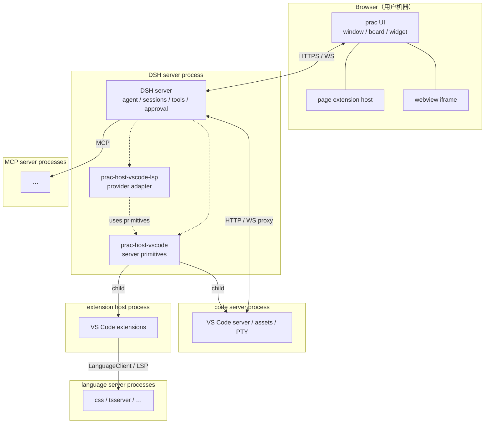
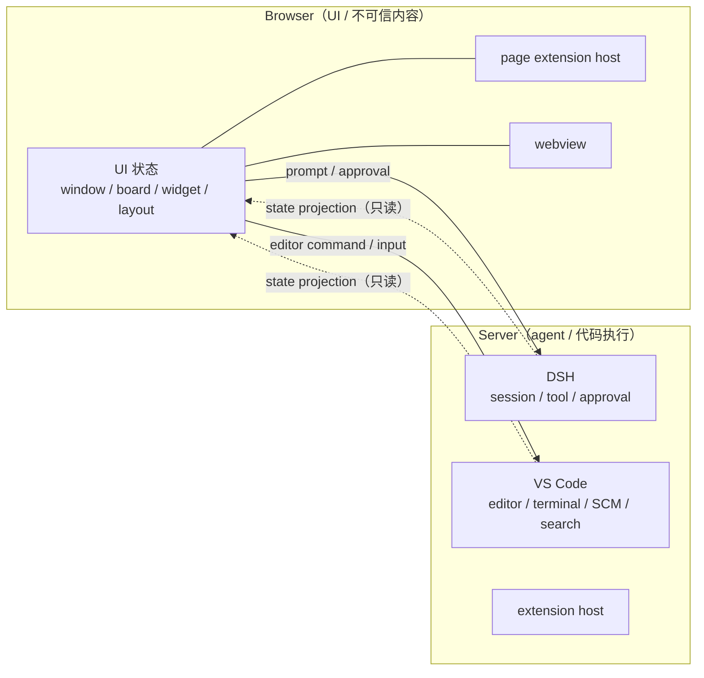
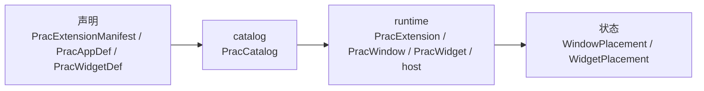
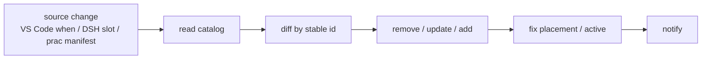
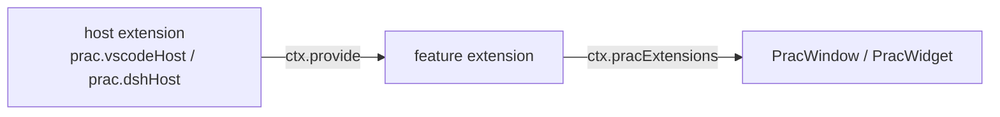
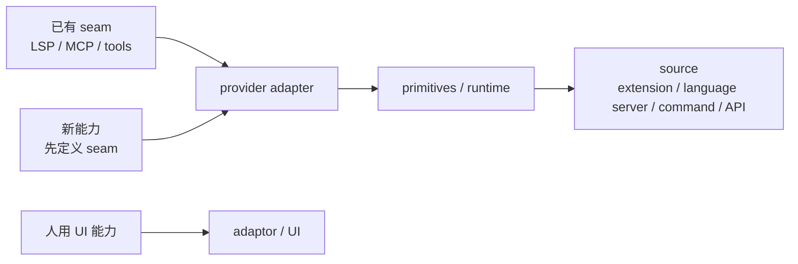
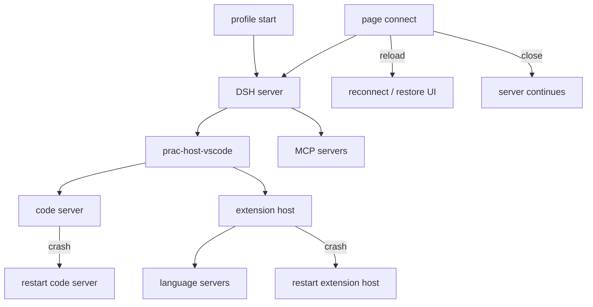

# Prac 的目标架构

> 现在时的参考。概念 / 词表见 [concepts.md](concepts.md)；window / board 细节见 [window-model.md](window-model.md)；来源映射见 [ui-surface-map.md](ui-surface-map.md)；设计理由在 `.agents/notes/proposed/`。
> 理念见 [philosophy.md](philosophy.md)；两个被依赖系统的内部结构见 [dsh.md](dsh.md) / [vscode.md](vscode.md)。

## 1. 目标与不变量

prac 是建立在 **Cordis / DSH** 上的 agent workspace：人和 agent 在同一个工作区里对话、编辑、审阅、验证、回滚。

不变量：

- **不 fork DSH**：改变行为走 DSH 的组装层（bundle / profile / patch）。
- **不 fork VS Code**：只 pin + patch + overlay，源码不进本仓。
- **不引第三方改造**（`monaco-vscode-api`、Theia 这类）。
- **prac 拥有组合**：window / board / widget 的 placement、active、chrome、持久化。
- **来源拥有内容**：VS Code、DSH、扩展只提供内容 / 能力，不拥有 WM。
- **Cordis 是共同 plugin runtime**：prac 和 DSH 不各造一套 loader。

## 2. 基座：Cordis / DSH

```text
Cordis plugin
  apply(ctx)
    → ctx.provide(...) / inject(...)
    → ctx.pracExtensions.register(extension)
    → ctx.effect(dispose)
```

- **Cordis plugin**：runtime 单元；`apply` / `inject` / `ctx.provide` / `ctx.effect`；
- **DSH plugin**：基于 Cordis 的产品级插件包；
- **prac extension**：Cordis plugin + contribution（`PracAppDef` / `PracWidgetDef` / `hostFor` / `contentFor`）；
- **VS Code extension**：VS Code 自己的插件包，跑在 VS Code host 里；prac 的 VS Code adaptor 是 Cordis plugin。

`ctx` 就是 DSH / Cordis 的 `Context`；`ctx.pracExtensions` 是扩展注册 service。

## 3. 部署实体与进程



- `prac-host-vscode` / `prac-host-vscode-lsp` 是 DSH server 进程里的 plugin row，不是新进程；
- `code server` / `extension host` 是 `prac-host-vscode` 起停的子进程；
- `language servers` 由 extension 的 `LanguageClient` 启动 / 连接；
- `page extension host` 在 Browser 侧，和 server 侧 extension host 分开。

## 4. Browser / Server 与状态



- **只读只指 state projection**，不指用户操作：编辑 / 保存 / 终端 / SCM / search 都是 UI 发出的 command / input；
- UI runtime 是 **window / board / widget / layout** 的唯一 writer；
- DSH 拥有 conversation / session / tool / approval；VS Code 拥有 editor / terminal / SCM / search / debug；prac 不复制；
- 文件 / editor buffer 的权威在 VS Code 与文件系统；prac 只保留 window / placement。

## 5. Extension / catalog / runtime



- **声明**：可序列化、可比较；不放 content / hostFor / handle；
- **catalog**：派生快照 + 索引；不持久化；
- **运行时**：Cordis plugin、host、window、widget、content root；
- **状态**：placement / active / Space。

### 5.1 动态贡献



- 贡献变化走 reconcile，不靠重启；
- 稳定 ID 是前提；
- 新 runtime 用新定义；旧 runtime 可以 pin 旧定义；
- restart 只用于 host 崩溃 / 不兼容 / registry 损坏。

### 5.2 host capability



- host extension 只提供 capability，不贡献 app / widget；
- feature extension 用 `inject` / `dependsOn`，host 未 ready → disabled / degraded；
- 没有 ambient `ctx.pracWindows`；能力显式取。

## 6. 能力路径



- **LSP**：VS Code 扩展 → `ctx.lsp` provider；细节在 [vscode.md](vscode.md)；
- **MCP**：VS Code 提供定义来源，DSH 起 client；
- **IDE**：editor / terminal / SCM / search 等能力由 VS Code host 提供，prac 只做 window / board / chrome；
- **人用 UI 能力**：走 adaptor / UI，不进 agent capability；
- VS Code 是内容来源，不是 DSH 的通用 API 桥。

## 7. 生命周期 / 部署



- 页面可关，server 继续；
- `extension host` / `code server` 崩溃：重启，页面重连；UI 从 frame / space / board key 恢复；
- 运行期状态按 XDG：config / state / data；构建期 `.build/`；
- 自用形态；不做多用户 / 登录；
- 升级 / 回滚走 profile + pin + 比较门。

## 8. 相关

- [concepts.md](concepts.md)：词表与体系。
- [window-model.md](window-model.md)：window / group / board / placement。
- [ui-surface-map.md](ui-surface-map.md)：来源 → 对象映射。
- [ui-acceptance.md](ui-acceptance.md)：UI 验收。
- [dsh.md](dsh.md) / [vscode.md](vscode.md)：被依赖系统的内部结构。
- [.agents/notes/in-progress/2026-11-05-tech-extension.md](../.agents/notes/in-progress/2026-11-05-tech-extension.md)：扩展模型 / catalog / reconcile。
