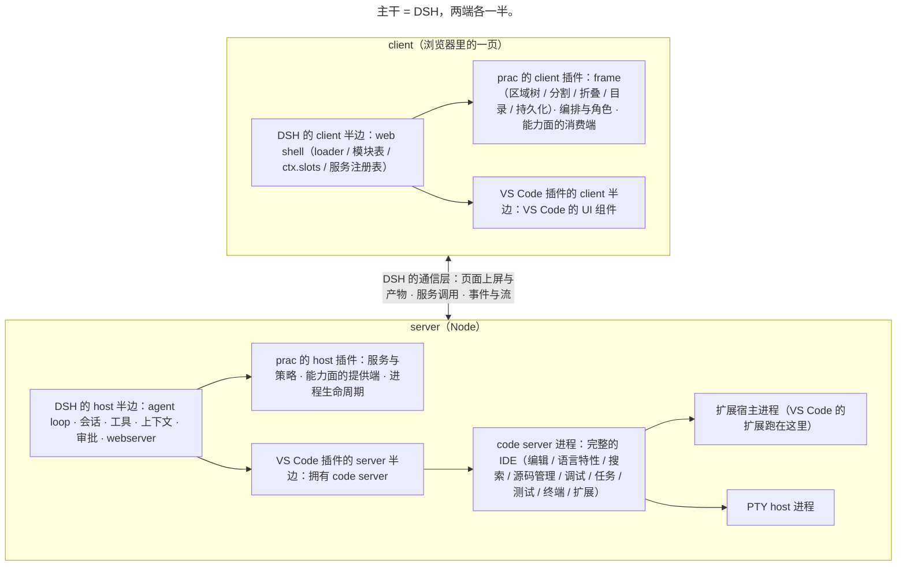

# Prac 的目标架构

> **本文件的设计已被取代**（2026-09-19 James：「放弃当前的架构设计，从需求出发，从头设计架构」）。
> 现在的设计在 [proposed/2026-09-19-architecture.md](../.agents/notes/proposed/2026-09-19-architecture.md)；本文保留为**旧设计的记录**，那篇定案后整体重写——其中大部分结构（主干是 DSH、两端、frame 与「view 是单位」）仍然有效，被扔掉的部分见那篇 §4。

> 面向目标的设计。实现进度、差距与踩坑见 [.agents/notes/](../.agents/notes/)；理念见 [philosophy.md](philosophy.md)。

---

## 1. 目标

### 1.1 为什么做 prac（设计的出发点）

1. **责任要放对地方**：AI 只做**有界认知**（感知当下、生成、局部转换——短单元、可验证）；人负责意图、高杠杆处的判断与真实校验；harness 负责**账本**（外部、持久、可核实的事实，不信任模型的自我报告）。责任永远在人，harness 的价值是让责任**可行使**（暴露推理、可验证、可回滚），而不是**可甩脱**。
2. **能力边界要分清真伪**：区分**真天花板**（模型确实做不到）与**假天花板**（rig 没给够工具、上下文、权限）。假天花板是要修的机会，不是结论。这要求 harness 能把"手上的事实"和"可能的动作"都摊在台面上。
3. **组织方式是认识论循环**：`决定 → 验证 → 重审`，不是 `计划 → 执行 → 交付`。计划是活的假设，会被现实证据击打后重修。
4. **两个生态都要用上**：harness 侧要 DSH 的**成熟骨架与生态**，IDE 侧要 VS Code 的**完整能力与生态**——而且不是"用一个包另一个"，是**把两边都拆散、按 prac 的目标重新组装**。

### 1.2 目标

prac 要做的是**一个供人和 agent 共用的工作台**：DSH 提供 harness（模型、工具、会话、审批、沙箱），VS Code 提供**完整的 IDE** 能力与生态（编辑、语言特性、搜索、源码管理、调试、任务、测试、终端、扩展），两者合成一个系统。

这个合成是**两端**的：**server 侧跑着 agent 与 harness，并且拥有完整的 IDE 能力**——所以 agent 能直接使用它们；**client 侧是人的界面**，由 prac 自己编排，VS Code 的 UI 在其中只是组件。**主干是 DSH**，prac 自己的部分与 VS Code 都以插件的形式挂在它上面。

### 1.3 三条不变量（架构变更的判据）

1. **不 fork DSH**：改变行为走它自己的组装层（bundle / profile / patch）。
2. **不 fork VS Code 源码树**：只 pin + patch + overlay，源码不进本仓，改动要小到可审计。
3. **不引第三方改造**（`monaco-vscode-api` / Theia 之类）：直接对官方 Code - OSS 下手。

---

## 2. 总体形态

### 2.1 两端：client 与 server

架构按两端看：**client** 与 **server**。DSH 与 VS Code 各自都同时有这两侧的部分，所以不能按系统来切分（§4）。

DSH 在两端都提供骨架：client 侧是页面的壳（loader、模块表、槽、服务注册表），server 侧是 harness 与进程（§2.2）。

### 2.2 主干是 DSH

组合、状态、进程、生命周期都归主干。DSH 在两端都提供骨架，prac 与 VS Code 的插件按各自所属的一端挂上去：

| 端         | DSH 作为主干的具体形态                                                                                      |
| ---------- | ----------------------------------------------------------------------------------------------------------- |
| **client** | **页面的壳**：loader 与模块表、`ctx.slots`、服务注册表、boot 注入——prac 的 frame 与座位挂在它的壳上         |
| **server** | **harness 与进程**：Cordis 插件树（host 插件）、profile / bundle / patch 组装、服务、agent loop、子进程管理 |

**DSH 的扩展方式就是插件**：Cordis 插件树（加上运行时的动态包）——host 半边在 Node、client 半边在页面，同一地址空间，耦合是 in-process 的 `inject`。

给 agent 的能力：DSH 侧是写一个插件挂进主干（工具 / 上下文 / 呈现三类）；VS Code 侧必须经过它的扩展宿主（唯一能调 `vscode.*` 的地方）。

主干的组装机制（profile → bundle → patch，按行 id 定位、可 insert / 可 disabled）就是 prac 的定制方式：定制表现为组装，不是改内核。

### 2.3 prac 自己写什么，继承什么

| 组成                  | 是什么                                                                                                                            | 目标                                                |
| --------------------- | --------------------------------------------------------------------------------------------------------------------------------- | --------------------------------------------------- |
| **主干（DSH）**       | harness 本身：agent loop、会话与 session log、工具运行时、上下文、审批与沙箱、设置、凭据、持久化                                  | **直接继承**，不重写                                |
| **prac 自己写的插件** | ① **frame**：一个通用多区域容器（区域树 / 分割 / 堆叠 / 折叠 / 底栏 / 视图目录 / 持久化）② **编排与角色**：谁放哪、注意力、快捷键 | 界面形态由 prac 拥有，不被任何一方绑定              |
| **agent 面**          | 六件事的落点：决策空间、依据一等公民、可逆检查点、审查主界面、架构记忆、活的计划                                                  | **立身之本**；先以纯消费者身份塞进 DSH 的扩展点     |
| **VS Code 集成族**    | 一组插件 + 它依赖的 lib 与 vendor（§3）                                                                                           | 引入**完整的 IDE** 能力与生态——**重要，只是一部分** |

### 2.4 一张图

---

## 3. VS Code 的集成

### 3.1 一组插件，按同一条轴切成两半

**不是"一个插件"，是"一组插件"**——我们基于 `vendor/vscode-embed` 开发**一组插件**（它们住在 `packages/*`，与 prac 自己的插件并列）。**VS Code 自己也按 prac 的两端切成两半**：

| VS Code 的那一半      | 在 prac 里是什么        | 提供什么                                                                       |
| --------------------- | ----------------------- | ------------------------------------------------------------------------------ |
| **code server**       | **server 侧的 remote**  | **完整的 IDE**（编辑、语言特性、搜索、源码管理、调试、任务、测试、终端、扩展） |
| **web**（web bundle） | **client 侧的 UI 组件** | **UI**                                                                         |

### 3.2 三层

| 层                                      | 是什么                                                                   |
| --------------------------------------- | ------------------------------------------------------------------------ |
| `vendor/vscode`                         | 引入的 VS Code 源码树 + 我们的 patch（pin / patch / overlay / 构建配方） |
| `vendor/vscode-embed`                   | 在它之上封装的可复用 lib：把 VS Code 变成可被程序驱动的部件，不绑定 prac |
| **VS Code 插件族**（住在 `packages/*`） | 基于这个 lib 构建的一组插件——把 VS Code 的能力与生态带入 prac 的地方     |

**lib 与插件的分工**：lib 只提供机制（资产服务、启动、宿主元素工厂、能力面的骨架）；政策在插件层（谁放在哪、何时启动、哪个 view 用哪个 part、能力怎么给 agent、进程生命周期）。

### 3.3 通信层：基于 DSH 的架构设计（§7 的待设计项）

**两半之间的通信层要基于 DSH 的架构重新设计**——**不是**把 VS Code 自己的传输（管理连接、扩展宿主连接、资源 HTTP）从浏览器透传到 code server。

设计约束：

- 主干的 remote 面是"**host 声明方法、client 调用**"，反向只有**转发事件**（其中 waterfall 类事件可携带回答），**没有通用双向 RPC**；
- **流复用 `/api/remote.mux` 是单向推送**：开流之后 client 只有 `open` / `cancel`，host 只有 `item` / `error` / `end` ⇒ 它承载不了"host 问 client"；
- host→client 的**请求 / 响应**现成只有一条路：转发事件里的 `waterfall`（带 `eventId`）+ client 用一元调用 `$events/result` 回答；它的事件白名单是 `api-remotes` 里的静态数组 ⇒ 要塞新事件就得改 DSH；
- 要做**通用双工**，只能改 gateway 的传输核心（新帧 + 客户端 API）——代价最高的一档；
- **VS Code 的 extHost 协议不应跨越 prac 的 CS 边界**——它属于 server 侧内部（code server ↔ 扩展宿主）。

设计形状、四个待裁项与各自的代价见 [abandoned/2026-09-16-vscode-integration-transport.md](../.agents/notes/abandoned/2026-09-16-vscode-integration-transport.md)（**已作为计划被取代**；现为 [架构重做](../.agents/notes/proposed/2026-09-19-architecture.md) 里的 P1）。

### 3.4 UI 组件的边界

"client 侧提供 UI 组件"要落到**组件**这一级，不是把整个 workbench 搬进页面。

组件的边界（编辑器控件到哪、tree / 终端 / 面板这些整块 UI 怎么办、哪些必须由 server 侧数据驱动）是 §7 的待设计项。

---

## 4. 两端的设计

### 4.1 每端有什么

|                   | **client（浏览器里的那一页）**                                    | **server（Node 进程）**                                              |
| ----------------- | ----------------------------------------------------------------- | -------------------------------------------------------------------- |
| **DSH**           | web shell（loader / 模块表 / `ctx.slots`）+ prac 自己的客户端插件 | host 插件（工具 / 上下文 / 会话）+ webserver                         |
| **VS Code**       | **UI 组件**（VS Code 插件的 client 半边）                         | **code server = remote**（完整的 IDE）+ 扩展宿主进程 + PTY host 进程 |
| **prac 自己写的** | frame、编排与角色、注意力、能力面的消费端                         | 路由、服务策略、能力面的提供端、进程生命周期                         |

### 4.2 状态住在哪一端

| 状态                              | 归     | 理由                            |
| --------------------------------- | ------ | ------------------------------- |
| 工作区注册表 / 会话 / session log | server | agent 要用；跨窗口共享          |
| 工具与 agent loop                 | server | agent 住在 server               |
| 扩展与其激活状态                  | server | 扩展宿主是 VS Code 生态的落点   |
| 终端（PTY、scrollback）           | server | 跨断线保活；人机两侧都可附着    |
| **IDE 能力（诊断、语言特性…）**   | server | agent 要直接取用                |
| **编辑器缓冲区与模型**            | server | 同上；client 只持有渲染用的视图 |
| **打开的文件集合**                | server | 工作区里正在发生什么            |
| frame 布局                        | client | 纯呈现状态，per-origin 即可     |
| VS Code 自己的 UI 状态            | client | 纯呈现状态，按工作区 id 隔离    |

### 4.3 端之间的线

| 线                   | 载体                                          | 内容                                            |
| -------------------- | --------------------------------------------- | ----------------------------------------------- |
| **页面上屏与产物**   | HTTP（同源静态 + 启动注入）                   | HTML、`client.js` 产物、boot 图                 |
| **服务调用**         | DSH 的 remote 面（client 调 host 声明的方法） | 能力面、会话、工作区、工具结果                  |
| **事件与流**         | 转发事件（host→client）+ 流复用               | 状态变化、流式输出、受限的反向回答（waterfall） |
| **VS Code 两半之间** | **基于 DSH 的架构设计**（§3.3、§7）           | IDE 能力 ↔ UI 组件                              |

### 4.4 设计原则

1. **IDE 能力必须能在 server 侧取到**：agent 在 server 侧；能力只存在于 client 侧时，agent 只能拿到被页面把关的、有损的视图。
2. **同一条状态不在两端各存一份**：跨窗口共享的状态放 server；服务端的共享单元是**连接**，不是页面。逐条所在地见 §4.2。
3. **UI 与 agent 读同一份能力数据**（`snapshot` / `subscribe` / `settled` / `version` / `actions`），不是各自问一份；没有 view 挂载也能回答；不开 `executeCommand` 后门。

---

## 5. 依赖的两个系统提供什么

### 5.1 DSH 提供

| 能力         | 形态                                                                                           | 设计怎么用                                                            |
| ------------ | ---------------------------------------------------------------------------------------------- | --------------------------------------------------------------------- |
| **插件**     | Cordis 插件（`apply(ctx)`、`inject` / `provide` / `effect`，卸载可逆）                         | prac 的每一行（**这是 DSH 自己的扩展方式，不是 VS Code 的扩展宿主**） |
| **组装**     | profile → bundle → patch（按行 id 定位、insert / disabled、`--dump-config`）                   | 把 prac 与 VS Code 插件装进主干；不动内核                             |
| **双平面**   | host 半边（Node ESM）与 client 半边（loader 产物）                                             | 能力在 host、UI 在 client（§3.1）                                     |
| **页面外壳** | `ctx.slots` 命名槽 + 服务注册表（消费方 pending 直到提供方出现）                               | prac 的 frame 与座位；跨插件传面                                      |
| **协议**     | remote（host 声明、client 调用）+ 转发事件 + 流复用                                            | 服务调用、状态变化、以及 §3.3 要设计的通信层                          |
| **服务面**   | 工具（`ctx.tools.register` / `defineTool`）、会话、session 投影、资源（client 侧）、快照 store | agent 面（工具 / 上下文）、frame 的持久化                             |

**prac 替掉了哪一层**：只替 `ui-layout` 这一行——本仓 `packages/bundle/web-app/cordis.patch.yml:9-10` 把它 `disabled: true`、`:15-16` insert `prac-client-ui-layout`。DSH 的它给的是一个**固定三列壳**，不是区域树（列宽常量 `packages/client/ui-layout/src/client/columns.ts:11-29`，`ctx.layout` 的面 `service.ts:28-51`，四个槽 `index.ts:148-158`；分割树与标签页在 `ui-dockkit`，由右侧栏使用）。本仓的 `prac-client-ui-layout` 占同一个内置 `root` 槽，重新声明 `sidebar` / `main` / `rightbar` / `shell.overlay` 四个槽、加一个 `prac.view` 列表座位（视图身份是 `<source>:<name>`，`dsh:` 直接映射 DSH 自己的槽——`packages/client/ui-layout/src/client/index.ts:92-106`、`catalogue.ts:23-40`）；`ctx.layout` 留作 compat shim（`index.ts:33-37`，`contract.ts:351` 的 `bindRoles`）。**替掉之后仍然继承**：`ui-renderer`（React 槽渲染、唯一 ctx 层 `renderSlot('root')`）、`ui-slots`、`dsh-client-store`、`ui-primitives`、`ui-dockkit`、`client-modules` 与 Cordis Loader、服务注册表（`provide` / `inject`，消费方 pending 直到提供方出现）、remote 与转发事件。prac 的 patch 只动了 `ui-layout` 一行。

设计只依赖约定：`dsh` 字段的三个角色（bundle / client / profile）、patch 语义、loader 产物形状、平台词表、`provide` / `inject` 的等待语义、命名槽、快照 store 的持久化。不依赖实现细节：具体行 id、API 包的导出名、快照字段的形状。

> DSH 的内部结构（`dsh web` 到像素的链与图、证据行号、槽的四种形态、5 个 UI 包的分工、9 词平台表、还没核实的地方）见 [dsh.md](dsh.md)。

### 5.2 VS Code 提供

| 能力                 | 形态                                                                                                                                                                                                     | 设计怎么用                                                                                                                                                                       |
| -------------------- | -------------------------------------------------------------------------------------------------------------------------------------------------------------------------------------------------------- | -------------------------------------------------------------------------------------------------------------------------------------------------------------------------------- |
| **完整的 IDE 能力**  | code server（remote）：编辑、语言特性、搜索、源码管理、调试、任务、测试、终端、扩展                                                                                                                      | server 侧 remote（§3.1）                                                                                                                                                         |
| **扩展生态**         | 扩展宿主进程 + extHost 协议 + 贡献点 + 市场                                                                                                                                                              | 能力来源；也是"能力层暴露给 agent"的接入点                                                                                                                                       |
| **UI 组件**          | web bundle 里的编辑器控件、工作台部件与视图（`CodeEditorWidget`、part / view container / view）                                                                                                          | client 侧的组件（§3.4）                                                                                                                                                          |
| **可组合的缝**       | `create()` 的构造选项、可覆写的 workbench 组合、`IWorkbenchLayoutService`、模块级命令面                                                                                                                  | 让 prac 拥有布局与编排，而不是被 workbench 拥有                                                                                                                                  |
| **pin + patch 形式** | 源码树 + 我们的 delta（patches）                                                                                                                                                                         | 改动可审计（不变量 2）                                                                                                                                                           |
| **（不取）**         | **VS Code 自带的 agent / chat 面**：`contrib/chat/**`（chat 循环、participants、会话、工具注册表与内置工具）、`contrib/mcp` 的客户端、`platform/agentHost/**`（copilot / claude / codex 作为被托管进程） | **agent 面归 DSH**（§2.2、§4.1）：循环、工具、会话、模型、规划与评审都在 DSH；生态里对 agent 开放的接口只剩 **MCP 与文件定制**（`SKILL.md` / `*.instructions.md` / `AGENTS.md`） |

**采用哪种运行形态**：VS Code 有四种形态，prac 只用**第三种**——[_"UI in the browser, extensions run in code server"_](https://github.com/microsoft/vscode/wiki/How-to-Contribute)：

| 形态                                             | UI 在哪 | 扩展在哪               | prac                                                                    |
| ------------------------------------------------ | ------- | ---------------------- | ----------------------------------------------------------------------- |
| `code-web`（`--target web` 单独跑）              | 浏览器  | 浏览器的 web worker    | ✗ 只有 web 扩展：终端 / 调试 / 任务 / 源码管理都不可用                  |
| **code server（`--target server` + 浏览器 UI）** | 浏览器  | **服务端的 Node 进程** | ✓ **就是它**：完整扩展生态，且能力天然在 server 侧                      |
| `server-web` / `reh-web`（server 自带客户端）    | 浏览器  | 服务端 Node            | ✗ 与"DSH 发前端"重合；它的 product 还被 `tweakProductForServerWeb` 改过 |
| `desktop` / `reh`（Electron / 远程开发包）       | 桌面    | 本地或远端 Node        | ✗ 不做桌面应用，也不给桌面 VS Code 当 remote                            |

因此构建只要**两个目标**：`--target web`（浏览器里的 UI，由 DSH 发）与 `--target server`（code server，扩展宿主在这里）。桌面、`server-web`、`reh*` 一律不构建。

**内部的两半**：**渲染器**跑 workbench（UI）；**扩展宿主**是另一个进程、跑扩展代码（只有 `vscode.*` API，没有 DOM）；两者之间那套协议的对端叫"**主线程**"——**不是线程，是角色名**，而且**实现在渲染器里**。这决定了 prac 的两件事：**没有页面就没有扩展宿主**（连接由渲染器发起），**上游也没有 server 侧的主线程实现**（实现全在 `api/browser/**`）——所以要让 server 侧拿到 IDE 能力，broker 得自己扮演它。

设计只依赖：连接按首消息分三型（prac 只用**管理面**与**扩展宿主**两型）、管理面的 channel 由服务端注册、extHost 协议不跨越 prac 的 CS 边界。

> 角色表与那张图、平台服务层是什么、协议与载体（帧格式、12 种消息、桌面 / 远程两种通道）见 [vscode.md](vscode.md)；协议清单（HTTP / 三型 WS / 握手 / channel）与行号见[工作记录](../.agents/worklog/2026-09-09-vscode-dsh-integration.md)「code server 的协议」。

---

## 6. prac 自己的机制

### 6.1 frame

一个**通用多区域容器**，不认识任何具体视图：区域树 + 分割（任意方向，**以 view 为主语**，因此任何方向都造不出空区域）+ 堆叠 + 折叠（记尺寸）+ 常驻底栏 + 视图目录（`prac.view` 槽）+ 持久化。

视图契约、树形摆放、收起记宽这类做法借鉴上游，frame 由 prac 拥有（[umbrella note](../.agents/notes/in-progress/2026-09-09-vscode-dsh-integration.md) §3.3）。

### 6.2 编排与角色

默认视图与默认落位、角色绑定、注意力（调出面 / 快捷键）、**只填空缺**的默认放置语义（默认放置不能覆盖已恢复的状态）。

### 6.3 能力面

一套 `Capability<T, A>` 同时服务 UI 与工具（§4.4 原则 3）。

### 6.4 agent 面（立身之本）

六件事各自的落点与优先级见 [proposed/2026-09-16-…](../.agents/notes/proposed/2026-09-16-epistemic-six-on-dsh-mechanisms.md)：**优先以纯消费者身份**把它们塞进 DSH 现有循环的扩展点（工具 + 上下文 + 呈现）；只有确需驱动轮次结构本身，才考虑更深的介入，且要显式记录。

### 6.5 怎么知道设计成立了

| 检查                         | 断言什么                                                                                             |
| ---------------------------- | ---------------------------------------------------------------------------------------------------- |
| **单元测试**（`vp test`）    | 机制：纯函数与纯算术（区域树重写、尺寸分配、折叠与缓存、子序、clamp、编排语义、持久化往返）          |
| **在浏览器里跑真页面的检查** | 真页面才能证明的事：产物过真 loader、部件/视图挂进搬出 prac 区域并画出像素、扩展真的激活、能力面契约 |
| **每条能力一条渲染断言**     | 拦住"模型对了、渲染器没跟上"这类单元测试看不见的假绿                                                 |

---

## 7. 尚未定的设计（下一件工作）

1. **通信层的具体设计**（§3.3）：能力以什么形状暴露（服务 / remote / 工具）、谁定帧、双工协议怎么承载、状态归谁。
2. **UI 组件的边界**（§3.4）：编辑器控件算到哪里；tree / 终端 / 面板这类整块 UI 是"组件"还是"部件"；它们的数据从哪来。
3. **插件族的划分**：server 侧一族与 client 侧一族各有哪些插件、边界划在哪（什么算一个插件）。
4. **code server 的生命周期**：谁起、谁重启、谁关、端口怎么给（主干拥有的具体形态）。
5. **能力面的清单与演进**：除 `editors` / `diagnostics` 之外要哪些（`documents` 一类），以及"给 agent 用"与"给 UI 用"是否需要不同的形状。

## 8. 相关

- [philosophy.md](philosophy.md)：两个轴 + 认识论循环 + 决策单元（§1 的出发点）。
- [.agents/notes/](../.agents/notes/)：决策记忆——每个「为什么 + 放弃了什么」，以及**实现进度、差距与踩坑**。
- [in-progress/2026-09-09-vscode-dsh-integration.md](../.agents/notes/in-progress/2026-09-09-vscode-dsh-integration.md)：本文件 §1–§4 的设计出自它的架构总纲（旧编号 `决定 22`；旧编号按同项工作的[工作记录](../.agents/worklog/2026-09-09-vscode-dsh-integration.md)台账解析）。
- [abandoned/2026-09-15-vscode-capabilities-into-prac.md](../.agents/notes/abandoned/2026-09-15-vscode-capabilities-into-prac.md)：能力面的形态与三步（**已作为主线被取代**）。
- [abandoned/2026-09-16-vscode-integration-transport.md](../.agents/notes/abandoned/2026-09-16-vscode-integration-transport.md)：§3.3 通信层的设计（**已作为计划被取代**）。
- [proposed/2026-09-16-epistemic-six-on-dsh-mechanisms.md](../.agents/notes/proposed/2026-09-16-epistemic-six-on-dsh-mechanisms.md)：六件事的落点（§6.4）。
- [proposed/2026-09-19-architecture.md](../.agents/notes/proposed/2026-09-19-architecture.md)：**现在的设计**（从需求出发重做，本文待它定案后重写）。
- `vendor/vscode/README.md`：上游 pin、补丁集、overlay、构建与验证的细节。
