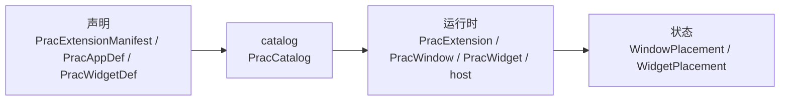
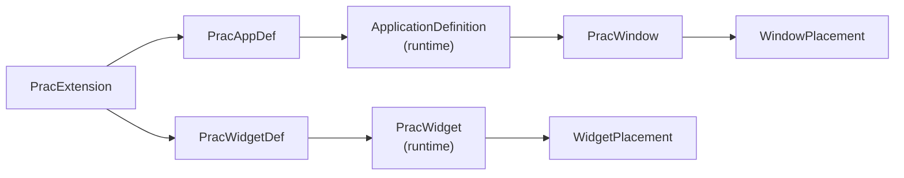

# prac 的概念

> 这份是**词表与体系**：prac 用哪些词、每个词指什么、哪些**不是**。它是现在时的参考。
> 架构在 [architecture.md](architecture.md)；扩展模型在 [.agents/notes/proposed/2026-11-05-tech-extension.md](../.agents/notes/proposed/2026-11-05-tech-extension.md)。

## 一句话

> prac 是建立在 **Cordis / DSH** 上的 agent workspace：**extension** 贡献 app / widget 定义，**catalog** 是派生索引，**PracWindow / PracWidget** 是运行时对象，**placement** 是持久化状态。

## 1. 基座

- **Cordis** 是 prac 和 DSH 共同的 plugin runtime；
- **DSH plugin** 是基于 Cordis 的产品级插件包；
- **prac extension** 是一个 Cordis plugin + 一组 contribution 对象，不是新的 loader；
- VS Code 是外部 host，通过 `prac.vscodeHost` 能力接进来；
- DSH 通过 `prac.dshHost` 能力接进来。

```text
Cordis plugin
  apply(ctx)
    → ctx.pracExtensions.register(extension)
    → ctx.effect(dispose)
```

## 2. 三层



- **声明**：可序列化、可比较；不放函数 / 句柄 / ReactNode；
- **catalog**：派生快照 + 索引；不持久化；
- **运行时**：Cordis plugin、host、window、widget、content root；
- **状态**：placement / active / Space；持久化，但不是声明。

## 3. 对象图



- `PracAppDef` + `contentFor` → `ApplicationDefinition`；app layer 再开 `PracWindow`；
- `PracWidgetDef` + `hostFor` → `PracWidget`；board 里放 `WidgetPlacement`；
- `WindowPlacement` 只描述窗口在 space root 的位置。

## 4. 对象

| 对象 | 是什么 | 不是什么 |
|---|---|---|
| **PracExtension** | Cordis plugin + contribution；`apps()` / `widgets()` / `hostFor` / `contentFor` | 不是新的 plugin runtime |
| **PracAppDef** | app 的声明：id / label / instances / defaultRegion | 不是 window；不含 content |
| **ApplicationDefinition** | app 的运行时定义：`PracAppDef` + `content(windowId)` | 不是 window 实例 |
| **PracWindow** | 一个窗口实例：身份 / 生命周期 / appId / title | 不是 DOM window；不是 tab |
| **PracWidgetDef** | widget 的声明：id / title / defaultBoard / defaultRegion | 不含 content / hostFor |
| **PracWidget** | widget 的运行时：`PracWidgetDef` + source + content | 不是 window；不直接进 group |
| **WindowPlacement** | window 在 space root 的 placement | 不是 window；不属于 `PracWindow` |
| **WidgetPlacement** | widget 在 board root 的 placement | 不是 widget |
| **PracCatalog** | 声明 / 定义的派生快照 + 索引 | 不是第二权威；不持久化 |
| **Window group** | 一组 window；tab strip 的 tab 是 window | 不是 editor group |
| **Space** | stage 的虚拟桌面；拥有一个 space root | 不是 project folder |
| **board** | widget 的布局内容 | 不是 window；board window 才是 window |

## 5. 关系约束

- **一个正在编辑的文件 = 一个 `PracWindow`**；tab 是 window group 的 window，不是 window 内的 tab；
- **一个 conversation = 一个 `PracWindow`**（当前）；
- `PracWindow` 只属于一个 window group / region；
- `WindowPlacement` 可以暂不在 group；
- `WidgetPlacement` 只在一个 board root；
- window group 的成员只能是 `PracWindow`；
- board window 是 content 为 board 的 `PracWindow`，不是 `PracWindow` 的子类；
- widget 不成为 tab；
- `active` 有两级：group 的 active window、board 的 active widget。

## 6. 来源

| 来源 | prac |
|---|---|
| VS Code editor input（文件 / diff / custom editor / webview） | `PracAppDef` + `PracWindow` |
| VS Code `ViewContainer` | board / board window |
| VS Code `ViewDescriptor` | `PracWidgetDef` / `PracWidget` |
| VS Code editor group | window group 的 adapter runtime |
| VS Code 菜单 / 命令 | action model |
| DSH `main` keyed entry | app / `PracWindow` |
| DSH `sidebar` / `rightbar` | app / board（后续） |
| DSH 内部 slot | widget |
| DSH `shell.overlay` | frame overlay |

- VS Code / DSH 是**内容来源**，不是 prac 的原生对象；
- `PracExtension` 负责转换；frame 不认识 `vscode:` / `dsh:`；
- adaptor 不拥有 placement / active / WM。

## 7. 布局

```text
Frame shell
  dock / sidebar / panel / chrome
  stage
    └─ Space
         └─ space root
              split / grid / region
                   └─ surface
                        └─ window group
                             └─ PracWindow
                                  └─ content
```

- `frame root` 只放 shell；
- `space root` 放 `WindowPlacement`；
- `board root` 放 `WidgetPlacement`；
- 一个 root 同时只有一个 writer；
- `surface` 是 region 的内容根；
- board root 是 window content 里的 layout hole，可 hit-test / drag / size / split；
- 跨 root 只允许 move。

## 8. 术语

| canonical | 不要用 | 说明 |
|---|---|---|
| **PracExtension** | partner | Cordis plugin + contribution |
| **PracCatalog** | catalogue | 派生快照 / 索引 |
| **PracWindow** | WindowInstance / WindowRecord | 窗口运行时 |
| **PracWidget** | WidgetInstance / WidgetItem | widget 运行时 |
| **PracAppDef** | — | app 声明 |
| **PracWidgetDef** | — | widget 声明 |
| **WindowPlacement** | WindowItem | window 位置 |
| **WidgetPlacement** | WidgetItem | widget 位置 |
| **application window** | editor view / editor group | editor / chat / diff / terminal 的 window |
| **editor group** | prac window group | VS Code adapter runtime |
| **source adapter** | — | 把 VS Code / DSH 内容投影成 prac 对象 |

## 9. 已退役

- **partner**：已被 extension 取代；
- **catalogue**：统一为 catalog；
- **WindowInstance / WindowRecord**：统一为 `PracWindow`；
- **WidgetInstance / WidgetItem**：统一为 `PracWidget` / `WidgetPlacement`；
- **view 是 prac 原生对象**：view 只属于 adapter / source；
- **board 是 window**：board 是内容；board window 才是 window；
- **seat / view group**：不是独立对象。

## 10. 相关

- [architecture.md](architecture.md)：部署 / 进程 / Browser-Server / 状态。
- [window-model.md](window-model.md)：window / group / placement。
- [ui-surface-map.md](ui-surface-map.md)：来源 → 对象映射。
- [ui-acceptance.md](ui-acceptance.md)：UI 验收。
- [.agents/notes/proposed/2026-11-05-tech-extension.md](../.agents/notes/proposed/2026-11-05-tech-extension.md)：extension / catalog / runtime。
