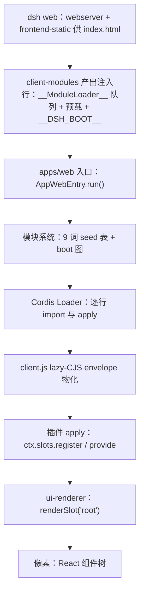

# DSH 的内部结构（参考）

> 这篇是 **DSH 自身**的结构：`dsh web` 从服务页面到像素的链、UI 组装原语、包与状态、平台词表，以及还没核实的地方。
> **prac 的架构**（用到 DSH 的什么、替掉了哪一层）在 [architecture.md](architecture.md) §5.1。行号除写明「本仓」的，都在 DSH checkout 的 `packages/**` 里。

**渲染架构**：`dsh web` 到像素是一条单向链：服务页面 → 注入 boot 图 → 浏览器内核 → 模块系统 → Cordis Loader → 插件 `apply` → 槽注册 → React 渲染。

| 环节            | 是什么                                                                                                                                                        | 证据（DSH checkout）                                                                                                                                                                                 |
| --------------- | ------------------------------------------------------------------------------------------------------------------------------------------------------------- | ---------------------------------------------------------------------------------------------------------------------------------------------------------------------------------------------------- |
| **服务页面**    | `dsh web` 是 `--profile web` 的别名；web profile 在 `dsh-web-app` 之上叠行                                                                                    | `apps/cli/src/args.ts:175`；`packages/bundle/web-app/cordis.patch.yml:135-161`                                                                                                                       |
| **页面注入**    | webserver 把 dist 的 `index.html` 过一遍结构化注入表；`frontend-static` 是读 dist 的 fallback                                                                 | `packages/host/webserver/src/index.ts:347-361`；`packages/host/frontend-static/src/index.ts:120-142`                                                                                                 |
| **boot 图**     | `client-modules` 的 node 半边扫 Loader 行里的 `dsh.client` 包，合成 boot 图并产出注入行（队列、预载、blocking bootstrap、`__DSH_BOOT__`）                     | `packages/client/modules/src/index.ts:474-509`、`:578-580`；声明字段 `packages/util/package-manifest/src/types.ts:43-57`                                                                             |
| **浏览器入口**  | Vite 入口对 `#root` 跑 `AppWebEntry`                                                                                                                          | `apps/web/src/main.ts:1-6`                                                                                                                                                                           |
| **boot 内核**   | 等 `__DSH_BOOT_READY__`、取 `window.__ModuleLoader__`、用 seed 表与 boot 图建模块系统；挂 Loader 并 `loader.internal = modules`；逐行 `loader.create`         | `packages/client/web/src/boot.ts:46-85`、`:113-135`                                                                                                                                                  |
| **seed 表**     | 9 个平台词 → shell 的静态导入                                                                                                                                 | `packages/client/web/src/seed.ts:24-38`；词表 `packages/client/web/src/platform.ts:8-14`                                                                                                             |
| **loader 产物** | 每个 client bundle 是 `window.__ModuleLoader__.load({id, factory})` 的闭包工厂；加载只注册工厂，物化才跑模块体；`require` 解析顺序 seed → 已物化 → 已注册工厂 | `packages/client/tsdown.client.ts:566-568`；`packages/client/modules/src/client/system.ts:172-192`、`:200-213`                                                                                       |
| **插件行**      | Loader 按 Cordis 服务依赖定激活顺序，import 后跑 `apply`；未激活的行在 boot 审计里报错                                                                        | `packages/client/web/src/boot.ts:124-135`、`:138-158`                                                                                                                                                |
| **槽**          | 插件在 `apply` 里 `ctx.slots.register(...)`                                                                                                                   | `packages/client/ui-layout/src/client/index.ts:148-158`；`packages/client/ui-conversation/src/client/apply.ts:388-393`                                                                               |
| **渲染**        | `ui-renderer` 安装槽渲染器并提供 `ctx.uiRenderer.mount`；boot 用 `inject(['uiRenderer'])` 挂载；React 树从内置 `root` 槽起                                    | `packages/client/ui-renderer/src/client/index.ts:88-96`；`packages/client/web/src/boot.ts:95-101`；`packages/client/ui-renderer/src/client/app.tsx:21`、`registry.ts:43`、`scoped-slots.tsx:895-931` |

**UI 组装原语**：

- `ctx.slots` 是**命名槽注册表**。一次 `register({ name, key?, children?, store?, inject? }, Component)` 同时声明该组件允许渲染的 child 槽（声明即独占授权）。槽有四种形态：`single`（单占用）、`list`（有序列表）、`keyed`（按 key 分派）、`chain`（条目自选）；作用域三种：`root` / `session-maybe` / `session`（`packages/client/ui-slots/src/index.ts:97-101`、`:149-155`；注册入口 `packages/client/ui-renderer/src/client/registry.ts:607-612`）。所以不是只有单值 / 列表两种。
- `root` 是内置的单值槽，只有 shell 从 ctx 层渲染它（`registry.ts:43`、`:349-356`）。
- **贡献一个 view / panel**：在 `apply` 里注册。进 `main`（keyed）的一个 key 就是一个中央面板——`ui-conversation` 注册 key `conversation`（`ui-conversation/src/client/apply.ts:388-393`）；进 `sidebar` / `rightbar`（single）就占据整列，进 `shell.overlay`（list）就叠在整帧之上（`ui-layout/src/client/index.ts:61-91`）。父组件在自己的渲染点用 `renderSlot('<key>', ownerProps)` 取出来（`ui-layout/src/client/AppFrame.tsx:40-42`、`:193-227`）。
- **由什么渲染**：React 18（`packages/client/ui-renderer/package.json:54-55`；锁定 18.3.1）。注册的组件是函数组件——渲染器按 `FC<InjectedProps>` 取用并以 JSX 展开（`scoped-slots.tsx:505`、`:510`、`:548`）。四种形态的分派在 `scoped-slots.tsx:801-812`（single / keyed）与 `:814-834`（chain）。
- **样式**：CSS Modules 在 bundle 内用 lightningcss 编译，工厂执行时注入带 `data-plugin` / `data-plugin-css` 的 `<style>`，类名是 hash（`packages/client/tsdown.client.ts:33-53`、`:502-525`）；全局 css 走同一注入器（`:542-556`）。主题别名 token 是 `--dsw-*`，由 `ui-layout` 的 presenter 写到 `document.body`（`ui-layout/src/client/index.ts:171-181`）。

| 包              | 负责                                                                                                                       | 形态                     |
| --------------- | -------------------------------------------------------------------------------------------------------------------------- | ------------------------ |
| `ui-slots`      | 命名槽的纯核心（声明、注册、四种形态、load 期校验），无 React                                                              | 静态链接库，也是 seed 词 |
| `ui-primitives` | 共享 React 原子（控件、图标、Markdown / 终端 / diff 等输出卡片），零 Cordis、只用 token                                    | 静态链接库，也是 seed 词 |
| `ui-dockkit`    | 停靠布局引擎（分割树 + 标签页 + 撤销历史）与组件；右侧栏是它的嵌入者                                                       | 静态链接库，也是 seed 词 |
| `ui-layout`     | 固定三列 AppFrame、列宽常量、`ctx.layout`、主题 presenter，并声明 `sidebar` / `main` / `rightbar` / `shell.overlay` 四个槽 | 一个 client 插件行       |
| `ui-renderer`   | 唯一把裸 observable 绑成 React hook、持有 React context、渲染 `root` 的包                                                  | 一个 client 插件行       |

（证据：`packages/client/ui-slots/README.md`、`ui-primitives/README.md`、`ui-dockkit/README.md`；`packages/client/ui-primitives/tsdown.config.ts` 与 `ui-dockkit/tsdown.config.ts` 都调 `staticLinked`；`ui-layout/src/client/columns.ts:11-29`、`service.ts:28-51`。）

**状态与数据**：

- `dsh-client-store` 是 React-free 的快照 store 引擎：`createSnapshotStore`（`getSnapshot` / `subscribe` / 生效方式）、`defineStore`（init + actions 声明表），可按名持久化到 localStorage（`packages/client/store/src/index.ts:103`、`:217`；契约 `packages/client/store/src/contract.ts:3-14`）。渲染侧只有 `ui-renderer` 把它绑成 React hook；业务组件不自己订阅。
- remote / typert：host 用装饰器声明方法并生成 descriptor；client 在 `apply` 里 `ctx.remote.$mount(contribution)`，得到 `ctx.remote.<namespace>` 的方法与 stream（`packages/api/remotes/src/client/index.ts:143-158`）。**它不直接进 React**：转发事件经 `ctx.remote.$on(...)` 更新 client 数据层（会话 / 工作区模型），模型再经 UI adapter 变成槽的标准 hook 或 store（`packages/api/session-controller/src/client/index.ts:102-107`）。分层与数据路径见 DSH 的 `docs/subsystems/web-client.md`。

**平台模块表（9 个词）**：`react`、`react/jsx-runtime`、`react-dom`、`react-dom/client`、`@deepseek-ai/cordis`、`@deepseek-ai/dsh-client-store`、`@deepseek-ai/dsh-client-ui-slots`、`@deepseek-ai/dsh-client-ui-primitives`、`@deepseek-ai/dsh-client-ui-dockkit`（`platform.ts:8-14`，逐一对应 `seed.ts:28-38` 的静态导入）。

- 为什么是这 9 个：四个 React 入口 + Cordis + 四个静态 client 库。它们是有运行时身份、必须只有一份的东西；其余依赖要么内联进各自的 bundle，要么由 `dsh.client.external` 逐包声明。
- 保证了什么：seed 的值是 shell 的静态导入，所以每个 bundle 拿到同一实例（`seed.ts:1-8`）；词表是单一真源，seed 表、tsdown externals、Vite alias 都消费它，模块身份不会漂移（`platform.ts:1-5`）。
- 两侧的强制：构建期把这 9 个（baseline）留成 external，非 baseline 的 workspace value import 被纯度门拒绝（`tsdown.client.ts:406-416`、`:482-500`）；运行期 `require` 先命中 seed，未命中就抛（`client/system.ts:200-213`）。

**未核实**：

- 任务里提到的 `clientPack` 在 DSH checkout 里搜不到（`packages/**` 只有 typert 测试里的局部变量 `clientPackage`）。这里按实际存在的两个名字写：client bundle 的 `__ModuleLoader__.load` 闭包工厂封装，以及 `dsh.client` 声明。
- prac 自己的 client bundle 由 `vite.config.ts` / `scripts/pack-client.ts` 的 pack 产出（本仓 `packages/client/ui-layout/src/client/index.ts:44-48`），与 DSH 的 `tsdown.client.ts` 不是同一条构建链；两条链产物的 envelope 是否逐字节同形，没有对比。
- 9 个词里每个词「必须是共享单例」的逐条判据，代码里只有 seed 注释与 baseline external 规则；`ui-primitives` / `ui-dockkit` 是否仅为去重而非身份必需，未核实。
