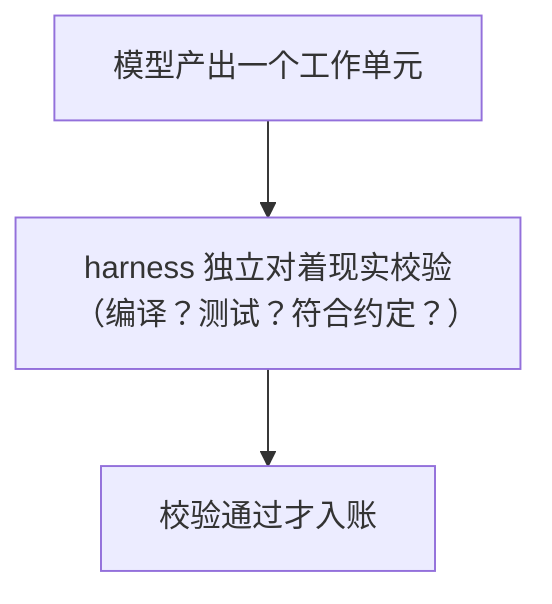

# Prac 哲学

> Prac 如何思考「Agent 的形态」。这是稳定的现在时参考；每条决策的「为什么 + 放弃了什么」见 [.agents/notes/](../.agents/notes/)。

## 责任分配

主流的隐含分工是「人 = 定目标 + 全程监督 + 判对错；AI = 稳定执行」——这让人和 AI 各自接到自己最不擅长的活。

Prac 的重排：

- **AI 只负责有界认知**：感知当下、提出选项、生成、做局部转换。每个都是可验证的短单元，不做长期自持。
- **人负责意图 + 高杠杆处的判断 + 真实校验**，只在值得介入的决策点出现。
- **harness 负责账本**：维护外部、持久、可核实的事实账户——哪个文件确实改了、测试真的过了、这个调用真的发生了。**harness 的事实源不信任模型的自我报告。**

## 验证环

不是「模型说完成就算完」，而是：

错误要分类处理，而不是无脑重试：

- **机械性**（局部 bug、语法/格式错）→ 修完重试。
- **方向性**（这条路本身就走错了）→ 重审方案，不是再试一次。
- **能力缺口**（不是模型不行，是 rig 没给够东西）→ 是我们要修的机会，不是结论。

## AI 能力：真假天花板

「AI 做不到 X」分两类：

- **真天花板**：当前模型确实做不到。
- **假天花板**：其实是这套 rig 没让模型触碰到它够得着的东西（缺工具、缺上下文、缺权限）——实践中绝大多数属于这类。

Prac 的价值之一，是系统地去猎假天花板，并把真天花板测准。

## 认识论循环

软件开发是创造性工作，不是重复事务。工作机制是「边做边想、不断调整」，很难一开始把所有东西想清楚。

因此 Prac 以**认识论循环**为主模型，而非「计划 → 执行 → 交付」的生产线：

计划是**活的假设**，会随现实揭示而不断被推翻重修，不是固定物。

## 决策交付单元

- **agent 的交付单元是「决策」，不是「代码」**：它交出来的是「有几个选项、各自代价、我推荐哪个、我打算怎么验证」，代码只是副产品。
- **人的交付单元是「承诺」**：把候选决策变成承诺的那份判断，以及系统的结构。
- **责任永远在人**——软件是对世界（和对未来维护者）的承诺，agent 担不起。但 harness 的职责不是让责任变得可甩脱，而是**让「你的责任」变得可行使**：把 agent 的推理暴露、可验证、可回滚。

## 认识论 harness 的六件事

1. **决策优先而非文件优先**：给大目标，它先摊开一个结构化的决策空间，不直接改文件。
2. **依据是一等公民**：每个计划步都承载「为什么选这个而不是那个」「考虑过哪些替代」。
3. **可逆、带检查点**：agent 的工作是一个候选工作区，能部分采纳、能回滚。
4. **审查是主界面，不是旁路功能**：让「审决策」而不是「审 diff」成为常态交互。
5. **架构记忆**：agent 始终装载系统的决策史（活的架构文档），不只是代码。
6. **活的计划**：计划是可被现实证据打击并触发的假设，重审计划是一等操作。
