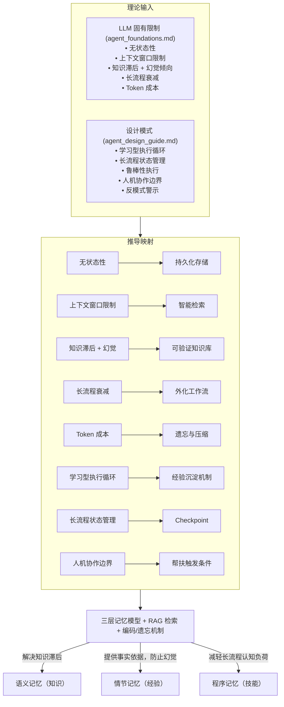
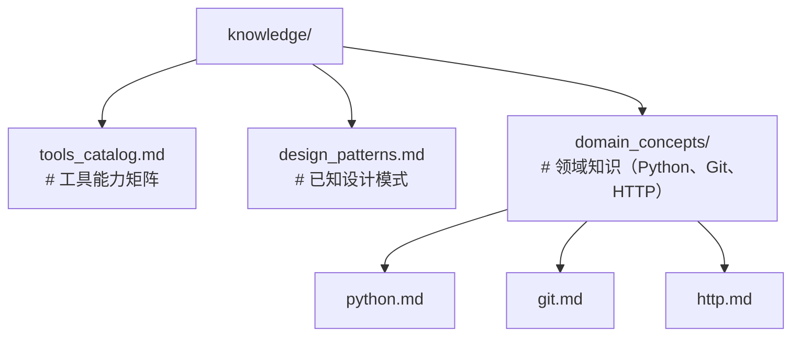
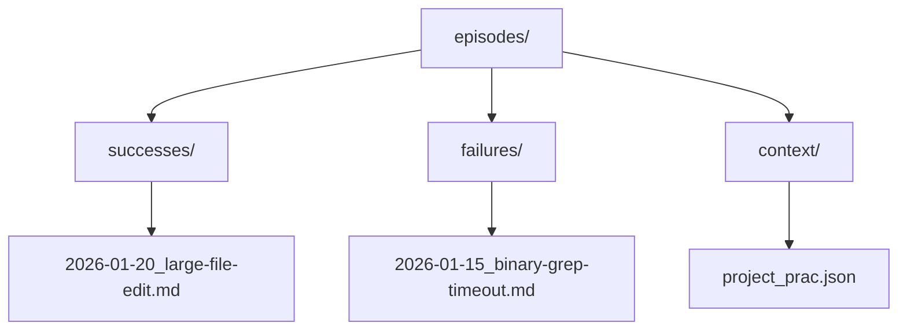
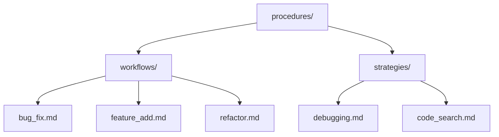
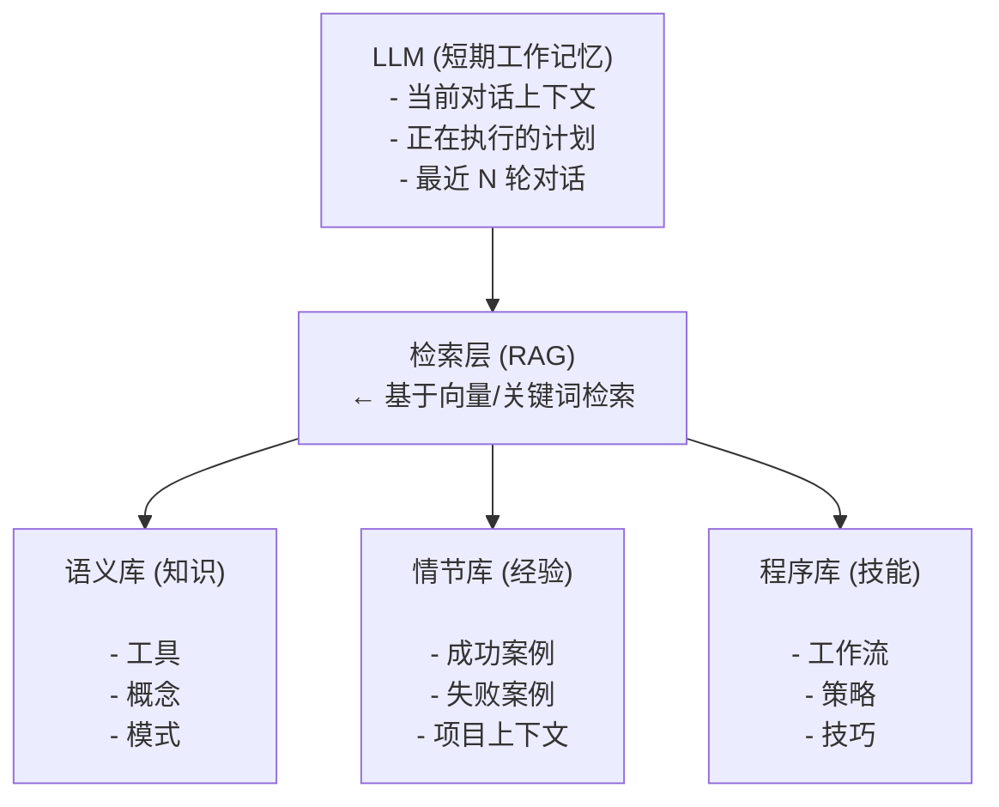
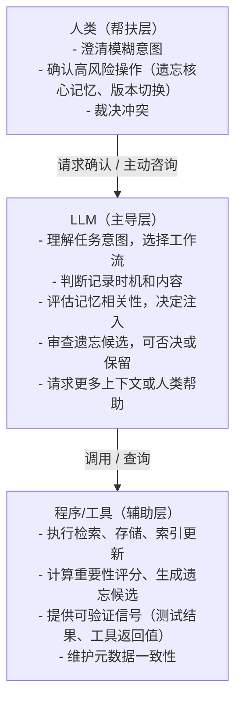

# Agent 记忆架构设计

> **本文档通过严格的逻辑推导，从 [agent_foundations.md](agent_foundations.md) 中定义的 LLM 固有特征，以及 [agent_design_guide.md](agent_design_guide.md) 中的设计模式与人机协作边界，推导出记忆系统的架构。**

**阅读指南**：

- **理论驱动**：每个设计决策都可追溯到特定的 LLM 限制或设计模式
- **完备性验证**：确保架构覆盖所有关键约束
- **实践导向**：提供具体的实现策略和性能指标

## 从理论到架构：推导过程

### 第一性原理推导

基于 [agent_foundations.md](agent_foundations.md) 中定义的 LLM 限制，以及 [agent_design_guide.md](agent_design_guide.md) 中的高级模式（如学习型执行循环、长流程状态管理），记忆系统的设计可以通过以下逻辑链条推导：

**推导流程图**：



#### 1. 核心限制 → 记忆系统必要性

| LLM 限制           | 直接推论                       | 架构需求                                     |
| ------------------ | ------------------------------ | -------------------------------------------- |
| **API 无状态**     | 每次调用都是"失忆的时间旅行者" | **持久化存储**：必须将状态外化到文件/数据库  |
| **上下文窗口有限** | 无法一次性加载全部知识         | **智能检索**：按需注入最相关的记忆           |
| **知识滞后性**     | 训练数据无法覆盖项目特定知识   | **可更新知识库**：持续积累领域知识           |
| **幻觉倾向**       | 虚构的记忆不可靠               | **经验验证**：记录成功/失败案例作为事实依据  |
| **长流程性能衰减** | 目标漂移、上下文污染           | **过程记忆**：外化工作流和策略，减轻认知负荷 |

**推论 1**：记忆系统不是可选优化，而是 Agent 长期运行的**必要基础设施**。

#### 2. 记忆内容分类 → 三层模型

基于认知科学的记忆理论和上述限制，记忆内容可分为三类：

| 记忆类型     | 对应人类记忆                            | 存储内容                     | 解决的 LLM 限制                                    |
| ------------ | --------------------------------------- | ---------------------------- | -------------------------------------------------- |
| **语义记忆** | 去语境化的知识（如"Python 是动态类型"） | 工具文档、API 规范、设计模式 | 知识滞后性、幻觉（提供权威参考）                   |
| **情节记忆** | 带时空标记的事件（如"上次修复 bug X"）  | 成功/失败案例、项目上下文    | 幻觉（事实依据）、知识滞后（项目特定经验）         |
| **程序记忆** | 操作技能（如"如何骑自行车"）            | 工作流模板、调试策略         | 长流程衰减（减轻规划负荷）、多目标处理（外化流程） |

**推论 2**：三层记忆模型不是任意分类，而是基于**内容特性和检索触发条件**的自然划分。

#### 3. 检索策略 → RAG 架构

| 问题                             | 推导                     | 设计决策                     |
| -------------------------------- | ------------------------ | ---------------------------- |
| 如何在有限窗口中找到最相关记忆？ | 向量嵌入可度量语义相似度 | **向量检索**（RAG）          |
| 某些场景需要精确匹配（如工具名） | 关键词检索速度快且精确   | **混合检索**（向量 + BM25）  |
| 旧记忆可能过时，新记忆更相关     | 引入时间衰减因子         | **时间加权检索**             |
| 不同任务需要不同记忆类型         | 任务识别 → 记忆类型筛选  | **分层检索**（先类型后内容） |

**推论 3**：检索层是记忆系统的**核心瓶颈**，其质量直接决定 Agent 性能。

#### 4. 遗忘机制 → 自适应管理

| 问题                       | 推导               | 设计决策                  |
| -------------------------- | ------------------ | ------------------------- |
| 记忆无限增长会导致检索噪声 | 淘汰低价值记忆     | **重要性评分** + 定期清理 |
| 过时知识会误导决策         | 更新或删除过时条目 | **时间戳 + 版本管理**     |
| 相似记忆重复存储浪费空间   | 合并重复内容       | **去重机制**              |
| 不同场景需要不同遗忘策略   | 根据记忆类型调整   | **分层遗忘策略**          |

**推论 4**：遗忘不是缺陷，而是**主动的信息过滤**机制。

#### 5. 人类帮扶触发条件

| 场景             | 触发条件                                | 帮扶方式                            |
| ---------------- | --------------------------------------- | ----------------------------------- |
| **意图模糊**     | LLM 任务分类置信度低于阈值              | 请求用户确认任务类型                |
| **记忆冲突**     | 检索到相互矛盾的记忆                    | 告知两个版本的存在，请求用户裁决    |
| **高风险遗忘**   | 候选遗忘的记忆被用户标记或高频引用      | 请求用户确认是否归档/删除           |
| **未验证记忆**   | 即将注入 `validation=unverified` 的记忆 | 附带提示："此信息未经验证"          |
| **首次任务类型** | 无匹配的程序记忆                        | 请求用户提供参考流程或确认 LLM 推断 |
| **版本选择**     | 需要使用非首选版本（deprecated/legacy） | 说明原因并请求确认                  |

**原则**：人类帮扶是**补充机制**，非默认路径；LLM 应尽可能自主决策，仅在置信度不足或风险较高时寻求帮助。

### 理论约束与设计取舍

| 理论约束           | 理想设计               | 实践妥协                | 取舍理由   |
| ------------------ | ---------------------- | ----------------------- | ---------- |
| Token 成本限制     | 每次检索加载完整上下文 | 仅加载摘要 + 懒加载详情 | 成本可控性 |
| 嵌入计算延迟       | 实时向量化所有查询     | 缓存常见查询的嵌入      | 响应速度   |
| 存储空间有限       | 永久保留所有记忆       | 分层遗忘 + 归档         | 检索质量   |
| 检索精度 vs 召回率 | 同时优化两者           | 根据任务类型调整阈值    | 实用性优先 |

## 记忆系统分类

基于上述推导，记忆系统包含三层：

### 1. 语义记忆（Semantic Memory）

**定义**：去语境化的知识和概念

**存储内容：**

- **领域知识库**：API 文档、代码规范、设计模式
- **工具能力索引**：每个工具的功能、参数、适用场景
- **概念映射**：术语表、类型定义、架构图

**目录结构：**



**检索触发条件：**

- 遇到不熟悉的概念或 API
- 需要选择合适的工具时
- 设计新功能时查阅模式库

**示例条目：**

```markdown
# Tool: unified_diff_patch

**功能**：应用 unified diff 格式的补丁修改文件
**适用场景**：

- 需要精确修改特定行
- 编辑大文件（减少 token 消耗）
- 多处小改动

**不适用**：

- 全文重写
- 二进制文件
```

### 2. 情节记忆（Episodic Memory）

**定义**：特定时间、地点的事件经历

**存储内容：**

- **成功案例**：解决特定问题的完整过程
- **失败案例**：错误尝试及原因分析
- **用户偏好**：交互模式、代码风格倾向
- **项目上下文**：当前 repo 的技术栈、目录结构、约定

**目录结构：**



**检索触发条件：**

- 遇到相似问题时检索成功/失败案例
- 开始新任务时回忆项目上下文
- 用户提到"上次你怎么做的"

**示例条目：**

```markdown
# Episode: 大文件编辑成功案例

**时间**：2026-01-20  
**任务**：修改 5000 行的配置文件  
**挑战**：全量替换会消耗大量 token  
**解决方案**：使用 unified diff，仅发送变更部分  
**结果**：token 消耗减少 90%，执行成功  
**经验**：对于 >1000 行文件，优先考虑 diff 方式
```

### 3. 程序记忆（Procedural Memory）

**定义**：如何执行动作的知识（技能）

**存储内容：**

- **工作流模板**：修复 bug、添加功能、重构代码的标准流程
- **调试策略**：二分查找、回溯法、最小复现
- **工具链技巧**：工具组合使用的最佳实践

**目录结构：**



**触发机制：**

- 任务类型识别后自动加载工作流
- 遇到阻塞时检索调试策略
- 工具选择时参考最佳实践

**示例工作流：**

```markdown
# Workflow: Bug Fix

1. **理解问题**
   - 阅读错误信息
   - 确认复现步骤

2. **定位代码**
   - 优先用 semantic_search（语义搜索）
   - 若有明确关键词，用 grep_search

3. **分析上下文**
   - 读取相关函数前后 20 行
   - 查看调用链

4. **修复验证**
   - 编写/运行测试
   - 确认 edge cases
```

## 记忆分层架构



## 控制层级

记忆系统的控制权分布于三个层级：



**设计原则**：

- **LLM 主导**：判断、决策、规划、执行的主体
- **程序辅助**：提供可靠信号、执行机械操作、生成候选
- **人类帮扶**：澄清歧义、确认高风险操作、裁决边界案例

## 关键机制（从理论推导）

### 1. 主动记录（Encoding）

**理论依据**：

- **无状态性** → 未记录的经验会永久丢失
- **幻觉倾向** → 需要事实依据而非 LLM 自行"回忆"
- **长流程衰减** → 外化知识减轻工作记忆负荷

**记录时机：**

| 触发条件     | 记录内容              | 目标记忆类型 | 理由                                         |
| ------------ | --------------------- | ------------ | -------------------------------------------- |
| 任务完成后   | 成功模式 → 工作流模板 | 程序记忆     | 将成功经验固化为可复用技能（应对长流程衰减） |
| 遇到异常     | 失败案例 + 根因分析   | 情节记忆     | 提供反面案例避免重复错误（应对幻觉）         |
| 发现新知识   | API 文档、模式库      | 语义记忆     | 弥补知识滞后（应对训练数据截止日期）         |
| 工具调用验证 | 实际返回值 vs 预期    | 情节记忆     | 以执行结果为准，不信任 LLM 陈述（应对幻觉）  |

**编码策略（质量保证）：**

- **抽象化**：从具体案例中提取通用模式（提高迁移性）
- **去噪**：过滤无关细节，保留关键信息（减少检索噪声）
- **结构化**：使用固定格式便于检索（Markdown + YAML frontmatter）
- **可验证性**：记录可重现的步骤和结果（防止虚假记忆）

### 2. 智能检索（Retrieval）

**理论依据**：

- **上下文窗口限制** → 无法加载全部记忆，必须精准筛选
- **多目标处理能力弱** → 减少无关信息干扰
- **Token 成本** → 每次注入都有代价

**检索触发矩阵：**

| 场景           | 检索目标     | 记忆类型 | 检索方法                | 理论依据             |
| -------------- | ------------ | -------- | ----------------------- | -------------------- |
| 任务开始       | 相关工作流   | 程序记忆 | 关键词匹配（任务类型）  | 减轻长流程规划负荷   |
| 遇到问题       | 类似案例     | 情节记忆 | 向量检索（语义相似）    | 利用历史经验避免幻觉 |
| 需要知识       | 概念文档     | 语义记忆 | 混合检索（精确 + 语义） | 弥补知识滞后         |
| 工具选择       | 工具能力索引 | 语义记忆 | 关键词 + 能力标签       | 精确匹配功能需求     |
| 用户提及"上次" | 历史会话     | 情节记忆 | 时间戳 + 向量检索       | 恢复上下文           |

**检索优化策略：**

1. **分层检索**：先筛选记忆类型，再搜索内容（减少搜索空间）
2. **混合排序**：`score = α·向量相似度 + β·关键词匹配 + γ·时间衰减`
3. **Top-K 截断**：仅返回前 K 条（K = f(窗口大小, token 预算)）
4. **懒加载**：先返回摘要，需要时再加载详情（节省 token）
5. **负例过滤**：排除已知的错误模式（避免重复失败）

**LLM 扩展权**：

- 初始返回 Top-K 结果
- **LLM 可请求扩展**："我需要更多相关记忆"→ 返回 Top-2K
- **LLM 可请求特定版本**：主动查看 `deprecated/legacy` 用于兼容场景

**理论保证**：检索算法需满足：

- **召回率**：相关记忆必须被检索（避免遗漏关键经验）
- **精确率**：无关记忆应被过滤（防止注意力稀释）
- **时效性**：新记忆优先于旧记忆（适应环境变化）
- **多样性**：避免返回冗余的相似记忆（优化信息密度）

**检索治理（架构层）**：

- **目标定义**：为语义/情节/程序三类记忆分别设定检索 SLO（如 recall@K、precision@K、时效性偏置），并将其绑定到任务类型（检索触发矩阵）。
- **决策循环**：规划 → 检索 → 执行 → 反馈 → 调整权重/阈值；反馈信号仅要求“相关/无关/缺失”三级，不限定实现细节。
- **晋升/降级规则**：召回高、贡献高的记忆标记为“常驻”；召回低、贡献低的记忆进入观察或归档队列，以保持检索信噪比。
- **路由约束**：同一请求内限制记忆类型数与总 token 预算，避免注意力稀释；必要时分批检索（先程序，后情节/语义）。
- **冲突回避**：检索阶段优先路由到 `status=preferred` 的语义记忆；仅在迁移/兼容场景按需显式拉取 `deprecated/legacy`，并在注入时标注其状态，避免并列注入冲突版本。

### 3. 适应性遗忘（Forgetting）

**理论依据**：

- **上下文窗口限制** → 记忆库过大会导致检索噪声
- **知识滞后 + 环境变化** → 过时记忆会误导决策
- **Token 成本** → 存储和检索都有代价

**为什么遗忘是必要的：**

| 问题             | 无遗忘的后果                   | 遗忘的价值       |
| ---------------- | ------------------------------ | ---------------- |
| 记忆库无限增长   | 检索延迟增加，噪声淹没信号     | 保持高信噪比     |
| 过时知识累积     | 基于错误假设做决策（如旧 API） | 适应环境演化     |
| 重复记忆堆积     | 浪费存储，检索返回冗余结果     | 优化信息密度     |
| 失败案例永久保留 | 负面经验抑制探索（过度保守）   | 鼓励重试改进策略 |

**分层遗忘策略：**

| 记忆类型     | 遗忘规则            | 触发条件                     | 保留条件               |
| ------------ | ------------------- | ---------------------------- | ---------------------- |
| **情节记忆** | 低重要性旧记忆淘汰  | 距今 > 90 天 且 引用次数 < 3 | 高成功率案例、用户标记 |
| **语义记忆** | 去重合并 + 版本更新 | 检测到重复或过时             | 权威来源、高频引用     |
| **程序记忆** | 低成功率模式淘汰    | 成功率 < 30% 或 被新模式替代 | 核心工作流、经验证模式 |

**遗忘算法（重要性评分）：**

```python
importance_score = (
    α * reference_count     # 被检索次数
    + β * success_rate      # 应用成功率
    + γ * recency_weight    # 时间衰减因子
    + δ * user_bookmark     # 用户标记
)

# 遗忘阈值：score < threshold → 候选淘汰
# 归档策略：低分记忆移至归档区（离线存储，降级检索）
```

**LLM 审查权**：

- 程序层生成遗忘候选列表
- **LLM 审查**：可否决算法建议，保留其认为重要但低分的记忆
- 高风险候选（用户标记、高频引用）需**人类确认**

**防止灾难性遗忘：**

- **核心知识保护**：工具索引、基础工作流永不删除
- **人工审查**：高风险遗忘需人工确认
- **可恢复性**：软删除 + 归档，而非物理删除
- **版本控制**：记录遗忘历史，支持回滚
- **首选版本保留**：对于同一概念/接口，遗忘/归档前必须确保至少保留一个 `status=preferred` 的当前版本，禁止在无替代表的情况下仅剩 `deprecated/legacy`。

**遗忘决策流（架构层）**：

- **分级保留**：定义“常驻/活跃/归档/删除”四级；常驻（核心流程、基础工具）不可删除，活跃按阈值评估，归档可降级检索，删除需确认。
- **类型策略**：情节记忆偏重时效与引用，程序记忆偏重成功率与覆盖度，语义记忆偏重权威度与版本新鲜度；各自的阈值与保护集在架构层声明。
- **双重门控**：算法筛选产生候选，策略门（阈值）+治理门（人工或策略例外表）共同决定归档/删除，避免误删低频但关键记忆。
- **可追溯性**：遗忘动作必须记录原因、触发信号、替代表（若有），以支持审计与回滚。

## 实现考量

### 知识库构建原则（渐进式披露）

**知识规模与更新策略（架构层）**：

- **低压力存储**：语义知识可大批量沉淀在文件系统中，依靠层次目录 + 渐进式披露降低上下文压力，遗忘压力主要来自检索噪声而非存储成本。
- **以新换旧**：对语义记忆，更关注版本新鲜度和权威度，而非简单淘汰；通过版本/来源字段让更新覆盖旧知识。
- **定期梳理**：为语义层设立周期性整理（如按月）的架构要求：合并重复、标记过时、补充缺失关联，保持可导航性和高信噪比。
- **冲突化解**：当同一概念存在多版本/多来源时，要求在架构上记录冲突状态与首选来源，避免检索阶段出现自相矛盾的注入。
- **最新覆盖旧**：LLM 不擅长处理冲突，架构要求对同一概念/接口的最新有效版本标记为“首选”，旧版本标记为“废弃/兼容”，检索默认仅注入首选内容，避免并列注入冲突片段。

### 记忆类型 Schema（frontmatter 最小字段）

**通用字段**：`title, summary, tags, type(semantic|episodic|procedural), related, backlinks, updated_at, source`

- **语义记忆**：建议补充 `canonical_source`（权威出处）、`version`（适用于 API/协议）。
- **情节记忆**：建议补充 `timestamp`（事件时间）、`outcome`（success/failure）、`cause`（根因）、`context`（环境/版本）。
- **程序记忆**：建议补充 `steps`（关键步骤列表）、`preconditions`（前置条件）、`postconditions`（验收标准）。

**治理字段（推荐，保持架构层抽象）**：

- `owner`（责任人/域）：用于升级、审计、问责。
- `provenance`（来源强度）：如 authoritative/manual/observed，用于检索排序与遗忘保护。
- `validation`（已验证/未验证/实验）：区分可直接注入的记忆与需提示风险的记忆。
- `confidentiality`（公开/私有/机密）：指导跨租户或远端镜像时的隔离策略。
- `expires_at` 或 `freshness_policy`：声明何时需要复核或降级。
- `checksum`/`model_version`：使索引与正文、嵌入模型的版本可对齐，便于一致性检查。

**版本偏好标记（设计建议）**：

- 使用 frontmatter 标记 `status`：`preferred`（首选/现行）、`deprecated`（废弃/仅兼容）、`legacy`（历史参考）。
- 当同一概念存在多版本时，要求显式 `supersedes`（取代目标列表）与 `superseded_by`，检索默认只注入 `preferred`，仅在“兼容/迁移”场景按需暴露 `deprecated/legacy`。
- 若 `validation` 未通过且无 `preferred` 版本，可降级为“观望”状态并避免自动注入，防止冲突暴露给 LLM。

**示例（情节记忆）**：

```yaml
---
title: 修复大文件 diff 失败
type: episodic
timestamp: 2026-01-20
outcome: success
cause: apply_patch context mismatch
context: repo=prac commit=abc123
summary: 将补丁上下文扩大到 5 行解决
tags: [patch, tooling]
related: [procedures/workflows/bug_fix.md]
backlinks: []
updated_at: 2026-01-20
source: local
---
```

### 本地索引管线（embedding + 层级导航）

- **分块规则**：按 Markdown heading 划分 chunk；chunk 元数据写入 `path, section, parent_headings, type, tags, updated_at`。
- **索引目录**：默认 `./.index/embeddings/` 本地存储，git 忽略；只作为加速层，不取代文件层级浏览。
- **刷新策略**：文件变更后增量重嵌入；可根据 `updated_at` 或 git diff 检测；提供全量重建命令用于校正漂移。
- **检索回跳**：检索结果返回 chunk 摘要 + 原文路径/heading，便于从嵌入结果回到文件导航。
- **安全与隐私**：本地默认不外发嵌入；如需远端镜像，需显式配置并支持选择性同步。

**索引生命周期与一致性（架构层约束）**：

- 以“正文版本 + 嵌入模型版本”作为索引标签，避免混用旧模型向量与新正文。
- 并发写入视为事务单元：正文落盘、元数据更新、索引更新需在一致性边界内完成，失败时回滚或重建。
- 允许“降级运行”模式：索引失效时可回退到目录/关键词导航，以保证可用性。
- 维护健康信号：定期校验 chunk 覆盖率、校验和、断链率，触发重建或审计。

**隔离与分级（数据平面原则）**：

- 按租户/项目/保密级别划分命名空间，检索默认只在当前域内查询，跨域需要显式授权。
- 嵌入与原文的同步/镜像遵循最小泄露原则：机密级记忆可禁用嵌入或仅存放摘要。
- 传输与存储加密、审计日志、访问令牌等作为架构要求列出，具体实现留待执行层。

### 技术栈选择

| 组件       | 候选方案                         |
| ---------- | -------------------------------- |
| 向量数据库 | ChromaDB, FAISS, Qdrant          |
| 文本检索   | Elasticsearch, Tantivy           |
| 存储格式   | Markdown + YAML frontmatter      |
| 嵌入模型   | OpenAI Embeddings, Sentence-BERT |

### 性能优化

- **懒加载**：仅检索需要的记忆
- **缓存**：高频记忆常驻内存
- **索引**：为不同检索模式建立索引
- **批量编码**：减少嵌入计算次数

### 可观测性

- 记录检索日志：哪些记忆被使用
- 成功率追踪：记忆对任务的贡献
- A/B 测试：对比有/无记忆的性能差异

## 理论完备性验证

### 设计自洽性检查

记忆架构必须满足以下理论约束：

| 理论约束                                               | 架构保证                    | 验证方法                   |
| ------------------------------------------------------ | --------------------------- | -------------------------- |
| **无状态性** → 需要显式持久化 (foundations)            | 三层记忆 + 文件/数据库存储  | 重启 Agent 后能恢复上下文  |
| **上下文窗口限制** → 需要精准检索 (foundations)        | RAG + 混合检索 + Top-K 截断 | 检索精度/召回率指标        |
| **幻觉倾向** → 需要事实依据 (foundations)              | 情节记忆（验证过的案例）    | 引用记忆时附带证据来源     |
| **知识滞后** → 需要持续学习 (foundations)              | 主动记录 + 可更新知识库     | 知识库更新频率             |
| **长流程衰减** → 需要外化流程 (foundations)            | 程序记忆（工作流模板）      | 流程步骤数 < 15 的成功率   |
| **多目标处理弱** → 需要减少噪声 (foundations)          | 遗忘机制 + 分层检索         | 无关记忆召回率（越低越好） |
| **Token 成本** → 需要优化传输 (foundations)            | 懒加载 + 摘要优先 + 去重    | 平均每次检索 token 消耗    |
| **学习型执行循环** → 需要经验沉淀 (design guide)       | 主动记录 + 反思循环         | 成功策略被固化为程序记忆   |
| **长流程状态管理** → 需要 Checkpoint (design guide)    | 状态快照 + 压缩摘要         | 长流程中断后可恢复         |
| **人机协作边界** → 需要帮扶触发条件 (design guide)     | 人类帮扶触发矩阵            | 高风险场景正确请求人类介入 |
| **反模式：忽略工具结果** → 需要验证记录 (design guide) | 情节记忆记录实际返回值      | 幻觉检测率                 |

### 边界情况分析

| 边界情况                 | 理论预测                | 架构应对                     |
| ------------------------ | ----------------------- | ---------------------------- |
| 冷启动（无历史记忆）     | 性能退化到基础 LLM 水平 | 预置核心语义记忆（工具文档） |
| 记忆冲突（新旧经验矛盾） | 幻觉风险增加            | 时间加权 + 人工审查          |
| 检索失败（无相关记忆）   | 依赖 LLM 原生能力       | 记录失败案例 → 下次检索改进  |
| 记忆爆炸（单次存储过多） | 检索效率下降            | 摘要压缩 + 分块存储          |
| 遗忘过度（删除关键记忆） | 能力退化                | 核心知识保护 + 软删除        |

## 未来方向

### 元认知能力

- **反思**：Agent 定期回顾自己的记忆质量
- **学习策略调整**：根据成功率优化记录/检索策略
- **记忆重组**：主动整理、归纳记忆库

### 社会记忆

- **团队记忆**：多个 Agent 共享知识库
- **用户特定记忆**：为不同用户维护独立上下文
- **版本管理**：记忆的时间旅行能力

### 自适应遗忘

- **强化学习**：通过反馈优化遗忘策略
- **情境感知**：根据任务类型调整记忆权重
- **梦境模拟**：离线时重新巩固重要记忆

## 相关文档

- [agent_foundations.md](agent_foundations.md) - Agent 理论基础（LLM 固有限制）
- [agent_design_guide.md](agent_design_guide.md) - Agent 设计指南（模式与反模式）
- [AGENTS.md](../../AGENTS.md) - 本项目 Agent 实现与工具索引
