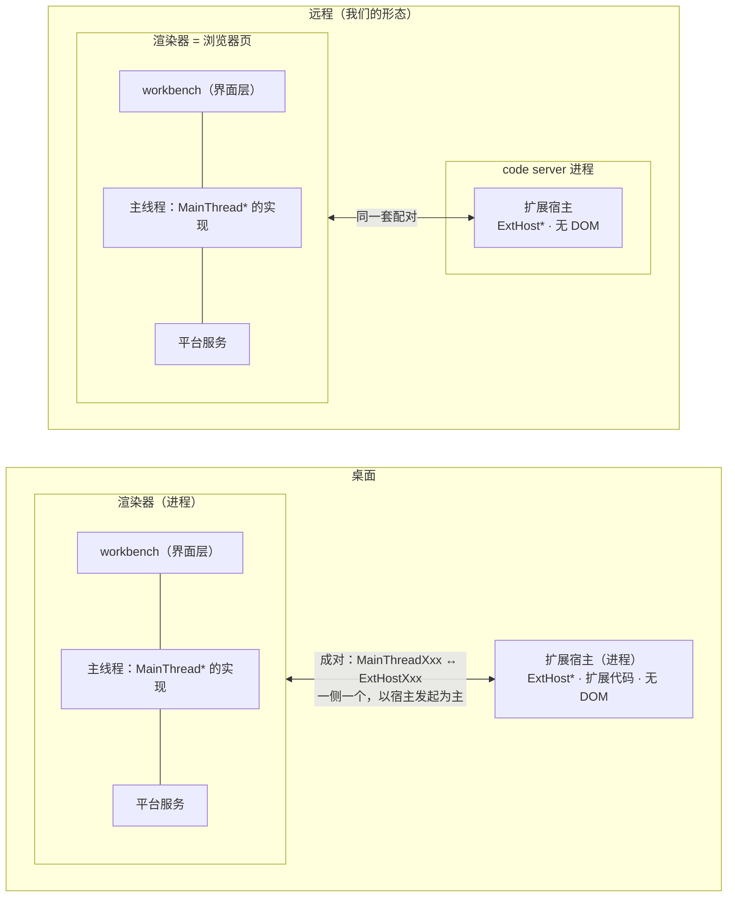

# VS Code 的内部结构（参考）

> 这篇记 VS Code 自己的结构：它内部怎么分成两半、平台服务是什么、扩展宿主协议跑在什么通道上、诊断是怎么走的、agent / MCP / 工具 / skill / prompt 分别做在哪一层，以及 UI 布局的 frame / part / container / pane / view 概念模型。
> **prac 怎么用它**（用哪种运行形态、语言服务怎么接）在 [in-progress/2026-09-19-architecture.md](../.agents/notes/in-progress/2026-09-19-architecture.md) 与 [architecture.md](architecture.md)（§2.2 / §4.2）。broker 那份设计已降级为那篇里的 P1（[abandoned/2026-09-16-vscode-integration-transport.md](../.agents/notes/abandoned/2026-09-16-vscode-integration-transport.md)）。**行号与数字都指 pinned `1.137.0` checkout。**

**内部怎么分成两半**：**渲染器**（renderer）跑 workbench 的界面；**扩展宿主**（extension host）是另一个进程，跑扩展代码，只能用 `vscode.*` API，**没有 DOM、没有界面**。扩展宿主协议的另一端叫"**主线程**"（main thread）——**它不是线程，是那套 RPC 里的角色名**（`MainContext.MainThreadXxx` ↔ `ExtHostContext.ExtHostXxx`），实现在 workbench 里，替扩展宿主做界面、编辑器、存储、诊断这些事。**两种运行形态下主线程都在渲染器里**，远程形态搬走的只有扩展宿主。

| 词           | 是什么                                                                       | 桌面                      | 远程 / 浏览器                       | 上游落点                                                                                                    |
| ------------ | ---------------------------------------------------------------------------- | ------------------------- | ----------------------------------- | ----------------------------------------------------------------------------------------------------------- |
| **渲染器**   | 跑 **workbench**（界面）的那个进程 / 页面：编辑器、视图、命令面板都在这里    | Electron renderer 进程    | 浏览器页                            | `src/vs/workbench/**`                                                                                       |
| **扩展宿主** | 跑**扩展代码**的独立进程：只有 `vscode.*` API，没有 DOM、没有界面            | 主进程拉起的 utility 进程 | **code server 里** `cp.fork` 的进程 | `api/common/extHost*` + `api/node/**`                                                                       |
| **主线程**   | extHost 协议的另一端：在 workbench 里替扩展宿主做界面 / 编辑器 / 存储 / 诊断 | 渲染器里                  | **渲染器里**（= 今天的页面）        | `api/browser/**` 的 `@extHostNamedCustomer(MainContext.MainThreadXxx)` 实现——**上游没有 server 侧的那一份** |



**平台服务**（`src/vs/platform/**`）是界面之下的**服务层**：文件、配置、存储、命令、遥测、日志、诊断，每个服务一个目录，下面分 `common/` 与 `browser/`（或 `node/`、`electron-main/`）。`src/vs/workbench/**` 是**界面层**，主线程的 `MainThread*` 实现也在这一层。依赖是单向的：workbench 大量 import platform，而 **platform 反过来 import workbench 是 0 处**。服务先用 `createDecorator<T>('id')` 换出一个服务标识（`instantiation.ts:109`），启动时注册实现（`workbench.common.main.ts:189`），再由 `IInstantiationService` 注进构造函数（接口 `instantiation.ts:52`）；platform 下一共 **233 个**服务标识。**主线程那 97 个文件里用到了 42 个服务、166 处**：

| 服务（import 处数）                                                       | 代表 file:line                                                                               |
| ------------------------------------------------------------------------- | -------------------------------------------------------------------------------------------- |
| `ILogService` (22)                                                        | `api/browser/mainThreadAuthentication.ts:23`                                                 |
| `IConfigurationService` (14) · `IInstantiationService` (14)               | `mainThreadAuthentication.ts:35` · `mainThreadCLICommands.ts:16`                             |
| `IUriIdentityService` (13) · `IFileService` (7) · `ITelemetryService` (7) | `mainThreadBulkEdits.ts:11` · `mainThreadDocuments.ts:13` · `mainThreadAuthentication.ts:15` |
| `IStorageService` (5) · `ICommandService` (5) · `IMarkerService` (1)      | `mainThreadStorage.ts:6` · `mainThreadCommands.ts:8` · `mainThreadDiagnostics.ts:6`          |

扩展宿主的 `$` 调用最后都落到这些服务上。完整的一条链：`ExtHostDiagnostics` 调 `$changeMany`（`api/common/extHostDiagnostics.ts:170`）→ `MainThreadDiagnostics.$changeMany`（`api/browser/mainThreadDiagnostics.ts:69`）→ `IMarkerService.changeOne`（`:51`）/ `changeAll`（`:93`）→ Problems 视图。整条链都在渲染器里，终点是平台服务。

**扩展宿主协议，以及它跑在什么上**：`api/common/extHost.protocol.ts`（**4218 行**）——代理标识 **168** 个 = `MainContext` **87** + `ExtHostContext` **81**；`MainThreadXxxShape` **86** 个接口 / **500** 个 `$` 方法；`ExtHostXxxShape` **81** 个接口 / **441** 个 `$` 方法（怎么数的：标识数两个 `…Context` 表里的条目，方法数 `interface XxxShape` 里以 `$` 开头的方法，都能用一条命令复算）。**主线程那 87 个实现全在渲染器里**：78 个 `@extHostNamedCustomer(MainContext.MainThreadXxx)` + 9 个手工注册（Documents / TextEditors / Webviews / WebviewPanels / WebviewViews / CustomEditors / NotebookDocuments / NotebookEditors / ChatOutputRenderer），全在 `src/vs/workbench/api/browser/**`——**协议之外没有 server 侧的实现可复用**。

协议本身是 `IRPCProtocol`（`proxyIdentifier.ts:8`），实现是 `RPCProtocol`（`rpcProtocol.ts:115`），两端各一个实例。消息是一帧一条的二进制：帧头 `uint8 type` + `uint32 req`（`:518-522`），12 种 type（`:940-953`：请求 1–4 / `Acknowledged` 5 / `Cancel` 6 / 回复 7–12）。`$` 方法用 JS `Proxy` 现造函数发出去（`:252`/`:461`），对端按 `rpcId` + `method` 在 `_doInvokeHandler` 里落到本地对象（`:449`）。物理通道被 `IMessagePassingProtocol`（`ipc.ts:99-106`）挡住了，两端都不知道自己跑在什么上：

- **桌面**：Electron **utility 进程**（不是 `child_process.fork`）+ **MessagePort**（`localProcessExtensionHost.ts:416`，环境变量 `VSCODE_WILL_SEND_MESSAGE_PORT`；扩展宿主侧 `api/node/extensionHostProcess.ts:183-203`）；
- **远程 / web（prac 的形态）**：浏览器 `new WebSocket`（`browserSocketFactory.ts:80`）→ code server 的 `upgradeToISocket`（`remoteExtensionHostAgentServer.ts:237`）→ `cp.fork` 出扩展宿主（`extensionHostConnection.ts:290`）→ 把这条 WS 与扩展宿主的管道 / socket 对拷（`:180-183` / `:190-200`；控制消息 `VSCODE_EXTHOST_IPC_SOCKET` / `…_READY`，连接方式由 `VSCODE_EXTHOST_WILL_SEND_SOCKET` / `VSCODE_EXTHOST_IPC_HOOK` 二选一）。

**发起方永远是渲染器**：远程要渲染器发 `desiredConnectionType === ExtensionHost`（`remoteAgentConnection.ts:362`）服务端才 fork；桌面由渲染器 `createExtensionHost()`（`localProcessExtensionHost.ts:225`）让主进程起 utility 进程。⇒ **没有页面就没有扩展宿主**，也就没有任何扩展能力。

**诊断是怎么走的**：全程靠 VS Code 扩展主动"推"，协议里没有"拉"的请求方法。

- **什么时候算，VS Code 扩展自己说了算**。公开面只有 `languages.createDiagnosticCollection()`（`vscode.d.ts:14822`）：php 扩展在 `onDidOpenTextDocument`（`php-language-features/src/features/validationProvider.ts:110`）和 `onDidChangeTextDocument` / `onDidSaveTextDocument`（`:163-166`，按 `php.validate.run` 二选一）之后跑 lint，再 `set()`（`:250`）；git 扩展监听自己 scheme 的文档变化（`git/src/diagnostics.ts:26`）。VS Code 不排期，也没有"诊断 provider"这种注册（`vscode.d.ts` 里没有）。
- **推**：`set()` 里同步调 `MainThreadDiagnostics.$changeMany(owner, entries)`（`api/common/extHostDiagnostics.ts:170`；`delete` ⇒ `:177`，`clear` / `dispose` ⇒ `$clear` `:184`/`:49`）；主线程落到 `IMarkerService.changeOne/changeAll`（`api/browser/mainThreadDiagnostics.ts:87`/`:93`），并给每条 marker 盖上 `origin = extHostId`（`:82-84`）。**上限在扩展宿主侧就先砍**：1000 条/文件、1100 条总数，超出后另加一条"还有 N 条"的 Info marker（`extHostDiagnostics.ts:134-156`）。
- **回推**：`IMarkerService.onMarkerChanged` → `$acceptMarkersChange`（`mainThreadDiagnostics.ts:32`、`:57-66`），并且**按 `origin` 把这个扩展宿主自己推的那些滤掉**（`:61`），所以扩展宿主里的镜像装的是**别人的** marker。`languages.getDiagnostics()` 读的是**本地**（自己的 collections + 这份镜像，`extHostDiagnostics.ts:313-345`），不是 RPC。
- **"拉"只有两处，而且都是读本地**：扩展宿主的 `languages.getDiagnostics()`（读上面那份本地表）；渲染器的 `IMarkerService.read()`（接口在 `platform/markers/common/markers.ts`；Problems 视图就是这么读的，`contrib/markers/browser/markersView.ts:549`）。两侧协议都**没有请求方法**——`MainThreadDiagnosticsShape` 只有 `$changeMany`/`$clear`，`ExtHostDiagnosticsShape` 只有 `$acceptMarkersChange`（`extHost.protocol.ts:254-257`、`:2382-2384`）。
- marker 上带 `modelVersionId`（写的时候由扩展宿主按当前文档版本盖上，`extHostDiagnostics.ts:140`/`:158`；`markerService.ts:234` 原样保留），所以读的人能知道"这条是对哪个版本算的"。
- **扩展宿主一死，它推的 marker 就没了**：`MainThreadDiagnostics.dispose()` 会把每个 owner 里 `origin === extHostId` 的剔掉，重写剩下的（`mainThreadDiagnostics.ts:36-55`）。
- **诊断不止一个来源**：除了扩展宿主推上来的，**渲染器自己也直接写 marker**——任务输出的问题匹配（`contrib/tasks/common/problemCollectors.ts:330`；`ITaskService` 就注册在渲染器 `contrib/tasks/browser/taskService.ts:44`，匹配器由终端任务系统在 `terminalTaskSystem.ts:885`/`:1060` 造出来）、设置编辑器的校验（`contrib/preferences/browser/preferencesRenderers.ts:520`/`:820`/`:951`）、notebook cell 诊断（`contrib/notebook/browser/contrib/cellDiagnostics/cellDiagnosticEditorContrib.ts:121`）、prompt 文件（`contrib/chat/browser/promptSyntax/promptFileContributions.ts:184`）、MCP（`contrib/mcp/browser/mcpLanguageFeatures.ts:202`）。这些 owner 的 `origin` 不属于任何扩展宿主，它们只活在渲染器进程里。
- **完整的那一份在哪个进程**：`IMarkerService` 的唯一实现是 `MarkerService`（`platform/markers/common/markerService.ts:150`），**构造函数零依赖**（纯内存 `DoubleResourceMap` + `MicrotaskEmitter`，`:152-158`），本身不依赖 DOM；但上游**只在渲染器 / 独立编辑器的 main 文件里注册它**（`workbench/workbench.common.main.ts:189`、`sessions/sessions.common.main.ts:188`、`editor/standalone/browser/standaloneServices.ts:1191`），扩展宿主和服务端都没注册。⇒ 扩展宿主进程里实际存在的，只有它自己那两张本地表。
- **语言服务器也只是众多来源之一**：language server 的诊断在 VS Code 这一侧**没有特权**——`vscode-languageclient` 的 diagnostics 功能一样是 `languages.createDiagnosticCollection(diagnosticCollectionName)` 再 `set()`（`DefaultDiagnosticCollectionProvider.create`），最后走同一条 `MainThreadDiagnostics.$changeMany`。三处差别值得记住：① 客户端可以在 `middleware.handleDiagnostics` 里**把诊断截下来**（装了 cSpell 4.9.3 的那份产物里，中间件只 `diagEmitter.fire(...)`、**不调 `next`**，转发回 collection 还是自己染色由它决定；内置 json 扩展也在 `handleDiagnostics` 里改写，`json-language-features/client/src/jsonClient.ts:306`）；② **LSP 的 `version` 落不到 marker 上**——服务端会发（cSpell 的服务端 `sendDiagnostics({uri, version, diagnostics})`，并自己用它做陈旧判断：`validateTextDocument stale …`），但 `DiagnosticCollection.set(uri, diagnostics)` 没有版本参数，marker 的 `modelVersionId` 是扩展宿主在 `set()` 那一刻按**本地**文档版本盖的（`extHostDiagnostics.ts:140`/`:158`），所以服务端算的是哪个版本，过这道门就丢了；③ **修复不在诊断里**：它走 `CodeActionProvider`（cSpell 服务端注册 `codeActionProvider: { codeActionKinds: [QuickFix] }`）。
- **读诊断的那一侧**（以 Error Lens 3.28.0 为例，`~/.vscode/extensions/usernamehw.errorlens-3.28.0/dist/extension.js` 没混淆）：它 `createDiagnosticCollection` 出现 **0 次**，**只读不写**。读法就是拉：`languages.getDiagnostics()`（不带参数 = 全部，状态栏计数用它；按 uri 拉用来画装饰），订阅 `languages.onDidChangeDiagnostics`，自带 delay / debounce（`errorLens.delay` / `delayMode`；`onSave` 模式下打字时**先把装饰清掉**、保存后再画）。它的输出全在界面侧：按严重度的行尾 `after.contentText`、整行背景、problem range、gutter 图标（运行时生成 SVG data URI）、`hoverMessage`（Markdown + `command:` 按钮）、CodeLens、状态栏两个计数 + 一条消息。它的输出循环都从 `window.visibleTextEditors` / `activeTextEditor` 出发，**没有编辑器就什么都不画**（不是报错，是什么都不做）；装饰真正落到屏幕上靠 `MainThreadTextEditors.$trySetDecorations`（`api/browser/mainThreadEditors.ts:304-311`，渲染器里找不到那个 editor id 就直接 `reject(illegalArgument('TextEditor(<id>)'))`；注册装饰类型是 `$registerTextEditorDecorationType`，`extHost.protocol.ts:349`）。⇒ **扩展可以在 server 侧的扩展宿主里跑，装饰由主线程代理到渲染器**——它的 `extensionKind: ["ui","workspace"]`，`main` 与 `browser` 指向同一个入口，两边都能跑。
- 还没核实：客户端**启用 pull**（`textDocument/diagnostic`）的具体路径。`vscode-languageclient` 不在 VS Code checkout 里，上面关于它和 cSpell 的结论来自**已安装的那份产物**（`~/.local/share/prac/code-server/extensions/streetsidesoftware.code-spell-checker-4.9.3/packages/{client,_server}/dist/*`），不是库的源码。

**激活的时候要不要等主线程**：

- 扩展宿主的 `initialize()` **卡在** `$initializeWorkspace` 的 barrier 上（`extHostExtensionService.ts:242` → `extHostWorkspace.ts:274-276`；`Barrier.wait()` 没有超时，`base/common/async.ts:530-554`）。⇒ 主线程不发那三条初始化推送，扩展宿主就永远停在这里，一个扩展都不会激活。
- **通道本身也是前提**：`extensionHostProcess.ts` 先等 MessagePort 或 socket——MessagePort 那条是 `process.parentPort.on('message')`（没人发就永远不 resolve，`:190-203`，而且这个分支要求父进程是 Electron），socket 那条有 60 秒超时，超时后 `onTerminate('VSCODE_EXTHOST_IPC_SOCKET timeout')`（`:208-212`）。
- 启动之后，**远程形态的激活不等渲染器确认**：`$onWillActivateExtension` 在 `isRemote` 时发了就不等，只有本地（桌面）扩展宿主才 await（`extHostExtensionService.ts:445-455`）。⇒ 没有页面，VS Code 扩展也能激活、也能自己 `set()` 诊断。
- 但 **UI 类型的 VS Code 扩展**，扩展宿主会把激活**交给主线程**（`extHostExtensionService.ts:193`）：判定是 `isHostExtension`——不在本宿主的 `myRegistry` 里、却在全局注册表里、有 main/browser 代码且 `api === 'none'`（`services/extensions/common/extensionDescriptionRegistry.ts:31-45`）。⇒ 没人答，激活就**永远挂着**。

## agent / MCP / 工具 / skill / prompt 分别做在哪一层

一共五层。前四层扩展都能参与，第五层是 core 自己的循环，VS Code 扩展替换不了。

**① 文件（仓库里，core 负责解析）**：`promptSyntax/` 认四种文件——`*.prompt.md`、`*.instructions.md`、`*.chatmode.md`（agent）、**`SKILL.md`**（skill），语言 id 分别是 `prompt` / `instructions` / `chatagent` / `skill`（`promptTypes.ts:22-40`）；默认目录 `.github/prompts`、`.github/instructions`、`.github/skills`（`promptFileLocations.ts:97`/`:102`/`:174`），另外也认 `AGENTS.md`（`:52`）；加载是自动的（`computeAutomaticInstructions.ts`）。

**② 扩展在 `package.json` 里声明**（这些声明点注册在 core）：`chatParticipants`（agent）、`languageModelTools` + `languageModelToolSets`、`languageModelChatProviders`、`chatSessions`、`chatPromptFiles` / `chatInstructions` / `chatAgents` / `chatSkills`、`chatPlugins`、`chatContext`、`chatOutputRenderer`、`chatViewsWelcome`、`mcpServerDefinitionProviders`。
注册点：`browser/chatParticipant.contribution.ts`、`common/tools/languageModelToolsContribution.ts`、`common/languageModels.ts`、`browser/chatSessions/chatSessions.contribution.ts`、`common/promptSyntax/chatPromptFilesContribution.ts`（enum `ChatContributionPoint`）、`common/plugins/agentPluginServiceImpl.ts`、`browser/contextContrib/chatContext.contribution.ts`、`browser/chatOutputItemRenderer.ts`、`common/discovery/extensionMcpDiscovery.ts`。

**③ VS Code 扩展 activate 的时候注册 API**：`chat.createChatParticipant`（`vscode.d.ts:20124`）、`lm.registerTool`（`:20777`）、`lm.registerMcpServerDefinitionProvider`（`:20841`）、选模型（`lm.selectChatModels`）。**session provider 还是 proposed**（`vscode.proposed.chatSessionsProvider.d.ts`）。

**④ core 自己的部分**（扩展只能往里填东西，换不掉）：chat 服务与循环（`common/chatService/`）、participants 管理（`common/participants/chatAgents.ts`）、工具的注册与确认（`common/tools/languageModelToolsService.ts`、`languageModelToolsConfirmationService.ts`）、**内建工具**（`common/tools/builtinTools/`：`askQuestionsTool` / `editFileTool` / `manageTodoListTool` / `reviewPlanTool` / `runSubagentTool` / `setArtifactsTool` / `taskCompleteTool` / `confirmationTool`…）、MCP 客户端（`contrib/mcp/**`：registry / server / connection / gateway / sandbox / sampling，工具经 `mcpLanguageModelToolContribution.ts` 变成 LM 工具）、会话模型（`chatSessionsService.ts`）、插件与技能模型（`common/plugins/agentPluginService.ts`：插件目录里有 `commands/`、`skills/`（`SKILL.md`）、`agents/`、`hooks/`、MCP 定义，见同目录的 `AGENTS_PLUGINS.md`）。
**工具调用谁发起**：主线程发起、扩展宿主回答（`ExtHostLanguageModelToolsShape.$invokeTool`，`extHost.protocol.ts:1887`；反方向的 `MainThreadLanguageModelToolsShape.$invokeTool` 是给宿主侧调主线程用的）。这两个代理标识的历史名字还叫 `MainThreadChatSkills` / `ExtHostChatSkills`（`:4053`/`:4193`）。

**⑤ agent host**（`platform/agentHost/**`）：把**外部 agent** 当被托管的进程跑起来——`node/copilot`、`node/claude`、`node/codex`、`node/localCommands`，并给它们一整套宿主设施：changeset（`agentHostChangesetService.ts`）、checkpoint（`agentHostCheckpointService.ts`）、plan review（`agentHostPlanReview.ts`）、git 和独立 worktree（`agentHostGitService.ts`；协议方法比如 `vscode/createAgentHostDetachedWorktree`，见 `agentHostExtensionProtocol.ts`）、文件系统 provider、customization、BYOK 模型（`agentHostByokLm.ts`）、managed rules / settings、OTel。

**和扩展生态的关系**：上面每一项**都有对应的扩展声明点或 API**——用得最多的就是 Copilot 扩展（它同时声明了 `chatParticipants` / `languageModelTools` / `languageModelToolSets` / `languageModelChatProviders` / `mcpServerDefinitionProviders` / `chatSessions` / `chatAgents` / `chatPromptFiles` / `chatSkills`）。⇒ **在 VS Code 里，"支持 agent"本身就是一块扩展面**：core 出循环和注册表，VS Code 扩展出 agent、工具、模型、会话、定制。MCP 还多一条：VS Code 会从**别的工具**那里导入服务器定义（`ExternalDiscoverySource`：Claude Desktop / Copilot / Windsurf / Cursor 的全局与工作区配置，`mcpConfiguration.ts:54-55`），也会 discovery 工作区里的 mcp 配置（`discovery/workspaceDotMcpDiscovery.ts`）。

## UI 布局概念模型：frame / part / container / pane / view

> 这一节是 VS Code 自己的布局概念，不是 prac 的 region/view 模型。**词相同不代表概念相同**：prac 的 `container` 是具名子区域，VS Code 的 `ViewContainer` 是 part 内部的视图分组；prac 的 `view` 是唯一组合单位，VS Code 的 `ViewPane` 是 container 里的一个 pane。
> 上游落点（pinned 1.137.0）：`src/vs/workbench/browser/layout.ts`、`src/vs/base/browser/ui/grid/grid.ts`、`src/vs/workbench/browser/part.ts`、`src/vs/workbench/browser/parts/**`、`src/vs/workbench/browser/parts/views/**`、`src/vs/base/browser/ui/splitview/**`、`src/vs/workbench/services/views/**`、`src/vs/workbench/browser/parts/editor/**`、`src/vs/platform/contextview/**`。

### 1. 总图

```text
Workbench（frame）
└─ Layout / Grid（顶层网格 + sash）
   ├─ TitlebarPart
   ├─ BannerPart
   ├─ ActivitybarPart            ← 图标条：选择 container
   ├─ SidebarPart                ← PaneCompositePart
   │   └─ ViewPaneContainer      ← container 运行时（PaneComposite）
   │       └─ PaneView（SplitView）
   │           ├─ ViewPane       ← view：Open Editors
   │           ├─ ViewPane       ← view：Folders
   │           └─ ViewPane       ← view：Outline / Timeline
   ├─ EditorPart                 ← 编辑器 part（平行链）
   │   └─ EditorGroupView        ← editor group（不是 ViewPane）
   │       ├─ EditorGroupModel
   │       ├─ EditorTabsControl
   │       └─ EditorPanes
   ├─ PanelPart                  ← PaneCompositePart
   │   └─ ViewPaneContainer      ← Problems / Output / Terminal / Debug Console
   ├─ AuxiliaryBarPart           ← PaneCompositePart（secondary sidebar）
   │   └─ ViewPaneContainer
   └─ StatusbarPart

Overlays（不是 Part）：
  QuickInput / ContextView（菜单）/ Hover / Notifications / Dialogs
```

### 2. 五层

| 层                                    | 是什么                                             | 谁拥有                                           | 例子                                                                           |
| ------------------------------------- | -------------------------------------------------- | ------------------------------------------------ | ------------------------------------------------------------------------------ |
| **Workbench / Layout / Grid**         | 整个 frame：顶层网格、part 位置、sash、序列化      | `Layout` / `SerializableGrid`                    | 工作台窗口                                                                     |
| **Part**                              | 顶层网格区域，有位置、最小/最大尺寸、自己的 chrome | `Part` 子类                                      | titlebar、activitybar、sidebar、editor、panel、auxiliarybar、statusbar、banner |
| **PaneCompositePart**                 | 承载一个 container 的 part                         | `SidebarPart` / `PanelPart` / `AuxiliaryBarPart` | 侧栏、底栏、次级侧栏                                                           |
| **ViewContainer / ViewPaneContainer** | 具名视图分组及其运行时                             | `ViewDescriptorService` + `ViewPaneContainer`    | Explorer、Search、SCM、Run、Problems、Output                                   |
| **Pane / ViewPane**                   | container 里的可折叠项；view 是 `ViewPane`         | `PaneView` / `ViewPaneContainer`                 | Open Editors、Folders、Outline、Timeline                                       |

- **`Part`**：顶层网格里的区域，不是 container。`TitlebarPart` / `BannerPart` / `ActivitybarPart` / `SidebarPart` / `PanelPart` / `AuxiliaryBarPart` / `EditorPart` / `StatusbarPart`。sash 在 `Layout`/`Grid` 层；part 自己只负责内容。
- **`ViewContainer`**：描述（id、title、icon、order、location）；`ViewContainerModel`：模型（all / active / visible view descriptors、顺序、大小、可见性）；`ViewPaneContainer`：运行时（`PaneComposite` 子类，持有 `ViewPane`s）。
- **`ViewContainerLocation`**：只有 `Sidebar` / `Panel` / `AuxiliaryBar`；**editor 不是 ViewContainerLocation**。
- **`Pane`**：基础可折叠项（header + twisty + body）；`PaneView` 是 `SplitView<Pane>`；`ViewPane` 继承 `Pane`，是一个 view 的运行时；`ViewPaneContainer` 是 `PaneComposite`，内部用一个 `PaneView` 装 `ViewPane`s。
- **`PaneComposite`**：container 的外壳：title bar + action bar + pane view；`ViewPaneContainer` 是它的子类。
- **`ViewPane`**：header 有 view title、twisty、title actions；body 是 tree / webview / welcome。
- **`EditorPart`**：独立 part，内部是 `EditorGroupView` 的 grid/splitview；`EditorGroupView` 不是 `ViewPane`，`EditorGroupModel` 管打开的编辑器、顺序、活动、preview/pinned，`EditorTabsControl` 是 group 内的 tab 条，`EditorPanes` 管编辑器面板。
- **`ActivitybarPart`**：part，不是 container。每个 `ActivitybarItem` 对应一个 `ViewContainer`；点击后把该 container 打开到 sidebar/panel/auxiliarybar；container 的切换载体是 part 里的容器条 / `PaneCompositeBar`，不是 activity bar 自己装视图。

### 3. 容易混淆的边界

| 容易混淆                       | 实际                                                                  |
| ------------------------------ | --------------------------------------------------------------------- |
| part = container               | **不是**；part 是顶层区域，container 是 part 内部的视图分组           |
| sidebar 就是 Explorer          | **不是**；sidebar 是 part，Explorer 是它当前承载的 container          |
| activity bar 装视图            | **不是**；activity bar 只选择 container                               |
| `ViewPaneContainer` 是 part    | **不是**；它是 `PaneComposite`，住在 `PaneCompositePart` 里           |
| `ViewPane` 是 container        | **不是**；它是 container 里的一个 view                                |
| editor group 是 view container | **不是**；editor 是另一条 part/group 链                               |
| 菜单都是 part                  | **不是**；菜单是 ContextView overlay                                  |
| 所有 pane 都是 view            | **不是**；`Pane` 是基类，`ViewPane` 才是 view；editor group 不是 pane |

### 4. 菜单 / action 的 scope

- `MenuId.ViewTitle`：**view** 的标题条 action（`ViewPane.menuActions`；`MenuId.ViewTitleContext` 是它的 `...` 上下文菜单）。
- `MenuId.ViewContainerTitle`：**container** 的标题/菜单（`ViewPaneContainer` 这一层）。
- `MenuId.ActivityBar` / `ActivityBarContext`：**activity bar** 的项与上下文菜单。
- `ViewContainerModel` / `IViewsService`：container 的 view 集合、可见性、focus；`IViewDescriptorService` 是注册表。
- 所以“Collapse Folders in Explorer”挂在 `ViewTitle` 菜单里，**owner 是 container**；`IViewsService.getViewWithId` 依赖 `ViewPaneContainer`，container 不存在时返回 `null`。

### 5. Overlay

- **全局 overlay**：Quick Input、Context View（菜单）、Hover、Notifications、Dialogs；不在 grid 里，住在 workbench 的 `mainContainer`（prac 里是 float host / `shell.overlay`），按视口坐标定位。
- **view 内部的浮层**：补全列表、webview 自己的 overlay 等，归 view 自己的隔离盒子，不和全局 overlay 同层。

### 6. 对 prac / adaptor 的含义

- **part** → prac 的顶层区域/part（sidebar/panel/aux/editor）；
- **container** → prac 的具名子区域（视觉分组）+ **`vscode-host` adaptor 内部的 container context**；
- **view** → `prac.view`（唯一的组合单位）；
- **pane** → view 的 header/body（实际的 `ViewPane`，挂在 frame 的隔离盒子里）；
- **editor group** → `PracEditorHost` 那条平行链，不混进 view container。

关键句：**part 是网格区域；container 是 part 里的视图分组；pane 是 container 里的可折叠项；view 是 pane 的一种；editor group 是另一条链；overlay 不在网格里。**

prac 的 frame 不认 part/container；这些语义由 `vscode-host` 这个 adaptor 承接（设计见 [2026-10-17-view-container-ownership.md](../.agents/notes/proposed/2026-10-17-view-container-ownership.md)）。
