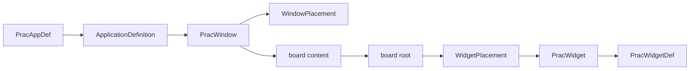

# Window / Board / Widget model（当前）

> 概念词表见 [concepts.md](concepts.md)；架构见 [architecture.md](architecture.md)；扩展 / catalog 见 [.agents/notes/in-progress/2026-11-05-tech-extension.md](../.agents/notes/in-progress/2026-11-05-tech-extension.md)。
> 本文只写 window / board / widget 的对象关系与 placement；不写 UI 交互文案。

## 1. 对象关系

- `PracAppDef` 是声明；`ApplicationDefinition` 是 runtime（多 `content(windowId)`）；
- `PracWindow` 是窗口运行时；`WindowPlacement` 是它在 space root 的位置；
- board 是 window 的 content；`board root` 是 board 自己的 layout root；
- `WidgetPlacement` 是 widget 在 board root 的位置；`PracWidget` 是 runtime；
- `PracWidgetDef` 是 widget 的声明。

## 2. Window

- 一个正在编辑的文件 = 一个 `PracWindow`；
- 一个 conversation = 一个 `PracWindow`（当前）；
- tab strip 的 tab 是 **window group 里的 window**，不是 window 内的 tab；
- window group 只包含 `PracWindow`；
- `PracWindow` 的身份 / 生命周期 / appId / appVersion / title 由 WM 持有；
- `PracWindow` 的内容由 app 提供：editor / chat / terminal / board；
- `WindowPlacement` 只描述位置 / region / order / hidden / size，不拥有 window；
- 已有 window / widget pin 它们启动时的 def version；新 runtime 用新 version。
- window 可以没有 board（application window）；board window 是 content 为 board 的普通 `PracWindow`，不是子类。

## 3. Board

- **board 不是 window**：board 是内容；
- **board window** 是 content 为 board 的 `PracWindow`；它可以放在 stage / sidebar / panel；
- board 拥有自己的 `board root`：`LayoutState<WidgetPlacement>`；
- board root 是 window content 里的 **layout hole**：frame 可以 hit-test / drag / size / split，但 window 仍是 content / lifecycle / focus / theme 的边界；
- 跨 root 只允许 **move**；split / combine 在目标 board root 内完成；
- widget 不直接进 window group。

## 4. Widget

- `PracWidgetDef`：声明（id / title / icon / defaultBoard / defaultRegion）；
- `PracWidget`：runtime（def + source + content，content 由 extension 的 `hostFor` 提供；`version` 来自 def）；
- `WidgetPlacement`：board root 里的位置 / order / hidden / collapsed / size / sourceId；
- 一个 widget 同时只在一个 board root；
- widget 可以被放在兼容 board 之间；placement 改，source 不变；
- widget 不是 tab，也不单独成为 window。

## 5. Placement / root

- **frame root**：shell；只放 dock / sidebar / panel / chrome 的 shell item，不放 window；
- **space root**：stage；放 `WindowPlacement`；
- **board root**：board 内容；放 `WidgetPlacement`；
- 每个 root 同时只有一个 writer；
- `WindowPlacement` 可以暂不在 group（`placed` 未归组）；
- `WidgetPlacement.region` 必须存在于 board root tree。

## 6. 持久化

- `prac-frame/v1/<scope>`：shell；
- `prac-space/v1/<scope>/<space>`：space root / `WindowPlacement`；
- `prac-board/v1/<scope>/<board>`：board root / `WidgetPlacement`；
- `scope` 是 `?workspace=` 哈希；不同 project folder 不共享；
- maximized 不持久化；注意力栈 / 返回栈 / 区域内 z-order 不持久化。

## 7. 相关

- [concepts.md](concepts.md)：词表。
- [architecture.md](architecture.md)：部署 / 进程 / Browser-Server。
- [ui-surface-map.md](ui-surface-map.md)：来源 → 对象。
- [ui-acceptance.md](ui-acceptance.md)：UI 验收。
